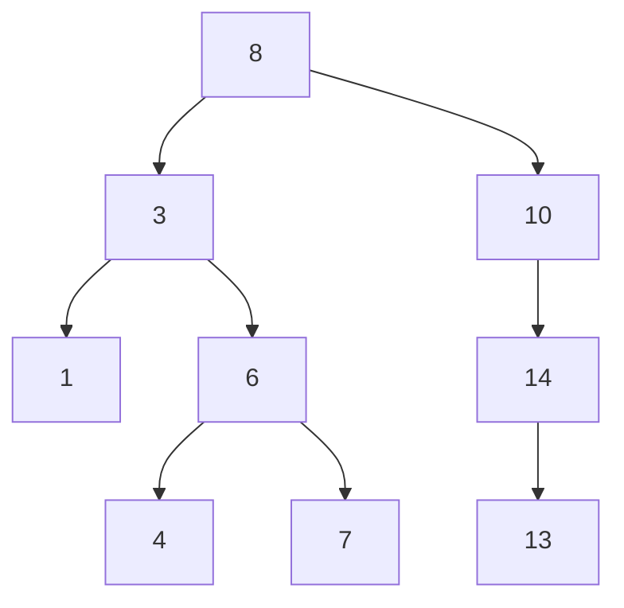
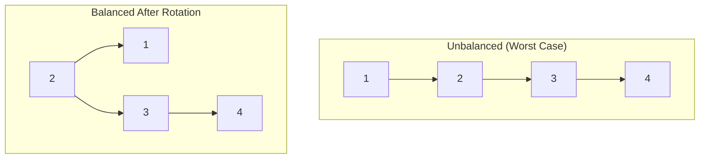
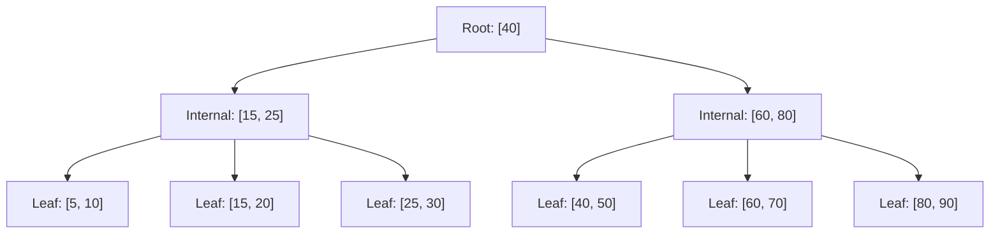
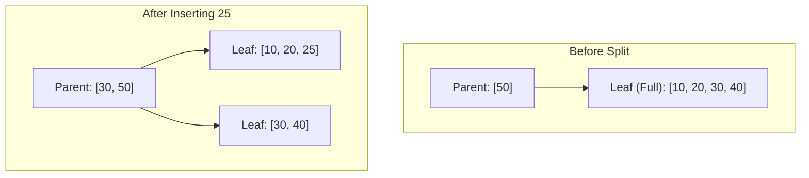

# Chapter 2: B-Tree Basics
> A foundational exploration of how binary search trees are adapted for disk-based storage, culminating in the B-Tree family of data structures used by most major database systems.

## Table of Contents
- [Chapter Overview](#chapter-overview)
- [Binary Search Trees (BSTs)](#binary-search-trees-bsts)
- [Tree Balancing](#tree-balancing)
- [Storage Hardware and Disk-Based Structures](#storage-hardware-and-disk-based-structures)
- [The B-Tree Data Structure](#the-b-tree-data-structure)
- [B-Tree Hierarchy & Separator Keys](#b-tree-hierarchy--separator-keys)
- [B-Tree Operations: Lookup, Split, Merge](#b-tree-operations-lookup-split-merge)
- [Worked Examples & Code Implementations](#worked-examples--code-implementations)
- [Design Patterns & Best Practices](#design-patterns--best-practices)
- [Trade-offs & Decision Framework](#trade-offs--decision-framework)
- [Interview & System Design Angles](#interview--system-design-angles)
- [AI/ML Engineering Relevance](#aiml-engineering-relevance)
- [Key Takeaways](#key-takeaways)
- [Glossary](#glossary)

## Chapter Overview
Most mutable storage structures in modern database systems use an in-place update mechanism where data records are updated directly at their target file locations. The B-Tree, introduced by Bayer and McCreight in 1971, is one of the most popular storage structures because it perfectly addresses the limitations of managing massive datasets on persistent storage media. 

This chapter explains why traditional memory-optimized search trees (like Binary Search Trees) fail when translated to disk storage. It breaks down hardware realities—such as the sequential I/O requirements of Hard Disk Drives (HDDs) and the block-erase behavior of Solid State Drives (SSDs)—that dictate how disk-based data structures must be designed. You will learn the mechanics of B-Trees, B+Trees, their lookup complexities, and the intricate balancing operations (splits and merges) that maintain their logarithmic performance.

## Binary Search Trees (BSTs)
### Core Concept
A Binary Search Tree (BST) is a sorted, in-memory data structure optimized for efficient key-value lookups. It consists of nodes, starting from a single root node. Each node contains a key, a value, and up to two child pointers (left and right).

### How It Works
Each node splits the search space into two subtrees:
- The **left subtree** contains keys that are less than the node's key.
- The **right subtree** contains keys that are greater than the node's key.

Searches start at the root and navigate left or right depending on the target key. The search can terminate early if the key is found in an internal node. 

### Diagram


### Example
If searching for `7` in the tree above:
1. Start at `8`. `7 < 8`, go left.
2. At `3`. `7 > 3`, go right.
3. At `6`. `7 > 6`, go right.
4. Target `7` found.

### Real-World Usage
BSTs (specifically balanced variants like Red-Black trees) are used internally by languages (e.g., C++ `std::map`, Java `TreeMap`) but are inherently unsuitable for raw disk-based storage due to unbounded depth and poor memory locality.

## Tree Balancing
### Core Concept
Without balancing, consecutive insertions can turn a BST into a "pathological tree" (essentially a linked list), degrading search complexity from $O(\log N)$ to $O(N)$. A tree is balanced if its height is approximately $\log_2 N$ and the difference in height between two subtrees is minimal.

### How It Works
Balancing ensures that traversing a child pointer roughly halves the search space. Rebalancing operations, such as tree rotations, occur after insertions or deletions. During a rotation, a middle node (pivot) is promoted to a higher level to maintain structural depth constraints.

### Diagram


## Storage Hardware and Disk-Based Structures
### Core Concept
Algorithms for persistent storage must account for the underlying hardware characteristics. The fundamental constraint is that storage devices operate on blocks (or pages) rather than single bytes.

### Hard Disk Drives (HDDs)
- **Mechanics:** Consist of spinning platters and moving read/write heads.
- **Constraints:** Disk seeks (mechanical movement) are highly expensive. 
- **Unit of Transfer:** Sector (typically 512 bytes to 4 KB).
- **Optimization:** Sequential I/O is favored to avoid costly head repositioning.

### Solid State Drives (SSDs)
- **Mechanics:** Built using memory cells connected in strings, grouped into pages, and blocks. No moving parts.
- **Constraints:** Writes can only happen to empty pages. Erasing can only happen at the block level ("erase blocks").
- **Unit of Transfer:** Page (2 to 16 KB for read/write), Block (64 to 512 pages for erase).
- **Flash Translation Layer (FTL):** A controller maps logical to physical pages and handles garbage collection to reclaim erased blocks.

### The Problem with BSTs on Disk
A naive on-disk BST would require one disk seek per comparison. With a fanout (number of children) of just 2, a BST is deep, requiring $O(\log_2 N)$ disk seeks. The scattered memory allocations ruin data locality. 
Optimal on-disk structures require:
1. **High Fanout:** To improve locality and pack more keys into a single disk block.
2. **Low Height:** To minimize expensive disk seeks.

## The B-Tree Data Structure
### Core Concept
The B-Tree perfectly addresses the hardware constraints of persistent storage by maximizing node capacity (fanout) to reduce tree height. It organizes nodes identically to disk pages, allowing a single disk read to fetch dozens or hundreds of keys at once.

### B-Tree vs B+Tree
- **B-Tree:** Values can be stored at any level (root, internal, leaf).
- **B+Tree:** Values are strictly stored at the leaf level. Internal nodes store only "separator keys" to guide navigation. This increases the internal node fanout drastically. Leaf nodes often contain sibling pointers to optimize range queries. 
> Note: In industry terminology (like MySQL InnoDB), the term "B-Tree" almost always implies a "B+Tree" under the hood.

### B-Tree Lookup Complexity
- **Disk Transfers:** $O(\log_K M)$ where $K$ is the fanout and $M$ is total items. The number of disk reads equals the tree height $h$.
- **Comparisons:** $O(\log_2 M)$. Once a page is loaded into memory, binary search is used to find the right key inside that page.

## B-Tree Hierarchy & Separator Keys
### Core Concept
B-Trees are structured bottom-up. They have three node types:
1. **Root Node:** Top level, no parent.
2. **Internal Nodes:** Middle routing layers.
3. **Leaf Nodes:** Bottom layer containing actual values.

### How It Works (Separator Keys)
Internal nodes hold separator keys (index entries) which define the boundaries of subtrees. For a node with $N$ keys, there are $N+1$ child pointers.
If a node contains keys `[10, 20]`:
- Pointer 0 leads to keys $< 10$
- Pointer 1 leads to keys $10 \le K < 20$
- Pointer 2 leads to keys $\ge 20$

### Diagram


## B-Tree Operations: Lookup, Split, Merge
### B-Tree Lookup Algorithm
Used for both point queries (exact match) and range scans (finding a start point).
1. Load root node.
2. Perform binary search in the node to find the first separator key $>=$ the target.
3. Follow the corresponding child pointer to the next level.
4. Repeat until reaching the target leaf node.

### B-Tree Node Splits (Insertions)
When an insertion targets a full node (exceeding capacity $N$), it **overflows** and must split:
1. Allocate a new sibling node.
2. Copy half the elements from the splitting node to the new one.
3. Insert the new element into the correct half.
4. **Promote** the middle separator key (the "split point") up to the parent node.
5. If the parent is full, it splits recursively. If the root splits, tree height increases.

### Diagram: Split Operation


### B-Tree Node Merges (Deletions)
When deletions cause a node's capacity to drop below a threshold, it **underflows**:
1. Check neighboring sibling nodes.
2. If the combined keys of two siblings fit into a single node, they are **merged**.
3. All elements from the right node are moved to the left.
4. The separator key pointing to the right node is **demoted** (removed) from the parent.
---

## Worked Examples & Code Implementations

### Example 1: B+Tree Fanout, Tree Height, and Disk Seeks Calculator

This example computes the internal fanout, leaf record capacity, and resulting tree height (number of disk seeks) for datasets ranging from 10 million to 1 billion records across standard page sizes (4KB, 8KB, 16KB), contrasting it with a memory-oriented Binary Search Tree.

```python
import math

def calculate_tree_metrics(record_count, page_size_bytes=8192, key_size_bytes=8, ptr_size_bytes=8, val_size_bytes=100):
    # Internal node: separator keys (K) + child pointers (K + 1)
    # K * (key_size + ptr_size) + ptr_size <= page_size
    internal_fanout = (page_size_bytes - ptr_size_bytes) // (key_size_bytes + ptr_size_bytes)
    
    # Leaf node capacity: (key + value) pairs per leaf page
    leaf_capacity = page_size_bytes // (key_size_bytes + val_size_bytes)
    
    # B+Tree Height = 1 (root/leaf) + ceil(log_fanout(total_leaves))
    total_leaves = math.ceil(record_count / leaf_capacity)
    tree_height = 1 + math.ceil(math.log(total_leaves, internal_fanout))
    
    # Binary Search Tree height: ceil(log2(N))
    bst_height = math.ceil(math.log2(record_count))
    return internal_fanout, leaf_capacity, tree_height, bst_height

print("=== B+Tree Fanout & Height vs. BST ===")
for N in [10_000_000, 1_000_000_000]:
    for page_size in [4096, 8192, 16384]:
        fanout, leaf_cap, btree_h, bst_h = calculate_tree_metrics(N, page_size)
        print(f"Records: {N:,} | Page: {page_size//1024:>2}KB | Fanout: {fanout:<4} | Leaf Cap: {leaf_cap:<3} | B+Tree Height (Disk Seeks): {btree_h} | BST Height: {bst_h}")
```

#### Execution Output
```text
=== B+Tree Fanout & Height vs. BST ===
Records: 10,000,000 | Page:  4KB | Fanout: 255  | Leaf Cap: 37  | B+Tree Height (Disk Seeks): 4 | BST Height: 24
Records: 10,000,000 | Page:  8KB | Fanout: 511  | Leaf Cap: 75  | B+Tree Height (Disk Seeks): 3 | BST Height: 24
Records: 10,000,000 | Page: 16KB | Fanout: 1023 | Leaf Cap: 151 | B+Tree Height (Disk Seeks): 3 | BST Height: 24
Records: 1,000,000,000 | Page:  4KB | Fanout: 255  | Leaf Cap: 37  | B+Tree Height (Disk Seeks): 5 | BST Height: 30
Records: 1,000,000,000 | Page:  8KB | Fanout: 511  | Leaf Cap: 75  | B+Tree Height (Disk Seeks): 4 | BST Height: 30
Records: 1,000,000,000 | Page: 16KB | Fanout: 1023 | Leaf Cap: 151 | B+Tree Height (Disk Seeks): 4 | BST Height: 30
```

---

### Example 2: In-Node Binary Search & Separator Key Routing

Demonstrates how a search key $K$ is routed across internal node separator keys `[K1, K2, ..., Kn]` to identify the target child pointer index in $O(\log_2 \text{keys})$ CPU comparisons.

```python
import bisect

def route_search_key(separator_keys: list[int], target_key: int) -> int:
    """
    Given separator keys [K1, K2, ..., Kn], maps target to child index:
    - Index 0: target < K1
    - Index i: Ki <= target < K(i+1)
    - Index n: target >= Kn
    """
    return bisect.bisect_right(separator_keys, target_key)

# Node contains separator keys: [20, 40, 60, 80] -> 5 child pointers (indices 0..4)
separator_keys = [20, 40, 60, 80]
test_keys = [10, 20, 35, 40, 75, 80, 95]

print("=== In-Node Binary Search Routing ===")
for q in test_keys:
    child_idx = route_search_key(separator_keys, q)
    print(f"Target Key: {q:2d} -> Routed to Child Pointer Index: {child_idx}")
```

#### Execution Output
```text
=== In-Node Binary Search Routing ===
Target Key: 10 -> Routed to Child Pointer Index: 0
Target Key: 20 -> Routed to Child Pointer Index: 1
Target Key: 35 -> Routed to Child Pointer Index: 1
Target Key: 40 -> Routed to Child Pointer Index: 2
Target Key: 75 -> Routed to Child Pointer Index: 3
Target Key: 80 -> Routed to Child Pointer Index: 4
Target Key: 95 -> Routed to Child Pointer Index: 4
```

---

### Example 3: B+Tree Node Split Simulation & Key Promotion

Demonstrates what occurs when a leaf node overflows its capacity ($M=3$). The node splits into two halves, connects sibling pointers, and returns the middle separator key for promotion to its parent.

```python
class BPlusTreeNode:
    def __init__(self, is_leaf=False, max_keys=3):
        self.is_leaf = is_leaf
        self.keys = []
        self.children = []  # Child pointers if internal, values if leaf
        self.next = None    # Sibling pointer for range scans
        self.max_keys = max_keys

    def split(self):
        mid = len(self.keys) // 2
        promoted_key = self.keys[mid]
        
        sibling = BPlusTreeNode(is_leaf=self.is_leaf, max_keys=self.max_keys)
        
        if self.is_leaf:
            # In a B+Tree leaf, keys from mid onward remain in sibling
            sibling.keys = self.keys[mid:]
            sibling.children = self.children[mid:]
            self.keys = self.keys[:mid]
            self.children = self.children[:mid]
            
            # Chain sibling pointers
            sibling.next = self.next
            self.next = sibling
        else:
            # In an internal node, promoted key moves strictly to parent
            sibling.keys = self.keys[mid + 1:]
            sibling.children = self.children[mid + 1:]
            self.keys = self.keys[:mid]
            self.children = self.children[:mid + 1]
            
        return promoted_key, sibling

# Simulate inserting keys [10, 20, 30, 40] into a leaf
leaf = BPlusTreeNode(is_leaf=True, max_keys=3)
leaf.keys = [10, 20, 30, 40]
leaf.children = ['v10', 'v20', 'v30', 'v40']

promoted_key, sibling = leaf.split()

print("=== B+Tree Node Split Result ===")
print(f"Original Leaf Keys after split  : {leaf.keys}")
print(f"Promoted Separator Key to Parent: {promoted_key}")
print(f"New Sibling Leaf Keys           : {sibling.keys}")
```

#### Execution Output
```text
=== B+Tree Node Split Result ===
Original Leaf Keys after split  : [10, 20]
Promoted Separator Key to Parent: 30
New Sibling Leaf Keys           : [30, 40]
```

---

### Example 4: B+Tree Leaf-Level Sibling Range Query Scan

Demonstrates how range queries execute in a B+Tree: after finding the initial leaf via tree descent, range scans proceed horizontally along leaf sibling pointers without re-traversing internal nodes.

```python
# Setup three chained leaf nodes
leaf1 = BPlusTreeNode(is_leaf=True)
leaf1.keys = [10, 20, 30]
leaf1.children = ["Alice", "Bob", "Charlie"]

leaf2 = BPlusTreeNode(is_leaf=True)
leaf2.keys = [40, 50, 60]
leaf2.children = ["David", "Eva", "Frank"]

leaf3 = BPlusTreeNode(is_leaf=True)
leaf3.keys = [70, 80, 90]
leaf3.children = ["Grace", "Hank", "Ivy"]

leaf1.next = leaf2
leaf2.next = leaf3

def range_scan(start_leaf, low_key, high_key):
    results = []
    curr = start_leaf
    visited_leaves = 0
    while curr:
        visited_leaves += 1
        for k, v in zip(curr.keys, curr.children):
            if low_key <= k <= high_key:
                results.append((k, v))
            elif k > high_key:
                return results, visited_leaves
        curr = curr.next
    return results, visited_leaves

records, leaves_visited = range_scan(leaf1, 20, 65)
print("=== B+Tree Sibling Linked List Range Scan ===")
print(f"Range Query [20..65] Results: {records}")
print(f"Leaves Visited horizontally via Sibling Pointers: {leaves_visited}")
```

#### Execution Output
```text
=== B+Tree Sibling Linked List Range Scan ===
Range Query [20..65] Results: [(20, 'Bob'), (30, 'Charlie'), (40, 'David'), (50, 'Eva'), (60, 'Frank')]
Leaves Visited horizontally via Sibling Pointers: 3
```

---

## Design Patterns & Best Practices
- **Page Size Alignment:** B-Tree node sizes are typically aligned to OS page sizes or disk block sizes (e.g., 4KB, 8KB, 16KB) to ensure that reading a node requires exactly one unfragmented disk block read.
- **Sequential Pointers:** To support fast range scans, B+Tree implementations explicitly link leaf nodes horizontally as a doubly-linked list.
- **Bottom-Up Growth:** Unlike BSTs which grow downward, B-Trees grow upward. A split at the root creates a new root, increasing tree height.

## Trade-offs & Decision Framework
| Characteristic | BST / AVL Trees | B-Trees (B+Trees) |
|---|---|---|
| **Storage Medium** | Memory-optimized | Disk-optimized |
| **Fanout** | Fixed at 2 | High (often 100s or 1000s) |
| **Height** | High ($O(\log_2 N)$) | Very Low ($O(\log_K N)$) |
| **Data Locality** | Poor (scattered pointers) | Excellent (block-aligned arrays) |
| **Balancing Cost**| High (frequent rotations) | Low (infrequent node splits/merges) |

**Decision Framework:** Use B-Trees whenever data exceeds RAM limits and must be paged to persistent block-based storage (HDDs or SSDs).

## Interview & System Design Angles
- **Database Indexing:** You are expected to know why databases use B+Trees instead of Hash Indexes or standard Binary Trees. (Answers: B+Trees support range queries perfectly, whereas Hash Maps do not; B+Trees handle disk I/O constraints perfectly, whereas BSTs do not).
- **Time Complexity:** Distinguish between disk I/O complexity ($O(\log_k N)$) and comparison complexity ($O(\log_2 N)$).
- **Concurrency:** In system design, scaling B-Trees involves latching mechanisms to lock nodes during splits/merges (often tested as "Lock Crabbing").

## AI/ML Engineering Relevance
- **Feature Stores:** B-Trees are the underlying structures for offline feature stores where large amounts of time-series ML features are written to disk and scanned via range queries (e.g., fetching features for a specific user between timestamps).
- **Vector Databases vs B-Trees:** While B-Trees excel at 1-dimensional exact matches and ranges, they fail at high-dimensional nearest neighbor searches. This contrasts heavily with Approximate Nearest Neighbor (ANN) indexes like HNSW, which are designed for semantic/vector searches in AI but often rely on underlying block-storage mechanisms inspired by B-Tree I/O management.

## Key Takeaways
- The jump from memory to disk drastically changes algorithm design because disk access happens via blocks (pages) and seeks are costly.
- A B-Tree optimizes for disk constraints by increasing node fanout, drastically reducing the height of the tree.
- Lookups in a B-Tree execute in $O(\log N)$ time, requiring very few disk reads (equal to tree height) but many CPU comparisons.
- The B+Tree variant stores values strictly in leaf nodes, maximizing the number of routing keys internal nodes can hold.
- Trees remain balanced dynamically through Split and Merge operations as nodes overflow or underflow.

## Glossary
- **Binary Search Tree (BST):** A tree structure where each node has up to two children, with left keys smaller and right keys larger.
- **Fanout:** The maximum number of children (pointers) a single node can hold.
- **Height:** The maximum depth of the tree from root to leaf.
- **Sequential I/O:** Reading or writing contiguous bytes on disk, which is significantly faster than random I/O.
- **B+Tree:** A variant of B-Tree where internal nodes store only keys for navigation, and all data records are stored in the leaf nodes.
- **Separator Keys:** Keys within internal nodes that define the boundaries of subtrees.
- **Split:** An operation that divides a full node into two, promoting a separator key to the parent.
- **Merge:** An operation that combines two under-utilized sibling nodes into one, demoting a key from the parent.
