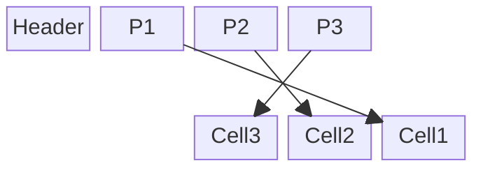

# Chapter 3: File Formats
> A deep dive into the on-disk binary representation of database systems, covering primitive serialization, page layouts, slotted pages, and space management.

## Table of Contents
1. [Chapter Overview](#chapter-overview)
2. [Binary Encoding & Primitive Types](#binary-encoding--primitive-types)
3. [File Organization Principles](#file-organization-principles)
4. [Page Structure & Slotted Pages](#page-structure--slotted-pages)
5. [Cell Layout & Ordering](#cell-layout--ordering)
6. [Space Management for Variable-Size Data](#space-management-for-variable-size-data)
7. [Versioning & Magic Numbers](#versioning--magic-numbers)
8. [Checksumming & Data Integrity](#checksumming--data-integrity)
9. [Worked Examples & Code Implementations](#worked-examples--code-implementations)
10. [Design Patterns & Best Practices](#design-patterns--best-practices)
11. [Trade-offs & Decision Framework](#trade-offs--decision-framework)
12. [Interview & System Design Angles](#interview--system-design-angles)
13. [AI/ML Engineering Relevance](#aiml-engineering-relevance)
14. [Key Takeaways](#key-takeaways)
15. [Glossary](#glossary)

## Chapter Overview

While in-memory data structures benefit from an abstraction layer provided by virtual memory and operating system memory allocators (like `malloc`), disk-resident data structures operate under a much stricter set of constraints. Developers building database engines must manually manage storage offsets, fragmentation, garbage collection, and data layout. In this unmanaged, persistent environment, the exact byte-level arrangement of data determines the storage engine's efficiency, update costs, and read performance.

This chapter explores how abstract data models (like B-Trees) are serialized into a concrete binary file format. It begins with the encoding of primitive data types and strings, scaling up to the composition of cells, and finally organizing those cells into disk pages. A central theme is the handling of mutability and variable-size data natively on disk. 

You will learn the mechanics of the "Slotted Page" layout—a foundational architecture used by almost all major relational databases (including PostgreSQL and SQLite)—and how metadata like headers, checksums, and magic numbers are orchestrated to ensure data integrity and backward compatibility.

---

## Binary Encoding & Primitive Types

Before records can be grouped into pages, the database must represent individual values as binary byte sequences. This requires rigorous serialization and deserialization protocols.

### Endianness
When dealing with multi-byte numeric types, the byte order (endianness) must be explicitly managed to ensure cross-platform compatibility.
*   **Big-endian:** The Most Significant Byte (MSB) is stored at the lowest memory address.
*   **Little-endian:** The Least Significant Byte (LSB) is stored at the lowest memory address.

*Real-World Usage:* Storage engines like RocksDB use platform-specific macros to detect endianness. If the host platform differs from the file format's defined endianness, the engine applies byte-reversal transformations (e.g., `EndianTransform`) during serialization/deserialization.

### Floating-Point Data
Floating point values (like 32-bit floats and 64-bit doubles) are usually encoded following the IEEE 754 standard, consisting of:
1.  **Sign bit** (1 bit)
2.  **Fraction / Mantissa** (23 bits for float)
3.  **Exponent** (8 bits for float)

### Strings and Variable-Size Data
Two dominant approaches exist for encoding variable-length arrays and strings:
1.  **Pascal Strings (UCSD Strings):** The length of the string is stored as an integer prefix (e.g., `uint16_t size`), followed by the raw data bytes.
    *   *Advantage:* O(1) length calculation. Enables safe memory slicing without scanning.
2.  **Null-Terminated Strings:** Characters are written sequentially until a terminating null byte (`\0`) is encountered.
    *   *Disadvantage:* Requires O(N) scanning to determine length.

*Implementation Choice:* Almost all modern binary file formats use the Pascal String pattern because it maps cleanly to bulk memory allocation and avoids read-time iteration overhead.

### Bit-Packed Data: Booleans, Enums, and Flags
To conserve space, booleans are not stored as individual bytes.
*   **Packed Booleans:** Up to 8 boolean values are packed into a single byte.
*   **Enums:** Low-cardinality discrete values (e.g., `NodeType: ROOT=0, INTERNAL=1, LEAF=2`) are mapped to small integers.
*   **Flags:** Non-mutually exclusive states are encoded as bits within a mask (powers of two). For instance:
    ```c
    int IS_LEAF = 0x01;              // bit 0: 00000001
    int HAS_VARIABLE_SIZE = 0x02;    // bit 1: 00000010
    int HAS_OVERFLOW = 0x04;         // bit 2: 00000100
    ```
    Values are toggled using bitwise operators (`|` to set, `& ~` to unset, `&` to check).

---

## File Organization Principles

File formats are structured as hierarchies: bytes form primitives, primitives form fields, fields form cells, cells form pages, and pages form the file.

### Fixed vs. Variable Layouts
A fixed database schema minimizes disk footprint because field names and types do not need to be written per record. A common layout pattern places fixed-size fields first, followed by variable-size fields.

```text
[Fixed Area]
4 bytes: employee_id
4 bytes: tax_number
2 bytes: first_name_length
2 bytes: last_name_length

[Variable Area]
<first_name_length bytes>: first_name
<last_name_length bytes>: last_name
```
To access variable-size fields efficiently, offset pointers (or lengths) are cached in the fixed-size header portion of the record, avoiding the need to sequentially parse every preceding variable-length field.

### Headers and Trailers
Database files usually contain a **File Header** (at byte 0) and sometimes a **File Trailer**. These areas hold global metadata:
*   Schema definitions or pointers to schema catalogs.
*   Lookup tables for internal page navigation.
*   Free-page lists (to recycle deleted pages).

---

## Page Structure & Slotted Pages

Database files are partitioned into fixed-size contiguous byte chunks called **Pages** (or blocks), usually ranging from 4KB to 16KB. A B-Tree node typically occupies exactly one page.

### The Problem with Naive Concatenation
The original B-Tree paper proposed simply concatenating keys (`k`), values (`v`), and child pointers (`p`) sequentially.
*   *Flaw 1:* Appending a key in the middle of the node requires shifting all subsequent elements, causing heavy rewrite amplification.
*   *Flaw 2:* This layout assumes fixed-size data; it entirely breaks down for variable-length records because free space cannot be seamlessly reclaimed when sizes differ.

### The Slotted Page Solution

To support variable-size records and O(1) space reclamation, databases use **Slotted Pages** (also called slot directories).

#### Core Concept
The page is decoupled into two distinct memory areas that grow toward each other:
1.  **Header + Pointer Array (Slot Array):** Starts at the beginning of the page and grows forward (left-to-right).
2.  **Cell Data (Payloads):** Starts at the end of the page and grows backward (right-to-left).

#### How It Works
*   When a new record is added, its raw data (the cell) is appended at the current end of the free space (growing backwards).
*   A fixed-size 2-byte integer (the *offset pointer*) is appended to the slot array, pointing to the exact byte offset of the cell.
*   **Logical Ordering:** The actual cell data on disk is kept in *insertion order* (to avoid shifting large byte arrays). However, the *offset pointers* in the slot array are sorted in *logical key order*.
*   When performing a binary search, the database searches the lightweight pointer array, dereferencing the offsets to read the actual keys.

#### Diagram: Slotted Page Layout


*Note: Pointers grow rightward, Cells grow leftward. The gap in the middle is the available Free Space.*

---

## Cell Layout & Ordering

A "Cell" is the self-contained payload stored within a slotted page. 

### Key Cells vs. Key-Value Cells
Nodes in a B-Tree distinguish between two types of cells:
1.  **Key Cells (Internal Nodes):** Contain a separator key and a Page ID pointer to a child node.
2.  **Key-Value Cells (Leaf Nodes):** Contain a key and the actual data record (or a pointer to the record).

### Structure of a Variable-Size Cell
To prevent duplicating metadata, all cells in a specific page are usually kept uniform (e.g., all variable-size, all key-value). A variable-size key-value cell looks like:

| Byte Offset | Size | Field | Description |
| :--- | :--- | :--- | :--- |
| `0` | 1 byte | Flags | Cell metadata (deleted, type) |
| `1` | 4 bytes | Key Size | Size of the key ($K$) |
| `5` | 4 bytes | Value Size | Size of the payload ($V$) |
| `9` | $K$ bytes | Key | Raw key bytes |
| `9 + K` | $V$ bytes | Value | Raw data bytes |

*Design Insight:* Offset pointers stored in the slotted page header are *page-local* (relative to the page start), allowing them to be compact (usually 2 bytes since pages are typically < 64KB). In contrast, pointers to child pages are *absolute* (or logical Page IDs) since they reference other disk locations.

### Rightmost Pointers
While standard cells hold a key and a pointer to the left-child page (keys less than the cell's key), a B-Tree internal node also needs a pointer for keys strictly greater than the maximum key in the page. This is handled by a special **Rightmost Pointer** stored in the Page Header, separate from the cell array.

---

## Space Management for Variable-Size Data

When a variable-size cell is deleted, shifting all remaining cells to close the gap is too expensive. 

### Fragmentation and Availability Lists
Instead of immediate compaction, the cell is marked as deleted (tombstoned), and its byte range is added to an in-memory or on-page **Availability List** (or free block list). 

When a new cell is inserted, the engine checks the availability list using a fit strategy:
*   **First Fit:** Uses the first contiguous deleted block large enough. *Trade-off:* Fast, but wastes the leftover tail space.
*   **Best Fit:** Scans the list to find the block whose size is closest to the new cell size, minimizing the remaining wasted space. *Trade-off:* Slower allocation but less fragmentation.

### Defragmentation and Overflow Pages
If a page has enough total free space, but it is highly fragmented (no single contiguous block is large enough for the new cell), the database triggers an internal **Page Defragmentation**. It rewrites the page in memory, packing all live cells tightly against the right edge, thereby consolidating the free space.

If the record is so large that it exceeds the page size (even after defragmentation), the database allocates an **Overflow Page**. The local cell stores a pointer to this external Overflow Page instead of the actual data.

---

## Versioning & Magic Numbers

File formats evolve. A storage engine must be able to read current and legacy formats without crashing.

### Versioning Strategies
1.  **Filename Prefixes:** (e.g., Apache Cassandra). Files are named `na-1-big-Data.db`, where `na` vs `ma` dictates the format version.
2.  **Manifest Files:** (e.g., PostgreSQL). Storing global format information in a parallel file like `PG_VERSION`.
3.  **Header Embedding:** Storing a fixed-size, immutable version string at byte 0 of the index file header.

### Magic Numbers
A **Magic Number** is a hardcoded, unique byte sequence placed at the very beginning of a file. It allows the software to immediately identify the file type and reject invalid files. For example, SQLite files always start with the 16-byte magic string: `SQLite format 3\000`.

---

## Checksumming & Data Integrity

Disks degrade, bits flip, and software bugs cause partial writes (torn pages). Databases must defensively detect corruption before serving bad data to applications or replicating it to other nodes.

### Checksums vs. CRCs
*   **Checksums:** Usually simple XOR or summations. Weak guarantees; cannot detect complex multi-bit corruption.
*   **CRCs (Cyclic Redundancy Checks):** Uses polynomial division and lookup tables. Specifically designed to detect burst errors (consecutive bit flips common in hardware faults).
*   **Cryptographic Hashes (SHA/MD5):** Used to prevent malicious tampering, but are generally too computationally expensive for basic disk corruption detection.

---

## Worked Examples & Code Implementations

### Example 1: Binary Slotted Page Implementation (`struct` / `bytearray`)

Demonstrates how a database engine builds a binary slotted page in memory using Python's `struct` library. The page header contains metadata (`MAGIC`, `cell_count`, `free_start`, `free_end`), 2-byte slot offset pointers grow left-to-right from offset 10, and variable-length cells grow right-to-left from offset 512.

```python
import struct

class SlottedPage:
    PAGE_SIZE = 512
    HEADER_FORMAT = ">IHHH"  # Magic (4B), CellCount (2B), FreeStart (2B), FreeEnd (2B)
    HEADER_SIZE = struct.calcsize(HEADER_FORMAT)  # 10 bytes
    MAGIC = 0x534C4F54  # 'SLOT' in ASCII

    def __init__(self):
        self.data = bytearray(self.PAGE_SIZE)
        # Initialize header: count=0, free_start=10, free_end=512
        struct.pack_into(self.HEADER_FORMAT, self.data, 0, self.MAGIC, 0, self.HEADER_SIZE, self.PAGE_SIZE)

    def _read_header(self):
        return struct.unpack_from(self.HEADER_FORMAT, self.data, 0)

    def _write_header(self, magic, count, free_start, free_end):
        struct.pack_into(self.HEADER_FORMAT, self.data, 0, magic, count, free_start, free_end)

    def insert(self, key: str, value: str) -> bool:
        k_bytes = key.encode('utf-8')
        v_bytes = value.encode('utf-8')
        cell_size = 2 + 2 + len(k_bytes) + len(v_bytes)  # 2B k_len + 2B v_len + payloads

        magic, count, free_start, free_end = self._read_header()

        # Slot pointer requires 2 bytes in slot array
        required_space = cell_size + 2
        available_space = free_end - free_start
        if required_space > available_space:
            return False  # Page full

        # 1. Allocate cell from the bottom (growing leftwards)
        cell_offset = free_end - cell_size
        struct.pack_into(f">HH{len(k_bytes)}s{len(v_bytes)}s", self.data, cell_offset,
                         len(k_bytes), len(v_bytes), k_bytes, v_bytes)

        # 2. Append 2-byte slot pointer (growing rightwards)
        slot_pos = self.HEADER_SIZE + (count * 2)
        struct.pack_into(">H", self.data, slot_pos, cell_offset)

        # 3. Update header
        self._write_header(magic, count + 1, free_start + 2, cell_offset)
        return True

    def get(self, target_key: str):
        magic, count, free_start, free_end = self._read_header()
        for i in range(count):
            slot_pos = self.HEADER_SIZE + (i * 2)
            cell_offset = struct.unpack_from(">H", self.data, slot_pos)[0]
            k_len, v_len = struct.unpack_from(">HH", self.data, cell_offset)
            k_bytes = struct.unpack_from(f">{k_len}s", self.data, cell_offset + 4)[0]
            if k_bytes.decode('utf-8') == target_key:
                v_bytes = struct.unpack_from(f">{v_len}s", self.data, cell_offset + 4 + k_len)[0]
                return v_bytes.decode('utf-8')
        return None

# Instantiate and insert records
page = SlottedPage()
page.insert("user:101", "Alice - Systems Engineer")
page.insert("user:102", "Bob - Storage Architect")
page.insert("user:103", "Charlie - Kernel Hacker")

magic, count, free_start, free_end = page._read_header()
print("=== Binary Slotted Page Execution ===")
print(f"Header State -> Magic: {hex(magic)} | Cells: {count} | Free Space: [{free_start}..{free_end}] ({free_end - free_start} bytes remaining)")
print(f"Lookup 'user:102' -> {page.get('user:102')}")
print(f"Lookup 'user:999' -> {page.get('user:999')}")
```

#### Execution Output
```text
=== Binary Slotted Page Execution ===
Header State -> Magic: 0x534c4f54 | Cells: 3 | Free Space: [16..406] (390 bytes remaining)
Lookup 'user:102' -> Bob - Storage Architect
Lookup 'user:999' -> None
```

---

### Example 2: Bit-Packed Flags & Masking

Demonstrates packing multiple database page state booleans into a single 8-bit integer field using bitwise operations.

```python
IS_LEAF       = 0x01  # Bit 0 (0000 0001)
HAS_OVERFLOW  = 0x02  # Bit 1 (0000 0010)
IS_ROOT       = 0x04  # Bit 2 (0000 0100)
IS_COMPACTED  = 0x08  # Bit 3 (0000 1000)

# Pack flags into a single 8-bit integer
flags = 0
flags |= (IS_LEAF | HAS_OVERFLOW)  # Set leaf and overflow bits

def decode_flags(f: int) -> dict:
    return {
        "is_leaf": bool(f & IS_LEAF),
        "has_overflow": bool(f & HAS_OVERFLOW),
        "is_root": bool(f & IS_ROOT),
        "is_compacted": bool(f & IS_COMPACTED)
    }

print("=== Bit-Packed Flags & Masking ===")
print(f"Encoded Flags Byte : {bin(flags)} (Hex: {hex(flags)})")
print(f"Decoded Flags Dict : {decode_flags(flags)}")
```

#### Execution Output
```text
=== Bit-Packed Flags & Masking ===
Encoded Flags Byte : 0b11 (Hex: 0x3)
Decoded Flags Dict : {'is_leaf': True, 'has_overflow': True, 'is_root': False, 'is_compacted': False}
```

---

### Example 3: CRC32 Page Checksumming & Corruption Detection

Demonstrates computing a cyclic redundancy check (CRC32) across an serialized page and catching bit flips / torn writes during page retrieval.

```python
import zlib

payload = bytes(page.data)
checksum = zlib.crc32(payload)

print("=== CRC32 Page Integrity & Corruption Detection ===")
print(f"Computed Page CRC32 Checksum: {hex(checksum)}")

# 1. Normal read verification
is_valid = (zlib.crc32(payload) == checksum)
print(f"Initial Checksum Verification: {'PASSED (Valid Page)' if is_valid else 'FAILED'}")

# 2. Simulate 1-bit corruption (hardware bit rot or torn write)
corrupted_payload = bytearray(payload)
corrupted_payload[50] ^= 0x01  # Invert single bit at byte offset 50
corrupted_checksum = zlib.crc32(corrupted_payload)
is_valid_after_rot = (corrupted_checksum == checksum)

print(f"After Bit Flip at Byte 50    : New Checksum = {hex(corrupted_checksum)} | Verification: {'PASSED' if is_valid_after_rot else 'REJECTED (Torn/Corrupt Page)'}")
```

#### Execution Output
```text
=== CRC32 Page Integrity & Corruption Detection ===
Computed Page CRC32 Checksum: 0xe7acdf03
Initial Checksum Verification: PASSED (Valid Page)
After Bit Flip at Byte 50    : New Checksum = 0xde96b20f | Verification: REJECTED (Torn/Corrupt Page)
```

---

### Example 4: In-Page Defragmentation & Compaction

Demonstrates soft-deleting a cell (leaving a dead space hole) and executing an in-page defragmentation pass that repacks live cells contiguously from the end of the page to maximize contiguous free space.

```python
class CompactableSlottedPage(SlottedPage):
    def delete(self, index: int):
        magic, count, free_start, free_end = self._read_header()
        if index < count:
            slot_pos = self.HEADER_SIZE + (index * 2)
            struct.pack_into(">H", self.data, slot_pos, 0)  # Offset 0 marks tombstoned slot

    def defragment(self):
        magic, count, free_start, free_end = self._read_header()
        live_cells = []
        for i in range(count):
            slot_pos = self.HEADER_SIZE + (i * 2)
            offset = struct.unpack_from(">H", self.data, slot_pos)[0]
            if offset != 0:
                k_len, v_len = struct.unpack_from(">HH", self.data, offset)
                total_len = 4 + k_len + v_len
                live_cells.append(bytes(self.data[offset:offset + total_len]))

        # Re-pack live cells contiguously from the end of the page
        new_free_end = self.PAGE_SIZE
        new_slot_pos = self.HEADER_SIZE
        for i, cell_bytes in enumerate(live_cells):
            new_free_end -= len(cell_bytes)
            self.data[new_free_end:new_free_end + len(cell_bytes)] = cell_bytes
            struct.pack_into(">H", self.data, new_slot_pos + (i * 2), new_free_end)

        new_free_start = self.HEADER_SIZE + (len(live_cells) * 2)
        self._write_header(magic, len(live_cells), new_free_start, new_free_end)

c_page = CompactableSlottedPage()
c_page.insert("k1", "val1")
c_page.insert("k2", "val2-large-payload-string")
c_page.insert("k3", "val3")
_, _, fs1, fe1 = c_page._read_header()

c_page.delete(1)  # Delete 'k2'
c_page.defragment()
_, _, fs2, fe2 = c_page._read_header()

print("=== In-Page Defragmentation ===")
print(f"Before Deletion -> Free Space: {fe1 - fs1} bytes")
print(f"After Deleting 'k2' & Defragmenting -> Free Space: {fe2 - fs2} bytes (Reclaimed { (fe2-fs2) - (fe1-fs1) } bytes of contiguous space)")
```

#### Execution Output
```text
=== In-Page Defragmentation ===
Before Deletion -> Free Space: 445 bytes
After Deleting 'k2' & Defragmenting -> Free Space: 478 bytes (Reclaimed 33 bytes of contiguous space)
```

---

## Design Patterns & Best Practices

1.  **Locality by Decoupling:** Keep metadata (sizes, flags) and access pointers linearly packed. When searching an array of pointers, the CPU cache efficiently pre-fetches the lightweight pointers, avoiding cache misses that would occur if it had to scan over variable-length payloads.
2.  **Page-Relative Offsets:** Never store absolute byte offsets inside a page. Use page-local 2-byte integer offsets to save space and make the page self-contained (relocatable on disk).
3.  **Tombstoning & Garbage Collection:** Prefer logical deletion with background/on-demand defragmentation over synchronous byte shifting.

---

## Trade-offs & Decision Framework

| Decision | Option A | Option B | When to Choose |
| :--- | :--- | :--- | :--- |
| **String Layout** | Pascal Strings (Length Prefixed) | Null-Terminated | **Always choose Pascal.** Allows O(1) length checks and safe slice mapping. |
| **Space Reuse Strategy** | First Fit | Best Fit | **First Fit** for high write throughput. **Best Fit** for read-heavy workloads where dense packing saves disk I/O. |
| **Key/Value Locality** | Interleave Keys & Values in Cell | Separate Key Array | Use **Separated Arrays** if keys are heavily scanned but values are rarely fetched. **Interleave** (standard B-Tree cell) if point-lookups dominate. |

---

## Interview & System Design Angles

**FAANG Interview Relevance:**
*   *Design a Key-Value Store:* You will inevitably be asked how data is structured on disk. Explaining the **Slotted Page** architecture is the gold standard for answering "How do you handle variable-size values without massive fragmentation?"
*   *Concurrency:* Interviewers might ask what happens if the system crashes during a write. You can bridge page layouts to Write-Ahead Logging (WAL) and torn-page protection (which relies heavily on per-page CRCs).
*   *Serialization:* If asked about Protobuf vs. JSON, you can demonstrate low-level understanding by discussing endianness, Pascal strings, and O(1) pointer navigation.

---

## AI/ML Engineering Relevance

While these concepts stem from relational databases, they are directly applicable to modern AI infrastructure:
*   **Vector Databases (e.g., Milvus, Pinecone):** High-dimensional embeddings are massive arrays of floating-point numbers. Managing these requires strict IEEE 754 endianness control. Furthermore, Approximate Nearest Neighbor (ANN) graphs (like HNSW) have nodes with a *variable number of edges*. Slotted pages are exactly how you persist variable-degree graph nodes to disk efficiently.
*   **Feature Stores:** Storing sparse ML features involves extreme variable-size data. Designing custom binary layouts using bit-packed flags and best-fit space reclamation is required to keep serving latency in the low milliseconds.
*   **Model Weights (Safetensors):** The shift from Python Pickle to formats like Safetensors relies heavily on length-prefixed binary layouts that allow zero-copy memory mapping—a concept identical to directly parsing Pascal strings from disk blocks.

---

## Key Takeaways
*   **Slotted Pages** are the industry standard for managing variable-size records on disk, decoupling logical sorting from physical insertion order.
*   **File organization** relies on hierarchies: bytes $\rightarrow$ fields $\rightarrow$ cells $\rightarrow$ slotted pages $\rightarrow$ files.
*   **Endianness and IEEE 754** must be explicitly handled when writing raw binary primitives to avoid cross-architecture corruption.
*   **Defragmentation** is handled locally within a page. If space runs out completely, the database creates an external **Overflow Page**.
*   **Integrity is hyper-local:** CRCs and Checksums are calculated per-page and stored in the page header to isolate hardware faults and allow targeted recovery.

---

## Glossary
*   **Slotted Page:** A disk page layout that separates offset pointers (growing from the front) from cell data (growing from the back) to manage variable-size data natively.
*   **Cell:** A localized byte payload in a database page representing a Key-Pointer pair (internal node) or Key-Value pair (leaf node).
*   **Endianness:** The sequential order of bytes used to represent multi-byte numbers in memory and disk (Big vs. Little).
*   **Pascal String:** A variable-length string encoding that prefixes the string with its integer length.
*   **CRC (Cyclic Redundancy Check):** An error-detecting code used to detect accidental changes (especially burst bit errors) in raw storage.
*   **Magic Number:** A constant byte sequence in a file header identifying the file format.
*   **Fragmentation:** Wasted disk space occurring when deleted records leave gaps too small to hold new records.
*   **Overflow Page:** An auxiliary disk page allocated when a data record is too large to fit inside standard slotted page boundaries.

