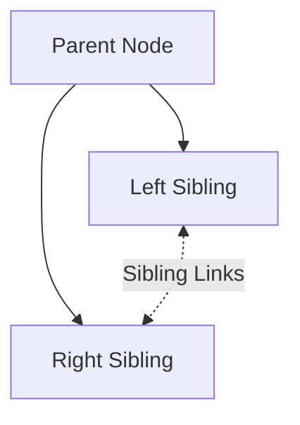
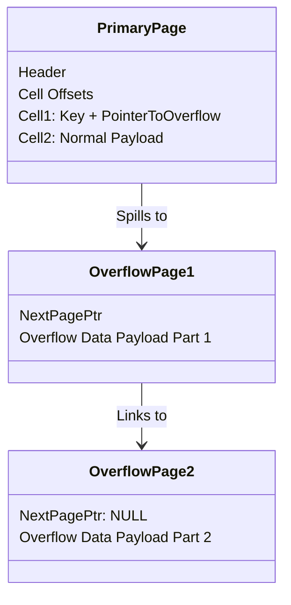

<Chapter 4: Implementing B-Trees>
> A deep dive into the physical implementation details of B-Trees, covering page organization, root-to-leaf traversal mechanics, optimizations, and maintenance processes.

## Table of Contents
- [Chapter Overview](#chapter-overview)
- [Page Organization and Metadata](#page-organization-and-metadata)
  - [Page Header](#page-header)
  - [Magic Numbers](#magic-numbers)
  - [Sibling Links](#sibling-links)
- [Managing Pointers and Keys](#managing-pointers-and-keys)
  - [Rightmost Pointers](#rightmost-pointers)
  - [Node High Keys](#node-high-keys)
- [Handling Variable-Size Data](#handling-variable-size-data)
  - [Overflow Pages](#overflow-pages)
- [Search and Navigation](#search-and-navigation)
  - [Binary Search with Indirection Pointers](#binary-search-with-indirection-pointers)
  - [Propagating Splits and Merges](#propagating-splits-and-merges)
  - [Breadcrumbs](#breadcrumbs)
- [Optimizations](#optimizations)
  - [Rebalancing](#rebalancing)
  - [Right-Only Appends (Fastpath)](#right-only-appends-fastpath)
  - [Bulk Loading](#bulk-loading)
  - [Compression](#compression)
- [Maintenance and Garbage Collection](#maintenance-and-garbage-collection)
  - [Vacuum and Maintenance](#vacuum-and-maintenance)
  - [Fragmentation Caused by Updates and Deletes](#fragmentation-caused-by-updates-and-deletes)
  - [Page Defragmentation](#page-defragmentation)
- [Worked Examples & Code Implementations](#worked-examples--code-implementations)
- [Design Patterns & Best Practices](#design-patterns--best-practices)
- [Trade-offs & Decision Framework](#trade-offs--decision-framework)
- [Interview & System Design Angles](#interview--system-design-angles)
- [AI/ML Engineering Relevance](#aiml-engineering-relevance)
- [Key Takeaways](#key-takeaways)
- [Glossary](#glossary)

## Chapter Overview
This chapter bridges the gap between the theoretical B-Tree algorithms and their physical implementations in modern database systems like PostgreSQL, MySQL InnoDB, and SQLite. While theoretical B-Trees manage mathematical keys and pointers, real-world systems must handle physical bytes, variable-sized payloads, concurrent access, and fragmentation on disk. 

The implementation details span three logical areas: establishing relationships between keys and pointers on pages, efficiently tracking root-to-leaf paths to propagate changes, and handling maintenance processes like rebalancing, defragmentation, and optimization techniques (e.g., right-only appends and bulk loading). Understanding these mechanisms is crucial for database systems engineers who need to tune storage engines, write robust data layers, or design high-performance indexing systems.

## Page Organization and Metadata
### Page Header
The page header is a reserved contiguous block of bytes at the beginning of a page containing metadata used for navigation, maintenance, and structural validation.

#### How It Works
Headers store attributes such as:
- Flags describing page contents (e.g., leaf vs. internal node)
- The number of cells (records) in the page
- Lower and upper byte offsets marking the boundaries of empty/free space (needed for the slotted page design)
- The page size and layout version
- Database-specific details (e.g., level in the tree, number of heap records)

#### Real-World Usage
- **PostgreSQL**: Stores page size and layout version in the header.
- **MySQL InnoDB**: Holds the number of heap records, node level, and implementation-specific values.
- **SQLite**: Stores the number of cells and a rightmost child pointer.

### Magic Numbers
A multibyte constant value embedded in a file or page header used to signal that the block represents a valid page, identify its type, or specify its version.

#### How It Works
Used for sanity checks and validation. When a database reads a page from disk, it checks the magic number. If the read bytes match the expected constant (e.g., `50 41 47 45` hex for `PAGE`), the database can be confident that the page is aligned correctly and loaded successfully, rather than reading corrupted or arbitrary data.

### Sibling Links
Pointers (offsets or page IDs) stored in the page header that point to the immediate left and right sibling pages on the same level of the B-Tree.

#### How It Works
Sibling links simplify horizontal traversal. Without them, locating a neighboring node requires ascending to the parent node and following the appropriate child pointer. If the current node is the first or last child, the ascent might propagate multiple levels up to find the next adjacent branch. 

#### Diagram


#### Trade-offs
While sibling links accelerate range scans, they complicate structural modifications. During a node split or merge, the neighboring nodes' links must be updated. Because the update modifies a sibling node rather than just the splitting/merging node or its parent, it requires acquiring additional locks, potentially reducing concurrency.

## Managing Pointers and Keys
### Rightmost Pointers
In a B-Tree, separator keys divide the tree into subtrees. A node with $N$ keys always has $N+1$ child pointers. Because one pointer is unmatched by a corresponding key on its left, it requires special handling.

#### How It Works
The rightmost pointer is often stored separately from the key-value cells, such as in the page header (as done in SQLite). When the rightmost child node is split, the newly promoted key and a pointer to the newly allocated right node are appended to the parent. The parent's rightmost pointer is then reassigned to point to the new rightmost node.

### Node High Keys
An alternative to managing a loose rightmost pointer is to use a "High Key." The high key represents the maximum possible key that can be stored in the subtree under the current node. 

#### How It Works
Instead of having $N$ keys and $N+1$ pointers where the last pointer is implicit (bounded by $+\infty$), the node explicitly stores the upper bound key $K_{N+1}$ for the last pointer. This ensures that every pointer is paired with a bounding key, mapping perfectly to standard cell structures and simplifying edge cases during splits.

#### Real-World Usage
- **PostgreSQL** uses this approach, heavily tied to the **Blink-Tree** concurrency model. The high key defines the strict upper boundary, allowing concurrent searchers to detect if they need to follow sibling links due to concurrent splits.

## Handling Variable-Size Data
### Overflow Pages
B-Tree node sizes (typically matching disk page sizes, e.g., 4KB or 8KB) and fanout are fixed. When a single record or variable-size payload exceeds the maximum allowed payload size for a node, the database spills the excess data to "overflow pages."

#### How It Works
1. A database defines a `max_payload_size` for records in a B-Tree page (often calculated as $PageSize / Fanout$).
2. If an inserted payload exceeds this limit, the primary B-Tree page stores the record prefix (which often contains the key, crucial for search).
3. The remaining payload bytes are written to an overflow page.
4. The primary page cell stores a pointer (Page ID) to the overflow page.
5. If one overflow page isn't enough, multiple overflow pages are linked together (forming a linked list) to accommodate massive payloads.

#### Diagram


## Search and Navigation
### Binary Search with Indirection Pointers
Since keys must be sorted to perform a binary search, B-Tree pages maintain logical ordering. In slotted pages, the physical cells may be out of order due to inserts and updates, but an array of cell offsets (indirection pointers) in the header is maintained in strictly sorted order.

#### How It Works
1. Start binary search on the contiguous array of cell offsets.
2. Pick the middle offset.
3. Follow the pointer to the physical cell in the page.
4. Compare the key in the cell with the search key.
5. If an exact match is needed and found, return. Otherwise, adjust bounds left or right.
6. The process ends by either finding the key or identifying the correct child pointer (or insertion point).

### Propagating Splits and Merges
When a leaf node overflows (or underflows), it triggers a split (or merge). This structural change must be propagated upward to the parent node. The database needs a way to traverse the path back to the root.

#### Two Main Approaches
1. **Parent Pointers**: Nodes store explicit pointers to their parents. (e.g., WiredTiger uses this for leaf traversal to avoid sibling pointer deadlocks).
2. **Breadcrumbs**: The path from the root is tracked dynamically during the initial top-down traversal.

### Breadcrumbs
Instead of persisting parent pointers on disk, databases maintain an in-memory stack (breadcrumbs) tracking the nodes visited during the root-to-leaf descent.

#### How It Works
During an insert or delete:
1. Traverse from root to leaf, pushing each visited node's reference and the chosen child index onto a stack.
2. If the target leaf needs splitting, pop the top item from the stack to find the immediate parent.
3. Propagate the new separator key to the parent.
4. If the parent also overflows, continue popping from the stack and propagating upwards until reaching the root or a node with sufficient space.

#### Real-World Usage
- **PostgreSQL** uses an in-memory `BTStack` to store breadcrumbs.

## Optimizations
### Rebalancing
Instead of immediately splitting a full node or merging a half-empty node, some implementations rebalance elements between neighboring nodes.

#### How It Works
- **Insert**: If a node is full, transfer some elements to a less occupied sibling.
- **Delete**: If a node underflows, borrow elements from a sibling.
- **B*-Trees**: Defer splitting until *both* neighboring siblings are full. Then, split the two full nodes into three nodes, each 2/3 full.

#### Trade-offs
Improves space utilization (higher occupancy means a shallower tree and faster searches). However, it adds computational complexity and locking overhead during writes. SQLite uses sibling balancing.

### Right-Only Appends (Fastpath)
Many systems use auto-incrementing primary keys. These inserts always target the rightmost leaf of the B-Tree.

#### How It Works
When an inserted key is strictly greater than the highest key in the rightmost page:
- **PostgreSQL (Fastpath)**: Skips the top-down read path entirely. It directly accesses the cached rightmost leaf and inserts the entry.
- **SQLite (Quickbalance)**: When the rightmost node is full, instead of splitting the node down the middle (leaving two half-empty nodes), it allocates a *new* rightmost node, leaving the previous node completely full and the new node nearly empty (expecting it to fill up immediately).

### Bulk Loading
When building a B-Tree from an already sorted dataset (or rebuilding for defragmentation), standard row-by-row insertion incurs massive overhead from splits and tree traversals.

#### How It Works
1. Write presorted data directly into leaf pages until they are full.
2. Propagate the first key of each leaf page upward.
3. Build internal nodes bottom-up, level by level.
4. No page splits or merges are required. Space utilization is maximized (100% full pages, or leaving configured empty space for future updates).

### Compression
Storing raw data wastes disk space and I/O bandwidth. Compression trades CPU cycles for reduced I/O and storage size.

#### How It Works
- **File-level**: Impractical for B-Trees due to random access requirements.
- **Page-level**: Pages are compressed individually. Because a compressed 4KB page takes less physical space, reading block-aligned boundaries might require padding or reading extra bytes. 
- **Row/Column-level**: Compression is decoupled from page management. Specific payloads are compressed using algorithms like Snappy, LZ4, or zLib.

## Maintenance and Garbage Collection
### Vacuum and Maintenance
Due to the slotted page design, physical space becomes fragmented over time. Deletes and updates leave "garbage" (dead/nonaddressable tuples) physically occupying bytes in the page. 

#### How It Works
B-Trees are navigated top-down. Any cell reachable via pointers is "addressable" (live). Any cell whose offset has been removed from the header is "garbage." Zero-filling garbage immediately is slow; instead, the bytes are left intact until defragmentation reclaims them.

### Fragmentation Caused by Updates and Deletes
- **Deletes**: Remove the cell offset from the header array. The cell payload remains physically on the page.
- **Splits**: Truncate cell offsets. The leftover bytes of moved cells become garbage.
- **Updates**: In many systems (especially those with MVCC), updates write a new version of the cell, leaving the old version intact until all concurrent transactions that could see it have finished.

### Page Defragmentation (Compaction)
Defragmentation (or VACUUM) is the asynchronous process of cleaning up fragmented pages.

#### How It Works
1. The system walks through the pages.
2. It physically rewrites the live cells back-to-back, strictly in logical order.
3. Dead cells are discarded, reclaiming a single contiguous block of free physical space.
4. Completely empty pages are returned to a "freelist" to be reused later. 

---

## Worked Examples & Code Implementations

### Example 1: Breadcrumbs Traversal Stack (`BTStack`) & Split Propagation

Demonstrates root-to-leaf descent saving the path on an in-memory stack (`breadcrumbs`), and propagating node splits bottom-up by popping parents off the stack without storing physical parent pointers on disk.

```python
class Node:
    def __init__(self, is_leaf=True, max_keys=3):
        self.is_leaf = is_leaf
        self.keys = []
        self.children = []  # Child node references if internal, values if leaf
        self.max_keys = max_keys

class BTreeWithBreadcrumbs:
    def __init__(self, max_keys=3):
        self.root = Node(is_leaf=True, max_keys=max_keys)
        self.max_keys = max_keys

    def search_with_breadcrumbs(self, key: int):
        """Descends root-to-leaf, pushing (node, child_idx) onto stack."""
        stack = []
        curr = self.root
        while not curr.is_leaf:
            idx = 0
            while idx < len(curr.keys) and key >= curr.keys[idx]:
                idx += 1
            stack.append((curr, idx))
            curr = curr.children[idx]
        return curr, stack

    def insert(self, key: int, value: str):
        leaf, stack = self.search_with_breadcrumbs(key)
        
        # Insert key sorted in leaf
        idx = 0
        while idx < len(leaf.keys) and leaf.keys[idx] < key:
            idx += 1
        leaf.keys.insert(idx, key)
        leaf.children.insert(idx, value)

        # Check for overflow
        if len(leaf.keys) > leaf.max_keys:
            self._split_and_propagate(leaf, stack)

    def _split_and_propagate(self, node: Node, stack: list):
        mid = len(node.keys) // 2
        promoted_key = node.keys[mid]
        
        sibling = Node(is_leaf=node.is_leaf, max_keys=node.max_keys)
        if node.is_leaf:
            sibling.keys = node.keys[mid:]
            sibling.children = node.children[mid:]
            node.keys = node.keys[:mid]
            node.children = node.children[:mid]
        else:
            sibling.keys = node.keys[mid + 1:]
            sibling.children = node.children[mid + 1:]
            node.keys = node.keys[:mid]
            node.children = node.children[:mid + 1]

        if not stack:
            # Root split: create new root
            new_root = Node(is_leaf=False, max_keys=self.max_keys)
            new_root.keys = [promoted_key]
            new_root.children = [node, sibling]
            self.root = new_root
            return

        # Pop parent from breadcrumb stack
        parent, child_idx = stack.pop()
        p_idx = 0
        while p_idx < len(parent.keys) and parent.keys[p_idx] < promoted_key:
            p_idx += 1
        parent.keys.insert(p_idx, promoted_key)
        parent.children.insert(p_idx + 1, sibling)

        if len(parent.keys) > parent.max_keys:
            self._split_and_propagate(parent, stack)

tree = BTreeWithBreadcrumbs(max_keys=3)
for k in [10, 20, 30, 40, 50, 60, 70]:
    tree.insert(k, f"val_{k}")

print("=== Breadcrumbs Traversal & Split Propagation ===")
print(f"Root Keys: {tree.root.keys} (is_leaf={tree.root.is_leaf})")
for i, child in enumerate(tree.root.children):
    print(f"  Child {i} Keys: {child.keys} (is_leaf={child.is_leaf})")
```

#### Execution Output
```text
=== Breadcrumbs Traversal & Split Propagation ===
Root Keys: [30, 50] (is_leaf=False)
  Child 0 Keys: [10, 20] (is_leaf=True)
  Child 1 Keys: [30, 40] (is_leaf=True)
  Child 2 Keys: [50, 60, 70] (is_leaf=True)
```

---

### Example 2: Overflow Page Spilling and Multi-Page Linked List Reconstruction

Demonstrates how B-Trees handle variable-size large payloads exceeding the maximum in-page cell threshold by writing the inline head to the primary page and spilling excess bytes across a linked chain of overflow disk pages.

```python
class PageManager:
    PAGE_SIZE = 128
    MAX_INLINE_PAYLOAD = 32

    def __init__(self):
        self.pages = {}
        self.next_page_id = 1

    def allocate_page(self) -> int:
        pid = self.next_page_id
        self.next_page_id += 1
        self.pages[pid] = bytearray(self.PAGE_SIZE)
        return pid

    def write_payload(self, payload: bytes) -> dict:
        if len(payload) <= self.MAX_INLINE_PAYLOAD:
            return {"type": "inline", "data": payload}

        inline_part = payload[:self.MAX_INLINE_PAYLOAD]
        overflow_part = payload[self.MAX_INLINE_PAYLOAD:]

        first_overflow_pid = self.allocate_page()
        curr_pid = first_overflow_pid
        chunk_size = self.PAGE_SIZE - 4  # 4 bytes for next_pid pointer

        for i in range(0, len(overflow_part), chunk_size):
            chunk = overflow_part[i:i + chunk_size]
            next_pid = self.allocate_page() if (i + chunk_size) < len(overflow_part) else 0
            page_data = next_pid.to_bytes(4, 'big') + chunk
            self.pages[curr_pid][:len(page_data)] = page_data
            curr_pid = next_pid

        return {
            "type": "overflow",
            "inline_head": inline_part,
            "overflow_head_pid": first_overflow_pid,
            "total_size": len(payload)
        }

    def read_payload(self, record_ref: dict) -> bytes:
        if record_ref["type"] == "inline":
            return record_ref["data"]

        data = bytearray(record_ref["inline_head"])
        curr_pid = record_ref["overflow_head_pid"]

        while curr_pid != 0:
            page_bytes = self.pages[curr_pid]
            next_pid = int.from_bytes(page_bytes[:4], 'big')
            content = page_bytes[4:].rstrip(b'\x00')
            data.extend(content)
            curr_pid = next_pid

        return bytes(data)[:record_ref["total_size"]]

pm = PageManager()
large_payload = (b"EMBEDDING_VECTOR_DATA_" * 15)[:280]  # 280 bytes
ref = pm.write_payload(large_payload)

print("=== Overflow Page Spilling ===")
print(f"Payload Size: {len(large_payload)} bytes -> Primary Page Cell Type: '{ref['type']}'")
print(f"Overflow Linked Page IDs Allocated: {[pid for pid in pm.pages]}")
restored = pm.read_payload(ref)
print(f"Payload Integrity Check: {'VERIFIED MATCH' if restored == large_payload else 'CORRUPT'}")
```

#### Execution Output
```text
=== Overflow Page Spilling ===
Payload Size: 280 bytes -> Primary Page Cell Type: 'overflow'
Overflow Linked Page IDs Allocated: [1, 2]
Payload Integrity Check: VERIFIED MATCH
```

---

### Example 3: Right-Only Append (Quickbalance) vs. Standard 50/50 Split

Demonstrates why monotonic/auto-incrementing keys cause 50% storage waste under standard 50/50 splitting, and how SQLite Quickbalance preserves 100% page occupancy by allocating a fresh right page.

```python
def simulate_splits(keys: list[int], max_keys=4, mode="standard"):
    leaves = [[]]
    for k in keys:
        target = leaves[-1]
        if len(target) < max_keys:
            target.append(k)
        else:
            if mode == "standard":
                # 50/50 split: split half into new node
                mid = len(target) // 2
                new_leaf = target[mid:] + [k]
                leaves[-1] = target[:mid]
                leaves.append(new_leaf)
            else:
                # Right-only Quickbalance: append new page, leave left 100% full
                leaves.append([k])
    
    total_keys = sum(len(l) for l in leaves)
    total_capacity = len(leaves) * max_keys
    avg_occupancy = (total_keys / total_capacity) * 100
    return len(leaves), avg_occupancy, leaves

keys_seq = list(range(1, 21))
p_count_std, occ_std, leaves_std = simulate_splits(keys_seq, max_keys=4, mode="standard")
p_count_qb, occ_qb, leaves_qb = simulate_splits(keys_seq, max_keys=4, mode="quickbalance")

print("=== Right-Only Append (Quickbalance) vs 50/50 Split ===")
print(f"Standard 50/50 Split : {p_count_std} Leaf Pages | Avg Occupancy: {occ_std:.1f}% | Layout: {leaves_std}")
print(f"SQLite Quickbalance  : {p_count_qb} Leaf Pages | Avg Occupancy: {occ_qb:.1f}% | Layout: {leaves_qb}")
```

#### Execution Output
```text
=== Right-Only Append (Quickbalance) vs 50/50 Split ===
Standard 50/50 Split : 9 Leaf Pages | Avg Occupancy: 55.6% | Layout: [[1, 2], [3, 4], [5, 6], [7, 8], [9, 10], [11, 12], [13, 14], [15, 16], [17, 18, 19, 20]]
SQLite Quickbalance  : 5 Leaf Pages | Avg Occupancy: 100.0% | Layout: [[1, 2, 3, 4], [5, 6, 7, 8], [9, 10, 11, 12], [13, 14, 15, 16], [17, 18, 19, 20]]
```

---

### Example 4: Bottom-Up Bulk Loading

Demonstrates constructing a B+Tree bottom-up from presorted records, achieving 100% space utilization without incurring runtime page splits or search overhead.

```python
def bulk_load_btree(sorted_keys: list[int], leaf_capacity=4, internal_capacity=4):
    # Step 1: Pack leaf pages
    leaf_pages = []
    for i in range(0, len(sorted_keys), leaf_capacity):
        leaf_pages.append(sorted_keys[i:i + leaf_capacity])

    # Step 2: Build internal levels bottom-up
    current_level = leaf_pages
    levels = [leaf_pages]
    
    def get_first_key(node):
        return node[0] if isinstance(node, list) else node["keys"][0]

    while len(current_level) > 1:
        next_level = []
        for i in range(0, len(current_level), internal_capacity):
            group = current_level[i:i + internal_capacity]
            separator_keys = [get_first_key(child) for child in group[1:]]
            next_level.append({"keys": separator_keys, "children_count": len(group)})
        levels.append(next_level)
        current_level = next_level

    return levels

sorted_data = list(range(1, 33))  # 32 sorted records
levels = bulk_load_btree(sorted_data, leaf_capacity=4, internal_capacity=4)

print("=== Bottom-Up Bulk Loading ===")
print(f"Bulk-Loaded Tree for {len(sorted_data)} records:")
print(f"  Level 2 (Root)     : {levels[2]}")
print(f"  Level 1 (Internal) : {levels[1]}")
print(f"  Level 0 (Leaves)   : {len(levels[0])} leaf pages (100% space utilization, zero split overhead)")
```

#### Execution Output
```text
=== Bottom-Up Bulk Loading ===
Bulk-Loaded Tree for 32 records:
  Level 2 (Root)     : [{'keys': [21], 'children_count': 2}]
  Level 1 (Internal) : [{'keys': [5, 9, 13], 'children_count': 4}, {'keys': [21, 25, 29], 'children_count': 4}]
  Level 0 (Leaves)   : 8 leaf pages (100% space utilization, zero split overhead)
```

---

## Design Patterns & Best Practices
1. **Slotted Page Architecture**: Decouple logical order (offset arrays) from physical order (raw bytes) to enable fast binary searches while allowing $O(1)$ variable-length inserts.
2. **Bottom-Up Construction**: When generating indexes over existing data, always bulk-load bottom-up to prevent write amplification and tree fragmentation.
3. **Optimized Write Paths**: Exploit domain knowledge (e.g., auto-incrementing integers) to shortcut tree traversals and optimize splits (right-only appends).

## Trade-offs & Decision Framework
| Decision | Option A | Option B | Trade-off |
|----------|----------|----------|-----------|
| **Sibling Links** | Yes (Forward/Backward pointers) | No | Fast range scans vs. complex locking and pointer maintenance during splits/merges. |
| **Overflow Data** | In-line arbitrary page resizing | Overflow linked pages | High fragmentation and I/O copying vs. pointer chasing for large records. |
| **Node Spills** | Immediate Split (Standard B-Tree) | Rebalancing (B*-Tree) | Simple code and fast local writes vs. better space utilization and shallower trees. |
| **Tree Traversal** | Parent Pointers | Breadcrumbs (Stack) | Disk space overhead/update complexity vs. in-memory tracking requiring full root descent. |

## Interview & System Design Angles
- **Database Engine Implementation**: If asked to design a key-value store, mentioning "slotted pages" for binary search and "overflow pages" for large payloads immediately signals deep database internals knowledge.
- **Performance Tuning**: Understanding fragmentation explains why database operations degrade over time and why DBAs run `VACUUM` in PostgreSQL or `OPTIMIZE TABLE` in MySQL.
- **Concurrency**: Mentioning high keys and Blink-Trees is crucial when discussing how to handle concurrent reads during a page split without locking the entire tree.

## AI/ML Engineering Relevance
- **Feature Stores & Vector Databases**: Feature stores (like Feast) often rely on underlying row-stores. Understanding B-Tree page fragmentation is vital when maintaining feature freshness via high-frequency updates, as fragmented pages drastically slow down batch feature retrieval for model training.
- **Embedding Storage**: When storing dense vectors (embeddings) alongside metadata, the vectors often exceed standard $4KB$ page payload limits. Recognizing how the database engine handles this via **Overflow Pages** dictates whether one should store vectors directly in the DB or in external blob storage (like S3) with a URI reference in the DB.
- **Bulk Loading Training Data**: Understanding bottom-up index bulk loading applies directly to constructing massive immutable ANN (Approximate Nearest Neighbor) indexes or ingesting historical training data rapidly without index thrashing.

## Key Takeaways
- **Page Metadata**: Headers store cell counts, free space bounds, and magic numbers for structural integrity.
- **Blink-Trees & High Keys**: Pairing pointers with strict upper-bound keys simplifies splits and enables highly concurrent traversal.
- **Overflow Pages**: Fixed-size B-Tree nodes handle variable-size large records by spilling excess payload into linked overflow pages.
- **Binary Search**: Slotted pages enable binary search via sorted indirection pointers, avoiding the need to physically sort records on every write.
- **Breadcrumbs**: In-memory stacks track the traversal path, eliminating the need to persist parent pointers on disk.
- **Right-Only Appends**: Optimizing for monotonic keys (auto-increment) bypasses root-to-leaf lookups and utilizes specialized page splitting to maximize node density.
- **Fragmentation**: Routine updates and deletes cause logical gaps. Asynchronous vacuuming physically compacts pages and reclaims space.

## Glossary
- **Magic Number**: A constant byte sequence used to validate file/page format.
- **High Key**: The upper bound value that can be stored in a subtree, used in Blink-Trees.
- **Overflow Page**: A linked secondary page storing payload bytes that exceed the primary node's limits.
- **Breadcrumbs**: An in-memory stack storing the path traversed from the root to a leaf.
- **B*-Tree**: A B-Tree variant that defers splits by balancing keys with siblings until two sibling nodes are full.
- **Garbage**: Nonaddressable data (e.g., deleted or overwritten cells) occupying physical space on a page before compaction.
- **Freelist**: A linked list of unused pages available for new allocations.
</Chapter 4: Implementing B-Trees>
