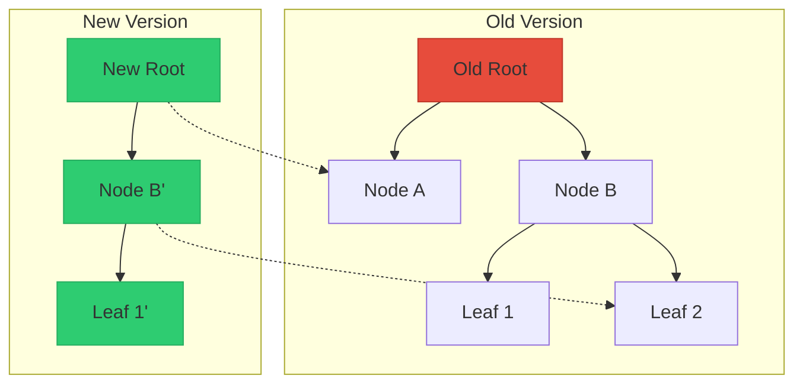
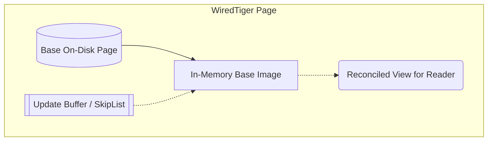
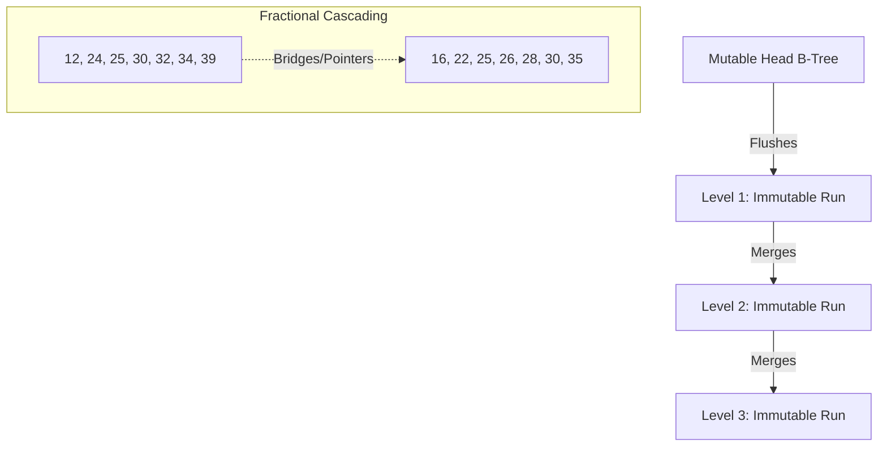
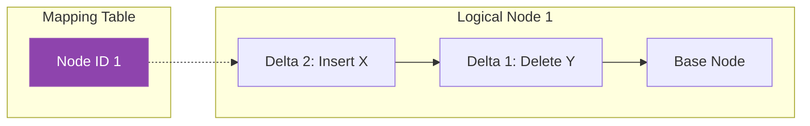

# Chapter 6: B-Tree Variants
> A deep dive into modern B-Tree variants designed to optimize for SSDs, concurrency, write amplification, and CPU cache hierarchies.

## Table of Contents
1. [Chapter Overview](#chapter-overview)
2. [Copy-on-Write B-Trees](#copy-on-write-b-trees)
3. [Lazy B-Trees](#lazy-b-trees)
4. [FD-Trees (Flash Disk Trees)](#fd-trees-flash-disk-trees)
5. [Bw-Trees (Buzzword Trees)](#bw-trees-buzzword-trees)
6. [Cache-Oblivious B-Trees](#cache-oblivious-b-trees)
7. [Worked Examples & Code Implementations](#worked-examples--code-implementations)
8. [Design Patterns & Best Practices](#design-patterns--best-practices)
9. [Trade-offs & Decision Framework](#trade-offs--decision-framework)
10. [Interview & System Design Angles](#interview--system-design-angles)
11. [AI/ML Engineering Relevance](#aiml-engineering-relevance)
12. [Key Takeaways](#key-takeaways)
13. [Glossary](#glossary)

## Chapter Overview
Traditional B-Trees were designed primarily for magnetic spinning disks (HDDs), where the primary goal was minimizing disk seeks. However, modern storage hardware (like SSDs and NVMe) and highly concurrent multi-core architectures expose several fundamental shortcomings in the original B-Tree design: high write amplification (due to page rewrites), space amplification (reserved empty space in nodes), and complex latching mechanisms (locks) that throttle concurrency. 

This chapter explores several B-Tree variants that rethink the canonical structure to solve these problems. We explore immutability (Copy-on-Write B-Trees), update buffering (Lazy B-Trees), append-only hierarchical logging (FD-Trees), lock-free update chains (Bw-Trees), and CPU-cache optimized layouts (Cache-Oblivious B-Trees). Understanding these variants is crucial for building modern storage engines that maximize hardware utilization and concurrent throughput.

---

## Copy-on-Write B-Trees

### Core Concept
Instead of updating B-Tree nodes in place, the Copy-on-Write (CoW) technique treats nodes as **immutable**. When a page needs modification, it is copied, updated, and written to a new location on disk. This creates a parallel tree hierarchy.

### How It Works
1. **Traverse and Copy**: When a write occurs, every node on the path from the root to the target leaf is copied.
2. **Modify the Copy**: The modifications are applied to the newly copied nodes.
3. **Atomic Root Switch**: Once all modifications are written to disk, the pointer to the root node is atomically updated to point to the new root.
4. **Garbage Collection**: Old tree versions remain accessible for concurrent readers. Once all readers using the old version finish, those pages are reclaimed.

### Diagram



### Advantages & Disadvantages
- **Advantages**: 
  - **Lock-free Reads**: Readers require zero synchronization. Since pages are immutable, readers do not block writers, and writers do not block readers.
  - **Crash Resilience**: Because the topmost pointer is switched atomically only when all modifications are persisted, no operation can observe an incomplete state.
  - **Inherent MVCC**: Naturally provides Multi-Version Concurrency Control.
- **Disadvantages**:
  - **Write Amplification**: Updating a single leaf requires copying every node up to the root, consuming more space and CPU cycles.

### Real-World Usage: LMDB
**Lightning Memory-Mapped Database (LMDB)**, used by OpenLDAP, heavily utilizes CoW B-Trees. LMDB requires no page cache, write-ahead log, checkpointing, or compaction. It serves reads directly from the memory map. Because of its append-only design, it does not use sibling pointers (unlike standard B+Trees) and must ascend back to the parent node during sequential scans. BoltDB (Go) is another popular key-value store using this pattern.

---

## Lazy B-Trees

### Core Concept
Lazy B-Trees reduce the overhead of B-Tree updates by buffering writes in memory and applying them to the on-disk tree asynchronously in batches. This mitigates the write amplification caused by updating the same node multiple times.

### How It Works
1. **WiredTiger (MongoDB default)**: 
   - Uses different formats for in-memory and on-disk pages.
   - Clean pages consist of an index constructed from the on-disk image.
   - Updates (inserts, deletes, modifications) are stored in an **update buffer** (often implemented as a skip list) attached to the in-memory page.
   - During reads, the update buffer is reconciled with the on-disk page to serve the latest data.
   - A background thread reconciles and flushes the page to disk.
   
2. **Lazy-Adaptive Tree (LA-Tree)**:
   - Groups nodes into subtrees and attaches an update buffer to the top node of each subtree.
   - Updates are added to the root's buffer.
   - When full, updates **cascade** down to lower-level buffers.
   - When updates reach the leaves, they are applied in a single batch, minimizing structural modification operations (SMOs).

### Diagram



### Real-World Usage
- **WiredTiger**: MongoDB's storage engine uses this to allow background threads to handle page splits/merges without blocking user read/write operations.

---

## FD-Trees (Flash Disk Trees)

### Core Concept
FD-Trees apply the append-only, cascading immutability ideas of LSM-Trees to B-Trees to eliminate random writes. This drastically reduces the garbage collection penalty on SSDs.

### How It Works
An FD-Tree consists of a small mutable head B-Tree and multiple immutable sorted runs (arrays) of logarithmically increasing size.
1. **Head Tree**: Small mutable B-Tree in memory/fast storage that absorbs all random writes.
2. **Logarithmic Runs**: When the head tree fills up, its contents are written to Level 1. When Level 1 fills, it merges with Level 2 (similar to LSM compactions).
3. **Fractional Cascading**: A technique to maintain pointers between levels. Instead of standard B-Tree indexing, it pulls every *N*th item from a lower-level array up to the higher-level array. This creates "bridges" or "fences".
4. **Search**: Binary search is done on the highest level. The bridges forward the search to the approximate location on the next level, reducing the cost to just $O(\log n)$ on the top level and $O(1)$ or minimal steps on subsequent levels.
5. **Deletes**: Handled via tombstones that cascade down the levels.

### Diagram



### Advantages
- Completely avoids random leaf writes.
- Significantly reduces write amplification compared to in-place B-Trees.

---

## Bw-Trees (Buzzword Trees)

### Core Concept
Developed by Microsoft, the Bw-Tree is a **lock-free** B-Tree variant that isolates updates into separate "delta nodes" connected via chains, resolving the concurrency bottlenecks and write amplification of traditional B-Trees.

### How It Works
1. **Update Chains**: A logical node consists of a base node and a linked list of delta nodes (representing inserts, updates, deletes). Base nodes are never modified in place.
2. **Mapping Table**: A centralized in-memory table maps Logical Node IDs (PIDs) to their physical memory/disk addresses.
3. **Lock-Free Updates via CAS**: 
   - A thread creates a new delta node pointing to the current head of the logical node.
   - It then uses an atomic Compare-and-Swap (CAS) to update the Mapping Table to point to the new delta node.
   - If CAS fails, the thread retries. No latches/locks are used.
4. **Consolidation**: As delta chains grow, read traversal slows down. A background thread consolidates the base node and delta chain into a new single base node, replacing the old pointer via CAS.
5. **Structural Modifications (SMOs)**: Splits and merges are broken into multi-step atomic operations (e.g., adding a split delta node, then updating the parent). Threads encountering an incomplete SMO must help finish it before proceeding.
6. **Epoch-Based Reclamation**: Memory is garbage-collected using epochs to ensure no lingering readers are accessing consolidated/deleted delta chains.

### Diagram



### Real-World Usage
- **SQL Server Hekaton**: Microsoft's in-memory OLTP engine.
- **Sled**: An experimental storage engine.
- **OpenBw-Tree**: An open-source implementation by CMU.

---

## Cache-Oblivious B-Trees

### Core Concept
While standard B-Trees are "cache-aware" (tuned explicitly for disk page sizes like 4KB or 8KB), cache-oblivious structures provide asymptotically optimal performance across *all* levels of the memory hierarchy (L1/L2/L3 cache, RAM, disk) without any hardware-specific tuning parameters.

### How It Works
1. **van Emde Boas Layout**: A static tree is recursively split in the middle of its edges into subtrees of size $\sqrt{N}$. This ensures that any recursive subtree is stored in a contiguous block of memory. Thus, a single block fetch seamlessly brings in a complete localized subtree.
2. **Packed Array**: To support dynamic inserts/deletes, the leaf level is maintained as a contiguous array with predefined gaps (based on density thresholds). Elements only shift locally into gaps during inserts.
3. **Rebuilds**: When a segment becomes too dense or sparse, that portion of the array and the static index above it are rebuilt.

### Trade-offs
While mathematically elegant, true cache-oblivious B-Trees are rare in production databases due to the overhead of array rebuilding and the fact that modern OS paging mechanisms often disrupt the theoretical cache benefits.

---

## Worked Examples & Code Implementations

### Example 1: Copy-on-Write (CoW) B-Tree Path Copying & Snapshot Isolation

Demonstrates immutable B-Tree path copying (as used in LMDB and BoltDB). Writes create copies of modified branch nodes up to a new root, allowing concurrent readers on earlier snapshots to proceed without locks.

```python
class CoWNode:
    def __init__(self, keys: list, children: list, is_leaf=True):
        self.keys = list(keys)
        self.children = list(children)
        self.is_leaf = is_leaf

class CoWBTree:
    def __init__(self):
        self.root = CoWNode(keys=[], children=[], is_leaf=True)

    def insert(self, key: int, value: str):
        new_root = self._cow_insert(self.root, key, value)
        self.root = new_root
        return self.root

    def _cow_insert(self, node: CoWNode, key: int, value: str) -> CoWNode:
        # Clone current node (Path Copying)
        new_node = CoWNode(node.keys, node.children, is_leaf=node.is_leaf)
        if new_node.is_leaf:
            idx = 0
            while idx < len(new_node.keys) and new_node.keys[idx] < key:
                idx += 1
            new_node.keys.insert(idx, key)
            new_node.children.insert(idx, value)
            return new_node
        else:
            idx = 0
            while idx < len(new_node.keys) and key >= new_node.keys[idx]:
                idx += 1
            copied_child = self._cow_insert(new_node.children[idx], key, value)
            new_node.children[idx] = copied_child
            return new_node

    def search(self, root_snapshot: CoWNode, key: int):
        curr = root_snapshot
        while curr:
            if curr.is_leaf:
                for k, v in zip(curr.keys, curr.children):
                    if k == key:
                        return v
                return None
            idx = 0
            while idx < len(curr.keys) and key >= curr.keys[idx]:
                idx += 1
            curr = curr.children[idx]
        return None

db = CoWBTree()
db.insert(10, "v10")
db.insert(20, "v20")

# Reader 1 acquires Snapshot 1
snapshot_1 = db.root
print("=== Copy-on-Write (CoW) Path Copying ===")
print(f"Snapshot 1 Keys : {snapshot_1.keys}")

# Writer performs modifications creating Snapshot 2
db.insert(15, "v15")
db.insert(30, "v30")
snapshot_2 = db.root

print(f"Snapshot 2 Keys (After Writes): {snapshot_2.keys}")
print(f"Reader on Snapshot 1 query 15: {db.search(snapshot_1, 15)} (Isolated from new writes!)")
print(f"Reader on Snapshot 2 query 15: {db.search(snapshot_2, 15)} (Live view)")
```

#### Execution Output
```text
=== Copy-on-Write (CoW) Path Copying ===
Snapshot 1 Keys : [10, 20]
Snapshot 2 Keys (After Writes): [10, 15, 20, 30]
Reader on Snapshot 1 query 15: None (Isolated from new writes!)
Reader on Snapshot 2 query 15: v15 (Live view)
```

---

### Example 2: Bw-Tree Lock-Free Delta Chains & Mapping Table with CAS

Demonstrates how Microsoft's Bw-Tree decouples logical node IDs from physical memory addresses using a Mapping Table, prepending modification delta records via atomic Compare-and-Swap (CAS) and consolidating them asynchronously into clean base nodes.

```python
class BaseNode:
    def __init__(self, records: dict):
        self.records = dict(records)

class DeltaNode:
    def __init__(self, op_type: str, key: str, val: str, next_ptr):
        self.op_type = op_type  # 'INSERT', 'DELETE', 'UPDATE'
        self.key = key
        self.val = val
        self.next = next_ptr

class BwTreeMappingTable:
    def __init__(self):
        self.mapping_table = {}  # logical_node_id -> physical_head_ptr

    def cas(self, node_id: int, old_ptr, new_ptr) -> bool:
        """Atomic Compare-and-Swap simulation."""
        if self.mapping_table.get(node_id) == old_ptr:
            self.mapping_table[node_id] = new_ptr
            return True
        return False

    def insert_delta(self, node_id: int, key: str, val: str):
        while True:
            old_head = self.mapping_table[node_id]
            delta = DeltaNode(op_type="INSERT", key=key, val=val, next_ptr=old_head)
            if self.cas(node_id, old_head, delta):
                return delta

    def read_key(self, node_id: int, key: str):
        curr = self.mapping_table[node_id]
        while isinstance(curr, DeltaNode):
            if curr.key == key:
                return None if curr.op_type == "DELETE" else curr.val
            curr = curr.next
        return curr.records.get(key)

    def consolidate(self, node_id: int) -> BaseNode:
        """Merges delta chain into a single contiguous base node."""
        curr = self.mapping_table[node_id]
        deltas = []
        while isinstance(curr, DeltaNode):
            deltas.append(curr)
            curr = curr.next
        base = curr
        new_records = dict(base.records)
        for d in reversed(deltas):
            if d.op_type == "DELETE":
                new_records.pop(d.key, None)
            else:
                new_records[d.key] = d.val
        new_base = BaseNode(new_records)
        self.mapping_table[node_id] = new_base
        return new_base

bw = BwTreeMappingTable()
base = BaseNode({"user:1": "Alice", "user:2": "Bob"})
bw.mapping_table[101] = base

print("=== Bw-Tree Delta Chains & Mapping Table ===")
print(f"Initial Base Node 101: {base.records}")
bw.insert_delta(101, "user:3", "Charlie")
bw.insert_delta(101, "user:1", "Alice Updated")

print(f"Read 'user:1' -> {bw.read_key(101, 'user:1')}")
print(f"Read 'user:3' -> {bw.read_key(101, 'user:3')}")
new_base = bw.consolidate(101)
print(f"Consolidated Node 101 Records: {new_base.records}")
```

#### Execution Output
```text
=== Bw-Tree Delta Chains & Mapping Table ===
Initial Base Node 101: {'user:1': 'Alice', 'user:2': 'Bob'}
Read 'user:1' -> Alice Updated
Read 'user:3' -> Charlie
Consolidated Node 101 Records: {'user:1': 'Alice Updated', 'user:2': 'Bob', 'user:3': 'Charlie'}
```

---

### Example 3: WiredTiger Lazy Update Buffer Reconciliation

Demonstrates how MongoDB's WiredTiger engine overlays in-memory modification buffers on top of base disk page images, reconciling them on reads and batch-flushing unified pages to disk asynchronously.

```python
class LazyPage:
    def __init__(self, base_disk_data: dict):
        self.base_disk_data = dict(base_disk_data)  # On-disk immutable base image
        self.update_buffer = {}                      # In-memory skip-list / update buffer

    def write(self, key: str, value: str):
        self.update_buffer[key] = value

    def read(self, key: str) -> str:
        # 1. Check in-memory update buffer first
        if key in self.update_buffer:
            return f"{self.update_buffer[key]} (from in-memory update buffer)"
        # 2. Fall back to base disk page
        if key in self.base_disk_data:
            return f"{self.base_disk_data[key]} (from base disk page)"
        return None

    def flush_to_disk(self) -> dict:
        merged = {**self.base_disk_data, **self.update_buffer}
        self.base_disk_data = merged
        self.update_buffer.clear()
        return self.base_disk_data

wt_page = LazyPage({"k1": "v1_disk", "k2": "v2_disk"})
wt_page.write("k2", "v2_modified_in_RAM")
wt_page.write("k3", "v3_new_in_RAM")

print("=== WiredTiger Lazy Update Buffer ===")
print(f"Read 'k1': {wt_page.read('k1')}")
print(f"Read 'k2': {wt_page.read('k2')}")
print(f"Read 'k3': {wt_page.read('k3')}")
flushed = wt_page.flush_to_disk()
print(f"Reconciled Flushed Disk Page Image: {flushed}")
```

#### Execution Output
```text
=== WiredTiger Lazy Update Buffer ===
Read 'k1': v1_disk (from base disk page)
Read 'k2': v2_modified_in_RAM (from in-memory update buffer)
Read 'k3': v3_new_in_RAM (from in-memory update buffer)
Reconciled Flushed Disk Page Image: {'k1': 'v1_disk', 'k2': 'v2_modified_in_RAM', 'k3': 'v3_new_in_RAM'}
```

---

## Design Patterns & Best Practices

| Pattern | Description | Used In |
|---------|-------------|---------|
| **Immutability** | Never update data in place. Copy and replace. | CoW, LMDB, FD-Trees |
| **Indirection / Mapping** | Decouple logical IDs from physical addresses. | Bw-Trees |
| **Delta Logging** | Prepend small changes rather than rewriting massive blocks. | Bw-Trees, WiredTiger |
| **Batching / Cascading** | Group operations and push them down levels periodically. | LA-Trees, FD-Trees |
| **Lock-free Concurrency** | Use CAS on atomic pointers instead of Read/Write latches. | Bw-Trees |

---

## Trade-offs & Decision Framework

| Requirement | Best Variant | Why |
|-------------|--------------|-----|
| **100% Lock-Free Reads, High Crash Safety** | **Copy-on-Write (LMDB)** | Natural MVCC, readers never blocked, isolated parallel state. |
| **Massive Write Throughput on SSDs** | **FD-Trees / LSM variants** | Eliminates random writes via append-only logs and compactions. |
| **High Concurrency in Multi-Core RAM** | **Bw-Trees** | CAS operations and latch-free delta chains avoid thread contention. |
| **Background SMO processing** | **Lazy B-Trees (WiredTiger)** | Buffers writes in memory skip-lists, merges to disk async. |

---

## Interview & System Design Angles

**1. "How would you design a highly concurrent in-memory database?"**
- **Answer Pivot**: Discuss Bw-Trees. Explain how traditional B-Trees fail due to latching (write-locks block readers, root locks bottleneck the system). Propose using Mapping Tables and Delta Chains to allow lock-free Compare-and-Swap (CAS) updates.

**2. "How do you mitigate write amplification on SSDs?"**
- **Answer Pivot**: Discuss FD-Trees or Lazy B-Trees. Explain how in-place updates to a 4KB B-Tree leaf for a 10-byte change ruins SSD lifespans. Propose buffering (LA-Trees) or append-only logarithmic runs with fractional cascading.

**3. "How does MongoDB's WiredTiger engine differ from traditional B-Trees?"**
- **Answer Pivot**: It uses a Lazy B-Tree approach. It maintains an in-memory skip-list (update buffer) alongside the base page image, reconciling them on reads and flushing to disk asynchronously.

---

## AI/ML Engineering Relevance

- **Feature Stores & Online Serving**: Bw-Tree concepts (lock-free delta chains) are highly relevant for Feature Stores where you have massive concurrent read volume for inference alongside constant low-latency streaming write updates. Latches cause latency spikes in ML serving; lock-free CAS prevents this.
- **Vector Databases & ANN Indexes**: While B-Trees are not inherently spatial, the memory layout strategies of *Cache-Oblivious trees (van Emde Boas layout)* are deeply relevant for optimizing Graph-based ANN indexes (like HNSW). Structuring graph nodes so that subgraphs fit neatly into CPU L1/L2 caches drastically accelerates distance computations during vector search.
- **Embedded ML Storage**: CoW B-Trees (like LMDB) are heavily used in embedded ML systems and edge AI. LMDB’s zero-copy architecture allows machine learning models to read training data or feature embeddings straight from the memory map with zero overhead, making it ideal for high-throughput localized data loading (e.g., PyTorch dataloaders often use LMDB).

---

## Key Takeaways
- Standard B-Trees struggle with concurrency bottlenecks (latches) and hardware realities (SSD write amplification, CPU cache misses).
- **Copy-on-Write** achieves high concurrency and MVCC by never modifying data in place, at the cost of copying entire tree paths.
- **Lazy B-Trees** buffer updates to drastically reduce the I/O cost of sequential modifications to the same node.
- **FD-Trees** adapt LSM concepts (logarithmic runs) into B-Trees using fractional cascading to maintain search performance.
- **Bw-Trees** decouple logical nodes from physical locations using a Mapping Table, allowing delta-updates via lock-free Compare-and-Swap.
- **Cache-Oblivious Trees** prove we can design algorithms that perform optimally across all cache boundaries using specialized mathematical memory layouts.

---

## Glossary
- **Write Amplification**: The ratio of data physically written to storage media compared to the logical data written by the application.
- **Space Amplification**: The ratio of size occupied on disk compared to the actual size of the raw data.
- **Fractional Cascading**: A technique to speed up searches in multiple overlapping sorted arrays by pulling every *N*th element from lower levels to higher levels.
- **Compare-and-Swap (CAS)**: An atomic CPU instruction used in multithreading to achieve synchronization without latches.
- **Epoch-based Reclamation**: A garbage collection technique where memory is only freed once all threads operating in the time period (epoch) where the memory was unlinked have terminated.
- **Structure Modification Operation (SMO)**: Operations that change the structure of a tree, such as page splits or page merges.
- **van Emde Boas Layout**: A recursive memory layout that places subtrees into contiguous memory blocks to optimize CPU cache utilization.
