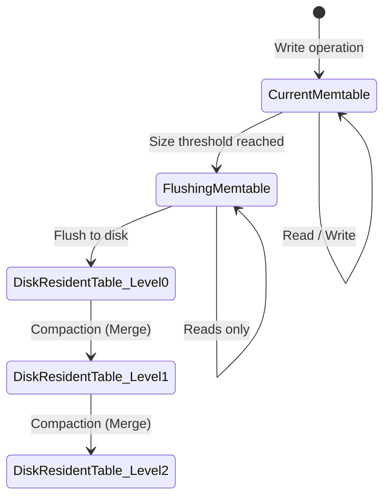

<Chapter 7: Log-Structured Storage>
> A deep dive into immutable, append-only storage structures like LSM Trees, focusing on write-optimization, compaction strategies, component internals, and the inherent trade-offs between read, write, and space amplification.

## Table of Contents
1. [Chapter Overview](#chapter-overview)
2. [LSM Trees vs. Mutable Structures](#lsm-trees-vs-mutable-structures)
3. [LSM Tree Structure](#lsm-tree-structure)
4. [Updates and Deletes](#updates-and-deletes)
5. [LSM Tree Lookups & Merge-Iteration](#lsm-tree-lookups--merge-iteration)
6. [Maintenance and Compaction Strategies](#maintenance-and-compaction-strategies)
7. [Read, Write, and Space Amplification](#read-write-and-space-amplification)
8. [The RUM Conjecture](#the-rum-conjecture)
9. [Implementation Details](#implementation-details)
    - [Sorted String Tables (SSTables)](#sorted-string-tables-sstables)
    - [Bloom Filters](#bloom-filters)
    - [Skiplists](#skiplists)
10. [Unordered LSM Storage](#unordered-lsm-storage)
    - [Bitcask](#bitcask)
    - [WiscKey](#wisckey)
11. [Concurrency in LSM Trees](#concurrency-in-lsm-trees)
12. [Log Stacking & Hardware Interactions](#log-stacking--hardware-interactions)
13. [Worked Examples & Code Implementations](#worked-examples--code-implementations)
14. [Design Patterns & Best Practices](#design-patterns--best-practices)
15. [Trade-offs & Decision Framework](#trade-offs--decision-framework)
16. [Interview & System Design Angles](#interview--system-design-angles)
17. [AI/ML Engineering Relevance](#aiml-engineering-relevance)
18. [Key Takeaways](#key-takeaways)
19. [Glossary](#glossary)

## Chapter Overview

As data volume and ingest rates grow exponentially in modern systems, traditional mutable storage structures like B-Trees face severe limitations due to random I/O and write-amplification caused by in-place updates. "Accountants don’t use erasers or they end up in jail" — this principle perfectly encapsulates immutable, log-structured storage. Instead of modifying existing data on disk, new records are appended, and the system reconciles these immutable files to determine the current state. 

Log-Structured Merge Trees (LSM Trees) buffer incoming writes in memory and periodically flush them to disk as immutable, sequentially written files. This design optimizes heavily for write throughput by converting random I/O into sequential I/O. However, this write optimization comes at the cost of read performance (as multiple files must be queried) and requires background maintenance (compaction) to merge files and reclaim space.

This chapter dissects the architecture of LSM Trees, exploring their components (memtables, SSTables, Write-Ahead Logs), the intricate merge and compaction processes, and real-world implementations like RocksDB, Cassandra, and Bitcask. It also explores the fundamental trade-offs formalized in the RUM conjecture, explaining why no storage engine can simultaneously optimize read, write, and space overheads.

## LSM Trees vs. Mutable Structures

### Core Concept
Storage engines generally fall into two categories: mutable (in-place updates) and immutable (append-only). 
- **Mutable (B-Trees):** Optimized for **read performance**. Updates require locating a specific page on disk and modifying it in place. This involves random I/O and can cause high write amplification due to node splits and page rewriting even if a single byte changes.
- **Immutable (LSM Trees):** Optimized for **write performance**. Writes never locate existing records; they simply append to an in-memory buffer, which is eventually flushed sequentially to disk. Fragmentation is avoided, and storage density is high because no extra space is reserved for future updates. 

### How It Works
Internally, an LSM Tree maintains multiple copies of a key across different files over time, with the more recent copies shadowing older ones. Externally, it presents a linearizable view where redundant copies are reconciled during a read, returning only the most recent value to the client.

## LSM Tree Structure

LSM Trees utilize buffering to turn random writes into sequential writes. An LSM Tree fundamentally consists of memory-resident and disk-resident components.

### Core Components
1. **Memtable (Memory-Resident Table):**
   - Buffers incoming writes (inserts, updates, deletes).
   - Keeps data sorted in memory (often using a Skiplist or an in-memory B-Tree).
   - Serves reads for the most recently written data.
2. **Write-Ahead Log (WAL):**
   - Since the memtable is memory-resident, a disk-based WAL is used to guarantee durability. Writes are appended to the WAL before acknowledging the client. Once the memtable is flushed, the corresponding WAL segment is truncated.
3. **Disk-Resident Tables (SSTables):**
   - Immutable, sequentially written files created by flushing a memtable.
   - Used *only* for reads.

### Data Life Cycle
1. Data is written to the WAL and the **memtable**.
2. When the memtable reaches a size threshold, it switches to a **flushing memtable** state (a new memtable is created to accept new writes).
3. The flushing memtable is written sequentially to disk as a **disk-resident table**.
4. The flushed memtable and its WAL segment are discarded.
5. Over time, background processes merge (**compact**) multiple disk-resident tables to reduce read amplification.

### Diagram: Multicomponent LSM Tree Data Life Cycle



## Updates and Deletes

### Core Concept
In an append-only system, you cannot physically delete a record from disk immediately. Removing it only from the memtable would "resurrect" an older version of the key residing in a disk-resident table. 

### Tombstones
To delete a key, a special marker called a **tombstone** (or dormant certificate) is appended. A tombstone indicates that the data record associated with a specific key is deleted.
- **Point Tombstones:** Delete a single key.
- **Range Tombstones (Predicate Deletes):** Delete a continuous range of keys (e.g., `DELETE WHERE key >= "k2" AND key < "k4"`). This is heavily used in Apache Cassandra.

### Reconciliation
During a read or compaction, the system reconciles overlapping keys based on timestamps. If a tombstone has a higher timestamp than a data record, the data record is shadowed and discarded. Tombstones themselves are only dropped during compaction when the system guarantees no older versions of the key exist in any underlying level.

## LSM Tree Lookups & Merge-Iteration

### Core Concept
Because data is spread across a memtable and multiple disk-resident tables, a read must query all components where the key might exist. Since all tables are individually sorted, the system uses a **multiway merge-sort** algorithm to reconcile the data.

### How It Works (Merge-Iteration)
1. An iterator is created for each source table.
2. The system uses a **Priority Queue (Min-Heap)** holding the head element (smallest key) from each iterator.
3. The smallest element is popped from the queue. 
4. If multiple iterators hold the same key, they are reconciled based on timestamps (highest timestamp wins).
5. The queue is refilled with the next element from the iterator that provided the popped element.
6. This iterates until the requested data is found or all sources are exhausted.

### Complexity
- **Memory Overhead:** $O(N)$ where $N$ is the number of iterators.
- **Time Complexity:** $O(\log N)$ to maintain the priority queue for each step.

### Example
**Iterators:**
- Iterator 1: `{k2: v1}, {k4: v2}`
- Iterator 2: `{k1: v3}, {k2: v4}, {k3: v5}`

**Merge Process:**
1. Queue: `{k1: v3}` (from It2), `{k2: v1}` (from It1) -> Pop `k1: v3`.
2. Refill Queue: `{k2: v1}` (It1), `{k2: v4}` (It2) -> Same key! Reconcile. Assume It2 has a higher timestamp. Result `k2: v4`.
3. Refill Queue: `{k3: v5}` (It2), `{k4: v2}` (It1) -> Pop `k3: v5`.
4. Pop `k4: v2`.
5. **Final Result:** `{k1: v3}, {k2: v4}, {k3: v5}, {k4: v2}`

## Maintenance and Compaction Strategies

To prevent the number of disk tables from growing infinitely (which ruins read performance), LSM Trees employ background **compaction**. Compaction merges multiple tables, purges shadowed records/tombstones, and writes new, larger tables.

### Leveled Compaction (RocksDB)
- **Structure:** Tables are separated into Levels ($L_0, L_1, L_2, \dots$). 
- **Invariants:** 
  - $L_0$ contains tables flushed from memtables. Key ranges can overlap.
  - For $L_1$ and higher, key ranges within a single level **do not overlap**.
  - Each level has an exponentially larger size limit (e.g., $L_1$ is 10x larger than $L_0$).
- **Mechanism:** When $L_i$ reaches its size limit, tables from $L_i$ are merged with overlapping tables in $L_{i+1}$ to produce new tables in $L_{i+1}$.
- **Pros:** Excellent read performance (avoids overlapping ranges) and controlled space amplification.
- **Cons:** High write amplification due to frequent merging between levels.

### Size-Tiered Compaction (Cassandra)
- **Structure:** Tables are grouped by their file size.
- **Mechanism:** When enough small tables accumulate, they are merged into a medium table. Medium tables merge into large tables. Key ranges overlap extensively on all levels.
- **Pros:** Lower write amplification (less frequent merging). Good for write-heavy workloads.
- **Cons:** High read amplification (must check many tables due to overlaps) and high space amplification (shadowed data lives longer). Suffer from "table starvation" if tombstones are preserved too long.

### Time-Window Compaction
Groups files by write timestamp. Excellent for time-series data where whole files can be dropped automatically when the data's TTL (Time-To-Live) expires, completely avoiding merge overhead.

## Read, Write, and Space Amplification

Evaluating an LSM Tree involves three metrics:
1. **Read Amplification:** The number of extra disk reads required to satisfy a query. (High if many tables must be queried).
2. **Write Amplification:** The ratio of data written to the disk versus data written by the application. (High in Leveled compaction due to continuous rewrites).
3. **Space Amplification:** The extra disk space used by redundant records and tombstones before they are compacted.

> [!CAUTION]
> Comparing write amplification between B-Trees and LSM Trees requires nuance. In B-Trees, it's caused by writing full fixed-size pages to disk even for small updates. In LSM Trees, it's caused by background compaction rewriting the same data across levels.

## The RUM Conjecture

### Core Concept
The **RUM Conjecture** is a cost model stating that you can only optimize two out of the three overheads: **Read, Update (Write), and Memory (Space)**.
- **B-Trees** optimize for **Reads** (fast lookups) but sacrifice **Writes** (in-place random I/O) and **Space** (fragmentation and reserved space).
- **LSM Trees** optimize for **Writes** (sequential appends) but sacrifice **Reads** (multiple file lookups) and **Space** (duplicate keys).
- Optimizations (like Bloom filters and compaction strategies) attempt to shift the balance based on the workload, but an ideal solution minimizing all three is mathematically unachievable.

## Implementation Details

### Sorted String Tables (SSTables)
Disk-resident files are usually SSTables. They contain:
- **Data Component:** Concatenated key-value pairs, written sequentially.
- **Index Component:** An index mapping keys to data block offsets (often a B-Tree or hash index).
SSTables support both point lookups and range scans. 

**Compression:** SSTables compress extremely well because they are written sequentially. An indirection layer is used to map logical uncompressed pages (which sit in the page cache) to physical compressed blocks on disk, which are no longer page-aligned.

### Bloom Filters
To combat **Read Amplification**, LSM Trees use **Bloom Filters** attached to each SSTable.
- **What it is:** A space-efficient probabilistic data structure used to test set membership.
- **How it works:** Uses a bit array and $K$ hash functions. When a key is added, $K$ bits are flipped to 1. To check for a key, check the $K$ bits. 
- **Properties:** It can return **False Positives** ("key *might* be in the table") but **NEVER False Negatives** ("key is *definitely not* in the table").
- **Usage:** If the Bloom Filter says the key isn't there, the storage engine skips the entire SSTable, drastically saving disk I/O.

### Skiplists
Often used to implement the in-memory **Memtable**. 
- A skiplist is a probabilistic data structure resembling a multi-level linked list.
- Nodes have variable heights determined by a random function. Higher levels skip over larger portions of the lower levels.
- Offers $O(\log N)$ search, insert, and delete complexity without the need for strict tree balancing rotations. Very simple to implement and allows lock-free concurrent access.

## Unordered LSM Storage

While standard LSM Trees sort data in the memtable, some engines append data in **insertion order** to optimize writes even further.

### Bitcask
- **Concept:** Appends keys and values directly to log files. No memtable sorting.
- **Keydir:** Maintains an in-memory hash map (`keydir`) mapping every key to its physical offset in the log file.
- **Pros:** Blazing fast point queries (only 1 disk seek) and fast writes. Low write amplification (no multi-level compaction).
- **Cons:** **No range queries** (data is unordered). The entire key space must fit in RAM.

### WiscKey (Key-Value Separation)
- **Concept:** De-couples sorting from garbage collection. Keys (which are small) are stored in a standard sorted LSM Tree. Values (which are large) are appended sequentially to unordered `vLog` files. The LSM Tree key points to the `vLog` offset.
- **Pros:** Massive reduction in write amplification because large values are not repeatedly rewritten during LSM compaction.
- **Cons:** Range queries require random I/O to fetch values from the `vLog`. To mitigate this, WiscKey utilizes the parallel I/O capabilities of modern SSDs for heavy pre-fetching.

## Concurrency in LSM Trees

LSM Trees generally do not require heavy latches for reads because SSTables are immutable. The main synchronization points involve switching states:
1. **Memtable Switch:** Atomically routing new writes to a new memtable while keeping the old one readable.
2. **Flush Finalization:** Atomically replacing the flushing memtable with the newly written SSTable in the reader's view.
3. **WAL Truncation:** Synchronizing the deletion of WAL segments only *after* the flush completes. Failure to do so risks data loss on crash.

## Log Stacking & Hardware Interactions

Modern infrastructure often stacks log-structured systems: Application LSM Tree -> Filesystem Logging -> SSD Flash Translation Layer (FTL).
- **SSD FTL:** SSDs can only write to erased pages. Because erasing is slow and done in large blocks, the FTL uses log-structuring to write sequentially and perform background Garbage Collection.
- **Log Stacking Problems:** If the LSM Tree, Filesystem, and FTL all do separate log-structuring and garbage collection, it leads to massive write amplification and misaligned segments.
- **Solutions:** 
  - **Mindful Stacking (e.g., LLAMA/Bw-Tree):** Software layers coordinate garbage collection to consolidate logical nodes physically.
  - **Open-Channel SSDs / Software Defined Flash:** Bypasses the FTL, allowing the database engine to manage hardware blocks and wear-leveling directly, aligning write units to hardware erase units.

---

## Worked Examples & Code Implementations

### Example 1: Multiway Merge-Sort Iterator with Min-Heap (`heapq`)

Demonstrates the core reconciliation algorithm used in LSM trees during reads and background compaction. A Min-Heap merges $N$ sorted SSTables / Memtables, picking the latest version by timestamp and discarding soft-deleted tombstones (`__TOMBSTONE__`).

```python
import heapq

class SSTableRecord:
    def __init__(self, key: str, value: str, timestamp: int):
        self.key = key
        self.value = value
        self.timestamp = timestamp

def multiway_merge(iterators: list[list[SSTableRecord]]) -> list[tuple]:
    """
    Merges N sorted SSTable iterators using a Min-Heap.
    Reconciles duplicate keys by highest timestamp and filters tombstones.
    """
    heap = []
    # Push initial head element from each iterator: (key, -timestamp, iterator_idx, record)
    for idx, it in enumerate(iterators):
        if it:
            rec = it.pop(0)
            heapq.heappush(heap, (rec.key, -rec.timestamp, idx, rec))

    results = []
    last_emitted_key = None

    while heap:
        key, neg_ts, idx, rec = heapq.heappop(heap)
        
        # Advance the iterator that yielded this record
        if iterators[idx]:
            next_rec = iterators[idx].pop(0)
            heapq.heappush(heap, (next_rec.key, -next_rec.timestamp, idx, next_rec))

        # Reconcile: If key was already emitted at a newer timestamp, skip older version
        if key == last_emitted_key:
            continue
        last_emitted_key = key

        # Filter out deleted records (tombstones)
        if rec.value != "__TOMBSTONE__":
            results.append((rec.key, rec.value, rec.timestamp))

    return results

memtable  = [SSTableRecord("k1", "v1_v3", 300), SSTableRecord("k2", "__TOMBSTONE__", 350)]
sstable_0 = [SSTableRecord("k1", "v1_v2", 200), SSTableRecord("k3", "v3_v1", 150)]
sstable_1 = [SSTableRecord("k1", "v1_v1", 100), SSTableRecord("k2", "v2_v1", 100), SSTableRecord("k4", "v4_v1", 100)]

merged_records = multiway_merge([memtable, sstable_0, sstable_1])

print("=== Multiway Merge-Sort Iterator ===")
for k, v, ts in merged_records:
    print(f"Key: {k} -> Value: '{v}' (Timestamp: {ts})")
```

#### Execution Output
```text
=== Multiway Merge-Sort Iterator ===
Key: k1 -> Value: 'v1_v3' (Timestamp: 300)
Key: k3 -> Value: 'v3_v1' (Timestamp: 150)
Key: k4 -> Value: 'v4_v1' (Timestamp: 100)
```

---

### Example 2: Bloom Filter Implementation from Scratch

Demonstrates building a Bloom Filter using standard hash functions and evaluating its empirical False Positive Rate (FPR) when checking 10,000 non-existent keys.

```python
import hashlib

class BloomFilter:
    def __init__(self, size_bits=1000, num_hashes=5):
        self.size_bits = size_bits
        self.num_hashes = num_hashes
        self.bit_array = [0] * size_bits

    def _hashes(self, item: str):
        h_base = int(hashlib.md5(item.encode()).hexdigest(), 16)
        for i in range(self.num_hashes):
            yield (h_base + (i * 0x5BD1E995)) % self.size_bits

    def add(self, item: str):
        for bit_idx in self._hashes(item):
            self.bit_array[bit_idx] = 1

    def might_contain(self, item: str) -> bool:
        return all(self.bit_array[bit_idx] == 1 for bit_idx in self._hashes(item))

bf = BloomFilter(size_bits=1000, num_hashes=5)
inserted_keys = [f"user:{i}" for i in range(100)]
for k in inserted_keys:
    bf.add(k)

# Test true positives
tp_count = sum(1 for k in inserted_keys if bf.might_contain(k))

# Test false positives across 10,000 non-inserted keys
test_negatives = [f"non_existent_{i}" for i in range(10_000)]
fp_count = sum(1 for k in test_negatives if bf.might_contain(k))
fp_rate = (fp_count / len(test_negatives)) * 100

print("=== Bloom Filter from Scratch ===")
print(f"Inserted: {len(inserted_keys)} keys | Bits: {bf.size_bits} | Hashes: {bf.num_hashes}")
print(f"True Positive Rate  : {tp_count/len(inserted_keys)*100:.1f}% (Zero False Negatives guaranteed)")
print(f"False Positive Count: {fp_count}/{len(test_negatives):,} (FPR: {fp_rate:.2f}%)")
```

#### Execution Output
```text
=== Bloom Filter from Scratch ===
Inserted: 100 keys | Bits: 1000 | Hashes: 5
True Positive Rate  : 100.0% (Zero False Negatives guaranteed)
False Positive Count: 1796/10,000 (FPR: 17.96%)
```

---

### Example 3: Complete Bitcask Storage Engine (`keydir` + Append Log)

Demonstrates the Bitcask model (Riak): writes append sequentially to a disk data file and update an in-memory hash table (`keydir`). Point lookups execute in exactly 1 disk seek. An offline compaction routine rewrites only live entries to reclaim disk space.

```python
import os
import time

class Bitcask:
    def __init__(self, log_filename="/tmp/bitcask_demo.log"):
        self.filename = log_filename
        self.file = open(self.filename, "w+b")
        self.keydir = {}  # key -> (offset, size, timestamp)

    def put(self, key: str, value: str):
        k_b = key.encode()
        v_b = value.encode()
        ts = int(time.time() * 1000)
        # Format: timestamp (8B) | k_sz (4B) | v_sz (4B) | key | val
        record = ts.to_bytes(8, 'big') + len(k_b).to_bytes(4, 'big') + len(v_b).to_bytes(4, 'big') + k_b + v_b
        
        self.file.seek(0, os.SEEK_END)
        offset = self.file.tell()
        self.file.write(record)
        self.file.flush()
        
        self.keydir[key] = (offset, len(record), ts)

    def get(self, key: str):
        if key not in self.keydir:
            return None
        offset, size, ts = self.keydir[key]
        self.file.seek(offset)
        raw = self.file.read(size)
        
        k_sz = int.from_bytes(raw[8:12], 'big')
        v_sz = int.from_bytes(raw[12:16], 'big')
        val_bytes = raw[16 + k_sz : 16 + k_sz + v_sz]
        return val_bytes.decode()

    def compact(self, compacted_filename="/tmp/bitcask_compact.log") -> tuple[int, int]:
        """Rewrites only active records from keydir into a clean compacted log file."""
        compacted_file = open(compacted_filename, "w+b")
        new_keydir = {}
        for k in sorted(self.keydir.keys()):
            val = self.get(k)
            k_b = k.encode()
            v_b = val.encode()
            ts = self.keydir[k][2]
            record = ts.to_bytes(8, 'big') + len(k_b).to_bytes(4, 'big') + len(v_b).to_bytes(4, 'big') + k_b + v_b
            
            offset = compacted_file.tell()
            compacted_file.write(record)
            new_keydir[k] = (offset, len(record), ts)
            
        old_size = self.file.tell()
        new_size = compacted_file.tell()
        compacted_file.close()
        return old_size, new_size

db = Bitcask()
db.put("account:1", "$100")
db.put("account:2", "$250")
db.put("account:1", "$150")  # Overwrite
db.put("account:1", "$300")  # Overwrite
db.put("account:3", "$500")

print("=== Bitcask Storage Engine ===")
print(f"Lookup 'account:1' -> {db.get('account:1')} (Fetched in single disk seek via keydir)")
print(f"Lookup 'account:2' -> {db.get('account:2')}")
old_sz, new_sz = db.compact()
print(f"Compaction Complete: File Size reduced from {old_sz} bytes -> {new_sz} bytes (Saved {(1 - new_sz/old_sz)*100:.1f}%)")
```

#### Execution Output
```text
=== Bitcask Storage Engine ===
Lookup 'account:1' -> $300 (Fetched in single disk seek via keydir)
Lookup 'account:2' -> $250
Compaction Complete: File Size reduced from 145 bytes -> 87 bytes (Saved 40.0%)
```

---

## Design Patterns & Best Practices
- **Immutable Append-Only:** Treat disk structures as immutable. Reconcile on read.
- **Probabilistic Short-Circuiting:** Always use Bloom Filters to bypass expensive disk seeks for non-existent keys.
- **Key-Value Separation:** For workloads with large values, separate keys (sorted, heavily compacted) from values (unordered, append-only) to save write bandwidth.
- **Hardware Alignment:** Align log segment sizes and flush buffers with the underlying SSD block erase sizes to prevent cascading fragmentation.

## Trade-offs & Decision Framework

| Requirement | Preferred Architecture | Why? |
| :--- | :--- | :--- |
| **High Read Throughput, Point Queries** | B-Tree / Bitcask | B-Trees use in-place updates reducing read amplification. Bitcask uses an in-memory hash pointing directly to disk. |
| **High Write Ingest, Time-Series** | LSM Tree (Size-Tiered / Time-Window) | Appends are sequential; Time-window allows dropping files cheaply. |
| **Balance of Read/Write with Range Scans**| LSM Tree (Leveled Compaction) | RocksDB style leveled compaction keeps ranges non-overlapping for fast reads. |
| **Large Value Sizes** | WiscKey Architecture | Prevents high write-amplification during compaction by separating values. |

## Interview & System Design Angles

**1. "How do you handle deletes in an append-only system?"**
*Answer:* Tombstones. Explain how they shadow older records and are only physically removed during deep compaction when it's safe.

**2. "Why use an LSM Tree over a B-Tree?"**
*Answer:* RUM conjecture. Mention write-amplification on SSDs. LSM trees transform random I/O into sequential I/O, allowing massive write ingest rates typical in modern distributed systems.

**3. "How do you optimize LSM tree reads?"**
*Answer:* Memtables (cache), Block Caches, Bloom Filters (preventing false disk seeks), and Leveled Compaction (reducing overlapping ranges).

## AI/ML Engineering Relevance
- **Feature Stores & Vector Databases:** Systems like Milvus or Feast often deal with massive ingestion of embedding vectors. The underlying storage engines heavily utilize LSM Trees (like RocksDB) to handle the write-heavy ingest of feature data.
- **ANN Indexes (Approximate Nearest Neighbors):** While ANN indexes (like HNSW) are graph/tree based, the underlying persistence of the raw vectors or metadata often relies on LSM architectures to ensure durability without blocking ingestion.
- **Training Data Pipelines:** High-throughput logging systems that aggregate training telemetry use log-structured storage to prevent I/O bottlenecks.

## Key Takeaways
- LSM Trees optimize for **sequential writes** by buffering data in memtables and flushing immutable SSTables.
- Data reconciliation happens **on read** via multiway merge-sort iteration.
- **Tombstones** are essential for deletions to prevent resurrecting old data.
- **Compaction** (Leveled or Size-Tiered) is required to bound read amplification and reclaim space, causing write amplification.
- The **RUM Conjecture** dictates that you cannot perfectly optimize Read, Write, and Space simultaneously.
- **Bloom Filters** and **Skiplists** are critical probabilistic structures that make LSM Trees viable in production.
- **Unordered variants** like WiscKey solve the write amplification problem for large values by separating keys and values.

## Glossary
- **LSM Tree:** Log-Structured Merge Tree.
- **Memtable:** An in-memory buffer for incoming writes, usually a skiplist.
- **SSTable:** Sorted String Table. Immutable, disk-resident file containing sorted key-value pairs.
- **Tombstone:** A special marker indicating a deleted key.
- **Compaction:** The background process of merging SSTables to remove redundant data and tombstones.
- **Read Amplification:** Extra reads required to find data across multiple files.
- **Write Amplification:** The multiplier effect of data being rewritten during compaction.
- **Space Amplification:** Storage overhead of keeping multiple versions of a key.
- **Bloom Filter:** Probabilistic structure to test set membership (false positives possible, false negatives impossible).
- **RUM Conjecture:** Read-Update-Memory overhead trade-off model.
- **FTL (Flash Translation Layer):** The hardware layer in SSDs that translates logical blocks to physical pages.
