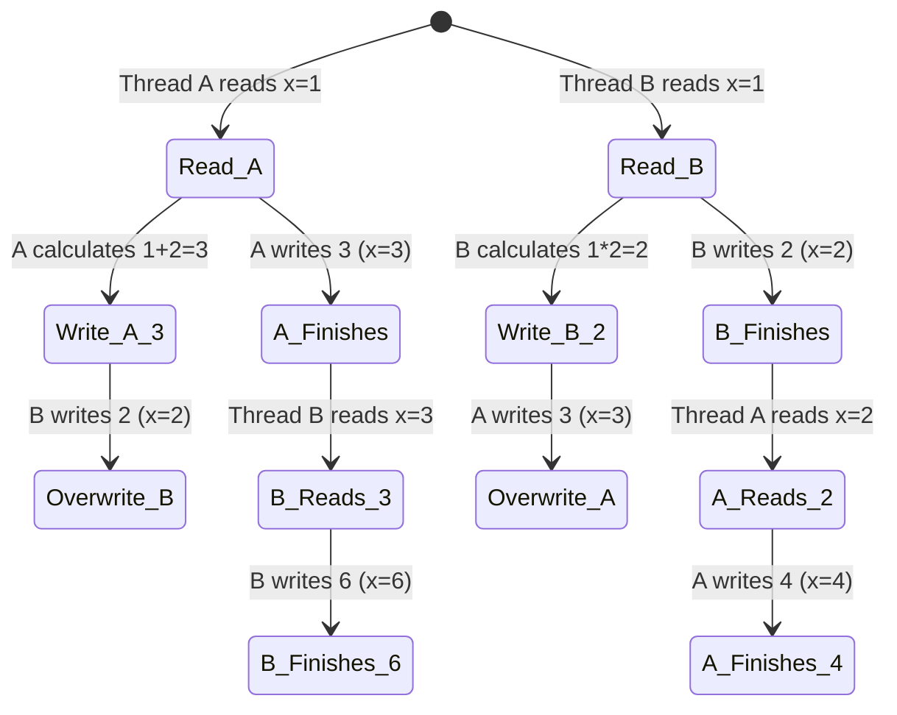
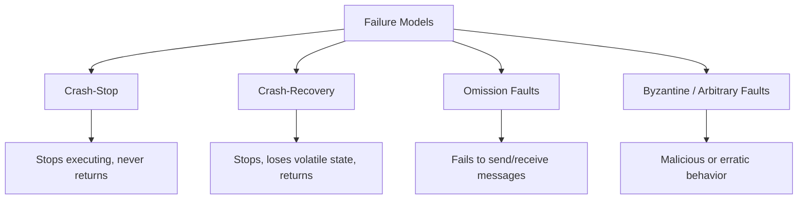

# Chapter 8: Introduction and Overview (Distributed Systems)
> A foundational exploration of concurrent execution, distributed fallacies, communication abstractions, failure models, time, and system synchrony in distributed architectures.

## Table of Contents
1. [Chapter Overview](#chapter-overview)
2. [Concurrent Execution & Shared State](#concurrent-execution--shared-state)
3. [Fallacies of Distributed Computing](#fallacies-of-distributed-computing)
4. [Processing, Queues & Backpressure](#processing-queues--backpressure)
5. [Clocks, Time & State Consistency](#clocks-time--state-consistency)
6. [Network Partitions & Cascading Failures](#network-partitions--cascading-failures)
7. [Distributed Systems Abstractions: Links](#distributed-systems-abstractions-links)
8. [The Two Generals' Problem](#the-two-generals-problem)
9. [FLP Impossibility Problem](#flp-impossibility-problem)
10. [System Synchrony Models](#system-synchrony-models)
11. [Failure Models](#failure-models)
12. [Clocks in Distributed Systems](#clocks-in-distributed-systems)
13. [Distributed System Theorems (CAP, PACELC, Harvest & Yield)](#distributed-system-theorems)
14. [Worked Examples & Code Implementations](#worked-examples--code-implementations)
15. [Design Patterns & Best Practices](#design-patterns--best-practices)
16. [Trade-offs & Decision Framework](#trade-offs--decision-framework)
17. [Interview & System Design Angles](#interview--system-design-angles)
18. [AI/ML Engineering Relevance](#aiml-engineering-relevance)
19. [Key Takeaways](#key-takeaways)
20. [Glossary](#glossary)

## Chapter Overview
Distributed systems represent a profound shift from single-node systems, primarily because they introduce concurrency, network unreliability, and independent failure domains. In a single-threaded program, execution history is linear and predictable. In a distributed environment, processes share state over unreliable networks, lack a perfectly synchronized global clock, and execute at unpredictable speeds.

This chapter lays the theoretical groundwork necessary to reason about distributed databases. It transitions from local concurrency issues to network-wide phenomena, analyzing the fallacies engineers often succumb to when assuming networks are reliable and fast. We explore essential abstractions like links and failure models, discuss foundational impossibilities like the Two Generals' Problem and the FLP Impossibility theorem, and bridge into practical models of system synchrony. Furthermore, this analysis extends into core distributed systems theorems (CAP, PACELC) and logical time (Lamport, Vector Clocks, HLCs) to complete the picture. 

Understanding these concepts is mandatory for designing, debugging, and scaling modern distributed data stores (e.g., Cassandra, Spanner, CockroachDB).

## Concurrent Execution & Shared State
### Core Concept
Even within a single node, concurrent threads accessing shared variables lead to unpredictable outcomes unless synchronized. A distributed system amplifies this by replacing shared memory with message passing over unreliable networks.

When two sequences of steps execute **concurrently**, they are in progress simultaneously but only one executes at a given moment (interleaving). When they execute in **parallel**, steps run simultaneously on multiple processors. 

### How It Works
Consider a shared variable `x = 1`. Thread A executes `x += 2`, and Thread B executes `x *= 2`. The possible outcomes depending on interleaving are:
- `x = 2`: Both read 1, B writes 2, A writes 3, A is overwritten. (Or A writes 3, B writes 2).
- `x = 3`: Both read 1, A writes 3, B writes 2, B is overwritten. 
- `x = 4`: B executes entirely (`x=2`), then A executes entirely (`x=4`).
- `x = 6`: A executes entirely (`x=3`), then B executes entirely (`x=6`).

### Diagram


### Transition to Distributed State
To solve shared state across nodes, we might introduce a single database. However, this replaces memory synchronization with **message passing**. If a process queries the DB and receives no response, it faces ambiguity: Is the DB overloaded? Did the network drop the packet? Did the DB crash? To handle this, we need **consistency models** to restrict execution histories and **failure models** to define how systems break.

## Fallacies of Distributed Computing
Peter Deutsch (1994) outlined assertions about distributed computing that are easy to overlook. Assuming the ideal case leads to catastrophic systemic failures when reality asserts itself.

### The Fallacies
1. **The network is reliable:** Links break, packets drop, connections drop. A successful initial connection guarantees nothing about the next packet.
2. **Latency is zero:** Data moves through software layers and physical cables. Remote calls are orders of magnitude slower than local calls. 
3. **Bandwidth is infinite:** Scaling up message size or cluster size eventually exhausts network capacity, leading to packet drops.
4. **The network is secure:** Adversaries exist; encryption and authentication are mandatory.
5. **Topology doesn't change:** Nodes join, leave, fail, and get replaced dynamically.
6. **There is one administrator:** Multi-tenant environments and federated systems lack a single locus of control.
7. **Transport cost is zero:** Serialization, deserialization, and network traversal consume CPU and RAM.
8. **The network is homogeneous:** Nodes run different OS versions, have different hardware, and process at different speeds.

> **Real-World Impact**: Hiding remote execution behind an API that looks local (e.g., ORMs, transparent RPCs) abstracts away the latency and failure modes, leading to developers interleaving local and blocking remote calls and destroying performance.

## Processing, Queues & Backpressure
### Core Concept
Local processing isn't instantaneous. Messages arrive at a node and sit in a queue before being processed. If producers outpace consumers, queues fill up, increasing latency without increasing throughput.

### How It Works
Queues serve three purposes:
1. **Decoupling:** Separation of receipt and processing.
2. **Pipelining:** Independent subsystems process different stages.
3. **Absorbing bursts:** Hiding inter-arrival variance from the processing logic.

However, infinitely large queues degrade system health. Messages sit in queues while the caller's timeout expires. The caller retries, adding duplicate messages to the queue, creating a death spiral.

### The Solution: Backpressure
Backpressure is a strategy to slow down producers when consumers are overwhelmed. Instead of accepting requests into an unbound queue, the consumer returns a fast-failure (e.g., HTTP 429 Too Many Requests) or restricts the TCP window size.

## Clocks, Time & State Consistency
### Core Concept
In distributed systems, time is an illusion. You cannot assume clocks on remote machines are synchronized. 

### Why Physical Time is Dangerous
- **Clock Drift:** Quartz oscillators tick at slightly different rates due to temperature and manufacturing differences.
- **NTP Limitations:** Network Time Protocol syncs clocks, but network latency jitter means synchronization is always an approximation (often off by milliseconds).
- **Time moving backwards:** If a clock is fast, NTP might step it backwards, causing negative durations or sequence inversions if relying on POSIX timestamps.

### State Consistency
Assuming strong state consistency everywhere leads to subtle bugs. For example, in Apache Cassandra, if node schemas are out of sync due to propagation delays, reading data can lead to corruption because one node encodes with Schema A and another decodes with Schema B. Divergent cluster views (ring state) can result in data misplacement.

## Network Partitions & Cascading Failures
### Core Concept
A **network partition** occurs when two or more servers cannot communicate, yet continue to operate independently. 

### Cascading Failures
A failure in one node shifts load to surviving nodes. If they cannot handle the increased load, they crash, shifting even more load to the remaining nodes until the entire cluster fails.
- **Example:** A node recovers and peers rush to stream missing data to it, exhausting network resources and immediately crashing the recovering node again.

### Mitigation Strategies
1. **Circuit Breakers:** Monitor failures; upon crossing a threshold, fail fast without attempting the remote call, giving the downstream service time to recover.
2. **Backoff:** Wait before retrying (e.g., exponential backoff) to reduce load.
3. **Jitter:** Add randomness to backoff times to prevent the "thundering herd" problem where all clients retry simultaneously.
4. **Validation:** Checksums to prevent silent data corruption from propagating.

## Distributed Systems Abstractions: Links
Network unreliability requires us to build robust abstractions over imperfect channels.

### 1. Fair-Loss Link
- **Properties:** 
  - **Fair loss:** If the sender retransmits infinitely, the message is eventually delivered.
  - **Finite duplication:** Messages aren't delivered infinitely many times.
  - **No creation:** Unsent messages are never delivered.
- **Analogy:** Raw UDP.

### 2. Stubborn Link
- **Properties:** The sender sets a timeout and retries indefinitely. Ensures the message is not irrecoverably lost, but causes duplicate deliveries.
- **Requirement:** Receiver operations must be **idempotent** (yielding the same result upon multiple applications, like `x = 5`), or the receiver must deduplicate.

### 3. Perfect Link
- **Properties:**
  - **Reliable delivery:** Sent once, delivered eventually.
  - **No duplication:** Delivered exactly once.
  - **No creation:** Only sent messages are delivered.
- **Implementation:** Uses sequence numbers (`n_consecutive`, `max_seen`) and acknowledgements (ACKs) to reorder and deduplicate messages.
- **Analogy:** TCP (within the context of a single session).

### The Myth of Exactly-Once Delivery
"Exactly-once delivery" is physically impossible over an unreliable network because the sender cannot know if the receiver crashed before processing, during processing, or after processing but before sending the ACK. Real systems use **at-least-once delivery** over the network coupled with **exactly-once processing** (idempotency/deduplication) at the application layer.

## The Two Generals' Problem
### Core Concept
A thought experiment proving that **deterministic agreement is impossible over an asynchronous, unreliable link**.

### Scenario
Two generals (A and B) must attack a city simultaneously to win. They communicate via messengers who must cross enemy territory (unreliable link).
1. Gen A sends: "Attack at dawn."
2. Gen B receives it, sends ACK.
3. Gen A receives ACK. But Gen B doesn't know A got the ACK. If A didn't get it, A won't attack.
4. Gen A sends ACK to the ACK. 
5. This requires infinite ACKs. The generals are always one ACK away from certainty.

### Conclusion
In the presence of link failures, no protocol can guarantee consensus with 100% certainty in bounded time.

## FLP Impossibility Problem
### Core Concept
Fisher, Lynch, and Paterson (1985) proved that in a purely asynchronous system, no consensus protocol can guarantee termination if even a single process might crash.

### Required Properties for Consensus
1. **Agreement:** All non-faulty processes decide on the same value.
2. **Validity:** The decided value was proposed by a participant (no default fallbacks).
3. **Termination:** Every non-faulty process eventually decides.

### The Proof Idea
In an asynchronous system, there is no upper bound on message latency or processing time. Therefore, it is impossible to distinguish between a crashed process and a very slow process. Because the protocol must wait for the slow process (to maintain agreement), but cannot wait forever (to maintain termination), it cannot guarantee consensus.

### Real-World Resolution
We circumvent FLP by introducing **timing assumptions** (synchrony) or accepting probabilistic termination (e.g., randomized backoffs in Raft/Paxos).

## System Synchrony Models
To solve FLP in practice, we refine our assumptions about time.

| Model | Processing Speed | Message Delay | Clock Drift | Solvability of Consensus |
|---|---|---|---|---|
| **Asynchronous** | Unbounded | Unbounded | Unbounded | Impossible (FLP) |
| **Synchronous** | Known bounds | Known bounds | Known bounds | Solvable |
| **Partially Synchronous** | Bounded *eventually* | Bounded *eventually* | Bounded *eventually* | Solvable in practice |

Real systems operate in a **partially synchronous** model: they behave synchronously most of the time, but undergo periods of asynchrony (network partitions, GC pauses). Algorithms like Raft use timeouts for leader election, risking multiple leaders during asynchronous periods but resolving back to one when synchrony returns.

## Failure Models
Algorithms are designed against specific models of how processes fail.

### Diagram


1. **Crash-Stop:** A process halts and never returns. Simplest model to build against.
2. **Crash-Recovery:** A process halts, loses in-memory state, and later recovers using persistent storage (WAL). Algorithms must handle processes resuming with stale state.
3. **Omission Faults:** A process skips steps or messages are dropped. Captures network partitions and GC pauses.
4. **Arbitrary / Byzantine Faults:** A process continues executing but sends incorrect, contradictory, or malicious messages. Requires Byzantine Fault Tolerance (BFT), commonly used in aerospace and blockchains (cryptocurrencies), but rarely in internal corporate data centers where nodes are trusted.

## Clocks in Distributed Systems
Since physical clocks drift, distributed databases rely on logical time to determine event ordering (causality).

### 1. Logical Clocks (Lamport Timestamps)
Developed by Leslie Lamport. A simple integer counter maintained by each node.
- **Rule 1:** Node increments its counter before local event.
- **Rule 2:** Node attaches its counter to outgoing messages.
- **Rule 3:** Upon receiving a message, node sets its counter to `max(local_counter, message_counter) + 1`.
- **Property:** If A -> B (A causes B), then `L(A) < L(B)`. However, `L(A) < L(B)` does *not* imply A caused B (cannot detect concurrent events).

### 2. Vector Clocks
Solves Lamport's limitation by tracking causality perfectly. Uses an array of counters, one for each node.
- **Mechanism:** `[A:2, B:1, C:0]`. When Node A sends to B, it includes the vector. B takes the element-wise maximum.
- **Property:** If `V(A) < V(B)` strictly, A caused B. If vectors are divergent (e.g., `[2, 1]` vs `[1, 2]`), events are concurrent.
- **Usage:** Amazon Dynamo, Riak for detecting write conflicts and creating siblings.

### 3. Hybrid Logical Clocks (HLC)
Combines physical timestamps with logical counters to provide causality while remaining queryable by humans.
- **Mechanism:** Tuple of `(Physical Time, Logical Counter)`. If physical time advances, reset counter to 0. If events happen in the same physical millisecond, increment the logical counter.
- **Usage:** CockroachDB, MongoDB.

## Distributed System Theorems
While not explicitly deeply detailed in the base text, the implications of state consistency, synchrony, and partitions natively lead to the following fundamental theorems.

### CAP Theorem
Formulated by Eric Brewer. In the presence of a Network Partition (P), a distributed system must choose between:
- **Consistency (C):** Every read receives the most recent write or an error (Linearizability).
- **Availability (A):** Every request receives a non-error response, without guarantee it contains the most recent write.

*Note: You do not choose 2 out of 3. P is a fact of nature. You choose between CP and AP when P happens.*

### PACELC Theorem
Extension of CAP by Daniel Abadi. 
**If there is a Partition (P), how does the system trade off Availability and Consistency (A and C); Else (E) when running normally, how does it trade off Latency (L) and Consistency (C)?**
- Cassandra: PA/EL (AP under partition, trades consistency for lower latency normally).
- Spanner/CockroachDB: PC/EC (CP under partition, prioritizes consistency over latency normally).

### Harvest and Yield
A practical extension to CAP for complex queries:
- **Yield:** The probability of completing a request (Availability).
- **Harvest:** The completeness of the result (e.g., searching an index where 1 out of 100 shards is down returns 99% of results). Systems can degrade Harvest to maintain Yield.

---

## Worked Examples & Code Implementations

### Example 1: Vector Clock Causality Tracking & Conflict Detection

Demonstrates tracking causality across communicating distributed nodes using vector clocks and detecting whether events are strictly causally ordered ($E_1 \prec E_2$) or concurrent ($E_1 \parallel E_2$, requiring application conflict resolution).

```python
class VectorClock:
    def __init__(self, node_id: str, all_nodes: list[str]):
        self.node_id = node_id
        self.clock = {n: 0 for n in all_nodes}

    def tick(self) -> dict:
        self.clock[self.node_id] += 1
        return dict(self.clock)

    def send_event(self) -> dict:
        self.clock[self.node_id] += 1
        return dict(self.clock)

    def receive_event(self, incoming_clock: dict) -> dict:
        for n, count in incoming_clock.items():
            self.clock[n] = max(self.clock.get(n, 0), count)
        self.clock[self.node_id] += 1
        return dict(self.clock)

    @staticmethod
    def compare(vc1: dict, vc2: dict) -> str:
        le = all(vc1[k] <= vc2[k] for k in vc1)
        ge = all(vc1[k] >= vc2[k] for k in vc1)
        if le and not ge:
            return "HAPPENED_BEFORE (E1 -> E2)"
        elif ge and not le:
            return "HAPPENED_AFTER  (E2 -> E1)"
        elif vc1 == vc2:
            return "IDENTICAL"
        else:
            return "CONCURRENT (Conflict Detected!)"

nodes = ["A", "B", "C"]
vA = VectorClock("A", nodes)
vB = VectorClock("B", nodes)
vC = VectorClock("C", nodes)

# Event 1: Node A performs local update
e1 = vA.tick()
# Event 2: Node A sends message to B, B receives
msg_A_to_B = vA.send_event()
e2 = vB.receive_event(msg_A_to_B)
# Event 3: Node C performs concurrent independent update
e3 = vC.tick()

print("=== Vector Clock Causality Tracking ===")
print(f"Event 1 (Node A) Clock: {e1}")
print(f"Event 2 (Node B) Clock: {e2}")
print(f"Event 3 (Node C) Clock: {e3}")
print(f"Relation (Event 1 vs Event 2): {VectorClock.compare(e1, e2)}")
print(f"Relation (Event 2 vs Event 3): {VectorClock.compare(e2, e3)}")
```

#### Execution Output
```text
=== Vector Clock Causality Tracking ===
Event 1 (Node A) Clock: {'A': 1, 'B': 0, 'C': 0}
Event 2 (Node B) Clock: {'A': 2, 'B': 1, 'C': 0}
Event 3 (Node C) Clock: {'A': 0, 'B': 0, 'C': 1}
Relation (Event 1 vs Event 2): HAPPENED_BEFORE (E1 -> E2)
Relation (Event 2 vs Event 3): CONCURRENT (Conflict Detected!)
```

---

### Example 2: Exponential Backoff with Full Jitter vs. No Jitter

Demonstrates how full randomized jitter flattens load spikes during service outages, preventing thundering herds from overwhelming recovered database servers.

```python
import random

def simulate_retries(num_clients=50, base_delay=1.0, max_delay=16.0, attempt=3):
    no_jitter_times = []
    full_jitter_times = []

    for _ in range(num_clients):
        exp_delay = min(max_delay, base_delay * (2 ** attempt))  # 8.0s
        no_jitter_times.append(round(exp_delay, 2))
        full_jitter_times.append(round(random.uniform(0, exp_delay), 2))

    def bucket_distribution(times):
        buckets = {}
        for t in times:
            b = int(t)
            buckets[b] = buckets.get(b, 0) + 1
        return dict(sorted(buckets.items()))

    return bucket_distribution(no_jitter_times), bucket_distribution(full_jitter_times)

dist_no_jitter, dist_full_jitter = simulate_retries()

print("=== Exponential Backoff with Full Jitter (50 Clients) ===")
print(f"No Jitter (Thundering Herd Peak) : {dist_no_jitter}  <-- All 50 clients hit server at second 8!")
print(f"Full Jitter (Smooth Distribution): {dist_full_jitter}")
```

#### Execution Output
```text
=== Exponential Backoff with Full Jitter (50 Clients) ===
No Jitter (Thundering Herd Peak) : {8: 50}  <-- All 50 clients hit server at second 8!
Full Jitter (Smooth Distribution): {0: 9, 1: 5, 2: 11, 3: 4, 4: 7, 5: 3, 6: 7, 7: 4}
```

---

### Example 3: Circuit Breaker State Machine

Demonstrates a resilient circuit breaker implementation with `CLOSED`, `OPEN`, and `HALF_OPEN` states, enforcing fail-fast request shedding to protect struggling downstream nodes.

```python
import time

class CircuitBreaker:
    CLOSED = "CLOSED"
    OPEN = "OPEN"
    HALF_OPEN = "HALF_OPEN"

    def __init__(self, failure_threshold=3, cooldown_seconds=1):
        self.state = self.CLOSED
        self.failure_threshold = failure_threshold
        self.cooldown = cooldown_seconds
        self.failure_count = 0
        self.last_failure_time = 0

    def record_success(self):
        self.failure_count = 0
        self.state = self.CLOSED

    def record_failure(self):
        self.failure_count += 1
        self.last_failure_time = time.time()
        if self.failure_count >= self.failure_threshold:
            self.state = self.OPEN

    def allow_request(self) -> bool:
        if self.state == self.CLOSED:
            return True
        elif self.state == self.OPEN:
            if (time.time() - self.last_failure_time) > self.cooldown:
                self.state = self.HALF_OPEN
                return True  # Allow trial probe
            return False  # Fail-fast
        elif self.state == self.HALF_OPEN:
            return True

cb = CircuitBreaker(failure_threshold=3, cooldown_seconds=1)

print("=== Circuit Breaker State Transitions ===")
print(f"Initial State: {cb.state}")
for i in range(3):
    cb.record_failure()
    print(f"Recorded Failure #{i+1} -> Fail Count: {cb.failure_count}, State: {cb.state}")

print(f"Request immediately after tripping: Allowed = {cb.allow_request()} (Fail-Fast protected!)")
time.sleep(1.1)
print(f"Request after cooldown: Allowed = {cb.allow_request()}, New State = {cb.state} (Trial probe)")
cb.record_success()
print(f"Probe succeeded -> Circuit Reset to State = {cb.state}")
```

#### Execution Output
```text
=== Circuit Breaker State Transitions ===
Initial State: CLOSED
Recorded Failure #1 -> Fail Count: 1, State: CLOSED
Recorded Failure #2 -> Fail Count: 2, State: CLOSED
Recorded Failure #3 -> Fail Count: 3, State: OPEN
Request immediately after tripping: Allowed = False (Fail-Fast protected!)
Request after cooldown: Allowed = True, New State = HALF_OPEN (Trial probe)
Probe succeeded -> Circuit Reset to State = CLOSED
```

---

## Design Patterns & Best Practices
1. **Assume Failure:** Use Chaos Engineering (e.g., Chaos Monkey, Toxiproxy) to simulate bit rot, packet loss, and node death.
2. **Design for Idempotency:** Assign unique sequence IDs to all mutating client requests. Databases should deduplicate writes to simulate exactly-once semantics.
3. **Defend with Backoff & Jitter:** Prevent thundering herds and cascading failures using exponential backoff with randomized jitter on client retries.
4. **Isolate with Circuit Breakers:** Wrap remote calls in circuit breakers to fail-fast when the downstream service degrades, preventing thread pool exhaustion on the caller.
5. **Acknowledge Time as Loose:** Never use strict `time.now()` equality to order distributed events. Use HLCs or Vector clocks for causality.

## Trade-offs & Decision Framework
| Scenario | Problem | Design Decision | Trade-off |
|---|---|---|---|
| Link Failure | Packet drop / Crash | Implement Stubborn Link (Retries) | Introduces duplicates; requires Idempotency. |
| Overloaded DB | Queues filling up | Backpressure / Circuit Breaker | Reduces Yield/Availability for upstream, protects system integrity. |
| Bounded Time vs Accuracy | FLP Impossibility | Add Timeouts (Partial Synchrony) | System might elect multiple leaders or pause temporarily during network blips. |
| Trust Model | Malicious Nodes | Byzantine Fault Tolerance | Heavy performance penalty (requires multi-round cryptographic voting). |

## Interview & System Design Angles
- **"How do you ensure exactly-once processing?"** Mention at-least-once network delivery + idempotency keys stored in the database.
- **"What happens if a node is slow vs dead?"** FLP Impossibility. Explain how heartbeat timeouts are used in practice (e.g., Raft leader election) and the risk of false positives.
- **"How do you prevent retries from killing your database?"** Exponential backoff and Jitter.
- **"Why not just use NTP for ordering transactions?"** Clock drift and time leaps. Mention Spanner's TrueTime (bounded uncertainty) or Hybrid Logical Clocks.

## AI/ML Engineering Relevance
- **Distributed Training:** In data-parallel training (e.g., Ring All-Reduce), an **omission fault** or slow node (straggler) stalls the entire training step because the gradient synchronization barrier acts as a synchronous system. 
- **Feature Stores:** Online feature stores (Redis, Cassandra) operate under PACELC's PA/EL model—they sacrifice strong consistency for ultra-low latency inference. Stale features are preferred over timing out an ML model prediction.
- **Vector Databases:** Distributed ANN indexes partition data across nodes. They heavily rely on **Harvest vs Yield** trade-offs. If one shard containing 2% of the vector embeddings is down, the system returns the top-K from the remaining 98% (reduced Harvest) to maintain fast response times (high Yield).

## Key Takeaways
- **Concurrency & State:** Moving from single-node to distributed replaces locks with message passing over unreliable channels.
- **Fallacies:** Networks drop packets, latency is real, and topologies shift. Build defensively.
- **Queueing limits:** Infinite queues destroy systems. Apply backpressure.
- **Links & Delivery:** TCP provides a perfect link illusion per session, but exactly-once delivery across app boundaries requires idempotent operations.
- **Impossibilities:** Two Generals proves consensus is impossible over faulty links. FLP proves consensus is impossible in purely asynchronous systems.
- **Failure Models:** Standard databases design for Crash-Recovery and Omission faults. Cryptocurrencies design for Byzantine faults.
- **Resilience Mechanisms:** Circuit breakers, retries with jitter, and continuous chaos testing are mandatory for survival.

## Glossary
- **Backpressure:** A mechanism to slow down producers when consumers are overwhelmed.
- **Byzantine Fault:** An arbitrary failure where a node may send incorrect or malicious data.
- **Circuit Breaker:** A pattern that stops network calls to a failing service to prevent cascading failures.
- **Concurrency:** Execution where multiple sequences of operations overlap in time.
- **FLP Impossibility:** Theorem stating consensus cannot be guaranteed in an asynchronous system with one crash failure.
- **Idempotence:** An operation that produces the same result no matter how many times it is executed.
- **Jitter:** Randomness added to backoff intervals to prevent synchronized retries.
- **Network Partition:** A state where nodes are divided into isolated subgroups that cannot communicate.
- **Omission Fault:** A failure where a node drops messages or fails to execute steps (e.g., due to GC pause).
