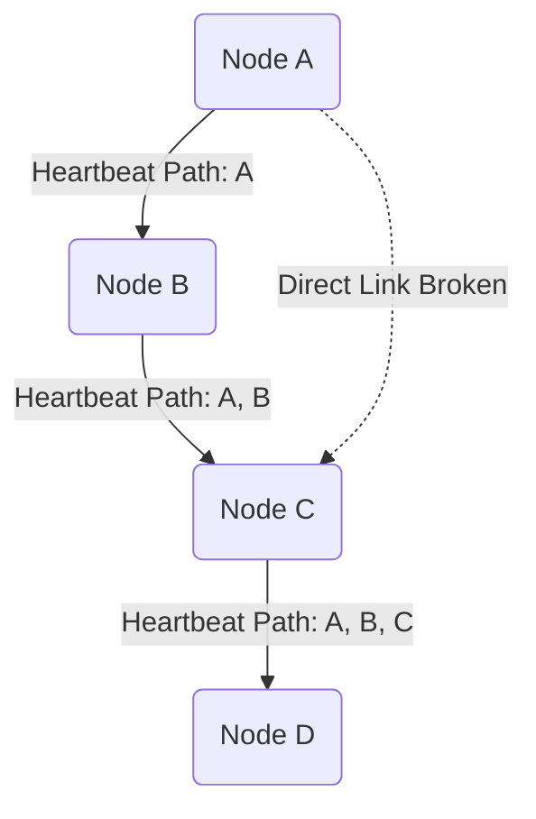
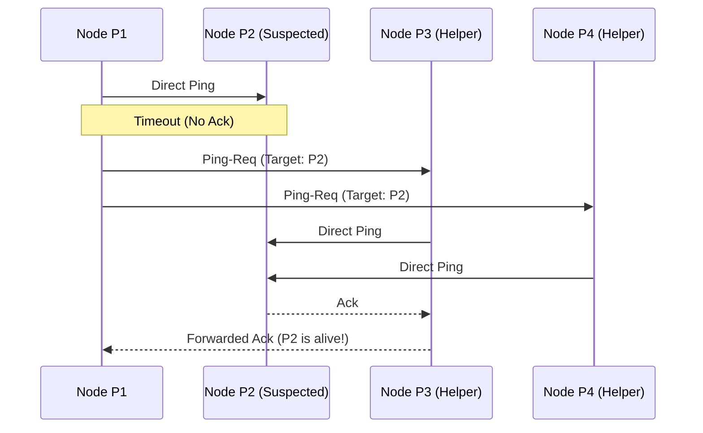

<Chapter 9: Failure Detection>
> Master the algorithms and protocols—from simple heartbeats to Phi-Accrual and SWIM—used by distributed systems to reliably distinguish between crashed and simply slow nodes without centralized coordination.

## Table of Contents
1. [Chapter Overview](#chapter-overview)
2. [Core Properties of Failure Detectors](#core-properties-of-failure-detectors)
3. [Heartbeats and Pings](#heartbeats-and-pings)
4. [Timeout-Free Failure Detectors](#timeout-free-failure-detectors)
5. [Outsourced Heartbeats (SWIM & Lifeguard)](#outsourced-heartbeats-swim--lifeguard)
6. [Phi-Accrual Failure Detector](#phi-accrual-failure-detector)
7. [Gossip and Failure Detection](#gossip-and-failure-detection)
8. [Reversing Failure Detection (FUSE)](#reversing-failure-detection-fuse)
9. [Worked Examples & Code Implementations](#worked-examples--code-implementations)
10. [Design Patterns & Best Practices](#design-patterns--best-practices)
11. [Trade-offs & Decision Framework](#trade-offs--decision-framework)
12. [Interview & System Design Angles](#interview--system-design-angles)
13. [AI/ML Engineering Relevance](#aiml-engineering-relevance)
14. [Key Takeaways](#key-takeaways)
15. [Glossary](#glossary)

## Chapter Overview
In distributed systems, detecting failures in a timely manner is essential for reacting correctly to changing cluster topologies. If a faulty process remains undetected, the system may continuously attempt to contact it, dramatically increasing latency and reducing overall availability. 

However, detecting failures in **asynchronous distributed systems** (where no assumptions can be made about message delays or execution speeds) is mathematically impossible, a concept formalized by the **FLP Impossibility** theorem. We cannot definitively distinguish between a process that has crashed completely and a process that is just running very slowly or experiencing network delays. 

Thus, a **Failure Detector** is a local subsystem responsible for identifying unreachable or failed processes, allowing the broader system to exclude them, guarantee liveness, and continue making progress. All real-world failure detectors exist on a continuum, making a necessary trade-off between **efficiency** (how fast they detect failures) and **accuracy** (how often they are correct).

---

## Core Properties of Failure Detectors

Any failure-detection algorithm is evaluated against two fundamental properties:

### 1. Completeness (Liveness)
Every non-faulty member must *eventually* notice a process failure. This ensures the algorithm can make progress and reach its final result. A failure detector that misses a crash violates completeness.

### 2. Accuracy (Safety)
The process failure must be precisely detected without false accusations. If an algorithm falsely accuses a live, healthy process of being dead (a false-positive), it lacks accuracy. 

> [!IMPORTANT]
> **The Efficiency-Accuracy Trade-off**
> It is provably impossible to build a failure detector that is both perfectly accurate and highly efficient in an asynchronous system. A highly efficient algorithm (fast detection) will inevitably produce false-positives (low accuracy). A highly accurate algorithm will take a long time to confirm a failure (low efficiency).
> 
> Most modern consensus and atomic broadcast algorithms accept that failure detectors will produce false-positives (Unreliable Failure Detectors) but use them to guarantee liveness while the consensus protocol itself guarantees safety.

---

## Heartbeats and Pings

The simplest way to monitor remote processes is by triggering periodic messages.

### How It Works
- **Ping:** Node A sends a message to Node B, expecting a response within a specified timeout. 
- **Heartbeat:** Node B actively and periodically sends messages to Node A to announce "I am still alive."

Each process maintains a local list of other processes (alive, suspected, dead) and the timestamp of their last response. If the timeout threshold is breached, the process is marked as suspected or dead. 

### Limitations (Deadline Failure Detectors)
Used by frameworks like **Akka**, Deadline Failure Detectors rely on strict timeouts. This approach is brittle:
- Relies heavily on the careful selection of ping frequency and timeout thresholds.
- Fails to account for local network degradation (e.g., if Node A's network interface is slow, it will assume *all* other nodes are dead, rather than realizing it is the one isolated).
- Does not capture the visibility of the suspected process from the perspective of the rest of the cluster.

---

## Timeout-Free Failure Detectors

To avoid the brittleness of timeouts in asynchronous environments, timeout-free detectors (like the **Heartbeat algorithm** by Aguilera et al.) rely purely on counting and routing paths.

### How It Works
1. Processes send heartbeat messages to their neighbors.
2. The message appends the path it has traveled (e.g., `P1 -> P2 -> P3`).
3. When a node receives a heartbeat, it increments the local counters for *all* participants present in the message's path.
4. It forwards the message to nodes not yet in the path.
5. Propagation stops when all known process IDs appear in the path.

Because the paths aggregate information from multiple neighbors, Node A can successfully determine that Node C is alive even if the direct link between A and C is broken.

### Diagram: Timeout-Free Propagation

*Even with a broken direct link, Node A's heartbeat reaches Node C, proving A is alive via the B -> C path.*

---

## Outsourced Heartbeats (SWIM & Lifeguard)

The **SWIM (Scalable Weakly-consistent Infection-style Process Group Membership)** protocol avoids global broadcasts and instead utilizes randomized, peer-to-peer "outsourced" heartbeats to detect failures reliably and scale linearly.

### How SWIM Works
1. **Direct Ping:** Process `P1` sends a ping to a random peer, `P2`.
2. **Timeout & Suspect:** If `P2` does not respond within the timeout, `P1` does not immediately mark it dead.
3. **Outsourced Ping:** `P1` selects $k$ random members (e.g., `P3`, `P4`) and sends a `ping-req(P2)` to them.
4. **Indirect Check:** `P3` and `P4` send their own direct pings to `P2`. If `P2` responds to any of them, they forward the ack to `P1`. 
5. **Resolution:** If the indirect pings also fail, `P2` is marked dead.

### Diagram: SWIM Protocol Operation


### Lifeguard Improvements
Standard SWIM can still suffer from false positives if `P1` itself is experiencing local network degradation (making it think everyone else is failing). **Lifeguard** adds local-health awareness:
- **Local Health Multiplier (LHM):** If `P1` notices many of its pings are failing, it decreases its own "health" score and drastically increases its timeouts before suspecting others.
- **Local Health Aware Suspicion (LHAS):** Ensures nodes don't easily declare others dead if they themselves are unhealthy.

---

## Phi-Accrual Failure Detector

Instead of a binary "Up/Down" state, the **$\varphi$-Accrual Failure Detector** (used by **Cassandra** and **Akka**) outputs a continuous probability scale indicating the likelihood that a node has crashed. 

### How It Works
1. **Monitoring:** A node records the arrival times of heartbeats from a peer in a fixed-size sliding window.
2. **Distribution Estimation:** It computes the mean and variance of the inter-arrival times, assuming they follow a normal distribution.
3. **Phi Calculation:** When a heartbeat is late, it calculates $\varphi$ (suspicion level) based on the probability $P_{later}(t)$ that a heartbeat will arrive more than $t$ time units after the previous one.
   $$ \varphi(t) = -\log_{10}(P_{later}(t)) $$
4. **Action:** If $\varphi$ crosses a configured threshold (e.g., $\varphi = 8$, meaning there is a 1 in $10^8$ chance the node is still alive but delayed), the node is marked dead.

### Real-World Usage
This is highly resilient to network jitter. If a cluster experiences heavy GC pauses or network latency spikes, the standard deviation of inter-arrival times widens, and the $\varphi$ threshold naturally becomes more forgiving, preventing cascading false-positives.

---

## Gossip and Failure Detection

**Gossip-based Failure Detection** distributes the state of the cluster epidemically, without any single point of failure or centralized coordinator.

### How It Works
1. Each node maintains a heartbeat table (Node ID, Heartbeat Counter, Local Timestamp).
2. Periodically, a node increments its own heartbeat counter.
3. It picks a random neighbor and sends its entire table.
4. The receiver merges the tables, taking the maximum heartbeat counter for each node, and updates its local timestamp.
5. If a node's heartbeat counter has not been updated in the local table for $T$ seconds, it is considered failed.

### Advantage
It provides a highly robust, aggregate view of the cluster. If `P3` and `P1` are partitioned, `P3`'s updates can still reach `P1` via `P2`'s gossip. The worst-case bandwidth grows linearly with the number of processes.

---

## Reversing Failure Detection (FUSE)

What if network partitions make propagating failure information impossible or too expensive? **FUSE (Failure Notification Service)** reverses the paradigm.

### How It Works
1. Nodes are organized into groups.
2. They periodically ping each other.
3. If Node `P2` crashes and stops responding to Node `P4`, `P4` will intentionally **stop responding to all pings** from anyone else.
4. This causes the failure to cascade intentionally. A single node failure is explicitly converted into a **group failure**.

### Use Case
This is used in systems where partial failures are unacceptable, and it is safer to declare an entire group/partition as dead rather than allowing subset operations to continue. It uses *quiescence* (absence of communication) as the very means of propagation.

---

## Worked Examples & Code Implementations

### Example 1: $\varphi$-Accrual Failure Detector Implementation

Demonstrates Hayashibara's $\varphi$-Accrual Failure Detector (as used in Apache Cassandra and Akka). Uses a sliding window of heartbeat intervals and normal distribution CDF to calculate a continuous suspicion metric: $\varphi = -\log_{10}(P_{later}(t))$.

```python
import math

class PhiAccrualDetector:
    def __init__(self, window_size=10, phi_threshold=8.0):
        self.window_size = window_size
        self.phi_threshold = phi_threshold
        self.intervals = []
        self.last_heartbeat = None

    def heartbeat(self, current_time: float):
        if self.last_heartbeat is not None:
            interval = current_time - self.last_heartbeat
            self.intervals.append(interval)
            if len(self.intervals) > self.window_size:
                self.intervals.pop(0)
        self.last_heartbeat = current_time

    def compute_phi(self, current_time: float) -> float:
        if not self.intervals or self.last_heartbeat is None:
            return 0.0

        mean = sum(self.intervals) / len(self.intervals)
        variance = sum((x - mean) ** 2 for x in self.intervals) / len(self.intervals)
        std_dev = math.sqrt(variance) if variance > 1e-4 else 0.020  # Floor std dev at 20ms

        t = current_time - self.last_heartbeat
        z = (t - mean) / std_dev
        p_later = 0.5 * math.erfc(z / math.sqrt(2))
        
        p_later = max(1e-15, min(1.0, p_later))
        phi = -math.log10(p_later)
        return phi

fd = PhiAccrualDetector(window_size=10, phi_threshold=8.0)
sim_time = 0.0

# 1. Warm-up with realistic network variance (~100ms +- 15ms)
sample_intervals = [0.095, 0.105, 0.100, 0.110, 0.090, 0.102, 0.098, 0.108, 0.092, 0.100]
for interval in sample_intervals:
    sim_time += interval
    fd.heartbeat(sim_time)

# 2. Evaluate steady state, transient jitter, and crash
phi_steady = fd.compute_phi(sim_time + 0.105)
phi_jitter = fd.compute_phi(sim_time + 0.135)
phi_crash  = fd.compute_phi(sim_time + 0.250)

print("=== φ-Accrual Failure Detector ===")
print(f"Normal Network   (105ms delay): φ = {phi_steady:.2f}  (Status: HEALTHY)")
print(f"Transient Jitter (135ms delay): φ = {phi_jitter:.2f}  (Status: SUSPICION GROWING)")
print(f"Node Crash       (250ms delay): φ = {phi_crash:.2f} (Status: {'DEAD (φ >= 8.0)' if phi_crash >= 8.0 else 'HEALTHY'})")
```

#### Execution Output
```text
=== φ-Accrual Failure Detector ===
Normal Network   (105ms delay): φ = 0.39  (Status: HEALTHY)
Transient Jitter (135ms delay): φ = 1.37  (Status: SUSPICION GROWING)
Node Crash       (250ms delay): φ = 13.40 (Status: DEAD (φ >= 8.0))
```

---

### Example 2: SWIM Protocol Indirect Probing Simulation

Demonstrates the SWIM membership protocol: when a direct ping to Node B times out, the prober requests $k=2$ random helper peers to ping Node B indirectly, preventing faulty network links from triggering false failure declarations.

```python
class SWIMNode:
    def __init__(self, node_id: str):
        self.node_id = node_id
        self.state = "ALIVE"  # ALIVE, SUSPECTED, DEAD

def probe_node_direct(target: SWIMNode, link_healthy: bool) -> bool:
    return link_healthy and target.state != "DEAD"

def swim_round(prober: str, target: SWIMNode, cluster: list[str], direct_link_ok: bool, peer_links_ok: bool):
    print(f"Node {prober} initiates direct ping to {target.node_id}...")
    if probe_node_direct(target, direct_link_ok):
        print(f"  -> Direct ping SUCCESS! Node {target.node_id} is ALIVE.")
        return "ALIVE"
    
    print(f"  -> Direct ping TIMEOUT! (Link degraded). Outsourcing to helper peers...")
    helpers = [n for n in cluster if n != prober and n != target.node_id][:2]
    
    indirect_success = False
    for helper in helpers:
        print(f"  -> Sending Ping-Req via Helper {helper}...")
        if probe_node_direct(target, peer_links_ok):
            print(f"     -> Helper {helper} reached {target.node_id} successfully!")
            indirect_success = True
            break
            
    if indirect_success:
        print(f"  => Indirect probe SUCCEEDED! Target {target.node_id} confirmed ALIVE (False positive avoided!).")
        return "ALIVE"
    else:
        print(f"  => All probes FAILED! Marking {target.node_id} as SUSPECTED.")
        target.state = "SUSPECTED"
        return "SUSPECTED"

node_B = SWIMNode("Node_B")
cluster_nodes = ["Node_A", "Node_B", "Node_C", "Node_D"]

print("=== SWIM Protocol Simulation ===")
swim_round("Node_A", node_B, cluster_nodes, direct_link_ok=False, peer_links_ok=True)
```

#### Execution Output
```text
=== SWIM Protocol Simulation ===
Node Node_A initiates direct ping to Node_B...
  -> Direct ping TIMEOUT! (Link degraded). Outsourcing to helper peers...
  -> Sending Ping-Req via Helper Node_C...
     -> Helper Node_C reached Node_B successfully!
  => Indirect probe SUCCEEDED! Target Node_B confirmed ALIVE (False positive avoided!).
```

---

### Example 3: Gossip-Based Heartbeat Counter Vector

Demonstrates how decentralized nodes exchange heartbeat counter vectors during pairwise gossip rounds to detect stalled or crashed nodes.

```python
class GossipNode:
    def __init__(self, node_id: str, cluster: list[str]):
        self.node_id = node_id
        self.heartbeat_table = {n: {"counter": 0, "local_ts": 0} for n in cluster}
        self.heartbeat_table[node_id]["counter"] = 1

    def tick_heartbeat(self, current_time: int):
        self.heartbeat_table[self.node_id]["counter"] += 1
        self.heartbeat_table[self.node_id]["local_ts"] = current_time

    def gossip_with(self, peer: "GossipNode", current_time: int):
        for n, data in peer.heartbeat_table.items():
            if data["counter"] > self.heartbeat_table[n]["counter"]:
                self.heartbeat_table[n]["counter"] = data["counter"]
                self.heartbeat_table[n]["local_ts"] = current_time

    def check_failures(self, current_time: int, threshold_secs: int = 5) -> list[str]:
        dead = []
        for n, data in self.heartbeat_table.items():
            if (current_time - data["local_ts"]) > threshold_secs:
                dead.append(n)
        return dead

nodes_list = ["N1", "N2", "N3"]
n1 = GossipNode("N1", nodes_list)
n2 = GossipNode("N2", nodes_list)
n3 = GossipNode("N3", nodes_list)

# Round 1: All nodes healthy
n1.tick_heartbeat(1)
n2.tick_heartbeat(1)
n3.tick_heartbeat(1)
n1.gossip_with(n2, 1)
n1.gossip_with(n3, 1)

print("=== Gossip Heartbeat Counter Vector ===")
print("Round 1 (All Healthy) -> N1's View:", {k: v["counter"] for k, v in n1.heartbeat_table.items()})

# Round 2: N3 crashes at t=2. N1 and N2 continue ticking until t=8
for t in range(2, 9):
    n1.tick_heartbeat(t)
    n2.tick_heartbeat(t)
    n1.gossip_with(n2, t)

dead_nodes = n1.check_failures(current_time=8, threshold_secs=5)
print(f"At Time t=8: Dead Nodes detected by N1: {dead_nodes} (N3 heartbeat stalled since t=1)")
```

#### Execution Output
```text
=== Gossip Heartbeat Counter Vector ===
Round 1 (All Healthy) -> N1's View: {'N1': 2, 'N2': 2, 'N3': 2}
At Time t=8: Dead Nodes detected by N1: ['N3'] (N3 heartbeat stalled since t=1)
```

---

## Design Patterns & Best Practices

1. **Continuous Suspicion over Binary States:** Use $\varphi$-accrual to dynamically adapt to changing network weather. Binary timeout limits are brittle in the cloud.
2. **Delegation of Suspicion:** Do not trust a single node's perspective. If Node A suspects Node B, force A to ask Node C to verify (Outsourced heartbeats / SWIM).
3. **Epidemic State Propagation:** Use Gossip for topology and membership state. It ensures eventual consistency of the cluster view even through complex network partitions.

---

## Trade-offs & Decision Framework

| Algorithm / Approach | Pros | Cons | Ideal Use Case |
|----------------------|------|------|----------------|
| **Fixed Timeout (Deadline)** | Trivial to implement. Low overhead. | High false-positive rate under network jitter. | Small, stable, low-latency intra-rack microservices. |
| **Timeout-Free (Heartbeat)** | Resilient to direct-link failures. Asynchronous safe. | Hard to interpret counters; threshold selection is tricky. | Environments with erratic link delays but stable paths. |
| **SWIM / Outsourced** | Scales to thousands of nodes. Low background bandwidth. Validates via peers. | Slightly higher latency to detect failures than direct pings. | Massive P2P networks, large distributed databases (Consul). |
| **$\varphi$-Accrual** | Adapts dynamically to GC pauses and network load. Extremely precise. | Requires maintaining distribution stats per peer. | Modern distributed DBs (Cassandra, Riak) where SLA is critical. |

---

## Interview & System Design Angles

**When asked: "How do nodes in your distributed system know if a master or peer is dead?"**
- **Bad Answer:** "They ping each other, and if it times out after 5 seconds, it's dead."
- **Good Answer:** "In a cloud environment, network jitter and GC pauses make strict timeouts dangerous, leading to false positives and cascading split-brains. I'd use a $\varphi$-Accrual failure detector, similar to Cassandra, which uses a sliding window of inter-arrival times to calculate a probabilistic suspicion level. This adapts dynamically to the current network weather."

**When designing large-scale cluster membership (e.g., Service Discovery):**
- Mention **SWIM** to demonstrate knowledge of overcoming the $O(N^2)$ network bottleneck of all-to-all heartbeats. Explain how "outsourcing" the ping via random peers prevents a single faulty network link from causing a false positive.

---

## AI/ML Engineering Relevance

- **Distributed Training (e.g., NCCL, Horovod):** Large-scale deep learning relies on Ring All-Reduce or hierarchical topologies. A single failed GPU/node hangs the entire collective operation. Fast, accurate failure detection allows the orchestrator to dynamically resize the ring and resume training without deadlocking the cluster for hours.
- **Feature Stores & Vector Databases (Milvus, Qdrant):** These databases rely on high-throughput distributed memory. They heavily utilize gossip protocols and $\varphi$-accrual to manage cluster membership of index/query nodes to ensure that similarity search queries aren't routed to dead partitions, which would otherwise ruin p99 latencies.
- **Model Serving Systems:** Inference routing gateways use outsourced health checks or sliding window anomaly detection (similar to $\varphi$-accrual) to stop sending requests to a model replica that is silently stalling due to CUDA OOMs or CPU throttling, rather than just relying on standard HTTP timeouts.

---

## Key Takeaways
- **FLP Impossibility** guarantees that you cannot definitively distinguish a crashed node from a slow one in an asynchronous system. 
- You must always trade off between **Efficiency** (speed of detection) and **Accuracy** (avoiding false positives).
- Simple **pings and timeouts** are insufficient for cloud environments due to network jitter and GC pauses.
- **SWIM** solves false positives and scaling issues by outsourcing heartbeats to random peers, confirming suspected failures indirectly.
- **$\varphi$-Accrual** failure detectors maintain a sliding window of heartbeat arrival times to compute a continuous, probabilistic suspicion level rather than a rigid binary state.
- **Gossip** protocols leverage the entire cluster to propagate failure states robustly, circumventing point-to-point network partitions.

---

## Glossary
- **Liveness:** The property guaranteeing that something good eventually happens (e.g., a failure is eventually detected).
- **Safety:** The property guaranteeing that nothing bad happens (e.g., a live node is never falsely accused of failing).
- **Completeness:** The requirement that every non-faulty node eventually detects a crashed node.
- **False-Positive:** Falsely identifying a live, functioning process as failed.
- **Quiescence:** The absence of communication; used in systems like FUSE to deliberately propagate a failure state. 
- **Byzantine Failure:** A scenario where a process intentionally lies about its state or the state of others (not covered by standard failure detectors, which assume non-malicious crashes).
