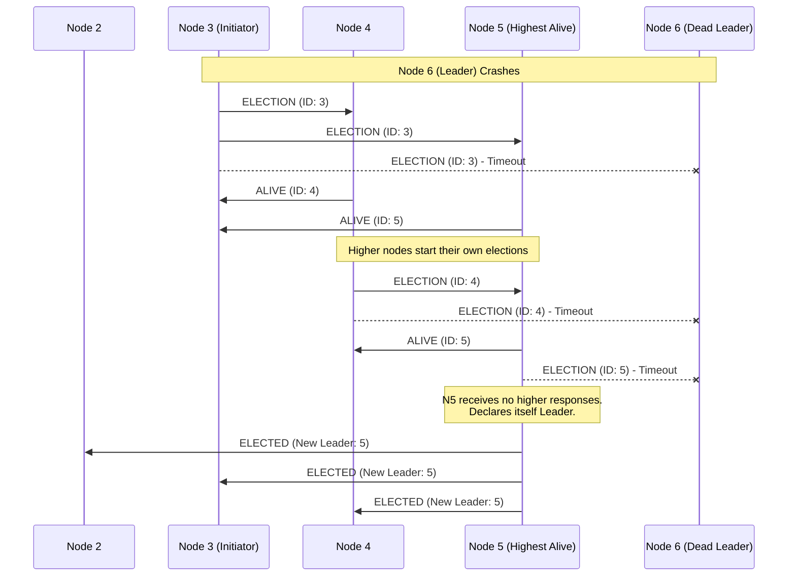
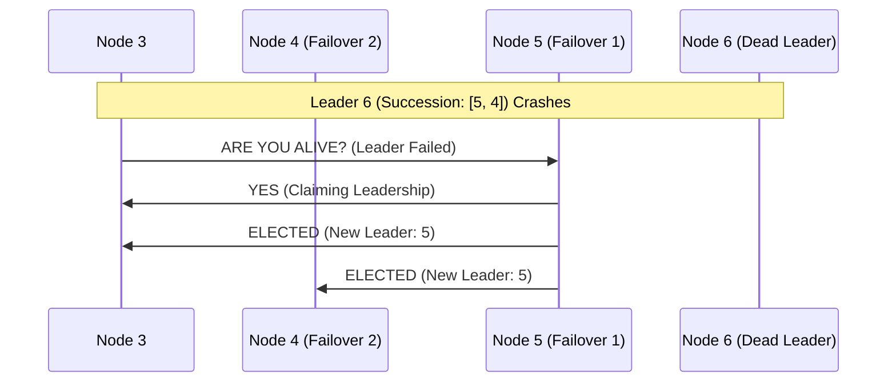
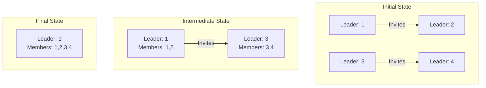
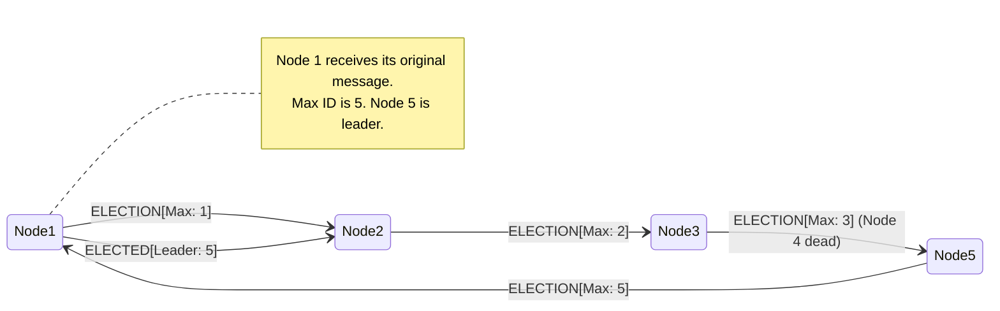
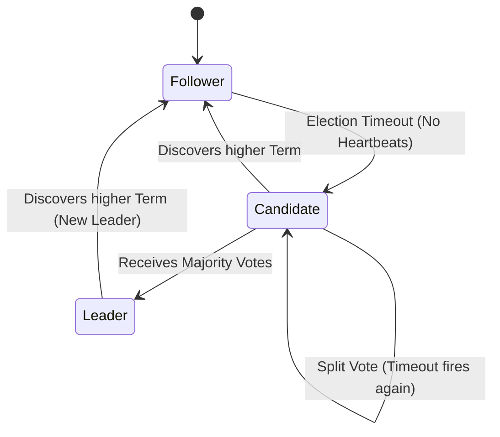

<Chapter 10: Leader Election>
> Master the algorithms, consensus protocols, and real-world mechanisms that distributed systems use to safely appoint coordinators, handle failures, and prevent split-brain scenarios.

## Table of Contents
1. [Chapter Overview](#chapter-overview)
2. [Why Leader Election?](#why-leader-election)
3. [Core Leader Election Algorithms](#core-leader-election-algorithms)
   - [Bully Algorithm (Garcia-Molina)](#bully-algorithm-garcia-molina)
   - [Next-In-Line Failover](#next-in-line-failover)
   - [Candidate/Ordinary Optimization](#candidateordinary-optimization)
   - [Invitation Algorithm](#invitation-algorithm)
   - [Ring Algorithm (Chang-Roberts)](#ring-algorithm-chang-roberts)
4. [Consensus-Based Leader Election](#consensus-based-leader-election)
   - [Raft Leader Election](#raft-leader-election)
   - [ZAB (ZooKeeper Atomic Broadcast) Election](#zab-zookeeper-atomic-broadcast-election)
5. [Managing Leader Failures and Split-Brain](#managing-leader-failures-and-split-brain)
   - [The Split-Brain Problem](#the-split-brain-problem)
   - [Fencing Tokens](#fencing-tokens)
   - [Leader Leases & Leader Stability](#leader-leases--leader-stability)
6. [Real-World Systems](#real-world-systems)
7. [Worked Examples & Code Implementations](#worked-examples--code-implementations)
8. [Design Patterns & Best Practices](#design-patterns--best-practices)
9. [Trade-offs & Decision Framework](#trade-offs--decision-framework)
10. [Interview & System Design Angles](#interview--system-design-angles)
11. [AI/ML Engineering Relevance](#aiml-engineering-relevance)
12. [Key Takeaways](#key-takeaways)
13. [Glossary](#glossary)

---

## Chapter Overview
In distributed networks, requiring full peer-to-peer synchronization for every operation is prohibitively expensive. The communication overhead scales quadratically with the number of participants, causing immense latency and network congestion. To drastically reduce this synchronization overhead and the number of round-trips required to reach decisions, distributed algorithms frequently rely on a **Leader** (or Coordinator).

A leader acts as a central authority to sequence operations, manage global state, broadcast messages, and orchestrate recovery. Because any participant is usually uniform and capable of assuming leadership, the role is dynamic. When a leader fails, the system must collectively agree on a replacement. This chapter explores both the classic deterministic topology-based algorithms (Bully, Ring) and modern consensus-driven approaches (Raft, ZAB) to safely and quickly elect leaders. We'll also examine edge cases like the "split-brain" phenomenon, and how modern systems safeguard against it using fencing tokens and leader leases.

---

## Why Leader Election?
Before diving into algorithms, it is crucial to distinguish **Leader Election** from **Distributed Locking**. 

While both involve exclusive ownership, they have distinct liveness and preference properties:
- **Distributed Locks**: Held for the short duration of a critical section. Liveness implies the lock is released quickly. It doesn't matter *who* holds the lock, only that mutual exclusion is maintained.
- **Leader Election**: Held for long durations (until crash). The leader's identity must be broadcasted and known to all peers so they can route requests to it. Stable, long-lived leaders are preferred over frequent role switching.

### Primary Responsibilities of a Leader
1. **Total Ordering**: Assigning global, monotonically increasing sequence numbers to client operations (vital for state machine replication).
2. **State Dissemination**: Acting as the hub to receive writes and broadcast updates to replicas.
3. **Reorganization**: Coordinating rebalancing, scaling, or recovery after cluster topology changes.
4. **Coordination Overhead Reduction**: Avoiding $O(N^2)$ message complexity by centralizing coordination to $O(N)$.

---

## Core Leader Election Algorithms

These traditional algorithms are simple but often lack strict safety guarantees (they can violate the "at most one leader" rule during network partitions). They prioritize liveness and simplicity.

### Bully Algorithm (Garcia-Molina)

#### Core Concept
Introduced by Hector Garcia-Molina in 1982, the Bully Algorithm relies on predefined, unique ranks (or identifiers) assigned to processes. The process with the absolute highest rank "bullies" the others into submission and claims leadership. It is also called "monarchial" election because the highest-ranked sibling automatically inherits the throne when the reigning monarch dies.

#### How It Works
1. A node $P$ detects that the current leader has failed (e.g., via a timeout).
2. $P$ sends an `ELECTION` message to all nodes with identifiers **greater** than its own.
3. If no higher-ranked node responds within a timeout, $P$ assumes it is the highest active node, elevates itself to Leader, and sends an `ELECTED` (or `COORDINATOR`) message to all lower-ranked nodes.
4. If a higher-ranked node $Q$ responds with an `ALIVE` message, $P$ aborts its election attempt and waits for $Q$ to claim leadership.
5. $Q$ then recursively starts its own election process (step 2) to ensure no nodes higher than $Q$ are alive.

#### Diagram


#### Example
A cluster has nodes [1, 2, 3, 4, 5, 6]. Node 6 is the leader. Node 6 crashes. Node 3 notices the timeout first. Node 3 pings 4, 5, and 6. 4 and 5 reply `ALIVE`. 3 steps down. 4 pings 5 and 6. 5 replies `ALIVE`. 4 steps down. 5 pings 6. No response. 5 broadcasts `ELECTED` to 1, 2, 3, 4.

#### Trade-offs
- **Pros**: Extremely simple to reason about and implement. Deterministic outcome.
- **Cons**: High message complexity ($O(N^2)$ in the worst case). Prone to the **split-brain** problem during network partitions. Highly vulnerable to **unstable nodes**: If the highest-ranked node has a flaky network connection, it will constantly crash, recover, and re-bully the cluster, leading to endless election loops and 0% availability.

### Next-In-Line Failover

#### Core Concept
An optimization over the Bully algorithm. Instead of dynamically discovering the highest-ranked active node via mass broadcast, the current leader proactively dictates a "line of succession." 

#### How It Works
The leader provides a predefined failover list of nodes ordered by rank (e.g., `[Node 5, Node 4]`).
When a node detects a leader failure, it directly contacts the highest-ranked alternative on the list. If that alternative is alive, it immediately assumes leadership without an expensive election round.

#### Diagram


#### Real-World Usage
This deterministic failover topology is often seen in Master/Standby replication configurations (e.g., PostgreSQL synchronous replication lists, or Redis Sentinel setups where priorities are hardcoded).

### Candidate/Ordinary Optimization

#### Core Concept
To further reduce message overhead, nodes are partitioned into two distinct subsets: **Candidates** (capable of being leaders) and **Ordinary** (never become leaders, only participate as followers). 

#### How It Works
1. An Ordinary node detects a leader failure.
2. It initiates the election by contacting *only* the Candidate nodes.
3. It collects responses, selects the highest-ranked active candidate, and broadcasts the result to the cluster.
4. **Tiebreaker Delay ($\delta$)**: To prevent multiple ordinary nodes from triggering simultaneous elections (message storms), each node waits a specific, highly variable delay $\delta$ before initiating. Higher priority nodes have lower $\delta$.

#### Example
Nodes 1, 2 (Ordinary). Nodes 4, 5, 6 (Candidates).
Node 6 crashes. Node 1 detects it, waits its delay $\delta_1$. Node 2 detects it, waits $\delta_2$. If $\delta_1 < \delta_2$, Node 1 acts first, pings 4 and 5. Node 5 is chosen, Node 1 announces it. Node 2 receives the announcement before its $\delta_2$ expires and cancels its election attempt.

### Invitation Algorithm

#### Core Concept
Unlike the Bully algorithm which assumes a single cluster, the Invitation algorithm embraces partitioning by default. It allows processes to "invite" other processes to join their group. This algorithm mathematically guarantees liveness by letting groups merge asynchronously.

#### How It Works
1. Every process starts as a leader of its own 1-node group.
2. Group leaders continuously ping processes outside their group, inviting them to merge.
3. If the contacted process is an ordinary member, it redirects the invitation to its current group leader.
4. Two group leaders negotiate. The leader of the *larger* group retains leadership to minimize the number of nodes that need to process a leadership change.
5. The smaller group merges into the larger group.

#### Diagram


### Ring Algorithm (Chang-Roberts)

#### Core Concept
Nodes are arranged in a logical ring topology. Each node knows its successor. Instead of broadcasting, election messages are passed sequentially around the ring.

#### How It Works
1. A node detects leader failure and creates an `ELECTION` message containing its own ID.
2. It sends the message to its successor. If the successor is down, it skips to the next available node in the ring.
3. When a node receives an `ELECTION` message, it appends its own ID to the active set inside the message (or simply updates a `MAX_ID` variable if its ID is higher) and passes it along.
4. When the message fully circulates and returns to the initiator, the initiator inspects the set (or the `MAX_ID`), identifies the highest-ranked node, and circulates an `ELECTED` message with the winner.

#### Diagram


#### Trade-offs
- **Pros**: Message complexity is bounded to $O(N)$ for a single election. No message storms.
- **Cons**: High latency. A full ring traversal takes significant time before a leader is confirmed. If the ring partitions, both halves will form separate rings, causing split-brain.

---

## Consensus-Based Leader Election

The algorithms discussed above lack **Safety** in the presence of network partitions (they allow Split-Brain). Modern distributed databases solve this using **Quorum Consensus**. A node can only become a leader if it secures votes from a strictly defined majority ($N/2 + 1$) of the cluster. Because two majorities cannot overlap, only one leader can exist per term/epoch.

### Raft Leader Election

#### Core Concept
Raft (used by etcd, Consul, CockroachDB) embeds leader election directly into its consensus protocol. It utilizes **randomized election timeouts** to naturally break ties and prevent split votes, and uses **Terms** (logical clocks) to establish strict epochs of leadership.

#### How It Works
1. **State Machine**: Nodes are in one of three states: Follower, Candidate, or Leader.
2. **Heartbeats**: The Leader suppresses elections by sending periodic heartbeats.
3. **Timeout**: If a Follower receives no heartbeat within a randomized timeout window (e.g., 150ms - 300ms), it transitions to Candidate.
4. **Election**: The Candidate increments its `Term` counter, votes for itself, and sends `RequestVote` RPCs to all peers.
5. **Voting Rules**:
   - A node only votes once per term.
   - A node only votes for a Candidate whose log is at least as up-to-date as its own.
6. **Winning**: If a Candidate receives votes from a majority of the cluster, it becomes Leader and immediately begins sending heartbeats to assert authority.
7. **Split Vote**: If multiple Candidates split the vote (none gets a majority), their random timeouts will naturally stagger their next attempts, resolving the tie.

#### Diagram


### ZAB (ZooKeeper Atomic Broadcast) Election

#### Core Concept
ZooKeeper uses an algorithm called **Fast Leader Election (FLE)**. Unlike Raft, which relies purely on random timeouts and term numbers, ZAB explicitly uses a combination of data freshness (zxid) and server IDs to deterministically select the best leader.

#### How It Works
ZooKeeper state is identified by a `zxid` (ZooKeeper Transaction ID).
1. Upon starting up or detecting leader failure, a node enters the `ELECTION` state.
2. A node proposes itself as the leader by broadcasting its vote `(zxid, myid)`.
3. Upon receiving a peer's vote, it compares the peer's vote with its own:
   - **Rule 1**: The node with the higher `zxid` wins (most up-to-date state).
   - **Rule 2**: If `zxid`s are equal, the node with the higher `myid` (server ID) wins.
4. If the peer's vote is better, the node updates its internal vote to match the peer and broadcasts this new vote to everyone.
5. Once a node sees that a **quorum** (majority) of nodes are broadcasting the exact same vote, it acknowledges that candidate as the Leader.

#### Real-World Usage
Apache ZooKeeper uses FLE to ensure that the elected leader has the most recent state of the znode tree, preventing data loss during failovers.

---

## Managing Leader Failures and Split-Brain

### The Split-Brain Problem
**Split-brain** occurs when a network partition divides the cluster into two or more subnets that cannot communicate with each other. In naive algorithms (Bully, Ring), both subnets will assume the other is dead and elect their own leaders. 

**Consequence**: Two leaders simultaneously accept writes for the same data, leading to irreconcilable data corruption and divergence.

**Solution**: Strict Majority Quorum. By requiring $N/2 + 1$ votes, only the partition containing the majority of nodes can elect a leader. The minority partition will stall, preserving safety at the cost of liveness for that specific partition.

### Fencing Tokens

Even with quorum consensus, split-brain can occur logically due to **asymmetric network delays or garbage collection (GC) pauses**.
Imagine Leader A experiences a 30-second GC pause. The cluster assumes it died, elects Leader B, and moves on. Leader A wakes up, still thinks it is the leader, and attempts to flush buffered writes to storage.

**Fencing** solves this:
1. Every time a new leader is elected, it is granted a monotonically increasing **Fencing Token** (Epoch/Term number).
2. The leader must attach this token to every write request sent to the underlying storage/replicas.
3. The storage layer keeps track of the highest token it has ever seen.
4. If "Zombie" Leader A tries to write with Token `5`, but the storage has already processed writes from Leader B with Token `6`, the storage **rejects** Leader A's write.

### Leader Leases & Leader Stability
Instead of relying purely on heartbeats and timeouts (which are susceptible to network jitter), modern systems use **Leader Leases**.

1. A leader acquires a "lease" on leadership for a fixed duration (e.g., 10 seconds).
2. It must periodically renew the lease with the cluster majority before it expires.
3. Followers guarantee they will absolutely not elect a new leader until the previous leader's lease has strictly expired.
4. This ensures **Leader Stability**, eliminating false-positive elections caused by minor network latency spikes, while providing a strict upper bound on how long the cluster will remain leaderless upon an actual crash.

---

## Real-World Systems

| Database / System | Election Mechanism | Core Philosophy |
| :--- | :--- | :--- |
| **Apache ZooKeeper** | ZAB (Fast Leader Election) | Strict data freshness (`zxid` + `myid`). Focus on atomic broadcast. |
| **etcd / Consul** | Raft | Randomized timeouts, terms, log matching. Extremely stable and robust against split-brain. |
| **MongoDB** | Raft-like (Replica Set Elections) | Priority-based voting. Nodes can be assigned priorities, combining Raft safety with Bully-like preference. |
| **Google Spanner** | Paxos Leader Leases | Uses TrueTime hardware clocks to guarantee disjoint leader leases across physical datacenters. |
| **Elasticsearch** | Zen Discovery (Historically) / Raft-like | Historically used a Bully-like algorithm with minimum master nodes. Moved to a strict consensus model in v7 to avoid split-brain. |

---

## Worked Examples & Code Implementations

### Example 1: The Bully Algorithm Simulation

Demonstrates the Garcia-Molina Bully algorithm: when the highest-ranked node (Leader Node 5) fails, a lower node (Node 2) initiates an election. Alive higher nodes take over, until the highest alive node (Node 4) bullies all others and broadcasts its coordinator announcement.

```python
class BullyNode:
    def __init__(self, node_id: int, cluster_ids: list[int]):
        self.node_id = node_id
        self.cluster_ids = sorted(cluster_ids)
        self.is_alive = True
        self.leader_id = max(cluster_ids)

def run_bully_election(initiator_id: int, nodes: dict[int, BullyNode]) -> int:
    print(f"Node {initiator_id} initiates Bully Election...")
    higher_nodes = [nid for nid in nodes if nid > initiator_id]
    
    alive_higher = []
    for target in higher_nodes:
        if nodes[target].is_alive:
            print(f"  Node {initiator_id} -> ELECTION message to Node {target}")
            print(f"  Node {target} -> ALIVE response to Node {initiator_id} (Takes over election)")
            alive_higher.append(target)

    if not alive_higher:
        winner = initiator_id
    else:
        winner = max(alive_higher)

    print(f"Node {winner} wins election and broadcasts COORDINATOR message to all lower nodes.")
    for nid, node in nodes.items():
        if node.is_alive:
            node.leader_id = winner
    return winner

nodes_cluster = {i: BullyNode(i, [1, 2, 3, 4, 5]) for i in range(1, 6)}
nodes_cluster[5].is_alive = False  # Simulate leader failure

print("=== The Bully Algorithm ===")
elected_leader = run_bully_election(initiator_id=2, nodes=nodes_cluster)
print(f"New Elected Coordinator: Node {elected_leader}")
```

#### Execution Output
```text
=== The Bully Algorithm ===
Node 2 initiates Bully Election...
  Node 2 -> ELECTION message to Node 3
  Node 3 -> ALIVE response to Node 2 (Takes over election)
  Node 2 -> ELECTION message to Node 4
  Node 4 -> ALIVE response to Node 2 (Takes over election)
Node 4 wins election and broadcasts COORDINATOR message to all lower nodes.
New Elected Coordinator: Node 4
```

---

### Example 2: Chang-Roberts Ring Election

Demonstrates the Chang-Roberts ring election algorithm: election messages circulate around a logical unidirectional ring. If an incoming candidate ID is greater than the receiver's ID, it is forwarded; if smaller, it is replaced by the receiver's ID. When a message circulates back to its originator, that node is elected.

```python
class RingNode:
    def __init__(self, node_id: int):
        self.node_id = node_id
        self.next_neighbor = None

def setup_ring(node_ids: list[int]) -> dict[int, RingNode]:
    ring_nodes = [RingNode(nid) for nid in node_ids]
    for i in range(len(ring_nodes)):
        ring_nodes[i].next_neighbor = ring_nodes[(i + 1) % len(ring_nodes)]
    return {n.node_id: n for n in ring_nodes}

def run_ring_election(start_node_id: int, ring_dict: dict[int, RingNode]) -> int:
    curr = ring_dict[start_node_id]
    msg_candidate = curr.node_id
    print(f"Node {curr.node_id} starts ring election with Candidate ID {msg_candidate} -> Node {curr.next_neighbor.node_id}")

    curr = curr.next_neighbor
    while True:
        if msg_candidate > curr.node_id:
            print(f"  Node {curr.node_id} (my_id={curr.node_id}) received {msg_candidate} (> my_id). Forwarding {msg_candidate} -> Node {curr.next_neighbor.node_id}")
            curr = curr.next_neighbor
        elif msg_candidate < curr.node_id:
            print(f"  Node {curr.node_id} (my_id={curr.node_id}) received {msg_candidate} (< my_id). Replacing with {curr.node_id} -> Node {curr.next_neighbor.node_id}")
            msg_candidate = curr.node_id
            curr = curr.next_neighbor
        else:
            print(f"  Node {curr.node_id} received its own candidate ID {msg_candidate}! Election Won.")
            break

    return msg_candidate

ring = setup_ring([1, 3, 5, 2, 4])  # Unordered logical ring: 1 -> 3 -> 5 -> 2 -> 4 -> 1
print("=== Chang-Roberts Ring Election ===")
winner = run_ring_election(start_node_id=2, ring_dict=ring)
print(f"Elected Ring Coordinator: Node {winner}")
```

#### Execution Output
```text
=== Chang-Roberts Ring Election ===
Node 2 starts ring election with Candidate ID 2 -> Node 4
  Node 4 (my_id=4) received 2 (< my_id). Replacing with 4 -> Node 1
  Node 1 (my_id=1) received 4 (> my_id). Forwarding 4 -> Node 3
  Node 3 (my_id=3) received 4 (> my_id). Forwarding 4 -> Node 5
  Node 5 (my_id=5) received 4 (< my_id). Replacing with 5 -> Node 2
  Node 2 (my_id=2) received 5 (> my_id). Forwarding 5 -> Node 4
  Node 4 (my_id=4) received 5 (> my_id). Forwarding 5 -> Node 1
  Node 1 (my_id=1) received 5 (> my_id). Forwarding 5 -> Node 3
  Node 3 (my_id=3) received 5 (> my_id). Forwarding 5 -> Node 5
  Node 5 received its own candidate ID 5! Election Won.
Elected Ring Coordinator: Node 5
```

---

### Example 3: Fencing Token Storage Validator (Zombie Leader Prevention)

Demonstrates how storage engines protect against "Zombie Leaders" (leaders deposed during GC pauses that awaken and attempt writes) by maintaining a monotonic fencing token/epoch and rejecting stale writes.

```python
class StorageEngineWithFencing:
    def __init__(self):
        self.highest_epoch_seen = 0
        self.data_store = {}

    def write(self, epoch_token: int, key: str, value: str) -> dict:
        if epoch_token < self.highest_epoch_seen:
            return {
                "status": "REJECTED",
                "reason": f"Stale Fencing Token {epoch_token} < Current Highest Seen {self.highest_epoch_seen} (Zombie Leader Blocked!)"
            }
        
        self.highest_epoch_seen = max(self.highest_epoch_seen, epoch_token)
        self.data_store[key] = value
        return {
            "status": "ACCEPTED",
            "epoch": self.highest_epoch_seen,
            "key": key,
            "value": value
        }

storage = StorageEngineWithFencing()

print("=== Fencing Token Storage Validation ===")
# 1. Leader A writes in Epoch 1
res1 = storage.write(epoch_token=1, key="config:rate_limit", value="1000_req_sec")
print(f"Leader A (Epoch 1) Write -> Status: {res1['status']} (Key: {res1.get('key')})")

# 2. Leader A experiences GC pause. Cluster elects Leader B (Epoch 2). Leader B writes:
res2 = storage.write(epoch_token=2, key="config:rate_limit", value="5000_req_sec")
print(f"Leader B (Epoch 2) Write -> Status: {res2['status']} (Key: {res2.get('key')})")

# 3. Zombie Leader A wakes up and attempts write with stale Epoch 1:
res3 = storage.write(epoch_token=1, key="config:rate_limit", value="STALE_ZOMBIE_VALUE")
print(f"Zombie Leader A (Epoch 1) Write -> Status: {res3['status']} | Reason: {res3.get('reason')}")
```

#### Execution Output
```text
=== Fencing Token Storage Validation ===
Leader A (Epoch 1) Write -> Status: ACCEPTED (Key: config:rate_limit)
Leader B (Epoch 2) Write -> Status: ACCEPTED (Key: config:rate_limit)
Zombie Leader A (Epoch 1) Write -> Status: REJECTED | Reason: Stale Fencing Token 1 < Current Highest Seen 2 (Zombie Leader Blocked!)
```

---

## Design Patterns & Best Practices

1. **Decouple Data Partitions from System Leaders**: 
   A single system-wide leader becomes a bottleneck for writes and routing. Implement **Multi-Raft** or partitioned leadership (like Spanner or CockroachDB). Each data shard has its own independently elected leader.
2. **Prefer Odd Cluster Sizes**: 
   Clusters should have $3, 5, \text{or } 7$ nodes. A 4-node cluster provides no additional fault tolerance over a 3-node cluster (both require 3 nodes for a majority) but increases the chance of split-votes and network partitions.
3. **Use Stable Storage for Terms**: 
   A node must persist its current term/epoch to disk *before* voting. If a node votes, crashes, reboots, and forgets its vote, it could vote twice in the same term, breaking the quorum safety guarantee.

---

## Trade-offs & Decision Framework

| Requirement | Recommended Algorithm | Rationale |
| :--- | :--- | :--- |
| **Strict Data Safety** (No Split-Brain) | Raft / Paxos / ZAB | Enforces majority quorums and monotonic term fencing. Prevents divergent state. |
| **Microcontroller / Sensor Networks** | Ring Algorithm | Extremely low memory and CPU overhead. Tolerates high message latency. |
| **Static Master/Slave Topology** | Next-in-line Failover | Predictable failover targets. Good for environments where nodes have distinct hardware capacities (e.g., Node 1 is an NVMe beast, Node 2 is HDD backup). |
| **High Churn Peer-to-Peer** | Invitation Algorithm | Naturally handles disjoint sets of nodes merging and splitting as connections drop and reconnect. |

---

## Interview & System Design Angles

> [!TIP] 
> **For FAANG Interviews**: If you are asked to design a highly available control plane, a distributed cron scheduler, or a rate-limiter, you almost always need to introduce **Leader Election**. 

**Common Interview Patterns:**
- **"How do you prevent two cron jobs from running at the same time on different servers?"**
  *Answer:* Use ZooKeeper or etcd to elect a leader. Only the leader schedules the cron. If the leader dies, the lease expires, and a new leader takes over.
- **"What if the leader experiences a GC pause, but the lock expires?"**
  *Answer:* Discuss **Fencing Tokens**. Any downstream system must validate the token to reject zombie leader writes.
- **"Why not just use Redis for leader election?"**
  *Answer:* Redis is an AP system (using asynchronous replication). If the Redis master dies, a lock might not have replicated to the replica. Two clients can acquire the same lock. For strong leader election, use CP systems (ZooKeeper, etcd).

---

## AI/ML Engineering Relevance

Leader Election is a silent backbone in modern distributed AI/ML infrastructure:

1. **Distributed Training (PyTorch Elastic / Torchrun)**: 
   When training massive LLMs across thousands of GPUs, nodes frequently fail. PyTorch Elastic uses `etcd` as a distributed key-value store to elect a **rendezvous leader**. The leader orchestrates the worker group, assigns ranks (world size), and handles dynamic scaling if nodes drop mid-training.
2. **Vector Databases (Milvus, Qdrant)**:
   Vector DBs partition vast high-dimensional embeddings. Each partition utilizes a Raft consensus group. The elected leader handles the intensive task of building the HNSW / ANN index and serializing it, while followers replicate the constructed graph.
3. **Model Serving Clusters (Ray Serve / Triton)**:
   In a Ray cluster, the **Global Control Store (GCS)** relies on leader election to maintain a single source of truth for actor placement, scheduling queues, and auto-scaling policies.

---

## Key Takeaways
- Naive algorithms like **Bully** and **Ring** prioritize liveness but are vulnerable to split-brain scenarios and catastrophic loops if high-ranked nodes are unstable.
- Modern architectures **require quorum** (Raft, ZAB) to safely elect leaders, ensuring mathematical impossibility of multiple active leaders in the same epoch.
- **Leader Leases** combined with synchronized or tightly-bound clocks prevent unnecessary failovers caused by transient network spikes.
- A **Fencing Token** must be passed to the data plane to definitively kill off "zombie" leaders emerging from GC pauses.
- To prevent the leader from becoming a system bottleneck, state should be **partitioned**, with independent leaders per shard (Multi-Raft).

---

## Glossary
- **Liveness**: The guarantee that the system will eventually progress (e.g., a leader *will* be elected).
- **Safety**: The guarantee that nothing bad will happen (e.g., *at most one* leader exists at any given time).
- **Split-Brain**: A catastrophic state where a network partition causes multiple nodes to simultaneously assume they are the solitary leader.
- **Quorum**: The minimum number of votes ($N/2 + 1$) required to make a definitive cluster-wide decision.
- **Fencing**: A mechanism using monotonically increasing tokens to reject operations from deposed, out-of-date leaders.
- **Leader Lease**: A time-bound contract granting exclusive leadership rights, which must be actively renewed.
