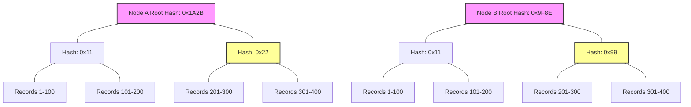
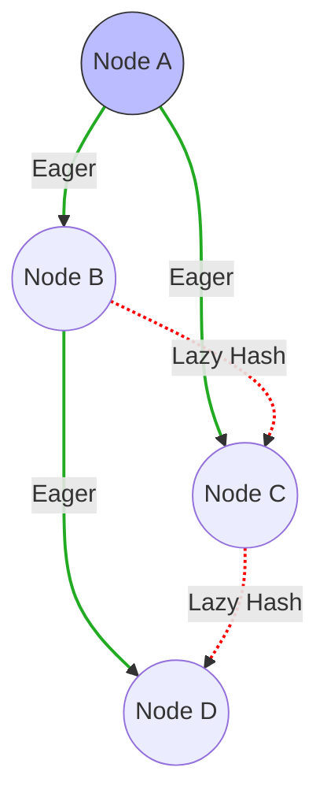

<Chapter 12: Anti-Entropy and Dissemination>
> Master the mechanisms that distributed databases use to detect divergence, repair inconsistencies, and reliably broadcast state across large clusters using anti-entropy and gossip protocols.

## Table of Contents
- [Chapter Overview](#chapter-overview)
- [Communication Patterns for Propagation](#communication-patterns-for-propagation)
- [Anti-Entropy Mechanisms](#anti-entropy-mechanisms)
  - [Read Repair](#read-repair)
  - [Digest Reads](#digest-reads)
  - [Hinted Handoff](#hinted-handoff)
  - [Merkle Trees](#merkle-trees)
  - [Bitmap Version Vectors](#bitmap-version-vectors)
- [Gossip Dissemination](#gossip-dissemination)
  - [Epidemics & Rumor Mongering](#epidemics--rumor-mongering)
  - [Overlay Networks & Spanning Trees](#overlay-networks--spanning-trees)
  - [Hybrid Gossip & Plumtrees](#hybrid-gossip--plumtrees)
  - [Partial Views & HyParView](#partial-views--hyparview)
- [Worked Examples & Code Implementations](#worked-examples--code-implementations)
- [Design Patterns & Best Practices](#design-patterns--best-practices)
- [Trade-offs & Decision Framework](#trade-offs--decision-framework)
- [Interview & System Design Angles](#interview--system-design-angles)
- [AI/ML Engineering Relevance](#aiml-engineering-relevance)
- [Key Takeaways](#key-takeaways)
- [Glossary](#glossary)

## Chapter Overview
In distributed systems, peer-to-peer or one-to-many communication models are limited to a single machine's throughput. Reliable propagation of data and cluster-wide metadata (e.g., node joining/leaving, schema changes, failure states) requires strategies that guarantee delivery despite network partitions and node crashes. This chapter dives into anti-entropy and gossip protocols, exploring how systems efficiently sync states, resolve divergence, and disseminate information.

As systems embrace eventual consistency to ensure high availability, replica divergence becomes inevitable. This property—the measure of state divergence between nodes—is called "entropy." The chapter teaches how distributed databases reduce this entropy over time, bringing replicas back into sync, through mechanisms like Read Repair, Hinted Handoff, Merkle Trees, and Bitmap Version Vectors, as well as how they distribute state reliably via Epidemic Gossip, Plumtrees, and HyParView.

## Communication Patterns for Propagation
To reliably propagate updates to all nodes, systems generally adopt one of three broad approaches:
1. **Notification Broadcast:** A single process sends messages directly to all others. Simple but scales poorly. Over-reliant on a single coordinator and requires overlap in uptime.
2. **Periodic Peer-to-Peer Anti-Entropy:** Peers connect pairwise to exchange state. Fixes missed deliveries but has high latency.
3. **Cooperative Gossip (Epidemic Broadcast):** Recipients become broadcasters. Spreads information quickly and reliably with high robustness, albeit with redundant messaging overhead.

Systems often split message delivery into two phases: **primary delivery** (best effort by coordinator) and **periodic sync** (anti-entropy to fix missed updates).

---

## Anti-Entropy Mechanisms
Anti-entropy brings nodes back up-to-date when primary delivery mechanisms fail. It lowers convergence bounds in eventually consistent systems. These processes can be background (comparing structures like Merkle Trees) or foreground (piggybacking on reads/writes like Read Repair).

### Read Repair
When the coordinator queries multiple replicas for data, it can naturally detect divergence. 

#### How It Works
1. A coordinator performs a distributed read, optimistically assuming replicas are in sync.
2. If the replica responses differ, the coordinator detects the inconsistency.
3. The coordinator forces a repair by sending the missing/latest updates to the lagging replicas.
4. With "Tunable Consistency", read repair can be blocking (client waits until repair completes, ensuring read monotonicity) or asynchronous (client gets the result quickly, repair happens in background).

#### Example & Real-World Usage
Cassandra and Riak heavily rely on read repair. Cassandra uses specialized iterators with merge listeners to reconstruct differences between the merged result and individual inputs, determining exactly what needs repairing.

### Digest Reads
To save bandwidth, instead of asking all replicas for full data snapshots, the coordinator uses digest reads.

#### How It Works
1. Coordinator issues ONE full read request to a single replica.
2. Coordinator issues **Digest Requests** to other replicas.
3. A Digest Request returns a non-cryptographic hash (e.g., MD5) of the requested data instead of the data itself.
4. The coordinator hashes the full response and compares it to the digests.
5. If digests match, nodes are in sync. If not, the coordinator issues full reads to lagging replicas, reconciles, and repairs.

### Hinted Handoff
A write-side repair mechanism optimized for temporary failures. 

#### How It Works
1. A coordinator attempts to write to a target replica.
2. If the target node fails to acknowledge, the coordinator stores a "hint" locally or on a substitute replica.
3. When the target node recovers, the hint is replayed to the node, getting it back in sync.
4. Used in sloppy quorums (e.g., Dynamo, Riak, Cassandra): A healthy node (not originally intended for the write) accepts the data on behalf of the failed node, preserving write availability. Once the failed node is up, the hint is forwarded and deleted from the substitute. 

### Merkle Trees
Foreground repairs (Read Repair) only fix active data. For background sync of cold data, sending entire tables to compare is too expensive. We use Merkle trees (Hash trees) instead.

#### How It Works
1. The lowest level of the tree hashes small, discrete ranges of records.
2. Higher levels hash the hashes of their children, recursively up to the root.
3. Nodes compare root hashes. If they match, the replicas are identical.
4. If they differ, nodes recursively compare children to drill down to the exact data range that differs, exchanging only the mismatched ranges.

#### Diagram: Merkle Tree Sync

*Comparison reveals `Level1A1` == `Level1B1`, so records 1-200 are skipped. The discrepancy is isolated to `Level1A2` vs `Level1B2`, pinpointing the repair scope.*

#### Real-World Usage
Cassandra and Dynamo use Merkle trees for Anti-Entropy Node Repair.

### Bitmap Version Vectors
A technique to resolve conflicts based on recency, capturing causal relationships without sending full data.

#### How It Works
1. Each write is represented by a dot `(i, n)` - sequence number `i` on node `n`.
2. Nodes maintain a logical clock of dots representing writes they've seen.
3. A state is compressed into a format like `(3, 01101_2)`, meaning the node has seen consecutive writes up to index 3, plus writes at index 5, 6, and 8.
4. Nodes exchange these bitmaps to accurately identify exactly which operations are missing, filling gaps using Dotted Causal Containers (DCC).

---

## Gossip Dissemination
When explicit coordination is too expensive, nodes use probabilistic communication mimicking human rumors or viral epidemics.

### Epidemics & Rumor Mongering
- **States:**
  - **Susceptible:** Node hasn't received the update.
  - **Infective:** Node holds the update and actively spreads it.
  - **Removed:** Node stops spreading after losing interest.
- **Mechanics:** Processes pick `f` peers at random (fanout) periodically and exchange "hot" information. Overlap guarantees high robustness and fault tolerance.
- **Interest Loss:** Redundant message delivery causes interest loss (either probabilistically or by duplicate threshold), transitioning nodes to the "Removed" state.

### Overlay Networks & Spanning Trees
Pure gossip is robust but not message-optimal (high redundancy). Overlay networks construct a temporary fixed topology (Spanning Tree).
- **Spanning Tree:** A loop-free graph covering the network. Messages propagate in log(N) steps without duplicates.
- **Flaw:** Breaking one link severs an entire subtree.

### Hybrid Gossip & Plumtrees
Plumtree (Push-Lazy-Push Multicast Tree) combines the efficiency of spanning trees with the resilience of epidemic gossip.

#### How It Works
1. **Eager Push (Tree):** A spanning tree is constructed. Nodes send FULL messages only via tree links.
2. **Lazy Push (Gossip):** Nodes send only MESSAGE IDs (hashes) to non-tree peers (lazy gossip network).
3. **Healing:** If a node receives a message ID via lazy push that it hasn't seen via eager push, it means the tree is broken. The node queries the peer for the full message, healing the tree.

#### Diagram: Plumtree


### Partial Views & HyParView
Maintaining a full cluster view is too expensive under high "churn" (nodes joining/leaving). 
- **HyParView** solves this by keeping an **Active View** (small list of active peers for tree overlay) and a **Passive View** (larger backup list for failovers).
- Nodes periodically "shuffle" to exchange views.
- If an active peer fails, it is replaced by a passive peer, allowing rapid self-healing without requiring any node to know the entire cluster.

---

## Worked Examples & Code Implementations

### Example 1: Merkle Tree Construction & $O(\log N)$ Range Reconciliation

Demonstrates how two distributed replicas build Merkle trees over key ranges and recursively compare root and child hashes to locate and sync the single mismatched record in $O(\log N)$ network exchanges without transmitting the entire dataset.

```python
import hashlib

def hash_val(val: str) -> str:
    return hashlib.sha256(val.encode()).hexdigest()[:8]

class MerkleTreeNode:
    def __init__(self, key_range: tuple, hash_str: str, left=None, right=None, data_record=None):
        self.key_range = key_range  # (low_key, high_key)
        self.hash_str = hash_str
        self.left = left
        self.right = right
        self.data_record = data_record

def build_merkle_tree(records: list[tuple[int, str]]) -> MerkleTreeNode:
    if len(records) == 1:
        k, v = records[0]
        return MerkleTreeNode(key_range=(k, k), hash_str=hash_val(f"{k}:{v}"), data_record=(k, v))

    mid = len(records) // 2
    left = build_merkle_tree(records[:mid])
    right = build_merkle_tree(records[mid:])
    combined_hash = hash_val(left.hash_str + right.hash_str)
    return MerkleTreeNode(key_range=(records[0][0], records[-1][0]), hash_str=combined_hash, left=left, right=right)

def reconcile_merkle_trees(node_A: MerkleTreeNode, node_B: MerkleTreeNode) -> list[int]:
    """Returns the list of mismatched key ranges/records traversed."""
    if node_A.hash_str == node_B.hash_str:
        return []  # Perfect match, zero sync needed!

    if node_A.left is None and node_A.right is None:
        return [node_A.data_record[0]]  # Leaf mismatch identified

    mismatches = []
    if node_A.left and node_B.left and node_A.left.hash_str != node_B.left.hash_str:
        mismatches.extend(reconcile_merkle_trees(node_A.left, node_B.left))
    if node_A.right and node_B.right and node_A.right.hash_str != node_B.right.hash_str:
        mismatches.extend(reconcile_merkle_trees(node_A.right, node_B.right))
    return mismatches

# Dataset: 8 keys (1..8)
data_replica_1 = [(i, f"value_{i}") for i in range(1, 9)]
data_replica_2 = [(i, f"value_{i}") for i in range(1, 9)]
data_replica_2[5] = (6, "value_6_DIVERGENT")  # Replica 2 has diverged at key 6

tree_1 = build_merkle_tree(data_replica_1)
tree_2 = build_merkle_tree(data_replica_2)

print("=== Merkle Tree Range Reconciliation ===")
print(f"Replica 1 Root Hash: {tree_1.hash_str} | Replica 2 Root Hash: {tree_2.hash_str}")
divergent_keys = reconcile_merkle_trees(tree_1, tree_2)
print(f"Hierarchical Comparison Identified Single Mismatched Key: {divergent_keys} (Synced in O(log N) tree hops!)")
```

#### Execution Output
```text
=== Merkle Tree Range Reconciliation ===
Replica 1 Root Hash: 4cd954fe | Replica 2 Root Hash: fba779ba
Hierarchical Comparison Identified Single Mismatched Key: [6] (Synced in O(log N) tree hops!)
```

---

### Example 2: Digest Read & Reconciliation Flow

Demonstrates Cassandra/Dynamo-style Digest Reads: the coordinator requests full payload data from 1 replica and lightweight MD5 hashes from other replicas, fetching full data and performing background repair only if a digest mismatch occurs.

```python
import hashlib

class DigestReplica:
    def __init__(self, name: str, data: dict):
        self.name = name
        self.data = dict(data)

    def read_full(self, key: str) -> str:
        return self.data.get(key)

    def read_digest(self, key: str) -> str:
        val = self.data.get(key, "")
        return hashlib.md5(val.encode()).hexdigest()[:8]

r1 = DigestReplica("R1", {"k1": "Full_Payload_Data_10KB"})
r2 = DigestReplica("R2", {"k1": "Full_Payload_Data_10KB"})
r3 = DigestReplica("R3", {"k1": "Full_Payload_Data_OLD_STALE"})

# Coordinator fetches 1 full data read from R1 + digests from R2 & R3
full_val = r1.read_full("k1")
d1 = hashlib.md5(full_val.encode()).hexdigest()[:8]
d2 = r2.read_digest("k1")
d3 = r3.read_digest("k1")

print("=== Digest Reads vs Full Data Reads ===")
print(f"R1 Full Read -> Digest: {d1} | R2 Digest: {d2} | R3 Digest: {d3}")
if d1 == d2 and d1 != d3:
    print(f"Digest Mismatch detected on R3 ({d3} != {d1})! Triggering background repair on R3.")
    r3.data["k1"] = full_val
    print(f"R3 Repaired. New R3 Digest: {r3.read_digest('k1')}")
```

#### Execution Output
```text
=== Digest Reads vs Full Data Reads ===
R1 Full Read -> Digest: c6dcfe75 | R2 Digest: c6dcfe75 | R3 Digest: 85766fe3
Digest Mismatch detected on R3 (85766fe3 != c6dcfe75)! Triggering background repair on R3.
R3 Repaired. New R3 Digest: c6dcfe75
```

---

### Example 3: Epidemic Gossip Dissemination Simulator

Demonstrates discrete round-based rumor mongering across 20 cluster nodes with a fanout factor of $f=2$, tracing exponential epidemic spread until 100% convergence.

```python
import random

def simulate_gossip(num_nodes=20, fanout=2) -> int:
    nodes = [0] * num_nodes
    nodes[0] = 1  # Node 0 is patient zero
    
    rounds = 0
    print(f"Initial State: 1/{num_nodes} nodes infected with update.")
    while sum(nodes) < num_nodes:
        rounds += 1
        infective_indices = [i for i, state in enumerate(nodes) if state == 1]
        for inf in infective_indices:
            targets = random.sample([i for i in range(num_nodes) if i != inf], fanout)
            for t in targets:
                nodes[t] = 1
        print(f"  Round {rounds}: {sum(nodes)}/{num_nodes} nodes received update ({sum(nodes)/num_nodes*100:.0f}%)")
    return rounds

print("=== Epidemic Gossip Dissemination Simulator ===")
total_rounds = simulate_gossip(num_nodes=20, fanout=2)
print(f"100% Cluster Convergence achieved in {total_rounds} gossip rounds!")
```

#### Execution Output
```text
=== Epidemic Gossip Dissemination Simulator ===
Initial State: 1/20 nodes infected with update.
  Round 1: 3/20 nodes received update (15%)
  Round 2: 7/20 nodes received update (35%)
  Round 3: 14/20 nodes received update (70%)
  Round 4: 17/20 nodes received update (85%)
  Round 5: 20/20 nodes received update (100%)
100% Cluster Convergence achieved in 5 gossip rounds!
```

---

## Design Patterns & Best Practices
1. **Scope Reduction Pattern:** Reduce anti-entropy costs by only repairing hot data (Read Repair) or targeted logs (Hinted Handoff). Use Merkle trees only for cold/background reconciliation.
2. **Two-Phase Propagation:** Do best-effort primary delivery, rely on asynchronous anti-entropy/gossip for eventual 100% convergence.
3. **Hybrid Topologies:** For cluster state, don't use pure gossip (too chatty) or pure trees (too fragile). Use hybrids like Plumtree.

## Trade-offs & Decision Framework

| Mechanism | Optimizes For | Trade-offs | Ideal Use Case |
| :--- | :--- | :--- | :--- |
| **Read Repair** | Freshness of actively queried data | Adds latency to read path (if blocking) | Read-heavy databases (Cassandra) |
| **Hinted Handoff** | High Write Availability | Re-delivery fails if substitute node dies | Temporary partitions/node restarts |
| **Merkle Trees** | Global dataset consistency | Expensive to compute, recomputes on writes | Periodic background cluster repair |
| **Pure Gossip** | Robustness & Fault Tolerance | High message redundancy (network cost) | Membership/Failure Detection |
| **Plumtrees** | Low latency, Low redundancy | Complex implementation | Heavy cluster-wide broadcasts |

## Interview & System Design Angles
- **"How does Cassandra maintain consistency without a master?"** Explain tunable consistency, Read Repair (foreground), and Merkle Tree Anti-Entropy (background). Mention sloppy quorums and hinted handoff.
- **"Design a distributed failure detection system."** Use Gossip Protocols. Mention UDP ping-pong, infective states, and HyParView for scaling large clusters without global membership lists.
- **"How to sync a billion rows between two data centers efficiently?"** Discuss Merkle Trees to isolate deltas to O(log N) depth and sync only the disparate leaf nodes.

## AI/ML Engineering Relevance
- **Feature Stores & Vector Databases:** Distributed vector databases (like Milvus or Qdrant) use gossip protocols for cluster membership and routing metadata. Maintaining global indexes of Approximate Nearest Neighbors (ANN) across shards requires background anti-entropy.
- **Distributed Training:** Ring All-Reduce mechanisms share similarities with Spanning Trees and overlay networks to optimally pass gradients without broadcasting N^2 messages.
- **Parameter Servers:** When updating weights asynchronously in a large parameter server fleet, hybrid gossip ensures all servers eventually converge on the correct global parameter state despite high churn or spot-instance preemptions.

## Key Takeaways
- Eventual consistency requires **entropy reduction** via anti-entropy protocols.
- **Read Repair** and **Hinted Handoff** fix active data cheaply; **Merkle Trees** fix cold data exhaustively.
- **Gossip protocols** scale infinitely by mimicking viral epidemics, overcoming network partitions through probabilistic overlap.
- **Hybrid algorithms** (Plumtree, HyParView) offer the best of both worlds: the low message overhead of spanning trees and the self-healing robustness of epidemic gossip.
- Maintaining **partial views** (instead of full cluster topologies) is critical for handling node churn.

## Glossary
- **Entropy:** Degree of state divergence between nodes.
- **Sloppy Quorum:** Allowing non-target replica nodes to temporarily accept writes to maintain availability during failures.
- **Merkle Tree:** A tree where leaf nodes are hashes of data blocks, and non-leaf nodes are hashes of their children.
- **Fanout:** The number of peers a node contacts in a single gossip round.
- **Convergence Latency:** Time taken for an update to reach all nodes in a cluster.
- **Churn:** The rate at which nodes join and leave the cluster.
</Chapter 12: Anti-Entropy and Dissemination>
