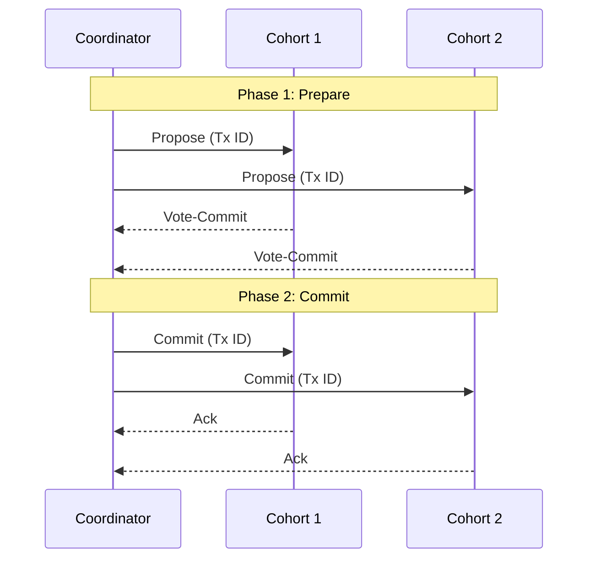
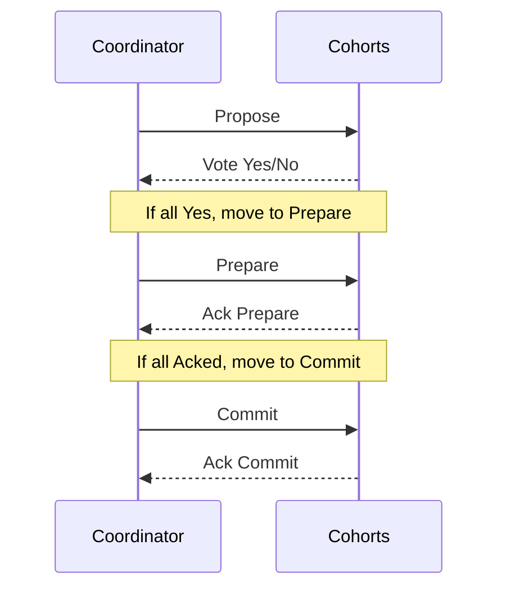
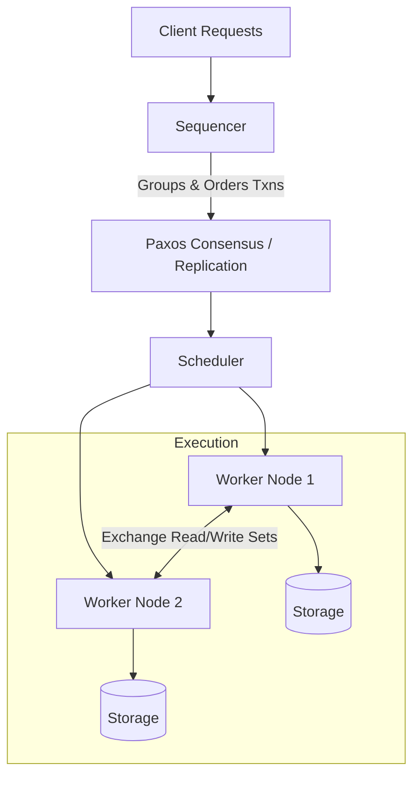
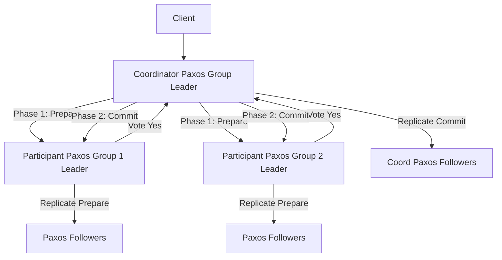
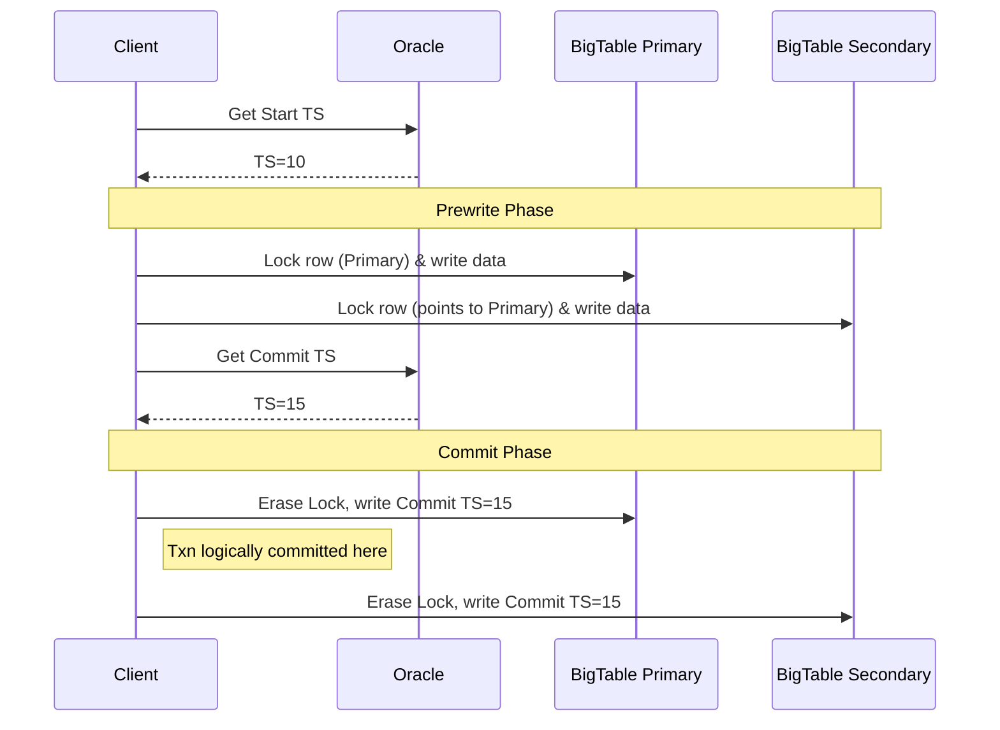

# Chapter 13: Distributed Transactions
> Master the complex world of multi-partition atomic operations, covering distributed commit protocols like 2PC/3PC, and modern distributed transaction models like Spanner, Calvin, and Percolator.

## Table of Contents
- [Chapter Overview](#chapter-overview)
- [Atomic Commitment & Transaction Managers](#atomic-commitment--transaction-managers)
- [Two-Phase Commit (2PC)](#two-phase-commit-2pc)
  - [Failure Scenarios in 2PC](#failure-scenarios-in-2pc)
- [Three-Phase Commit (3PC)](#three-phase-commit-3pc)
- [Distributed Transactions with Calvin](#distributed-transactions-with-calvin)
- [Distributed Transactions with Spanner](#distributed-transactions-with-spanner)
- [Database Partitioning & Consistent Hashing](#database-partitioning--consistent-hashing)
- [Distributed Transactions with Percolator](#distributed-transactions-with-percolator)
- [Coordination Avoidance & RAMP Transactions](#coordination-avoidance--ramp-transactions)
- [Worked Examples & Code Implementations](#worked-examples--code-implementations)
- [Design Patterns & Best Practices](#design-patterns--best-practices)
- [Trade-offs & Decision Framework](#trade-offs--decision-framework)
- [Interview & System Design Angles](#interview--system-design-angles)
- [AI/ML Engineering Relevance](#aiml-engineering-relevance)
- [Key Takeaways](#key-takeaways)
- [Glossary](#glossary)

## Chapter Overview

In a distributed system, ensuring consistency across multiple partitions or nodes is one of the most fundamentally challenging problems. While local transaction models (like single-node concurrency control discussed in Chapter 5) are well-understood, they fall short when a transaction spans multiple isolated partitions. When we transfer money between accounts hosted on completely different physical servers, we must ensure the operation remains strictly atomic—meaning either both the debit and credit succeed, or neither does, despite network failures or node crashes. 

Distributed transactions require coordination among nodes, commonly referred to as distributed commit or atomic commitment protocols. These protocols dictate how multiple independent replicas or partitions can reach a unanimous decision. If a single node fails to commit its portion of the transaction, the entire distributed operation must be rolled back to preserve system consistency.

This chapter dives deep into the mechanisms behind distributed coordination. We start from foundational protocols like Two-Phase Commit (2PC) and Three-Phase Commit (3PC), analyzing their mechanics and failure modes. We then explore state-of-the-art implementations deployed at massive scale, such as Calvin (deterministic execution), Spanner (TrueTime and 2PC over Paxos), and Percolator (Snapshot Isolation over MVCC). Understanding these systems is the cornerstone of designing resilient, geo-distributed databases.

---

## Atomic Commitment & Transaction Managers

### Core Concept
To make operations across remote nodes appear atomic, databases rely on **atomic commitment algorithms**. These algorithms ensure unanimity: a transaction will only commit if *every single participant* votes in favor of it. If even one participant rejects the transaction, it is aborted everywhere. 

The entity responsible for scheduling, coordinating, executing, and tracking transactions across nodes is called the **Transaction Manager**. 

### How It Works
Atomic commitment algorithms define the communication rules but leave the local implementation up to the database:
1. When data is considered "ready to commit".
2. How to quickly make transaction results visible.
3. How to roll back partially applied changes if the transaction is aborted.

*Note: These algorithms operate under the assumption of crash-recovery or network partition fault models. They do not handle Byzantine failures (nodes actively lying or sending malicious arbitrary values).*

### Real-World Usage
Virtually all distributed databases use some form of atomic commitment. Examples include MySQL (XA transactions), PostgreSQL, Kafka (producer/consumer exactly-once semantics), MongoDB, and distributed coordination systems like Apache ZooKeeper.

---

## Two-Phase Commit (2PC)

### Core Concept
**Two-Phase Commit (2PC)** is the most widespread protocol for distributed atomic updates. It separates the execution into two phases: collecting votes (Phase 1) and executing the final decision (Phase 2). 

2PC involves a **Coordinator** (the node driving the transaction) and **Cohorts** (the participant nodes holding the data partitions). 

### How It Works
1. **Phase 1: Prepare (Propose):**
   - The coordinator sends a `Propose` message to all cohorts, including the transaction details.
   - Cohorts execute the transaction locally but leave it in a "precommitted" state (locks acquired, written to WAL).
   - If a cohort can commit, it replies with a `Vote-Commit`. If it encounters a conflict or error, it replies with `Vote-Abort`.
2. **Phase 2: Commit/Abort:**
   - If *all* cohorts send `Vote-Commit`, the coordinator logs a commit decision and sends a `Commit` message to all cohorts.
   - If *any* cohort sends `Vote-Abort` (or times out), the coordinator logs an abort decision and sends an `Abort` message to all cohorts.
   - Cohorts finalize the transaction (commit/rollback), release locks, and acknowledge the coordinator.

### Diagram


### Failure Scenarios in 2PC
2PC is known as a **blocking protocol** because certain failures can leave cohorts in an indefinite waiting state.

1. **Cohort Failure:**
   - If a cohort fails during the *Prepare* phase, the coordinator times out and aborts the transaction. 
   - When the failed cohort recovers, it must ask the coordinator about the final decision.
2. **Coordinator Failure:**
   - If the coordinator fails *after* sending `Propose` but *before* sending `Commit/Abort`, cohorts are left in a **state of uncertainty**. 
   - The cohorts hold locks but do not know if the transaction succeeded globally. They cannot arbitrarily abort because another cohort might have received a `Commit` right before the coordinator crashed. They are blocked until the coordinator recovers or a backup coordinator can deduce the state.

---

## Three-Phase Commit (3PC)

### Core Concept
**Three-Phase Commit (3PC)** attempts to solve the blocking problem of 2PC by introducing an intermediate phase (`Prepare`) and timeouts. 3PC operates under the assumption of a synchronous network model (bounded message delays).

### How It Works
1. **Propose:** Coordinator sends proposed value. Cohorts vote.
2. **Prepare:** Coordinator broadcasts vote results. If all voted yes, it sends `Prepare`. If a cohort receives this, it knows *all other cohorts voted yes*.
3. **Commit:** Coordinator tells cohorts to officially commit.

### Diagram


### Trade-offs & Failures
If the coordinator fails during Phase 2, cohorts that timed out waiting for `Prepare` will abort. Cohorts that received `Prepare` and timed out waiting for `Commit` will commit (knowing unanimity was reached).
**The Split-Brain Problem:** 3PC fails catastrophically under network partitions. If a partition occurs, some cohorts might timeout and abort, while others proceed to commit, violating atomicity. Because of this fatal flaw in asynchronous networks, **3PC is rarely used in practice**.

---

## Distributed Transactions with Calvin

### Core Concept
Instead of coordinating at commit-time (like 2PC), **Calvin** removes contention by pre-determining the global transaction execution order. Since transaction order is deterministic, all replicas receiving the exact same input sequence will produce the exact same database state.

### How It Works
1. **Sequencing:** A **Sequencer** collects incoming transactions, groups them into epochs (e.g., 10ms batches), and establishes a strict serial order.
2. **Replication:** The batch is replicated across the cluster (via Paxos).
3. **Scheduling & Execution:** The **Scheduler** orchestrates execution. Worker threads analyze the transaction's *read set* and *write set*.
4. Nodes figure out which partitions hold the required data, forward local data to active participants, and execute the transactions in the exact sequenced order without needing a distributed commit protocol at the end.

### Diagram


### Real-World Usage
**FaunaDB** is a prominent example implementing the Calvin protocol, allowing fast, geographically distributed transactions with low conflict overhead.

---

## Distributed Transactions with Spanner

### Core Concept
Google's **Spanner** takes the opposite route to Calvin. It embraces 2PC but makes it highly available by running 2PC over **Paxos groups** (replica sets) rather than individual nodes. It achieves strict serializability (External Consistency) across the globe using **TrueTime**.

### How It Works
1. **TrueTime API:** A high-precision wall-clock API (`TT.now()`) that returns an interval `[earliest, latest]` representing clock uncertainty bounds.
2. **Commit Wait:** To guarantee linearizability, a committing transaction chooses a timestamp `ts > latest` and *waits* until TrueTime guarantees that `earliest > ts` before responding to the client. This ensures no subsequent transaction can accidentally get an older timestamp.
3. **2PC over Paxos:** 
   - A multi-shard transaction acquires locks at the Paxos Group Leaders for each shard.
   - The coordinator group leader initiates a 2PC protocol.
   - Even if a leader node crashes, the Paxos group simply elects a new leader and the 2PC process continues, removing the blocking flaw of standard 2PC.

### Diagram


### Real-World Usage
**Google Spanner**, **CockroachDB**, and **YugabyteDB** use derivatives of this architecture.

---

## Database Partitioning & Consistent Hashing

### Core Concept
Storing all data on a single node is impossible for modern applications. **Partitioning (Sharding)** logically divides data into smaller segments.

### How It Works
1. **Modulo Hashing:** `hash(key) % N`. Simple, but brittle. If cluster size `N` changes to `N'`, almost all keys remap to new nodes, causing massive data movement.
2. **Consistent Hashing:** Hashes are mapped to a circular "ring". Each node represents a point on the ring and owns the data range up to its predecessor. When a node is added/removed, only its immediate neighbors are affected. Relocation is minimal (on average `K/N` keys).

### Real-World Usage
Consistent hashing is the backbone of **Apache Cassandra**, **DynamoDB**, and **Riak**.

---

## Distributed Transactions with Percolator

### Core Concept
**Percolator** is Google's system for incremental processing over massive datasets (originally built for web indexing). It provides **Snapshot Isolation (SI)** semantics and a client-driven 2PC protocol sitting on top of **Bigtable** (a distributed key-value store).

### How It Works
Percolator stores metadata (locks, write locations) natively in Bigtable columns, using Bigtable's single-row atomic read-modify-write mutations to avoid race conditions.

1. **Prewrite Phase:**
   - The client asks a Timestamp Oracle for a start timestamp (`TS1`).
   - The client selects one row as the "Primary Lock".
   - It writes data and locks for all involved rows, checking for newer writes or existing locks (aborting if conflicts are found).
2. **Commit Phase:**
   - The client gets a commit timestamp (`TS2`).
   - It releases the Primary Lock and replaces it with a write record pointing to `TS1`.
   - Once the primary is committed, the transaction is logically complete. The client asynchronously cleans up secondary locks.

### Diagram


### Real-World Usage
**TiDB** (a MySQL-compatible NewSQL database) uses the Percolator model extensively to provide strongly consistent, distributed MVCC over its distributed key-value engine (TiKV).

---

## Coordination Avoidance & RAMP Transactions

### Core Concept
Distributed coordination (like 2PC) adds latency and contention. **Coordination Avoidance** asks: when can we safely skip coordination? The answer lies in **Invariant Confluence (I-Confluence)**: if two diverged database states can always be safely merged into a valid state without violating invariants, coordination is unnecessary.

### How It Works (RAMP)
**Read-Atomic Multi Partition (RAMP)** transactions offer *Read Atomic* isolation: either all of a transaction's writes are visible, or none are (preventing fractured reads). 
- Writers attach metadata to their updates.
- Readers observing a partial write can use the metadata to independently fetch missing updates from other partitions, repairing the read state locally.
- Provides **Synchronization independence** (transactions don't stall each other) and **Partition independence** (clients only talk to relevant partitions).

---

## Worked Examples & Code Implementations

### Example 1: Two-Phase Commit (2PC) Protocol Simulation

Demonstrates the Two-Phase Commit (2PC) protocol executing across distributed database shards, evaluating both the successful commit path (where all cohorts prepare and vote YES) and the rollback path (where a cohort fails and the coordinator issues a global abort).

```python
class Cohort:
    def __init__(self, name: str):
        self.name = name
        self.state = "INIT"
        self.locked_data = {}
        self.committed_data = {}

    def prepare(self, key: str, value: str, can_commit: bool = True) -> bool:
        if not can_commit:
            print(f"  [{self.name}] Votes NO (Cannot prepare lock)")
            return False
        self.locked_data[key] = value
        self.state = "PREPARED"
        print(f"  [{self.name}] Prepared: Locked key='{key}', Votes YES")
        return True

    def commit(self, key: str):
        if key in self.locked_data:
            self.committed_data[key] = self.locked_data.pop(key)
            self.state = "COMMITTED"
            print(f"  [{self.name}] Committed: key='{key}', value='{self.committed_data[key]}'")

    def abort(self, key: str):
        self.locked_data.pop(key, None)
        self.state = "ABORTED"
        print(f"  [{self.name}] Aborted: Lock released for key='{key}'")

def run_2pc(coordinator_log: list, cohorts: list[tuple[Cohort, str, str, bool]]) -> str:
    print("--- Phase 1: Prepare ---")
    votes = []
    for cohort, k, v, can_prepare in cohorts:
        vote = cohort.prepare(k, v, can_commit=can_prepare)
        votes.append(vote)

    print("--- Phase 2: Commit / Abort ---")
    if all(votes):
        coordinator_log.append("GLOBAL_COMMIT")
        print("  [Coordinator] Logged GLOBAL_COMMIT. Broadcasting commit to cohorts...")
        for cohort, k, v, _ in cohorts:
            cohort.commit(k)
        return "COMMITTED"
    else:
        coordinator_log.append("GLOBAL_ABORT")
        print("  [Coordinator] Logged GLOBAL_ABORT. Broadcasting abort to cohorts...")
        for cohort, k, v, _ in cohorts:
            cohort.abort(k)
        return "ABORTED"

c1 = Cohort("Shard_Account_A")
c2 = Cohort("Shard_Account_B")

print("=== 2PC Distributed Transaction ===")
print("Scenario 1: Happy Path (Both Shards Healthy)")
log1 = []
tx1_res = run_2pc(log1, [(c1, "acc:alice", "-$100", True), (c2, "acc:bob", "+$100", True)])
print(f"Transaction 1 Result: {tx1_res}\n")

print("Scenario 2: Failure Path (Shard B Fails Prepare)")
log2 = []
tx2_res = run_2pc(log2, [(c1, "acc:alice", "-$500", True), (c2, "acc:bob", "+$500", False)])
print(f"Transaction 2 Result: {tx2_res}")
```

#### Execution Output
```text
=== 2PC Distributed Transaction ===
Scenario 1: Happy Path (Both Shards Healthy)
--- Phase 1: Prepare ---
  [Shard_Account_A] Prepared: Locked key='acc:alice', Votes YES
  [Shard_Account_B] Prepared: Locked key='acc:bob', Votes YES
--- Phase 2: Commit / Abort ---
  [Coordinator] Logged GLOBAL_COMMIT. Broadcasting commit to cohorts...
  [Shard_Account_A] Committed: key='acc:alice', value='-$100'
  [Shard_Account_B] Committed: key='acc:bob', value='+$100'
Transaction 1 Result: COMMITTED

Scenario 2: Failure Path (Shard B Fails Prepare)
--- Phase 1: Prepare ---
  [Shard_Account_A] Prepared: Locked key='acc:alice', Votes YES
  [Shard_Account_B] Votes NO (Cannot prepare lock)
--- Phase 2: Commit / Abort ---
  [Coordinator] Logged GLOBAL_ABORT. Broadcasting abort to cohorts...
  [Shard_Account_A] Aborted: Lock released for key='acc:alice'
  [Shard_Account_B] Aborted: Lock released for key='acc:bob'
Transaction 2 Result: ABORTED
```

---

### Example 2: Google Percolator Distributed Transaction Model

Demonstrates Google Percolator's client-driven distributed transaction protocol (used in TiDB/TiKV) with Primary/Secondary locks and Snapshot Isolation over MVCC column families (`data`, `lock`, `write`).

```python
class PercolatorStore:
    def __init__(self):
        self.data_cf = {}   # (key, start_ts) -> value
        self.lock_cf = {}   # key -> (primary_key, start_ts)
        self.write_cf = {}  # (key, commit_ts) -> start_ts

    def prewrite(self, key: str, value: str, start_ts: int, primary_key: str) -> bool:
        if key in self.lock_cf:
            return False  # Write conflict
        self.lock_cf[key] = (primary_key, start_ts)
        self.data_cf[(key, start_ts)] = value
        return True

    def commit_primary(self, primary_key: str, start_ts: int, commit_ts: int) -> bool:
        if self.lock_cf.get(primary_key) != (primary_key, start_ts):
            return False
        # Remove primary lock and write commit record (Transaction logically commits here!)
        del self.lock_cf[primary_key]
        self.write_cf[(primary_key, commit_ts)] = start_ts
        return True

    def commit_secondary(self, key: str, start_ts: int, commit_ts: int) -> bool:
        if key in self.lock_cf:
            del self.lock_cf[key]
        self.write_cf[(key, commit_ts)] = start_ts
        return True

    def read_snapshot(self, key: str, read_ts: int):
        committed_versions = [ts for (k, ts) in self.write_cf if k == key and ts <= read_ts]
        if not committed_versions:
            return None
        latest_commit_ts = max(committed_versions)
        start_ts = self.write_cf[(key, latest_commit_ts)]
        return self.data_cf.get((key, start_ts))

store = PercolatorStore()
# Transfer $100 from Alice (Primary) to Bob (Secondary)
store.prewrite("alice", "$900", start_ts=10, primary_key="alice")
store.prewrite("bob", "$1100", start_ts=10, primary_key="alice")

print("=== Percolator Model (Primary & Secondary Locks) ===")
print(f"After Prewrite -> Active Locks: {store.lock_cf}")
print(f"Reader (TS=12) reads Alice: {store.read_snapshot('alice', read_ts=12)} (Snapshot Isolation)")

# Commit phase
store.commit_primary("alice", start_ts=10, commit_ts=15)
store.commit_secondary("bob", start_ts=10, commit_ts=15)

print(f"After Commit -> Active Locks: {store.lock_cf} | Write CF: {store.write_cf}")
print(f"Reader (TS=20) reads Alice: {store.read_snapshot('alice', read_ts=20)}")
print(f"Reader (TS=20) reads Bob  : {store.read_snapshot('bob', read_ts=20)}")
```

#### Execution Output
```text
=== Percolator Model (Primary & Secondary Locks) ===
After Prewrite -> Active Locks: {'alice': ('alice', 10), 'bob': ('alice', 10)}
Reader (TS=12) reads Alice: None (Snapshot Isolation)
After Commit -> Active Locks: {} | Write CF: {('alice', 15): 10, ('bob', 15): 10}
Reader (TS=20) reads Alice: $900
Reader (TS=20) reads Bob  : $1100
```

---

### Example 3: Consistent Hashing Ring with Virtual Nodes

Demonstrates Consistent Hashing with virtual nodes. When adding a 4th node to a 3-node cluster, only a minimal fraction of keys ($\approx K/N$) are relocated, preventing cluster-wide resharding storms.

```python
import hashlib
import bisect

class ConsistentHashRing:
    def __init__(self, vnodes: int = 5):
        self.vnodes = vnodes
        self.ring = []       # Sorted virtual node hash points
        self.node_map = {}   # hash -> physical_node_name

    def _hash(self, key: str) -> int:
        return int(hashlib.sha256(key.encode()).hexdigest(), 16) % (2**32)

    def add_node(self, node: str):
        for i in range(self.vnodes):
            h = self._hash(f"{node}-vnode-{i}")
            bisect.insort(self.ring, h)
            self.node_map[h] = node

    def get_node(self, key: str) -> str:
        if not self.ring:
            return None
        h = self._hash(key)
        idx = bisect.bisect_right(self.ring, h) % len(self.ring)
        return self.node_map[self.ring[idx]]

ring = ConsistentHashRing(vnodes=5)
for n in ["Node_1", "Node_2", "Node_3"]:
    ring.add_node(n)

test_keys = [f"key_{i}" for i in range(100)]
initial_mapping = {k: ring.get_node(k) for k in test_keys}

# Add a 4th node to the cluster
ring.add_node("Node_4")
new_mapping = {k: ring.get_node(k) for k in test_keys}

moved_keys = sum(1 for k in test_keys if initial_mapping[k] != new_mapping[k])

print("=== Consistent Hashing Ring with Virtual Nodes ===")
print(f"Total Keys: {len(test_keys)} across 3 nodes.")
print(f"After adding 'Node_4' -> Keys Relocated: {moved_keys}/{len(test_keys)} ({moved_keys}% moved)")
print(f"Ideal theoretical relocation when scaling from 3 to 4 nodes is 25% (1/N+1).")
```

#### Execution Output
```text
=== Consistent Hashing Ring with Virtual Nodes ===
Total Keys: 100 across 3 nodes.
After adding 'Node_4' -> Keys Relocated: 6/100 (6% moved)
Ideal theoretical relocation when scaling from 3 to 4 nodes is 25% (1/N+1).
```

---

## Design Patterns & Best Practices

1. **Leader Logging for Recovery:** In 2PC, always persist the coordinator's commit decision to a replicated log before notifying cohorts. If the coordinator crashes, a backup can read the log and tell cohorts the outcome.
2. **Client-Driven Protocols:** Systems like Percolator push the transaction coordination logic into a thick client library. The storage nodes (Bigtable) remain simple and scalable.
3. **Decouple Commit from Visibility:** Use MVCC. Write data with future or pending timestamps so readers aren't blocked by ongoing distributed commits. 

---

## Trade-offs & Decision Framework

| Protocol Model | Strengths | Weaknesses | Best Use Case |
|---|---|---|---|
| **Two-Phase Commit (2PC)** | Simple, guarantees strong consistency, easy to reason about. | Blocking protocol; vulnerable to coordinator failures. | Traditional RDBMS, internal microservice orchestrations. |
| **Three-Phase Commit (3PC)** | Non-blocking in synchronous networks. | Suffers from Split-Brain in network partitions; high message overhead. | Practically abandoned; theoretical milestone. |
| **Calvin (Deterministic)** | High throughput, avoids 2PC blocking/locking overhead. | Batching latency, requires pre-declared read/write sets. | High-throughput OLTP, strict serializability without high lock contention. |
| **Spanner (2PC + Paxos + TrueTime)** | High availability (survives node failure), External Consistency. | Hardware dependency (Atomic clocks/GPS), higher write latency due to commit wait. | Globally distributed NewSQL databases requiring linearizability. |
| **Percolator (Client 2PC + MVCC)** | Horizontal scalability, excellent for long-running batch transactions. | High RPC overhead; timestamp oracle can be a bottleneck. | distributed MVCC layer on top of massive NoSQL stores (TiDB, Bigtable). |

---

## Interview & System Design Angles

When designing a distributed database in a system design interview:
- **"How do you handle multi-shard updates safely?"** Mention 2PC, but immediately point out its blocking flaw. Upgrade your answer by explaining how **Spanner** wraps 2PC in Paxos groups to make it highly available.
- **"How do you prevent global lock contention in distributed transactions?"** Discuss **Calvin**'s approach: agree on order via a Sequencer first, then execute deterministically without locks.
- **"How do you generate globally unique timestamps?"** Discuss a centralized Timestamp Oracle (Percolator/TiDB), TrueTime/Clock synchronization bounds (Spanner), or Hybrid Logical Clocks (CockroachDB).
- **"How do you partition the database?"** Avoid basic modulo hashing. Specify **Consistent Hashing** (Cassandra style) and explain how it prevents cluster-wide re-sharding storms.

---

## AI/ML Engineering Relevance

- **Feature Stores & Consistency:** Feature stores (like Feast or Hopsworks) that aggregate real-time transaction data require cross-partition atomic writes to ensure machine learning models don't ingest "fractured" reads where only half a user's activity is updated. 
- **Distributed Training & Parameter Servers:** Distributed ML training pipelines often hit the same consensus and coordination bottlenecks. The principles behind **Coordination Avoidance (I-Confluence)** apply to asynchronous weight updates (e.g., Hogwild!) where exact serializability is relaxed for throughput, and states are mathematically merged.
- **Vector Databases:** Distributed vector databases (like Milvus or Qdrant) use partitioning (sharding) extensively. When adding nodes to an ANN index cluster, consistent hashing is critical to ensure vector data doesn't require complete cluster re-indexing.

---

## Key Takeaways
- **2PC is foundational but blocking:** It fails gracefully but can leave nodes locked and waiting indefinitely if the coordinator crashes.
- **3PC is theoretically non-blocking but practically flawed:** Network partitions cause split-brain scenarios, making it unfit for async networks.
- **Spanner solves 2PC blocking via Consensus:** By running 2PC across Paxos clusters rather than single nodes, Spanner ensures coordinators and cohorts are highly available.
- **Calvin avoids execution coordination entirely:** By establishing a deterministic global order upfront, worker nodes can execute lock-free and guarantee identical end states.
- **Percolator implements distributed MVCC:** Using a timestamp oracle and client-driven 2PC, it layers ACID transactions over horizontally scalable NoSQL stores.
- **Consistent Hashing minimizes rebalancing:** It maps nodes and data to a ring, restricting data movement to neighboring nodes during scaling events.

---

## Glossary
- **Atomic Commitment:** An algorithm ensuring that a group of distributed processes either all commit or all abort a transaction.
- **Cohort:** A participant node in a distributed transaction that holds a partition of the data.
- **Split Brain:** A state where a network partition causes different parts of a cluster to independently make conflicting decisions.
- **Snapshot Isolation (SI):** A concurrency control mechanism where transactions execute against a static snapshot of the database, preventing read skew but allowing write skew.
- **External Consistency:** The highest level of consistency (equivalent to Linearizability), where transaction timestamps strictly reflect real-time serialization order (used by Spanner).
- **TrueTime:** Google's API that exposes wall-clock time along with an explicit error bound, used to enforce External Consistency without global locking.
- **I-Confluence (Invariant Confluence):** A property where multiple valid divergent database states can be safely merged into a final valid state without coordination.
