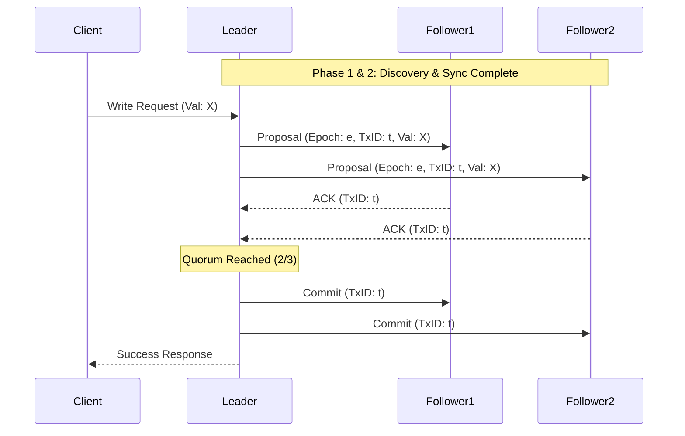
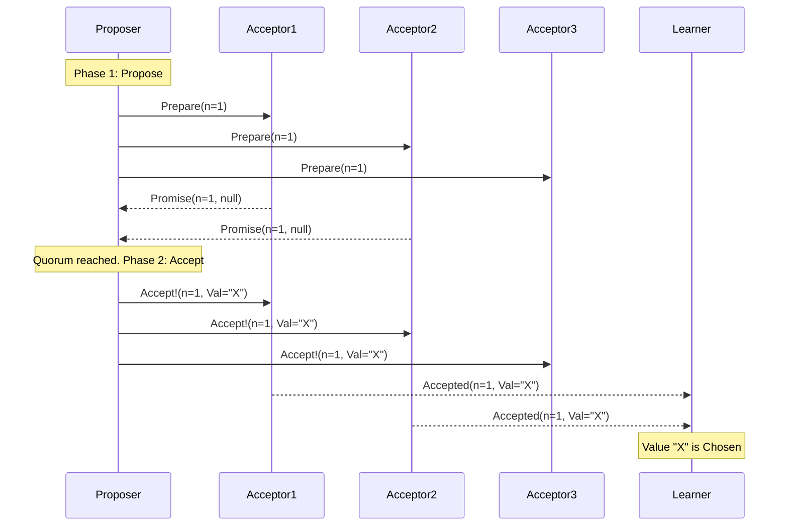
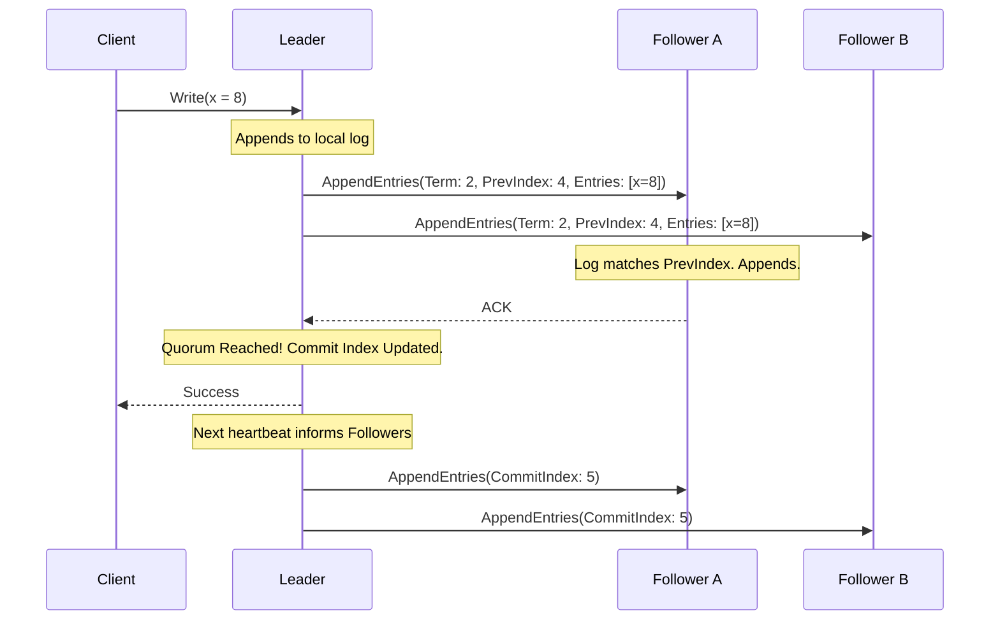

# Chapter 14: Consensus
> A deeply technical, exhaustive dive into distributed consensus protocols, exploring how distributed systems agree on values and event ordering in the presence of failures.

## Table of Contents
- [Chapter Overview](#chapter-overview)
- [The Consensus Problem & FLP Impossibility](#the-consensus-problem--flp-impossibility)
- [Broadcast Abstractions](#broadcast-abstractions)
- [Virtual Synchrony](#virtual-synchrony)
- [Zookeeper Atomic Broadcast (ZAB)](#zookeeper-atomic-broadcast-zab)
- [Paxos and Its Variations](#paxos-and-its-variations)
  - [Classic Paxos](#classic-paxos)
  - [Multi-Paxos](#multi-paxos)
  - [Fast Paxos](#fast-paxos)
  - [Egalitarian Paxos (EPaxos)](#egalitarian-paxos-epaxos)
  - [Flexible Paxos](#flexible-paxos)
  - [Generalized Solution to Consensus](#generalized-solution-to-consensus)
- [Raft Consensus Algorithm](#raft-consensus-algorithm)
- [Byzantine Fault Tolerance (PBFT)](#byzantine-fault-tolerance-pbft)
- [Worked Examples & Code Implementations](#worked-examples--code-implementations)
- [Design Patterns & Best Practices](#design-patterns--best-practices)
- [Trade-offs & Decision Framework](#trade-offs--decision-framework)
- [Interview & System Design Angles](#interview--system-design-angles)
- [AI/ML Engineering Relevance](#aiml-engineering-relevance)
- [Key Takeaways](#key-takeaways)
- [Glossary](#glossary)

---

## Chapter Overview

Consensus is the pinnacle of distributed systems research. The algorithms in this chapter allow multiple independent processes to reach an agreement on a value or a sequence of values, ensuring that the system functions consistently even when network partitions occur or nodes crash. 

Consensus is the backbone of robust, strongly consistent systems. It puts events in a specific total order and provides certainty that all participating nodes will observe the exact same sequence of state changes. While concepts like gossip protocols spread information eventually, consensus guarantees immediate agreement (linearizability) among participants, making it essential for core infrastructure services like leader election, distributed locks, and replicated state machines.

From a theoretical perspective, any consensus algorithm must guarantee three properties:
1. **Agreement:** The decision value is the exact same for all correct processes.
2. **Validity:** The decided value must have been proposed by one of the processes (no arbitrary default values).
3. **Termination:** All correct processes will eventually reach the decision.

## The Consensus Problem & FLP Impossibility

### The FLP Impossibility
The **FLP Impossibility Theorem** (Fischer, Lynch, Paterson - 1985) fundamentally dictates that in a **completely asynchronous system**, it is impossible to guarantee consensus in a bounded amount of time if even a single node can crash. 
* In a purely asynchronous network, message delivery latency is unbounded.
* Therefore, it is impossible for an alive process to distinguish between a crashed node and a very slow node.
* Because of this, deterministically guaranteeing both **Safety** (no two nodes decide differently) and **Liveness** (every correct node eventually decides) is impossible.

### Practical Implications
Since failure detection can never be 100% accurate in an asynchronous model, practical consensus algorithms (like Paxos and Raft) prioritize **Safety** over Liveness. 
* They use timeouts to suspect failures and trigger leader elections. 
* They guarantee that an incorrect decision is *never* made, even if the system briefly halts (losing Liveness) while waiting for network conditions to stabilize.

---

## Broadcast Abstractions

A critical building block for consensus is message dissemination. Different broadcast abstractions offer different guarantees.

### 1. Best-Effort Broadcast
* **Concept:** The sender simply loops through all targets and sends the message.
* **Failure Mode:** If the sender crashes midway, some nodes get the message, and some do not. No recovery is attempted by the receivers. Silent failures occur.

### 2. Reliable Broadcast
* **Concept:** Guarantees that all correct processes receive the same messages, even if the initial sender crashes.
* **How It Works:** Uses a flooding mechanism. When a process receives a message, it immediately forwards it to all other known processes.
* **Cost:** Generates $O(N^2)$ messages, flooding the network, but significantly improves reliability.

### 3. Atomic Broadcast (Total Order Multicast)
* **Concept:** A reliable broadcast that guarantees **Total Order**. 
* **Properties:**
  1. **Atomicity:** Either all non-failed processes deliver the message, or none do.
  2. **Order:** All non-failed processes deliver the messages in the *exact same order*.
* **Relevance:** Atomic broadcast is computationally equivalent to solving consensus in a system with crash failures. 

---

## Virtual Synchrony

Virtual Synchrony is an abstraction for group communication that delivers totally ordered messages to a *dynamic* group of peers.

### How It Works
* Nodes are organized into **Groups**. 
* The system provides a consistent **Group View** to all members.
* When a node joins, leaves, or crashes, a **View Change** occurs.
* **Delivery Guarantees:** Virtual synchrony draws a strict boundary between message *receipt* (arriving at a node) and *delivery* (processed by the node). A message sent in a specific View $V_i$ can *only* be delivered in $V_i$.
* **Barrier Synchronization:** View changes act as barriers. A message cannot cross a view change boundary. If a view change is announced, all pending messages for the current view must be fully delivered to all surviving members before transitioning to the new view.

---

## Zookeeper Atomic Broadcast (ZAB)

Apache Zookeeper uses ZAB to ensure total order and atomic delivery across its replicas. ZAB employs a strongly-consistent leader-follower model.

### Core Concepts
* **Roles:** Leader and Follower.
* **Epochs:** Protocol timeline is split into Epochs (monotonically increasing). Only one leader exists per epoch.
* **Heartbeats:** The leader must maintain a quorum of heartbeats. If it loses the quorum, it steps down.

### The Three Phases of ZAB

1. **Discovery:**
   * A prospective leader contacts nodes to learn the latest epoch.
   * It proposes a new epoch ID greater than any seen.
   * Followers acknowledge with the highest transaction ID they saw in the previous epoch.
   * *Safety Constraint:* Followers stop accepting proposals from older epochs.
2. **Synchronization:**
   * The prospective leader proposes itself as the leader for the new epoch.
   * The leader ensures all followers have the same history by streaming any missing committed proposals from earlier epochs.
   * *Safety Constraint:* Followers will not accept leader attempts from any other process for this epoch.
3. **Broadcast:**
   * Active messaging starts. 
   * The leader receives a client write, establishes order, and broadcasts a proposal to followers.
   * Followers acknowledge. Once a quorum acknowledges, the leader sends a commit message.

### Diagram: ZAB Broadcast Flow



### Fast Recovery Optimization
Because ZAB ensures total order, during synchronization, the leader simply identifies the follower with the highest transaction ID and streams data exclusively from that node, avoiding complex multi-node state reconciliation.

---

## Paxos and Its Variations

Paxos, introduced by Leslie Lamport, is the foundational algorithm for distributed consensus. It allows a set of nodes to agree on a single value (Single-Decree Paxos).

### Roles in Paxos
* **Proposers:** Receive client requests, create proposals (with a sequence number and value), and attempt to collect votes.
* **Acceptors:** Vote to accept or reject proposals. A quorum of acceptors is required to agree.
* **Learners:** Replicas that simply learn the agreed-upon value.
*(Note: In practice, a single physical node plays all three roles simultaneously).*

### Classic Paxos: The Two-Phase Algorithm

Paxos guarantees consensus over two phases:

#### Phase 1: Propose (Voting / Leader Election for the Round)
1. **Prepare:** A Proposer selects a unique, monotonically increasing proposal number $n$ and sends a `Prepare(n)` message to a majority of Acceptors.
2. **Promise:** An Acceptor receives `Prepare(n)`. 
   * If $n$ is greater than any proposal number it has ever responded to, it promises *never* to accept any future proposals with a number less than $n$.
   * If the Acceptor has already accepted a value in the past (say, proposal $m$ with value $v$), it includes `(m, v)` in its response.

#### Phase 2: Accept (Replication)
1. **Accept Request:** Once the Proposer receives Promises from a quorum, it examines the responses.
   * If any Acceptor returned an already-accepted value, the Proposer *must* abandon its own value and adopt the highest-numbered value returned by the Acceptors.
   * If no values were returned, the Proposer can use its own value $v$.
   * It sends `Accept!(n, v)` to a quorum of Acceptors.
2. **Accepted:** An Acceptor accepts `Accept!(n, v)` *unless* it has already responded to a `Prepare` with a number greater than $n$. If accepted, it notifies the Learners.

### Diagram: Normal Paxos Execution



### Quorums and Safety
Paxos relies on overlapping majorities (quorums). If $2f+1$ nodes exist, the system tolerates $f$ failures. Since any two majorities intersect by at least one node, it is impossible for two different Proposers to independently commit different values. 

### Failure Scenarios
* **Proposer Fails Before Phase 2:** A new Proposer uses a higher $n$. The Acceptors haven't accepted anything, so the new Proposer safely proposes its own value.
* **Proposer Fails Mid-Phase 2:** Value $V_1$ is accepted by a minority (e.g., Acceptor1). A new Proposer starts Phase 1. Its quorum will intersect with Acceptor1. The new Proposer discovers $V_1$ and is forced to drive $V_1$ to completion. *This is how Paxos ensures a decided value is never lost.*
* **Dueling Proposers (Livelock):** Proposer A sends `Prepare(1)`. Proposer B sends `Prepare(2)`. Acceptors promise B. Proposer A's `Accept!(1)` is rejected. A retries with `Prepare(3)`. Acceptors promise A. B's `Accept!(2)` is rejected. This loops forever.
  * **Solution:** Randomized backoff timers.

---

### Multi-Paxos
Running full two-phase Paxos for every single command is slow. Multi-Paxos optimizes this by electing a **Stable Leader** (a distinguished Proposer).
* **Optimization:** Once a Leader is established via Phase 1, it skips Phase 1 for all subsequent commands, jumping straight to Phase 2 (`Accept!`).
* **Leases:** To serve strongly consistent reads without querying a quorum, the Leader uses time-bound **leases**. Acceptors promise not to accept other leaders during the lease duration. This relies strictly on bounded clock drift for safety.

---

### Fast Paxos
Fast Paxos reduces round-trips by allowing clients/proposers to bypass the Leader and send `Accept!` requests directly to Acceptors.
* **Trade-off:** The quorum size must increase to $2f + 1$ out of $3f + 1$ total nodes (Classic Paxos only needs $f + 1$ out of $2f + 1$).
* **Collisions:** If two clients propose simultaneously, Acceptors might accept different values (a collision). The Leader must intervene, execute a classic round, and resolve the conflict. Under high load, collisions make Fast Paxos slower than Classic Paxos.

---

### Egalitarian Paxos (EPaxos)
EPaxos eliminates the single-leader bottleneck. It allows *any* node to drive consensus for a specific command.
* **Mechanism:** It uses **Command Dependencies**. A proposal includes a command and its dependencies (other potentially conflicting commands).
* **Fast Path:** The leader node sends a `Pre-Accept` to a "fast quorum" ($3f/4$). If all replicas agree on the exact same dependencies, the command is committed immediately in 1 round-trip.
* **Slow Path:** If replicas disagree on dependencies (meaning concurrent conflicting writes occurred), the leader merges the dependencies, bumps the sequence number, and runs a standard Paxos-like accept phase.
* **Execution:** Replicas build a dependency graph and execute commands in reverse-dependency order. Non-conflicting writes (e.g., to different keys) run fully concurrently.

---

### Flexible Paxos
Traditional consensus assumes all quorums must be a simple majority. Flexible Paxos proved this is false. 
* **The Math:** Let $Q_1$ be the Phase 1 (election) quorum size, and $Q_2$ be the Phase 2 (replication) quorum size. The only mathematical requirement is that $Q_1 + Q_2 > N$.
* **Application:** Phase 2 (replication) happens constantly, while Phase 1 (election) is rare. You can shrink $Q_2$ (e.g., require only 2 nodes out of 5 for replication) as long as you increase $Q_1$ (e.g., require 4 nodes out of 5 for leader election). This trades slightly lower availability during leader elections for significantly lower latency during steady-state replication.

---

## Raft Consensus Algorithm

Designed in 2013 specifically for **understandability**, Raft decomposes consensus into Leader Election, Log Replication, and Safety.

### Core Concepts
* **Roles:** Leader, Follower, Candidate.
* **Terms:** Time is divided into monotonically increasing terms. A new term starts with an election.
* **Log Entries:** A sequence of commands. Each entry has an index, a term ID, and the command payload.

### Leader Election
1. Followers expect periodic heartbeats from the Leader.
2. If the **Election Timeout** fires, a Follower transitions to **Candidate**, increments the term, votes for itself, and broadcasts `RequestVote`.
3. **Safety Check:** A Follower will *only* grant a vote if the Candidate's log is at least as up-to-date as its own (comparing the term of the last entry, and then the length of the log).
4. The Candidate that gets a majority of votes becomes the new Leader.

### Log Replication
1. Leader receives a command and appends it to its local log.
2. Leader sends `AppendEntries` to all Followers.
3. Followers verify the entry: The Leader includes the `index` and `term` of the *previous* log entry. If the Follower doesn't have an exact match at that index, it rejects the append. This forces the Leader to back up and overwrite the Follower's divergent history.
4. Once a majority of Followers ACK, the Leader **commits** the entry locally and applies it to its state machine.
5. The Leader notifies Followers of the new `commitIndex` in subsequent RPCs.

### Diagram: Raft Log Replication



---

## Byzantine Fault Tolerance (PBFT)

Previous algorithms handle *crash faults*. What if nodes are malicious, compromised, or experiencing bit flips (Byzantine faults)? 

### Practical Byzantine Fault Tolerance (PBFT)
PBFT ensures safety and liveness assuming up to $f$ nodes are Byzantine out of a total of $N = 3f + 1$ nodes.
* Why $3f+1$? Because if $f$ nodes are malicious, and $f$ nodes are just slow/partitioned, we must be able to reach consensus with the remaining $f+1$ nodes. $(f) + (f) + (f+1) = 3f+1$.
* **Cryptography:** All messages are cryptographically signed and hashes (digests) are verified.

### Protocol Phases ($O(N^2)$ Complexity)
1. **Pre-prepare:** The primary (leader) receives a request and broadcasts a signed `Pre-prepare` message with a hash of the payload.
2. **Prepare:** Backups verify the signature/hash and broadcast a `Prepare` message to *every other node*. A node waits until it receives $2f$ identical `Prepare` messages from different nodes. This ensures the primary didn't lie to different nodes.
3. **Commit:** Nodes broadcast a `Commit` message to all peers. Once a node collects $2f+1$ identical `Commit` messages, the command is executed.

---

## Worked Examples & Code Implementations

The following complete, runnable Python 3 implementations demonstrate fundamental consensus mechanics: single-decree Paxos safety under competing proposals, Raft log replication with conflict resolution, and Flexible Paxos asymmetric quorum tradeoffs.

### 1. Single-Decree Classic Paxos Simulation

This script models Paxos Acceptors and Proposers navigating Phase 1 (`Prepare`/`Promise`) and Phase 2 (`Accept!`/`Accepted`). It demonstrates the core Paxos safety invariant: when Proposer 2 preempts Proposer 1 after a value was partially accepted, Proposer 2 discovers the accepted value and is forced to propose that same value, ensuring consensus stability.

```python
from dataclasses import dataclass
from typing import Optional, List

@dataclass
class Promise:
    accepted: bool
    highest_promised_ballot: int
    accepted_ballot: Optional[int] = None
    accepted_value: Optional[str] = None

class Acceptor:
    def __init__(self, node_id: int):
        self.node_id = node_id
        self.promised_ballot: int = 0
        self.accepted_ballot: Optional[int] = None
        self.accepted_value: Optional[str] = None

    def receive_prepare(self, ballot_num: int) -> Promise:
        """Phase 1b: Promise not to accept lower ballots if ballot_num > promised_ballot."""
        if ballot_num > self.promised_ballot:
            self.promised_ballot = ballot_num
            return Promise(
                accepted=True,
                highest_promised_ballot=ballot_num,
                accepted_ballot=self.accepted_ballot,
                accepted_value=self.accepted_value
            )
        return Promise(accepted=False, highest_promised_ballot=self.promised_ballot)

    def receive_accept(self, ballot_num: int, value: str) -> bool:
        """Phase 2b: Accept value if ballot_num >= promised_ballot."""
        if ballot_num >= self.promised_ballot:
            self.promised_ballot = ballot_num
            self.accepted_ballot = ballot_num
            self.accepted_value = value
            return True
        return False

class PaxosCluster:
    def __init__(self, num_acceptors: int):
        self.acceptors = [Acceptor(i + 1) for i in range(num_acceptors)]
        self.majority = (num_acceptors // 2) + 1

    def run_simulation(self):
        print("--- 1. Single-Decree Classic Paxos Simulation ---")
        print(f"Cluster initialized with {len(self.acceptors)} acceptors. Quorum majority = {self.majority}\n")

        # Step 1: Proposer 1 initiates Phase 1 (Prepare)
        print("[Step 1] Proposer 1 initiates Phase 1 (Prepare) with Ballot 100 for value 'TXN_A'")
        p1_promises = []
        for acc in self.acceptors[:2]:  # Quorum of 2/3
            p = acc.receive_prepare(100)
            p1_promises.append((acc.node_id, p))
            print(f"  Acceptor {acc.node_id} -> Promise(ballot=100, prev_val={p.accepted_value})")

        # Step 2: Proposer 1 begins Phase 2 (Accept) on Acceptor 1 only before network delay
        print("\n[Step 2] Proposer 1 begins Phase 2 (Accept) with Ballot 100, Value 'TXN_A'")
        acc1_accepted = self.acceptors[0].receive_accept(100, "TXN_A")
        print(f"  Acceptor 1 accepts ('TXN_A', ballot=100): {acc1_accepted}")
        print("  * Network delay: Proposer 1's accept message to Acceptor 2 is delayed...")

        # Step 3: Proposer 2 intervenes with higher Ballot 200
        print("\n[Step 3] Proposer 2 intervenes with Ballot 200 for value 'TXN_B'")
        print("  Proposer 2 sends Prepare(ballot=200) to all 3 Acceptors:")
        p2_promises = []
        for acc in self.acceptors:
            p = acc.receive_prepare(200)
            p2_promises.append((acc.node_id, p))
            print(f"  Acceptor {acc.node_id} -> Promise(ballot=200, highest_accepted_ballot={p.accepted_ballot}, val='{p.accepted_value}')")

        # Step 4: Proposer 2 adopts the highest ballot value seen
        highest_ballot = -1
        adopted_value = "TXN_B"
        for node_id, p in p2_promises:
            if p.accepted_ballot is not None and p.accepted_ballot > highest_ballot:
                highest_ballot = p.accepted_ballot
                adopted_value = p.accepted_value

        print(f"\n[Step 4] Paxos Invariant Check: Highest accepted value observed was '{adopted_value}' (at ballot {highest_ballot})")
        print(f"  Proposer 2 MUST abandon its own value 'TXN_B' and propose '{adopted_value}' instead!")

        # Step 5: Proposer 2 sends Accept(200, adopted_value)
        print(f"\n[Step 5] Proposer 2 sends Accept(ballot=200, value='{adopted_value}') to all Acceptors:")
        accepted_count = sum(1 for acc in self.acceptors if acc.receive_accept(200, adopted_value))

        if accepted_count >= self.majority:
            print(f"\n>> CONSENSUS DECIDED: Value '{adopted_value}' chosen with quorum ({accepted_count}/{len(self.acceptors)}). Safety preserved!")

cluster = PaxosCluster(3)
cluster.run_simulation()
```

**Execution Output:**
```text
--- 1. Single-Decree Classic Paxos Simulation ---
Cluster initialized with 3 acceptors. Quorum majority = 2

[Step 1] Proposer 1 initiates Phase 1 (Prepare) with Ballot 100 for value 'TXN_A'
  Acceptor 1 -> Promise(ballot=100, prev_val=None)
  Acceptor 2 -> Promise(ballot=100, prev_val=None)

[Step 2] Proposer 1 begins Phase 2 (Accept) with Ballot 100, Value 'TXN_A'
  Acceptor 1 accepts ('TXN_A', ballot=100): True
  * Network delay: Proposer 1's accept message to Acceptor 2 is delayed...

[Step 3] Proposer 2 intervenes with Ballot 200 for value 'TXN_B'
  Proposer 2 sends Prepare(ballot=200) to all 3 Acceptors:
  Acceptor 1 -> Promise(ballot=200, highest_accepted_ballot=100, val='TXN_A')
  Acceptor 2 -> Promise(ballot=200, highest_accepted_ballot=None, val='None')
  Acceptor 3 -> Promise(ballot=200, highest_accepted_ballot=None, val='None')

[Step 4] Paxos Invariant Check: Highest accepted value observed was 'TXN_A' (at ballot 100)
  Proposer 2 MUST abandon its own value 'TXN_B' and propose 'TXN_A' instead!

[Step 5] Proposer 2 sends Accept(ballot=200, value='TXN_A') to all Acceptors:
  Acceptor 1 accepted: True
  Acceptor 2 accepted: True
  Acceptor 3 accepted: True

>> CONSENSUS DECIDED: Value 'TXN_A' chosen with quorum (3/3). Safety preserved!
```

---

### 2. Raft Log Replication & Divergence Repair

This script simulates the Raft Leader-Follower log replication protocol. When a follower contains uncommitted entries from an old leader term that diverged, the leader uses `prevLogIndex` and `prevLogTerm` in `AppendEntries` to back up, detect the point of divergence, truncate conflicting uncommitted entries, and synchronize the follower's log.

```python
from dataclasses import dataclass
from typing import List

@dataclass
class LogEntry:
    term: int
    command: str

@dataclass
class AppendResult:
    term: int
    success: bool
    match_index: int

class RaftFollower:
    def __init__(self, node_id: str, current_term: int, log: List[LogEntry]):
        self.node_id = node_id
        self.current_term = current_term
        self.log = list(log)
        self.commit_index = 0

    def append_entries(self, term: int, leader_id: str, prev_log_index: int,
                       prev_log_term: int, entries: List[LogEntry],
                       leader_commit: int) -> AppendResult:
        # Rule 1: Reply false if term < currentTerm
        if term < self.current_term:
            return AppendResult(self.current_term, False, len(self.log))

        # Rule 2: Reply false if log doesn't contain entry matching prevLogIndex and prevLogTerm
        if prev_log_index > 0:
            if prev_log_index > len(self.log):
                return AppendResult(self.current_term, False, len(self.log))
            if self.log[prev_log_index - 1].term != prev_log_term:
                return AppendResult(self.current_term, False, prev_log_index - 1)

        # Rule 3 & 4: Overwrite conflicting entries and append new ones
        insert_index = prev_log_index
        for i, entry in enumerate(entries):
            idx = insert_index + i
            if idx < len(self.log):
                if self.log[idx].term != entry.term:
                    self.log = self.log[:idx]
                    self.log.append(entry)
            else:
                self.log.append(entry)

        # Rule 5: Update commitIndex
        if leader_commit > self.commit_index:
            self.commit_index = min(leader_commit, len(self.log))

        return AppendResult(self.current_term, True, len(self.log))

# Setup Leader and divergent Follower log
leader_log = [
    LogEntry(term=1, command="SET a=1"),
    LogEntry(term=1, command="SET b=2"),
    LogEntry(term=2, command="SET c=3"),
    LogEntry(term=3, command="SET d=4"),
    LogEntry(term=3, command="SET e=5"),
]
follower_log = [
    LogEntry(term=1, command="SET a=1"),
    LogEntry(term=1, command="SET b=2"),
    LogEntry(term=1, command="SET x=99"),  # Divergent uncommitted entry at index 3
]

follower = RaftFollower("Node-2", current_term=3, log=follower_log)
leader_commit = 4
next_index = 5  # Leader starts optimistically at end of log

print("--- Raft Log Repair Simulation ---")
step = 1
while True:
    prev_log_index = next_index - 1
    prev_log_term = leader_log[prev_log_index - 1].term if prev_log_index > 0 else 0
    entries_to_send = leader_log[prev_log_index:]

    print(f"\n[Round {step}] Leader sends AppendEntries(prevLogIndex={prev_log_index}, prevLogTerm={prev_log_term}, entries={[e.command for e in entries_to_send]}):")

    res = follower.append_entries(
        term=3, leader_id="Leader-1",
        prev_log_index=prev_log_index,
        prev_log_term=prev_log_term,
        entries=entries_to_send,
        leader_commit=leader_commit
    )

    if res.success:
        print(f"  Follower: SUCCESS (matched up to index {res.match_index}, commitIndex={follower.commit_index})")
        break
    else:
        print(f"  Follower: REJECT (log mismatch). Leader decrements next_index ({next_index} -> {next_index - 1})")
        next_index -= 1
        step += 1

print("\nFinal Synchronized Follower Log:")
for i, entry in enumerate(follower.log, 1):
    status = "(COMMITTED)" if i <= follower.commit_index else "(UNCOMMITTED)"
    print(f"  [{i}] Term {entry.term}: {entry.command} {status}")
```

**Execution Output:**
```text
--- Raft Log Repair Simulation ---

[Round 1] Leader sends AppendEntries(prevLogIndex=4, prevLogTerm=3, entries=['SET e=5']):
  Follower: REJECT (log mismatch). Leader decrements next_index (5 -> 4)

[Round 2] Leader sends AppendEntries(prevLogIndex=3, prevLogTerm=2, entries=['SET d=4', 'SET e=5']):
  Follower: REJECT (log mismatch). Leader decrements next_index (4 -> 3)

[Round 3] Leader sends AppendEntries(prevLogIndex=2, prevLogTerm=1, entries=['SET c=3', 'SET d=4', 'SET e=5']):
  Follower: SUCCESS (matched up to index 5, commitIndex=4)

Final Synchronized Follower Log:
  [1] Term 1: SET a=1 (COMMITTED)
  [2] Term 1: SET b=2 (COMMITTED)
  [3] Term 2: SET c=3 (COMMITTED)
  [4] Term 3: SET d=4 (COMMITTED)
  [5] Term 3: SET e=5 (UNCOMMITTED)
```

---

### 3. Flexible Paxos Quorum Configuration & Tradeoffs

Flexible Paxos proves that quorums only need to intersect across phases ($Q_1 + Q_2 > N$), removing the requirement that $Q_2$ (write quorum) intersect with itself. This allows tuning write quorums to be smaller ($Q_2 = 2$) for low latency and high write fault tolerance, while making leader election quorums larger ($Q_1 = N - Q_2 + 1$).

```python
def analyze_flexible_paxos():
    configs = [
        {"N": 5, "Q1": 3, "Q2": 3, "name": "Classic Majority Paxos (N=5)"},
        {"N": 5, "Q1": 4, "Q2": 2, "name": "Flexible Paxos: Fast Writes (N=5)"},
        {"N": 7, "Q1": 4, "Q2": 4, "name": "Classic Majority Paxos (N=7)"},
        {"N": 7, "Q1": 6, "Q2": 2, "name": "Flexible Paxos: Ultra-Fast Writes (N=7)"},
        {"N": 7, "Q1": 5, "Q2": 3, "name": "Flexible Paxos: Balanced (N=7)"},
    ]

    header = f"{'Configuration':<38} | {'N':<3} | {'Q1 (Election)':<13} | {'Q2 (Write)':<10} | {'Write Tolerance':<15} | {'Election Tolerance'}"
    print(header)
    print("-" * len(header))

    for cfg in configs:
        n, q1, q2 = cfg["N"], cfg["Q1"], cfg["Q2"]
        write_tolerance = n - q2      # Node crashes tolerated before write quorum is lost
        election_tolerance = n - q1   # Node crashes tolerated before election quorum is lost
        print(f"{cfg['name']:<38} | {n:<3} | {q1:<13} | {q2:<10} | {write_tolerance} nodes failure | {election_tolerance} nodes failure")

analyze_flexible_paxos()
```

**Execution Output:**
```text
Configuration                          | N   | Q1 (Election) | Q2 (Write) | Write Tolerance | Election Tolerance
----------------------------------------------------------------------------------------------------------------
Classic Majority Paxos (N=5)           | 5   | 3             | 3          | 2 nodes failure | 2 nodes failure
Flexible Paxos: Fast Writes (N=5)      | 5   | 4             | 2          | 3 nodes failure | 1 nodes failure
Classic Majority Paxos (N=7)           | 7   | 4             | 4          | 3 nodes failure | 3 nodes failure
Flexible Paxos: Ultra-Fast Writes (N=7) | 7   | 6             | 2          | 5 nodes failure | 1 nodes failure
Flexible Paxos: Balanced (N=7)         | 7   | 5             | 3          | 4 nodes failure | 2 nodes failure
```

---

## Design Patterns & Best Practices

1. **Replicated State Machine (RSM):** Consensus is almost always used to build an RSM. The algorithm perfectly sequences an append-only log of deterministic commands. Every node replays the log; therefore, every node ends up in the exact same state.
2. **Leases for Local Reads:** To avoid distributed quorums on read requests, use time-bound leases. A leader guarantees it won't be replaced for $T$ milliseconds, so it can safely serve reads locally. *Requires tight control over NTP/clock drift.*
3. **Randomized Backoffs:** Always use randomized timeouts (like Raft's election timeout or Paxos's restart backoff) to break symmetry and prevent livelock when multiple nodes attempt to become leaders simultaneously.
4. **Log Compaction / Snapshots:** Consensus logs grow infinitely. Periodically, the state machine must dump a snapshot to disk, allowing the system to truncate the distributed log up to that point.

---

## Trade-offs & Decision Framework

| Algorithm | Node Roles | Message Complexity | Best Use Case |
|-----------|------------|--------------------|---------------|
| **Classic Paxos** | Proposer, Acceptor | High (2 phases per write) | Theoretical foundation; single-value agreement. |
| **Multi-Paxos** | Stable Leader | Low (1 phase per write) | High-throughput, strongly consistent databases (Spanner). |
| **Raft** | Leader, Follower | Low (1 phase per write) | When developer understandability and operational simplicity are paramount (Etcd, Consul). |
| **EPaxos** | Leaderless | Varies (1 phase if no conflict) | Geo-distributed setups where leader latency is unacceptable and workloads have low key conflicts. |
| **ZAB** | Leader, Follower | Low | Systems needing strict FIFO client order and fast recovery (Zookeeper). |
| **PBFT** | Primary, Backup | $O(N^2)$ | Untrusted environments, blockchain, consortium networks. |

---

## Interview & System Design Angles

**1. "How do you split a brain?" (Network Partitions)**
*   **Answer:** Consensus algorithms mathematically prevent split-brain by requiring a strict majority (quorum). In a 5-node cluster split into 3 and 2, the partition with 3 nodes continues. The partition with 2 nodes halts because it cannot form a quorum. 

**2. Spanner vs. Cassandra:**
*   **Angle:** Cassandra uses AP (Availability/Partition-tolerance) techniques like sloppy quorums and hinted handoffs. It uses Last-Write-Wins and vector clocks, giving *Eventual Consistency*. Google Spanner uses CP (Multi-Paxos under the hood) mapped to TrueTime, giving strict *Linearizability*.

**3. Why odd numbers of nodes?**
*   **Angle:** 3 nodes tolerate 1 failure. 4 nodes *also* only tolerate 1 failure (majority is 3). Therefore, adding a 4th node decreases reliability (more nodes that could fail, without increasing fault tolerance) and increases latency. Always use $2f+1$ (3, 5, or 7).

---

## AI/ML Engineering Relevance

While consensus seems purely infrastructural, it heavily impacts ML platforms:
1. **Feature Stores & Vector Databases:** Systems like Milvus or distributed feature stores (Feast on highly available backends) rely on Raft/Paxos to maintain strong consistency for metadata, schema changes, and cluster topology. 
2. **Distributed Training:** Tools like PyTorch Distributed/Ray rely on strongly consistent key-value stores (Etcd) to coordinate worker nodes, track training epochs, handle leader election for the Parameter Server, and detect worker crashes reliably.
3. **Model Serving:** When deploying active-active model serving architectures, consensus guarantees that rate limits, dynamic weight updates, and traffic routing rules are globally consistent, preventing catastrophic split-brain routing.

---

## Key Takeaways

* **Consensus = Total Order:** The true goal of consensus is getting a distributed set of machines to agree on the exact order of a sequence of events.
* **Safety over Liveness:** Because of the FLP Impossibility theorem, Paxos and Raft guarantee they will never make a wrong decision (Safety), but they might temporarily stall if the network is highly unstable (Liveness).
* **Quorums are the Arbiter:** The overlap of majorities is the mathematical bedrock of all non-Byzantine consensus.
* **Leader Bottlenecks:** Multi-Paxos and Raft funnel all writes through a single leader. Algorithms like EPaxos trade simplicity for leaderless, dependency-graph-based concurrent writes.
* **Raft vs. Paxos:** Raft is fundamentally a refined, highly-constrained version of Multi-Paxos optimized for software engineering and implementation simplicity.

---

## Glossary

* **Liveness:** The property that a system will eventually make progress and reach a decision.
* **Safety:** The property that a system will never return an incorrect or conflicting result.
* **Linearizability:** A correctness condition where an operation appears to take effect instantaneously at exactly one point in time between its invocation and completion.
* **Quorum:** The minimum number of votes (usually a majority) required to perform an operation.
* **Epoch / Term:** A monotonically increasing logical time unit during which a specific node acts as the leader.
* **Split Vote:** A scenario where multiple nodes attempt to become leader simultaneously and the votes are divided such that no one achieves a quorum.
