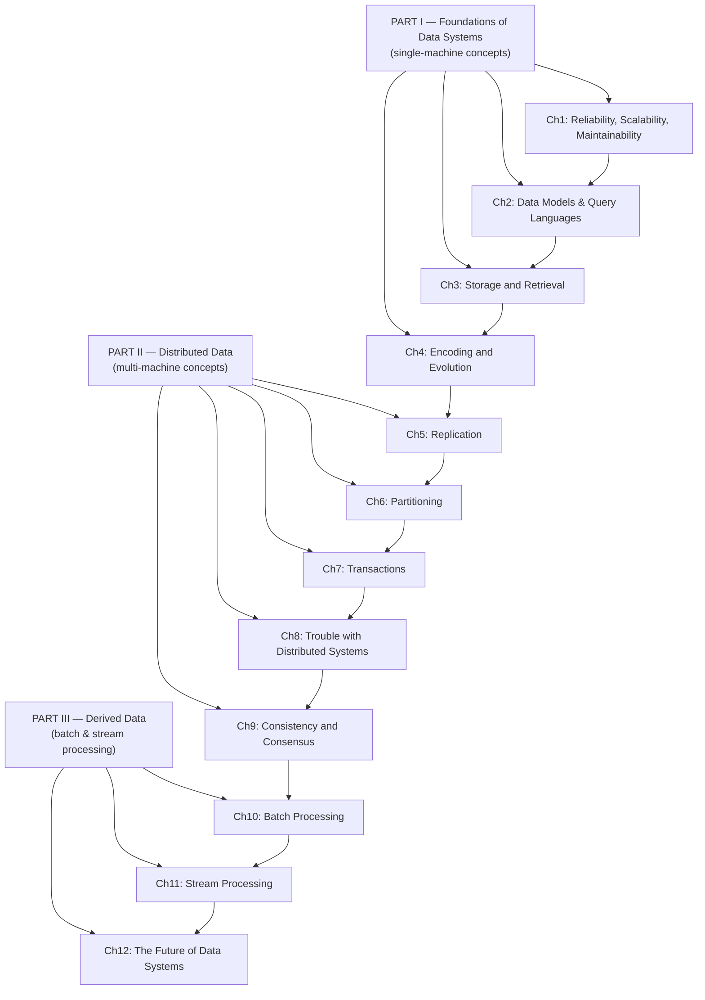

# Designing Data-Intensive Applications — Detailed Notes Index

> A chapter-by-chapter deep dive into Martin Kleppmann's *Designing Data-Intensive Applications*, built directly from the book's own text (definitions, worked examples, named systems, and the author's own opinions where the book expresses them). Each file below is self-contained but cross-references the others. Built for SDE-2+/backend interview prep, and for genuinely understanding the book, not just skimming it.

---

## How to Use This Series

- **New to the book / first pass:** read in order, Ch1 → Ch12. Part I builds the vocabulary (storage, encoding) that Part II (distributed data) and Part III (derived data) depend on.
- **Interview cramming:** each file ends with an **"Interview-Ready Talking Points"** section — read just those across all 12 files for a fast, high-signal refresher.
- **Looking something up:** use the map below to jump straight to the right chapter file.
- **Companion material:** two earlier files in this same workspace — `distributed-systems-notes.md` (Dynamo-style KV store internals: consistent hashing, quorums, vector clocks, gossip, Merkle trees) and `microservices-backend-interview-notes.md` (the broader system-design interview landscape: Raft, Sagas, Kafka, caching, resilience patterns) — cover adjacent ground from a more interview-drill angle. This series covers the *book itself*, in the book's own terms and depth.

---

## The Book's Structure at a Glance

---

## Chapter Map

| # | File | Core content |
|---|---|---|
| 1 | `ch01-reliable-scalable-maintainable.md` | Fault vs. failure, chaos engineering, load parameters (Twitter fan-out example), percentiles & tail-latency amplification, operability/simplicity/evolvability |
| 2 | `ch02-data-models-and-query-languages.md` | Relational vs. document vs. graph models, the hierarchical→network→relational→document historical arc, schema-on-read vs. schema-on-write, Cypher/SPARQL/Datalog |
| 3 | `ch03-storage-and-retrieval.md` | Hash indexes, SSTables & LSM-trees, B-trees, write amplification, OLTP vs. OLAP, column-oriented storage, star schemas, materialized views |
| 4 | `ch04-encoding-and-evolution.md` | JSON/XML/binary encodings, Thrift/Protobuf vs. Avro, backward/forward compatibility, why RPC is a "fundamentally flawed" abstraction, the three dataflow modes |
| 5 | `ch05-replication.md` | Single-leader / multi-leader / leaderless replication, replication lag anomalies (read-your-writes, monotonic reads, consistent prefix), quorums and their real-world limitations |
| 6 | `ch06-partitioning.md` | Key-range vs. hash partitioning, secondary index partitioning (document vs. term), rebalancing strategies, request routing |
| 7 | `ch07-transactions.md` | ACID precisely defined, weak isolation levels (read committed, snapshot isolation/MVCC), lost updates, write skew & phantoms, serializability (2PL, SSI, actual serial execution) |
| 8 | `ch08-trouble-with-distributed-systems.md` | Why partial failure is the defining hard problem, unreliable networks/clocks, process pauses, fencing tokens, Byzantine faults |
| 9 | `ch09-consistency-and-consensus.md` | Linearizability vs. serializability, the CAP theorem (and why the book says to avoid it), total order broadcast, 2PC, fault-tolerant consensus (Raft/Paxos/Zab), ZooKeeper |
| 10 | `ch10-batch-processing.md` | Unix philosophy → MapReduce, reduce-side vs. map-side joins, dataflow engines (Spark/Tez/Flink), Pregel/graph processing |
| 11 | `ch11-stream-processing.md` | Message brokers vs. log-based brokers (Kafka), CDC, event sourcing, CQRS, windowing, event time vs. processing time, stream joins, exactly-once semantics |
| 12 | `ch12-future-of-data-systems.md` | Unbundling databases, the end-to-end argument, timeliness vs. integrity, "apology"-based loose constraints, auditability, ethics of predictive analytics |

---

## The Big Ideas That Run Through the Whole Book

A handful of concepts reappear across many chapters — recognizing them is what separates "read the book" from "understood the book":

- **Everything is a log, eventually.** WALs (Ch3) → replication logs (Ch5) → partitioned logs / Kafka (Ch11) → event sourcing (Ch11) → total order broadcast (Ch9) → `CREATE INDEX` itself (Ch12) are all variations on *append-only, ordered records* driving derived state.
- **Declarative beats imperative, almost everywhere.** SQL over CODASYL (Ch2), CSS over manual DOM manipulation (Ch2), relational query optimizers over hand-tracked access paths (Ch2), dataflow-engine relational operators over hand-written MapReduce joins (Ch10).
- **Consensus is everywhere, once you look for it.** Leader election (Ch5, Ch8), linearizable compare-and-set, total order broadcast, and atomic commit (Ch9) are all formally *equivalent* problems.
- **Immutability simplifies fault tolerance.** Batch job inputs (Ch10), event sourcing (Ch11), MVCC (Ch7) — an operation you can safely retry/rerun/reprocess is worth an enormous amount of engineering effort to obtain.
- **The end-to-end argument.** A lower layer's reliability feature (TCP retransmission, a database transaction, a stream processor's "exactly-once") reduces but never eliminates the need for the *application* to solve the problem completely, end to end (Ch4's RPC critique, Ch11's idempotence, Ch12's request-ID pattern).
- **Every "guarantee" has an asterisk worth knowing.** `w+r>n` isn't a strict guarantee (Ch5); "repeatable read" means different things in different databases (Ch7); CAP's definitions don't match common usage (Ch9). Knowing the asterisk is what separates textbook knowledge from interview-grade depth.

---

## Original Short-Form Notes

A more condensed, single-file version of this same book (written before this detailed series) is also in this workspace as `ddia-book-notes.md`, if you want a fast, ~12-section refresher instead of the full per-chapter depth here.