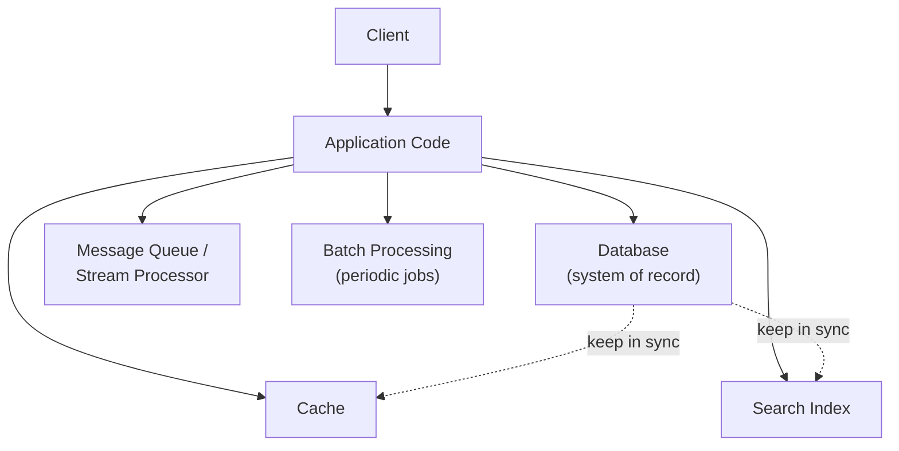
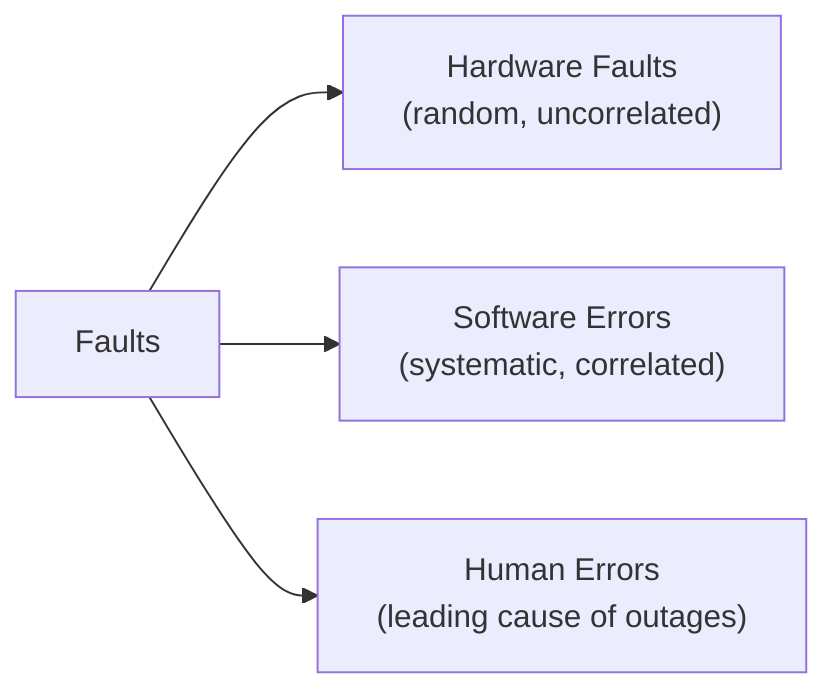
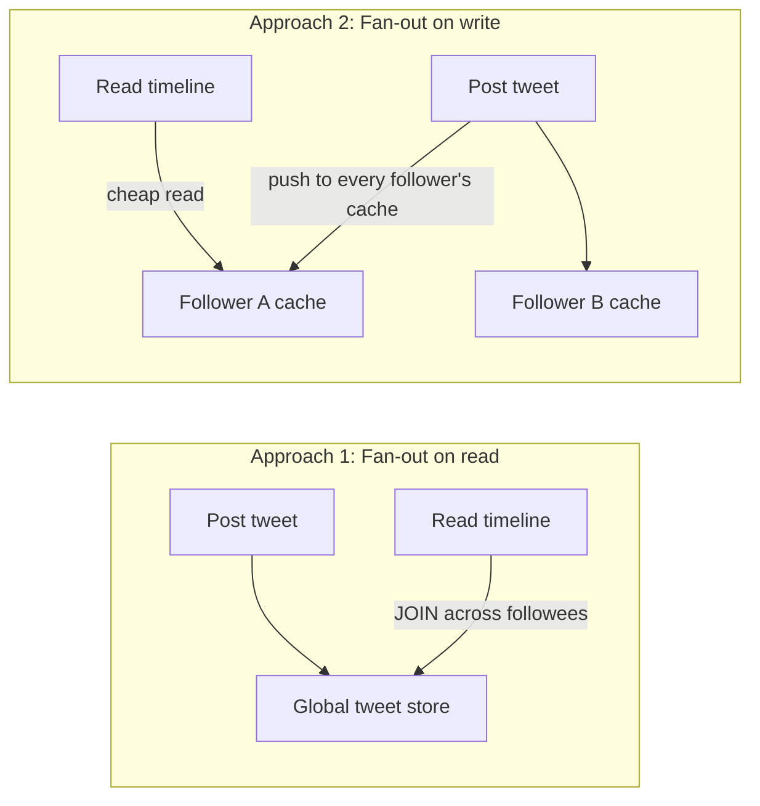
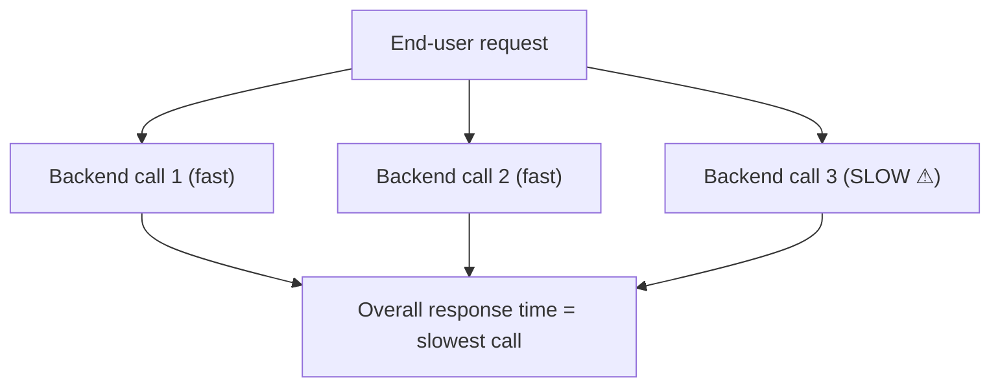
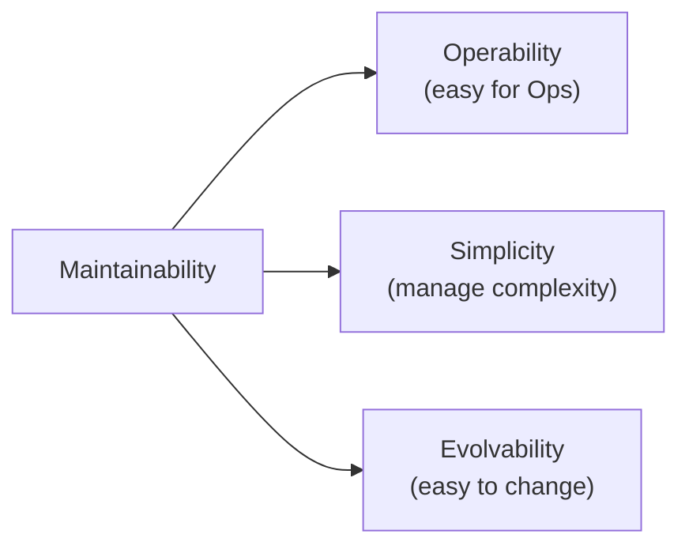

# Chapter 1 — Reliable, Scalable, and Maintainable Applications

> Part of a detailed, chapter-by-chapter note series on *Designing Data-Intensive Applications* (Kleppmann). See `00-index.md` for the full series map.

---

## 1.1 What Is a "Data-Intensive" Application?

Most modern applications are **data-intensive** rather than **compute-intensive** — raw CPU power is rarely the bottleneck; the challenge is the **amount of data, the complexity of data, and the speed at which it changes.**

A data-intensive app is typically assembled from standard building blocks:

| Building block | Purpose | Example tool |
|---|---|---|
| **Database** | Store data so it can be found again later | PostgreSQL, MongoDB |
| **Cache** | Remember the result of an expensive operation to speed up reads | Memcached, Redis |
| **Search index** | Let users search/filter data by keyword | Elasticsearch, Solr |
| **Stream processing** | Send a message to another process, handled asynchronously | Kafka, Flink |
| **Batch processing** | Periodically crunch a large amount of accumulated data | Hadoop, Spark |

**Key insight of the chapter:** the boundaries between these categories are blurring — Redis is a datastore *and* a message queue; Kafka is a message queue with database-like durability. Increasingly, a single application composes **several** specialized tools stitched together with application code, because no single tool meets every requirement. When you do this, you've become not just an application developer but a **data system designer**, responsible for your own composite guarantees (e.g., "the cache stays correctly in sync with the DB").

The book frames the rest of itself around **three core concerns** important in most software systems:

| Concern | One-line definition |
|---|---|
| **Reliability** | Continue to work correctly, even when things go wrong |
| **Scalability** | Reasonable ways of dealing with growth (data, traffic, complexity) |
| **Maintainability** | Many different people can work on it productively over time |

---

## 1.2 Reliability

**Reliability, informally:** the app performs the function the user expected; it tolerates user mistakes/misuse; performance is good enough for the expected load; the system prevents unauthorized access/abuse. Put together: *"continuing to work correctly, even when things go wrong."*

### Fault vs. Failure — the most important distinction in this section
- **Fault** — one *component* of the system deviating from its spec.
- **Failure** — the system *as a whole* stops providing the required service to the user.
- You cannot reduce the probability of a fault to zero (short of trivial/impossible cases — "if Earth were swallowed by a black hole..."), so the goal is to design **fault-tolerance mechanisms that prevent faults from causing failures.**

⭐ **Counterintuitive idea — Chaos Engineering:** In fault-tolerant systems, it can make sense to deliberately *increase* the rate of faults (e.g. randomly killing processes without warning — Netflix's **Chaos Monkey**) to continuously exercise your fault-tolerance machinery and build confidence it actually works when faults occur naturally. Many critical bugs stem from *poor error handling* of rare cases, so deliberately triggering those rare cases in a controlled way surfaces the bugs early.

- Prevention is preferred over cure for a few cases where no cure exists — e.g. **security breaches** (once an attacker has exfiltrated sensitive data, that can't be undone). But most of the book deals with faults that *can* be cured/tolerated.

### The Three Kinds of Faults

#### Hardware Faults
- Disks crash, RAM goes bad, power grids blackout, cables get unplugged. **Hard disk MTTF (mean time to failure) ≈ 10–50 years** → on a cluster of **10,000 disks, expect ~1 disk failure per day** on average.
- First line of defense: **redundancy** — RAID disk arrays, dual power supplies, hot-swappable CPUs, datacenter batteries/diesel generators. Keeps individual machines running for years, but doesn't eliminate the risk of *total* machine failure.
- As systems scale to many machines, the *rate* of hardware faults scales proportionally — plus cloud platforms (AWS etc.) are *designed* to prioritize flexibility/elasticity over single-machine reliability, so VM instances can vanish without warning.
- This pushes systems toward **software fault-tolerance techniques** that tolerate the loss of *entire machines* — which also brings an operational bonus: a system that tolerates machine failure can be patched **one node at a time** (a "rolling upgrade," covered in Chapter 4) instead of requiring full-system downtime.

#### Software Errors
Unlike hardware faults, software bugs are **systematic and correlated** — the same bug fires on every node simultaneously, which is why they tend to cause *more* system failures overall than uncorrelated hardware faults. Examples given in the book:
- A bug triggered by a specific bad input crashing every app instance at once (e.g. the **June 30, 2012 leap-second bug** in the Linux kernel that made many applications hang simultaneously).
- A runaway process consuming a shared resource (CPU, memory, disk, network bandwidth).
- A dependency service slowing down, becoming unresponsive, or returning corrupted responses.
- **Cascading failures** — a small fault in one component triggers a fault in another, which triggers further faults.
- Mitigations (no silver bullet exists): careful assumption-checking, thorough testing, process isolation, allowing crash+restart, and continuous **self-checking** in production (e.g. a message queue that asserts "messages in == messages out" and alerts on discrepancy).

#### Human Errors
- Humans configure and operate these systems, and **one study found configuration errors by operators were the *leading* cause of outages** — hardware faults (servers/network) accounted for only **10–25%** of outages.
- Best systems combine several mitigations:
  - Minimize opportunities for error via good abstractions/APIs/admin UIs that make the right thing easy and the wrong thing hard (but not so restrictive that people route around them).
  - **Decouple** where people make mistakes from where those mistakes cause failures — provide full-featured, non-production **sandbox environments** with real data, so people can experiment safely.
  - Test thoroughly at every level — unit through whole-system integration through manual testing.
  - Allow quick and easy recovery — fast rollback, gradual/canary rollout, and tooling to recompute data if something bad happened.
  - Set up clear monitoring — performance metrics and error rates ("telemetry"), so problems are visible early.
  - Implement good management practices and training.

### How Important Is Reliability?
Reliability isn't only for "critical" systems like nuclear plants or air traffic control. Bugs in ordinary business applications cause lost productivity, and outages of ecommerce sites can have huge revenue and reputational costs. Even in "noncritical" apps, we owe our users a responsibility to behave reliably — e.g. a parent storing photos of their kids trusts the photo app not to corrupt their memories.

---

## 1.3 Scalability

**Scalability ≠ a single number.** The right question is *"if the system grows in a specific way, what are our options for coping?"* You always need to first describe **load** and **performance** quantitatively before you can discuss whether something "scales."

### Describing Load — Load Parameters
Load parameters depend on the system's architecture: requests/sec to a web server, read/write ratio in a DB, number of simultaneously active users, cache hit rate, etc.

**The book's running case study — Twitter's home timeline (~2012 numbers):**

| Operation | Rate |
|---|---|
| Post tweet | ~4.6k requests/sec average, peaking >12k/sec |
| Read home timeline | ~300k requests/sec |

Two competing architectures:

| Approach | Mechanism | Tradeoff |
|---|---|---|
| **1. Fan-out on read** | Home timeline query joins across everyone the user follows at read time | Cheap write, expensive read |
| **2. Fan-out on write** | Maintain a precomputed cache ("mailbox") per user; on tweet post, push into every follower's cache | Cheap read, expensive write |

- Twitter started with approach 1, but it couldn't keep up with the read load, so they switched to approach 2 — because tweet-publish rate is **~2 orders of magnitude lower** than timeline-read rate, so it's better to do more work at write time.
- Downside of approach 2: an average tweet fans out to ~75 followers → **4.6k tweets/sec becomes 345k writes/sec** to timeline caches. But some users have **>30 million followers**, meaning a *single* tweet can cause **>30 million writes**, all ideally delivered within Twitter's 5-second target — a huge engineering challenge.
- **Final twist:** Twitter moved to a **hybrid** — most tweets fan out on write, but tweets from celebrities (very high follower count) are excluded from fan-out and instead fetched separately and merged at read time (approach 1) for just those few accounts. This gives consistently good performance across both normal and celebrity users.
- ⭐ **Takeaway:** the right load parameter to focus on (here, the *distribution of followers per user*, weighted by tweet frequency) is architecture-specific — you have to think about which parameter actually drives your system's fan-out/hot-spot behavior.

### Describing Performance
Two ways to look at scalability once you can describe load:
1. Increase a load parameter, keep resources fixed → how does performance degrade?
2. Increase a load parameter → how much must resources increase to keep performance unchanged?

- **Batch systems** (Hadoop etc.) care about **throughput** — records processed per second, or total job run time for a given dataset size.
- **Online systems** care about **response time** — time between a client sending a request and receiving a response.

> **Latency vs. response time (often confused):** *Response time* is what the client experiences — includes actual processing time (service time) **plus** network delay **plus** queueing delay. *Latency* is the duration a request spends *waiting to be handled* (before service actually starts).

### Percentiles — why the average is misleading
Response time should be treated as a **distribution**, not a single number, because repeated identical requests still vary (context switches, GC pauses, page faults, network retransmits, mechanical vibration in the rack, etc.).

| Metric | Meaning |
|---|---|
| **Mean (average)** | Sum of all values / n — commonly reported but doesn't tell you how many users actually experienced that delay |
| **Median (p50)** | Half of requests are faster, half slower — good proxy for "typical" wait |
| **p95 / p99 / p999** | 95%/99%/99.9% of requests are faster than this threshold — these are the **tail latencies** |

⭐ **Why tail latencies matter (Amazon's example):** Amazon defines internal service response-time requirements at the **99.9th percentile** even though it affects only 1 in 1,000 requests — because the slowest-loading customers tend to be the ones with the **most data on their account** (i.e., the ones who've bought the most — the most valuable customers!). Amazon found **a 100ms increase in response time reduces sales by 1%**; others report a 1-second slowdown cuts a satisfaction metric by 16%.
- Optimizing even further out (p9999 — 1 in 10,000) was judged **too expensive for too little benefit** by Amazon — very high percentiles are dominated by random events outside your control, with diminishing returns.
- **SLOs/SLAs** typically encode percentile targets, e.g. "median < 200ms AND p99 < 1s, service up ≥ 99.9% of the time."

⭐ **Tail latency amplification:** when an end-user request requires calling **multiple backend services in parallel**, the overall request is only as fast as the *slowest* of those parallel calls. Even if each individual backend call is slow only 1% of the time, the more backend calls a single request fans out to, the *higher* the probability that at least one of them is slow — so a higher proportion of overall end-user requests end up slow.

- **Head-of-line blocking:** because a server can only process a limited number of things in parallel, a few slow requests can hold up *subsequent* requests even if those are individually fast to process — so **measure response times on the client side**, not just the server side.
- **Practical tip on measuring percentiles:** for high-volume systems, don't naively sort every response time in a rolling window (too expensive) — use approximation algorithms like **forward decay, t-digest, or HdrHistogram**. And never *average* percentiles across time windows or machines — that's mathematically meaningless; combine using histograms instead.

### Approaches for Coping with Load

| Approach | Description | Tradeoff |
|---|---|---|
| **Scaling up (vertical)** | Move to a more powerful single machine | Simpler, but expensive at the high end |
| **Scaling out (horizontal / "shared-nothing architecture")** | Distribute load across many smaller machines | Cheaper per unit, but adds distributed-systems complexity |
| **Elastic scaling** | System automatically adds resources when it detects load increase | Good for unpredictable load |
| **Manual scaling** | A human decides when to add capacity | Simpler, fewer operational surprises |

- An architecture good for one order of magnitude of load is unlikely to cope with **10x** that load without a rethink — fast-growing services may need to rearchitect at every order-of-magnitude jump.
- Good real-world architectures are usually a **pragmatic mix** — e.g. a handful of fairly powerful machines is often simpler *and* cheaper than a huge fleet of tiny VMs.
- ⭐ **Stateless vs. stateful:** distributing **stateless** services is straightforward; distributing **stateful data systems** (databases) introduces significant complexity — which is why common wisdom has long been "keep the database on one node (scale up) until forced otherwise." As distributed-systems tooling matures, this may increasingly change even for "boring" use cases.
- There's no one-size-fits-all scalable architecture — a system built to handle 100,000 requests/sec, each 1KB, looks completely different from a system built to handle 3 huge requests/min, each 2GB, even though the two might have superficially "similar" throughput.

---

## 1.4 Maintainability

The vast majority of software cost is **not** initial development — it's the ongoing cost of **maintenance**: fixing bugs, keeping systems operational, investigating failures, adapting to new platforms, modifying for new use cases, repaying technical debt, adding new features.

The book focuses design efforts on three principles:

### Operability — Making Life Easy for Operations
*"Good operations can often work around the limitations of bad (or incomplete) software, but good software cannot run reliably with bad operations."* Even automated ops needs humans to set it up correctly.

A good operations team is typically responsible for:
- Monitoring system health, restoring service quickly if degraded
- Tracking down the cause of problems (failures, degraded performance)
- Keeping software/platforms patched (including security)
- Understanding how systems affect each other, to avoid damaging changes
- Capacity planning — anticipating future problems before they hit
- Establishing good deployment/configuration-management practices
- Performing complex maintenance (e.g., migrating a platform)
- Maintaining security through configuration changes
- Defining processes that make operations predictable
- Preserving organizational knowledge about the system as people come and go

Good **data systems** help operability by:
- Giving visibility into runtime behavior/internals (monitoring)
- Supporting automation and integration with standard tooling
- Avoiding dependency on individual machines (rolling maintenance without downtime)
- Providing good documentation and a predictable operational model ("if I do X, Y happens")
- Sensible defaults, but overridable when needed
- Self-healing where appropriate, but with manual override available
- Predictable behavior, minimizing surprises

### Simplicity — Managing Complexity
Small projects can be simple; large projects tend to accrete complexity ("**big ball of mud**"). Symptoms: explosion of state space, tight coupling, tangled dependencies, inconsistent naming, hacks to fix performance problems, special-casing.

- Complex software → harder maintenance → overrun budgets/schedules → **higher risk of bugs**, since hidden assumptions and unintended interactions are more easily overlooked.
- ⭐ **Accidental complexity** (Moseley & Marks) — complexity that is **not inherent to the problem** as users experience it, but arises purely from the implementation. Removing accidental complexity (not features) is the goal.
- The best tool for removing accidental complexity: **abstraction** — hides implementation detail behind a clean interface, is reusable across many applications, and improves quality everywhere it's used (fix the abstraction once, everyone benefits). Examples: a high-level programming language abstracts machine code/registers/syscalls; SQL abstracts away on-disk data structures, concurrency, and crash-recovery.
- Distributed systems are noted as an area where **good algorithms exist, but good, well-packaged abstractions are still comparatively rare** — this book keeps an eye out for candidates.

### Evolvability — Making Change Easy
Requirements are *never* static — new facts emerge, new use cases appear, priorities shift, platforms change, regulations change, scale forces architecture changes.
- Agile practices (TDD, refactoring) address this at the scale of a **single application's source code**. This book is concerned with agility at the scale of an entire **data system**, potentially spanning several applications/services with very different characteristics — e.g., how would you "refactor" Twitter's timeline architecture from approach 1 to approach 2 in production?
- Ease of modifying a data system is closely tied to its **simplicity** and its **abstractions** — simple systems are easier to change. The book uses the specific term **evolvability** to name this idea at the data-system level (distinct from the code-level "agility" the Agile movement usually discusses).

---

## Chapter 1 Summary Table

| Requirement type | Examples |
|---|---|
| **Functional** | What the app should do — store, retrieve, search, process data |
| **Nonfunctional** | Security, reliability, compliance, scalability, compatibility, maintainability |

| Pillar | Core question | Key techniques covered |
|---|---|---|
| **Reliability** | Does it keep working when things go wrong? | Redundancy, fault isolation, chaos testing, good abstractions/sandboxes for humans |
| **Scalability** | Can it cope with growth? | Load parameters, percentiles, scale up vs. out, elastic vs. manual |
| **Maintainability** | Can people work on it productively over time? | Operability, simplicity/abstraction, evolvability |

---

## Interview-Ready Talking Points from This Chapter

- Define **fault vs. failure** precisely — this distinction alone is a strong interview signal.
- Explain **why chaos engineering makes sense** — deliberately inducing faults exercises rarely-tested error-handling code paths.
- Be ready to explain **why averages lie and percentiles matter**, with the Amazon "most valuable customers hit the tail latency" example.
- Walk through the **Twitter fan-out tradeoff** as a concrete example of "load parameter" thinking and hybrid-architecture design.
- Explain **tail latency amplification** — why fanning a request out to many parallel backend calls makes the *overall* p99 worse than any individual call's p99.
- Be able to state, in your own words, the difference between **accidental complexity** and complexity inherent to the problem — and why **abstraction** is the primary tool for eliminating the former.