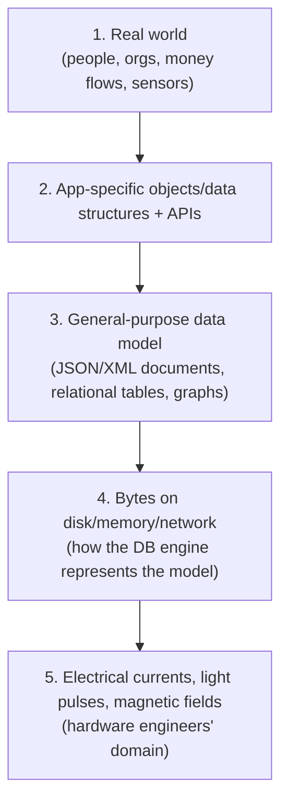
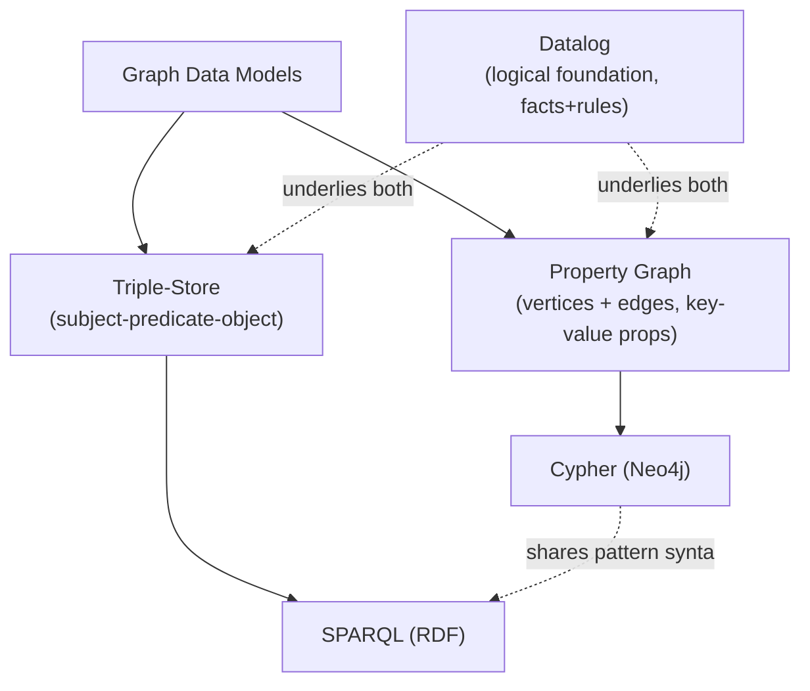

# Chapter 2 — Data Models and Query Languages

> Part of a detailed, chapter-by-chapter note series on *Designing Data-Intensive Applications* (Kleppmann). See `00-index.md` for the full series map.

---

## 2.1 Why Data Models Matter So Much

Data models are arguably **the most important part of software development** — they shape not just *how* software is written, but *how you think about the problem* you're solving.

Applications are built by **layering one data model on top of another** — each layer hides the complexity of the layer below behind a clean interface:



Every data model **embodies assumptions** about how it will be used — some operations become easy/fast, others awkward/slow. Choosing the right one for your application is a high-leverage decision.

---

## 2.2 Relational Model vs. Document Model

### The Relational Model
- Proposed by **Edgar Codd in 1970**; data organized into **relations** (tables), each an *unordered* collection of **tuples** (rows).
- Roots: 1960s–70s **business data processing** on mainframes — transaction processing (sales, banking, airline reservations, warehouse stock-keeping) and batch processing (invoicing, payroll, reporting).
- Dominant for ~25-30 years. Competitors have come and gone: the **network model** and **hierarchical model** (1970s-80s), **object databases** (late 80s-90s), **XML databases** (2000s) — none dethroned it.
- Turned out to **generalize far beyond** its original business-processing scope — most of the web (publishing, social networking, ecommerce, SaaS) still runs on relational DBs today.

### The Birth of NoSQL
"NoSQL" originated as a 2009 **Twitter hashtag** for a meetup on open-source, distributed, nonrelational databases — retroactively reinterpreted as "**Not Only SQL**."

**Driving forces behind NoSQL adoption:**

| Driver | Explanation |
|---|---|
| Greater scalability | For very large datasets or very high write throughput |
| Preference for FOSS | Over commercial database products |
| Specialized query needs | Not well served by the relational model |
| Schema frustration | Desire for a more dynamic/expressive data model |

Different apps have different needs, so relational and nonrelational datastores likely **coexist indefinitely** — an idea called **polyglot persistence**.

### The Object-Relational Mismatch
Most application code is object-oriented, but relational tables are flat rows/columns — this **"impedance mismatch"** requires a translation layer. **ORM frameworks** (ActiveRecord, Hibernate) reduce boilerplate but can't fully hide the difference.

- Example: a résumé/LinkedIn-style profile has one-to-many nested structures (multiple jobs, multiple degrees). In a relational schema this typically means either normalizing into separate tables (`positions`, `education`, `contact_info`) referenced by a `user_id` foreign key, or storing it as one denormalized text column — neither is a perfect fit.
- A **JSON document** representation is a much more natural fit for this kind of self-contained, tree-shaped data — this observation is the root of the document-database argument.

### Many-to-One and Many-to-Many Relationships
- Normalizing data (e.g. representing "region" or "industry" as an ID referencing a lookup table instead of a free-text string) creates **many-to-one relationships** — this is the classic reason relational databases favor IDs+joins over embedding.
- **Document databases handle one-to-many tree structures well, but joins are weak or absent.** If the DB doesn't support joins, you must emulate them in application code with multiple queries — shifting work from DB to app.
- ⭐ Crucial point: **data tends to become more interconnected as features are added.** A résumé app that starts join-free (organizations/schools as plain strings) will often later need "organizations as linkable entities" (so a company profile page exists) or "recommendations" (a link from one user's profile to another's) — both are many-to-many relationships that erode the document model's initial simplicity.

### Are Document Databases Repeating History?
The book draws a direct historical parallel:

| Era | Model | Key trait | Fate |
|---|---|---|---|
| 1960s-70s | **Hierarchical model** (IBM IMS) | Tree of nested records — remarkably similar to JSON | Handled one-to-many well, many-to-many poorly, no joins |
| 1970s | **Network model (CODASYL)** | Generalizes hierarchical model: a record can have *multiple* parents; links are like in-memory pointers ("access paths") traversed by a cursor | Powerful but forced programmers to manually track access paths — brittle, hard to change |
| 1970s-onward | **Relational model** | Lay all data out flatly as tables; **the query optimizer decides access paths automatically**, not the programmer | Won the "great debate" of the 1970s — became SQL, took over the world |

⭐ **The recurring lesson:** the relational model's true innovation wasn't tables per se — it was that the query optimizer (not the human programmer) figures out *how* to execute a query, freeing developers from hand-tracking access paths, and making it *possible to add new access patterns without rewriting all existing queries*. Document databases, in reintroducing an access-path-like reliance on nesting/embedding, are seen by the book as revisiting some of the same trade-offs the hierarchical/network-model era already grappled with.

### Relational vs. Document Today — Practical Comparison

| Factor | Relational | Document |
|---|---|---|
| Schema flexibility | Strong (schema-on-write) | Strong (schema-on-read) |
| Locality for nested/tree data | Weaker (requires "shredding" into multiple tables) | Strong — the whole tree loads in one read |
| Many-to-many / joins | Strong | Weak or absent |
| Best fit | Highly interconnected data | Data that's naturally a self-contained document, one-to-many hierarchical |

**Which model → simpler app code?**
- Document model shines when data really is document-shaped (a tree loaded as a whole) — the relational alternative, "**shredding**" a document into several tables, can produce cumbersome schemas and complex app code.
- Poor join support may not matter (e.g. an analytics app just logging events).
- But if many-to-many relationships matter, forcing them into a document model means either **denormalizing** (and doing extra app-level work to keep denormalized copies consistent) or **emulating joins in application code** (slower than a DB-native join, and pushes complexity upward).
- ⭐ Rule of thumb stated directly in the book: *for highly interconnected data, the document model is awkward, the relational model is acceptable, and graph models are the most natural.*

### Schema-on-Read vs. Schema-on-Write

| | Schema-on-write (relational) | Schema-on-read (document) |
|---|---|---|
| When is structure enforced? | At write time — DB rejects data that doesn't conform | At read time — the app interprets whatever structure is there |
| Analogy | Static (compile-time) type checking | Dynamic (runtime) type checking |
| "Schemaless" is misleading — | — | there's still an *implicit* schema the reading code assumes, just not *enforced* by the DB |

- Changing a field format (e.g. splitting `name` into `first_name`+`last_name`): in a document DB, just start writing new documents with the new shape and add defensive code for old documents (`if (user.name && !user.first_name) { ... }`); in a relational DB, run an explicit migration (`ALTER TABLE ... ADD COLUMN`).
- ⭐ Myth-busting note from the book: schema migrations have a reputation for being slow/requiring downtime, but **most relational databases execute `ALTER TABLE` in milliseconds** — MySQL is called out as a notable exception (it historically copied the entire table on `ALTER TABLE`, causing real downtime on large tables).

### Data Locality for Queries
- A document is usually stored as a single contiguous string (JSON/XML/BSON) — if you need most/all of a document at once, this **locality** is a performance win (no joins/lookups needed). Loading a small part of a large document is wasteful (whole document must be loaded).
- On updates, most databases require rewriting the *whole* document even for small changes (though some allow partial updates). So the locality advantage is really only relevant when you need large parts of the document simultaneously and it isn't too large.
- ⭐ **Google's Spanner** and multi-table index/locality features in some relational DBs (e.g. Oracle's "column-family" nesting) show this isn't strictly a relational-vs-document distinction — locality can be engineered into a relational schema too (e.g. "interleaving" child rows physically next to their parent row).

---

## 2.3 Query Languages for Data

- **Declarative** (SQL) — you specify **what** pattern of data you want, not **how** to get it. The database's query optimizer decides execution details (join order, index use, parallelization).
- **Imperative** — code tells the machine to perform operations in a specific order (IMS/CODASYL both used imperative query APIs — typically COBOL iterating records one at a time).

### Why declarative wins — the CSS/JavaScript DOM analogy (the book's illustrative example)
Compare highlighting a selected list item's title:
- **CSS** (declarative): `li.selected > p { background-color: blue; }` — the browser automatically detects when the rule applies/stops applying (e.g., when the `selected` class is removed) and updates the style; browser vendors can optimize CSS/XPath execution transparently, without breaking your code.
- **Imperative JavaScript/DOM equivalent** — much longer, manually walks the DOM tree, and has *real bugs*: if the `selected` class is later removed, the blue background **doesn't automatically get removed** unless you rerun the same imperative code — declarative code doesn't have this staleness problem because the browser re-evaluates the rule continuously.

⭐ This is exactly why SQL beat imperative predecessors: declarative code is shorter, hides implementation details that can be improved transparently over time, and is far easier to auto-parallelize across multiple CPU cores/machines.

### MapReduce Querying
- A programming model for bulk distributed processing (popularized by Google; discussed in full in Ch10). Supported in a **limited, read-only-query form** by some NoSQL stores (MongoDB, CouchDB).
- **Neither fully declarative nor fully imperative** — a hybrid: you write small code snippets (`map` and `reduce` functions, from functional programming) which the framework calls repeatedly.
- The book's worked example — "count shark sightings per month":
  ```sql
  -- SQL (declarative)
  SELECT date_trunc('month', observation_timestamp) AS observation_month,
         sum(num_animals) AS total_animals
  FROM observations WHERE family = 'Sharks'
  GROUP BY observation_month;
  ```
  ```javascript
  // MongoDB MapReduce (hybrid)
  db.observations.mapReduce(
    function map() {
      var key = this.observationTimestamp.getFullYear() + "-" + (this.observationTimestamp.getMonth()+1);
      emit(key, this.numAnimals);
    },
    function reduce(key, values) { return Array.sum(values); },
    { query: { family: "Sharks" }, out: "monthlySharkReport" }
  );
  ```
- `map`/`reduce` functions **must be pure** (no side effects, no additional DB queries) — this restriction is what lets the framework run them anywhere, in any order, and safely retry on failure.
- **Usability downside:** you must write and coordinate *two* functions instead of one query, and a declarative language gives the query optimizer more room to improve performance automatically. This is exactly why **MongoDB 2.2 added a declarative "aggregation pipeline"** language — the book's wry conclusion: *"a NoSQL system may find itself accidentally reinventing SQL, albeit in disguise."*

---

## 2.4 Graph-Like Data Models

When **many-to-many relationships are pervasive**, even the relational model becomes awkward, and modeling data explicitly as a **graph** (vertices + edges) becomes the most natural choice.

| Graph example | Vertices | Edges |
|---|---|---|
| Social graph | People | "Knows each other" |
| Web graph | Web pages | HTML links |
| Road/rail network | Junctions | Roads/rail lines |

Well-known algorithms operate directly on this structure: shortest-path search (navigation), **PageRank** (web-page popularity ranking). Graphs also elegantly store **heterogeneous** data in one place — e.g. Facebook's single graph mixes people, locations, events, checkins, and comments as different vertex types, all connected by typed edges.

### Property Graph Model
Each **vertex** has: a unique ID, outgoing edges, incoming edges, a collection of key-value properties.
Each **edge** has: a unique ID, a tail vertex (start), a head vertex (end), a label describing the relationship type, a collection of key-value properties.

- Any vertex can have an edge connecting it to any other vertex — no schema restricts which kinds of things can be connected, which gives graphs great **extensibility** for evolving/complex data.
- Can be represented in a relational schema too (two tables: `vertices` and `edges`, the edges table with `tail_vertex`/`head_vertex` foreign keys) — but querying "traverse a variable number of hops" is where relational SQL becomes clumsy, requiring recursive CTEs, while a graph query language handles it naturally.

### The Cypher Query Language
- Declarative query language for property graphs, created for **Neo4j**.
- Named for its distinctive **ASCII-art-like arrow syntax** describing patterns, e.g. `(person) -[:BORN_IN]-> (location)`.
- Handles **variable-length path traversal** concisely — e.g. `:WITHIN*0..` in Cypher means "follow a `WITHIN` edge zero or more times," letting you express "find people who emigrated from the US to Europe" (crossing an arbitrary number of nested location boundaries — city→state→country→continent) in a single, short query. The equivalent in recursive SQL is far more verbose.

### Triple-Stores and SPARQL
- The **triple-store model** is largely equivalent to the property graph model, but expresses everything as **(subject, predicate, object)** triples — e.g. `(Jim, likes, Bananas)`.
- **SPARQL** ("SPARQL Protocol and RDF Query Language") is the query language for triple-stores using the **RDF** data model. SPARQL predates Cypher, and Cypher's pattern-matching syntax was borrowed from it — SPARQL queries are often even more concise than the equivalent Cypher.

### Datalog — the theoretical foundation
- An older (1980s academic) query language the book presents as the **logical foundation** underlying both Cypher-like and SPARQL-like graph querying: data is represented as a small number of "facts" and rules that derive new facts from existing ones — closer to formal logic programming (Prolog-like), and less immediately intuitive, but the book uses it to show the underlying unity of graph query approaches.



---

## Chapter 2 Summary Table

| Model | Best for | Weak at |
|---|---|---|
| **Relational** | Highly interconnected data, ad-hoc joins, flexible query patterns you didn't foresee at design time | Deep nesting / document-shaped data |
| **Document** | Self-contained tree-shaped data with rare relationships (one-to-many) | Many-to-many relationships, joins |
| **Graph (property or triple)** | Data where "anything can potentially relate to anything" — social/recommendation/knowledge graphs | Simpler, less-connected datasets (overkill) |

## Interview-Ready Talking Points

- Be ready to explain the **hierarchical → network → relational → document** historical arc and *why* relational won (query optimizer replaces hand-tracked access paths).
- Explain **schema-on-read vs. schema-on-write** with the static/dynamic-typing analogy — a clean, memorable framing.
- Use the **CSS vs. imperative DOM manipulation** analogy to explain *why declarative query languages* (SQL) outperform imperative ones for maintainability and optimizer freedom.
- Know that **MapReduce querying is a hybrid**, not fully declarative — and why MongoDB added a declarative aggregation pipeline on top of it.
- State the rule of thumb: *highly connected data → graph model is most natural; relational is acceptable; document is awkward.*