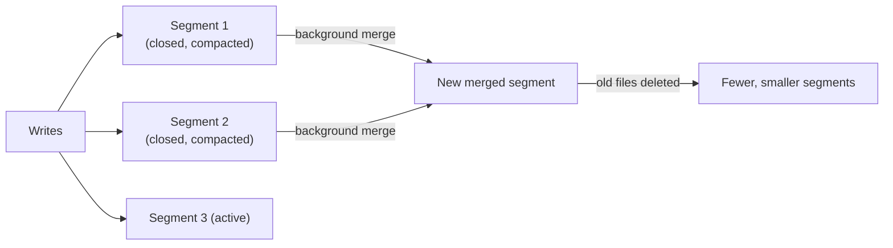
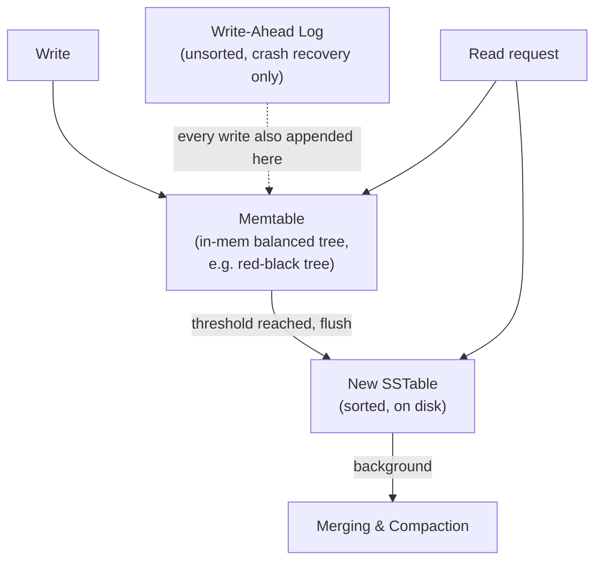
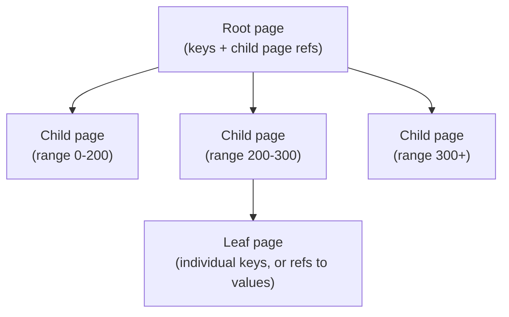
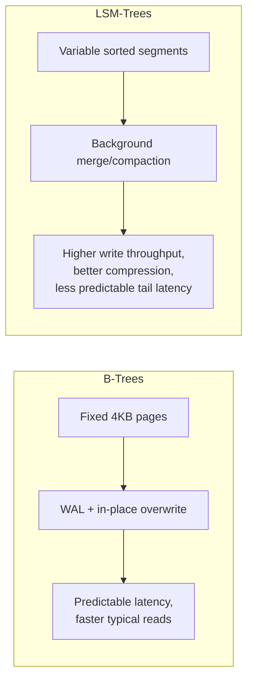
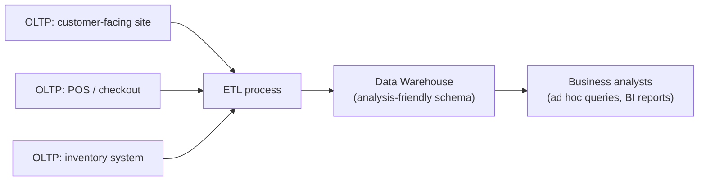
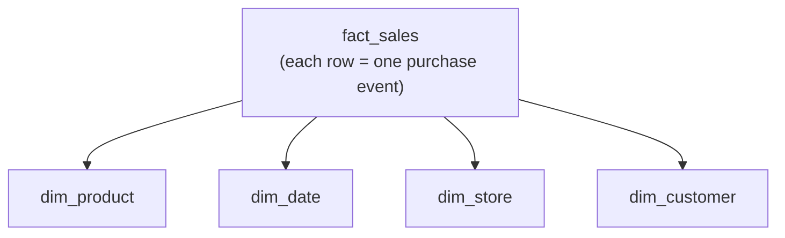
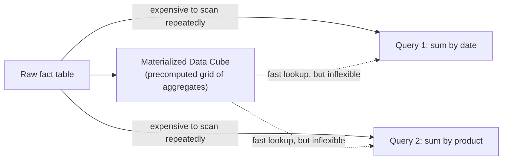

# Chapter 3 — Storage and Retrieval

> Part of a detailed, chapter-by-chapter note series on *Designing Data-Intensive Applications* (Kleppmann). See `00-index.md` for the full series map.

---

## 3.1 The World's Simplest Database

The book opens with two Bash functions that form a real (if terrible) key-value store:

```bash
db_set () { echo "$1,$2" >> database }
db_get () { grep "^$1," database | sed -e "s/^$1,//" | tail -n 1 }
```

- `db_set` **appends** to a file — every update just adds a new line; old versions of a key are *not* overwritten. This "append-only file" is exactly what the book calls a **log** — not to be confused with application/text logs; here it just means *an append-only sequence of records* (possibly binary).
- `db_set` performance is actually **great**, because appending to a file is one of the cheapest possible write operations.
- `db_get` performance is **terrible at scale** — `O(n)`: it must scan the *entire* file for every lookup. Doubling the number of records doubles lookup time.

**The fix: an index.** An index is extra metadata *derived from* the primary data, that acts as a signpost to locate what you want faster. Indexes only affect query performance, not the data's content — but they come at a cost:

⭐ **The fundamental storage-engine trade-off:** well-chosen indexes speed up reads, but *every* index slows down writes, because the index must also be updated on every write. This is why databases don't index everything by default — you (the developer/DBA) choose indexes deliberately, based on your app's query patterns.

---

## 3.2 Hash Indexes

The simplest index for key-value data: keep an **in-memory hash map** from key → byte offset in the (append-only) data file. To read, look up the offset in the hash map, seek to that file position, and read.

- This is essentially what **Bitcask** (Riak's default storage engine) does. Works great as long as **all keys fit in RAM** — values can be much bigger than RAM, since each is loaded with a single disk seek (or zero I/O if the OS filesystem cache already has it).
- **Ideal workload:** small number of distinct keys, each updated *very* frequently — e.g., key = video URL, value = play count, incremented on every play.

### Managing an append-only log forever: segments + compaction
To avoid running out of disk space:
1. Break the log into **segments** — close a segment at a size threshold, start a new one.
2. **Compaction** — throw away all but the *most recent* value for each key within a segment.
3. **Merging** — since compaction shrinks segments, merge several compacted segments together in the background into a new file (segments, once written, are never modified — merged output goes to a brand-new file).
4. Reads/writes continue uninterrupted on old segments during background merge; once merging finishes, reads switch to the new merged segment and old files are deleted.
5. Each segment keeps its own in-memory hash table; lookups check the newest segment first, then progressively older ones (merging keeps segment count low so this stays fast).



### Practical details a real hash-index implementation needs
| Concern | Solution |
|---|---|
| File format | Binary (length-prefixed strings) instead of CSV — faster, avoids escaping |
| Deleting records | Append a **tombstone** record; merging process discards prior values for that key |
| Crash recovery | Restoring the hash map by re-scanning a huge segment is slow — Bitcask snapshots each segment's hash map to disk for fast reload |
| Partially written records | Checksums detect and let you ignore corrupted tail writes from a mid-write crash |
| Concurrency control | Usually **one writer thread** (writes are strictly sequential); segments are immutable once closed, so **many reader threads** can read concurrently with no locking |

### Why append-only (rather than update-in-place)?
1. Appending and segment merging are **sequential** writes — much faster than random writes, especially on spinning disks (and to some extent SSDs too).
2. Concurrency and crash recovery are simpler — no risk of a crash leaving a file half-old, half-new spliced together mid-record.
3. Merging avoids long-term **fragmentation**.

### Limitations of hash indexes
- The hash table **must fit in memory** — a huge key cardinality is a dealbreaker (on-disk hash maps are possible in principle but perform poorly: lots of random I/O, expensive to grow when full, hash collisions need fiddly logic).
- **Range queries are inefficient** — you'd have to look up every key individually; there's no way to scan, say, `kitty00000` through `kitty99999` efficiently, unlike a sorted structure.

---

## 3.3 SSTables and LSM-Trees

**SSTable = Sorted String Table.** The key change from a plain hash-indexed log: **require that each segment file is sorted by key.**

### Advantages of sorting segments
1. **Efficient merging** — merging sorted segments is just like the merge step of mergesort: read the first key from each input file, write the lowest to the output, repeat. If the same key appears in multiple segments, keep the value from the **most recent** segment (since segments are chronologically ordered).
2. **No need to keep every key in memory** — because the file is sorted, a **sparse** in-memory index suffices (e.g. one key per few KB of segment). To find `handiwork`, find the nearest indexed key below it (e.g. `handbag`) and scan forward from there — sequential scanning within a few KB is very fast.
3. **Compressible in blocks** — since a read scans over a range of key-value pairs anyway, you can group them into a block and compress before writing to disk; each sparse-index entry points to the start of a compressed block. Saves disk space *and* I/O bandwidth.



### Constructing SSTables: LSM-Trees
Incoming writes arrive in arbitrary order — how do you get sorted output? Maintain the sort **in memory** (much easier than on disk) using a balanced tree structure (red-black tree, AVL tree) — this in-memory structure is called a **memtable**:
1. Write comes in → add to the memtable.
2. Memtable exceeds a size threshold (typically a few MB) → flush it to disk as a new SSTable (cheap, since the tree is already sorted). This becomes the most recent segment; a fresh memtable takes over for new writes.
3. Reads check the memtable first, then progressively older on-disk segments.
4. Background process periodically merges and compacts segment files.

**The crash-recovery gap:** an in-flight memtable that hasn't yet flushed is lost on crash. Fix: also append every write to a separate **unsorted append-only log** (a WAL) purely for crash recovery — discard it once the corresponding memtable is safely flushed to an SSTable.

- This is essentially the algorithm behind **LevelDB, RocksDB** (embeddable KV libraries; LevelDB usable inside Riak as an alternative to Bitcask), and (with similar principles) **Cassandra, HBase** — both inspired by **Google's Bigtable paper**, which introduced the terms *SSTable* and *memtable*.
- Formally named **Log-Structured Merge-Tree (LSM-Tree)** by Patrick O'Neil et al. Storage engines built on this merging-sorted-files principle are called **LSM storage engines**.
- **Lucene** (the indexing engine behind Elasticsearch and Solr) uses a similar SSTable-like structure for its term dictionary (word → posting list of document IDs).

### Performance optimizations for LSM-trees
- **Bloom filters** — a memory-efficient probabilistic set structure that tells you a key is *definitely absent* (never a false negative) — used to avoid checking every segment on disk for keys that don't exist (which would otherwise require checking the memtable + every segment back to the oldest).
- **Compaction strategy choices:**
  - **Size-tiered compaction** — newer, smaller SSTables successively merge into older, larger ones. (HBase; also supported by Cassandra.)
  - **Leveled compaction** — key range split into smaller SSTables, older data moved into separate "levels," allowing more incremental compaction using less disk space. (LevelDB — hence the name; also RocksDB.)

⭐ **Core takeaway:** the LSM-tree idea (a cascade of SSTables merged in the background) is simple and works well even when the dataset far exceeds available memory. Sorted storage gives efficient **range queries**, and sequential disk writes give **high write throughput**.

---

## 3.4 B-Trees

The **most widely used indexing structure** overall (despite LSM-trees "gaining acceptance") — introduced in **1970**, called "ubiquitous" within a decade, and still the standard index in almost every relational database (and many nonrelational ones too).

- Like SSTables, B-trees keep key-value pairs **sorted by key** for efficient lookups and range queries — but the design philosophy differs completely.
- LSM-trees: **variable-size segments** (megabytes+), always written sequentially.
- B-trees: **fixed-size pages/blocks**, traditionally **4 KB**, read/written one page at a time — matching how disks are physically organized into blocks.

### How a B-tree works


- One page is the **root**; every lookup starts there. Each page holds several keys and child-page references; each child owns a contiguous key range.
- The number of child references per page = **branching factor** — typically **several hundred** in practice.
- Because branching factor is high, tree **depth is O(log n)** and stays *very* shallow — most databases fit in **3-4 levels**. Concretely: a 4-level tree of 4KB pages with branching factor 500 can address **up to 256 TB**.
- **Update:** find the leaf page containing the key, modify it, write the page back (existing references to it stay valid).
- **Insert (growing the tree):** find the page whose range covers the new key; if it doesn't have room, **split** it into two half-full pages and update the parent to reflect the new range boundary — this can cascade upward if the parent is also full.

### Making B-trees reliable
- The fundamental operation — **overwriting a page in place on disk** — is dangerous: if a crash happens mid-write (or mid-multi-page-write, e.g. during a page split that must update a child *and* its parent), you risk a **corrupted index** (e.g. an orphan page).
- Standard fix: a **write-ahead log (WAL / redo log)** — every B-tree modification is appended to this log *before* it's applied to the actual tree pages. On crash recovery, replay the WAL to restore consistency.
- **Concurrency control** is also trickier than for log-structured engines, since multiple threads mutating shared pages in place need protection — typically via **latches** (lightweight locks). LSM-trees sidestep this because merging happens in the background without touching live query paths, atomically swapping segments in when ready.

### B-tree optimizations
| Optimization | Idea |
|---|---|
| **Copy-on-write** (e.g. LMDB) | Instead of overwriting + WAL, write a modified page to a *new* location and update parent pointers to a new version — also useful for concurrency (basis for MVCC/snapshot isolation, Ch7) |
| **Key abbreviation (B+ trees)** | Don't store the full key in interior pages — just enough to act as a boundary — packs more keys per page → higher branching factor → fewer levels |
| **Sibling pointers** | Leaf pages reference their left/right neighbor leaves, enabling in-order scans without jumping back up to the parent |
| **Fractal trees** | Borrow log-structured ideas to reduce disk seeks (name has nothing to do with fractal geometry) |

---

## 3.5 Comparing B-Trees and LSM-Trees

**Rule of thumb** (with the caveat that benchmarks are workload-sensitive and inconclusive in general — you should test with *your* workload): **LSM-trees tend to be faster for writes; B-trees tend to be faster for reads** (LSM reads must check multiple structures at various stages of compaction).

### Advantages of LSM-trees

| Advantage | Explanation |
|---|---|
| **Lower write amplification** (often) | A B-tree writes every piece of data at least *twice* (once to WAL, once to the tree page — sometimes more, on page splits) *and* must write a whole 4KB page even for a tiny change. LSM-trees also rewrite data during compaction/merging, but with lower net amplification in many configurations. |
| **Higher sustained write throughput** | Sequential writes of compact SSTables, versus random overwrites of scattered pages — especially significant on spinning disks. |
| **Better compressibility, smaller files** | LSM-trees aren't page-oriented and periodically rewrite to eliminate fragmentation; B-trees leave unused space in pages from splits/partial fills. |

⭐ **Write amplification** — one logical database write resulting in *multiple* physical disk writes over the system's lifetime — is a first-class concern, especially on SSDs, which can only be overwritten a limited number of times before wearing out. Lower write amplification = higher achievable write throughput within a fixed disk-bandwidth budget, and less SSD wear.

### Downsides of LSM-trees
- **Compaction can interfere with foreground reads/writes** — even with careful incremental scheduling, a request may have to wait on an in-progress compaction; this mostly shows up as elevated **high-percentile latency** (p99+), while average throughput/latency impact is usually small. B-trees are generally **more predictable**.
- **Compaction can't always keep up with write throughput** — if compaction falls behind, the number of unmerged segments grows unboundedly (risking running out of disk space), and reads slow further as they must check more and more segment files. Most SSTable-based engines **don't throttle incoming writes** even when this happens — so you need explicit monitoring to catch it.
- (Also: since a key can exist in *multiple* segments at once during the LSM lifecycle, transactional isolation/uniqueness enforcement (e.g. `SELECT FOR UPDATE`-style locking) is more naturally handled by B-trees, which associate one key with exactly one place in the tree at any time.)



---

## 3.6 Other Indexing Structures

- So far: primary key indexes (one value per key). **Secondary indexes** (not necessarily unique — multiple rows can share a value) are also crucial, and can be built from either B-trees or log-structured indexes — with entries pointing to (or containing) the row's location.
- **Storing values within the index:**
  - The value could be the actual row (a **clustered index** — data is stored directly in the index structure, e.g. MySQL's InnoDB primary key).
  - Or a reference/pointer to the row stored elsewhere in a **heap file** (avoids duplicating data across multiple secondary indexes).
  - **Covering index / index with included columns** — a middle ground: store *some* columns directly in the index to answer common queries without an extra lookup, at the cost of extra storage and write overhead for keeping the copy in sync.
- **Multi-column indexes:**
  - **Concatenated index** — combine several fields into one key by simple concatenation (e.g. `(lastname, firstname)`).
  - **Multi-dimensional indexes** (e.g. for geospatial "find restaurants within this bounding box" queries) — a standard B-tree/LSM-tree can't efficiently answer a 2D range query; specialized structures like **R-trees** are used instead.
- **Full-text search / fuzzy indexes** — Lucene-style search engines support finding similar keys (misspellings, synonyms) — beyond the scope of exact-match indexing this chapter otherwise focuses on.
- **Keeping everything in memory** — since RAM has become cheap enough that many datasets fit entirely in memory, **in-memory databases** (Redis, Memcached, VoltDB, SAP HANA, Datomic) have grown popular. Even so, durability still typically requires writing a log to disk (or replicating to other machines) — the *performance* advantage of an in-memory DB isn't just "avoiding disk reads" (a disk-backed DB with enough RAM for OS page-cache would also avoid most physical disk reads) — it's mainly from **avoiding the overhead of encoding in-memory data structures into a disk-writable form.** In-memory DBs can also offer data models that are awkward to implement with disk-based indexes (e.g. Redis's priority queues, sets).
- ⭐ **Anti-caching** — recent research extends the in-memory model to datasets *larger* than RAM by evicting least-recently-used data to disk (similar to OS virtual memory/swap, but at the finer granularity of individual records rather than whole pages) — indexes must still fit fully in memory though.

---

## 3.7 Transaction Processing or Analytics? (OLTP vs. OLAP)

- "Transaction" historically meant a commercial transaction (sale, order, payroll) — the term stuck even as databases expanded to non-commercial data (blog comments, game actions, contacts).
- ⭐ **Important clarification:** a transaction doesn't need ACID properties to be called a "transaction" in this context — it just means the system allows **low-latency reads/writes**, as opposed to periodic batch jobs.

| Property | OLTP (Transaction Processing) | OLAP (Analytic Processing) |
|---|---|---|
| **Main read pattern** | Small number of records per query, fetched by key | Aggregate over a huge number of records |
| **Main write pattern** | Random-access, low-latency writes from user input | Bulk import (ETL) or event stream |
| **Primarily used by** | End user/customer, via web app | Internal business analyst, for decision support |
| **What data represents** | Latest state (current point in time) | History of events over time |
| **Dataset size** | Gigabytes to terabytes | Terabytes to petabytes |

- SQL is flexible enough to serve both, but from the late 1980s/early 90s, companies increasingly separated **OLTP databases** from a dedicated **data warehouse** for analytics.

### Data Warehousing
- A large enterprise runs many separate OLTP systems (customer-facing site, POS/checkout, inventory, supply chain, HR, etc.) — each guarded jealously because it needs to stay highly available and low-latency for the business.
- DBAs are reluctant to let analysts run **expensive, large-scan ad hoc queries** directly against OLTP data, since it can degrade concurrent transaction performance.
- Solution: a **data warehouse** — a separate, read-only copy of all the OLTP data, extracted, cleaned, transformed into an analysis-friendly schema, and loaded — a process called **ETL (Extract-Transform-Load)**.



- The **indexing algorithms optimized for OLTP (B-trees, hash indexes) turn out to be poor at OLAP** — hence the rest of the chapter shifts to storage engines optimized specifically for analytics.
- Data warehouses and OLTP DBs look similar on the surface (both often speak SQL) but have fundamentally different internal engines — many vendors now specialize in one or the other. Examples: **Teradata, Vertica, SAP HANA, ParAccel** (commercial); **Amazon Redshift** (hosted ParAccel); open-source SQL-on-Hadoop: **Hive, Spark SQL, Impala, Presto, Tajo, Drill** (some based on Google's **Dremel**).

### Stars and Snowflakes: Schemas for Analytics
The dominant analytic schema pattern is the **star schema** (aka dimensional modeling):

- **Fact table** — center of the star; each row = one event (e.g., one purchase, one page view). Columns are either **attributes** (price, cost — enabling profit margin calc) or **foreign keys to dimension tables**.
- **Dimension tables** — represent the **who, what, where, when, how, why** of each fact — e.g. `dim_product`, `dim_date`, `dim_store`, `dim_customer`.
- Fact tables can be **massive** — big enterprises (Apple, Walmart, eBay) may have **tens of petabytes** of transaction history, mostly in fact tables. They're often over **100 columns wide**, sometimes several hundred.
- **Snowflake schema** — a variation where dimensions are further normalized into sub-dimension tables (e.g. `dim_product` referencing separate `brand` and `category` tables instead of storing them as strings). More normalized, but star schemas are usually preferred for **analyst simplicity**.



---

## 3.8 Column-Oriented Storage

**Core problem:** a typical data warehouse query touches maybe **4-5 columns out of 100+** in a fact table, but still needs to scan a huge number of *rows*. Row-oriented storage forces you to load *entire rows* (all 100+ columns) off disk just to read the few columns you need — hugely wasteful.

**The fix:** store each **column** contiguously in its own file, instead of each row. A query only reads/parses the columns it actually references. (This applies to non-relational data too — e.g. **Parquet**, based on Google's Dremel, is a columnar format for document data.)

- Column files must be kept in the **same row order** so the *k*-th entry across all column files reconstructs the *k*-th logical row.

### Column Compression
Column-oriented storage lends itself extremely well to compression, because values *within* one column tend to be repetitive.

**Bitmap encoding** (particularly effective in warehouses): for a column with `n` distinct values, create `n` separate bitmaps (one bit per row, 1 if that row has that value). If `n` is small (e.g. ~200 countries), store dense bitmaps directly; if `n` is larger, bitmaps become **sparse** and can additionally be **run-length encoded** for remarkable compactness.

- Bitmap indexes are perfect for typical warehouse filter queries:
  - `WHERE product_sk IN (30, 68, 69)` → bitwise **OR** of the three bitmaps.
  - `WHERE product_sk = 31 AND store_sk = 3` → bitwise **AND** of the two bitmaps (valid because both bitmaps share the same row ordering).

> ⚠️ Note: Cassandra/HBase's **"column families"** (inherited from Bigtable) are **not** truly column-oriented in this sense — within a column family, all columns of a row are stored *together*, and there's no column compression. The Bigtable data model is "still mostly row-oriented" despite the naming.

**Vectorized processing:** beyond disk I/O savings, column storage lets the query engine fit a compressed chunk of one column comfortably into the **CPU's L1 cache** and iterate over it in a tight, branch/function-call-free loop — much faster than per-record function calls. Bitwise AND/OR-style operators can act directly on these compressed chunks.

### Sort Order in Column Storage
- Row order within a column store doesn't matter functionally (insertion order is simplest — just append to each column file), but you can *choose* to impose a sort order as an indexing mechanism — similar to SSTables.
- ⚠️ You must sort **whole rows together** (not each column independently) — otherwise you lose the ability to reconstruct which values belong to the same row.
- **Choosing sort keys:** the DBA picks columns to sort by based on common query patterns — e.g., make `date_key` the primary sort key if queries commonly filter recent date ranges; a secondary sort key (e.g. `product_sk`) groups same-product-same-day rows together, speeding up product-within-date-range queries.
- **Compression benefit compounds with sorting** — a low-cardinality *primary* sort column, once sorted, produces long runs of repeated values → excellent run-length compression, even at billions of rows. This effect weakens for the 2nd/3rd sort keys (more "jumbled") but is still net positive.
- **Multiple sort orders (C-Store / Vertica idea):** since data must be *replicated* anyway (for fault tolerance), why not store each replica sorted **differently**, optimized for different query patterns? Queries then pick whichever sorted replica best matches their access pattern. Conceptually similar to multiple secondary indexes in a row store, but with a key difference: in a column store there's usually no separate pointer-based index — each sorted replica *is* a full copy of the data, just physically laid out differently.

### Writing to Column-Oriented Storage
Column-oriented optimizations are read-optimized and make **writes harder** — an update-in-place B-tree approach doesn't work with compressed columns (inserting mid-table would require rewriting all column files). Solution: reuse the **LSM-tree pattern** — writes go first to an in-memory (row- or column-oriented, doesn't matter) sorted store; once enough accumulate, they're merged in bulk with the on-disk column files, written as new files. (This is essentially what **Vertica** does.) Queries transparently combine on-disk column data with recent in-memory writes — this distinction is hidden by the query optimizer.

### Aggregation: Data Cubes and Materialized Views
Not every warehouse uses columnar storage — but it's rapidly gaining popularity for ad hoc analytic query speed.

- **Materialized view** — a table-like object whose contents are the **actual, persisted result** of a query (unlike a *virtual* view, which is just a shortcut expanded on the fly at query time). Because it's a denormalized derived copy, it must be **kept up to date** as underlying data changes — which makes writes more expensive. Rare in OLTP (write cost too high), more viable in read-heavy warehouses.
- **Data cube / OLAP cube** — a common special case: a **grid of precomputed aggregates**, grouped by combinations of dimensions (e.g. total sales, by date × product). Extremely fast for the specific aggregate queries it was built for — but inflexible; it can't answer queries outside the precomputed dimensions (e.g. "which products were purchased *together*" if that combination wasn't materialized).



---

## Chapter 3 Summary Table

| Storage family | Examples | Best for | Weakness |
|---|---|---|---|
| **Hash index (log-structured)** | Bitcask | Frequent updates to a small, bounded key set | No range queries, keys must fit in RAM |
| **LSM-Tree (SSTable-based)** | LevelDB, RocksDB, Cassandra, HBase | High write throughput, range queries, scales past RAM | Compaction can hurt tail latency; less predictable |
| **B-Tree** | Almost all RDBMSs | Predictable read latency, mature/battle-tested | Higher write amplification, page fragmentation |
| **Column-oriented** | Vertica, Redshift, Parquet-based systems | Analytic scans over few columns, many rows | Writes are expensive; needs LSM-style buffering |

## Interview-Ready Talking Points

- Precisely explain **why hash indexes can't do range queries** but SSTables can (sorting).
- Walk through the **LSM-tree write path** end to end: memtable → WAL → SSTable flush → background compaction → Bloom filters for negative lookups.
- Give the **B-tree vs. LSM-tree tradeoff** crisply: writes/throughput/compression favor LSM; predictable read latency favors B-trees; explain *write amplification* as the underlying mechanism.
- Explain the **OLTP vs. OLAP** distinction using the book's own comparison table, and describe *why* ETL into a separate data warehouse became standard practice.
- Explain **why columnar storage helps analytics** (only touching needed columns + compression + vectorized CPU processing) and why it makes **writes** harder (requiring an LSM-style write buffer).