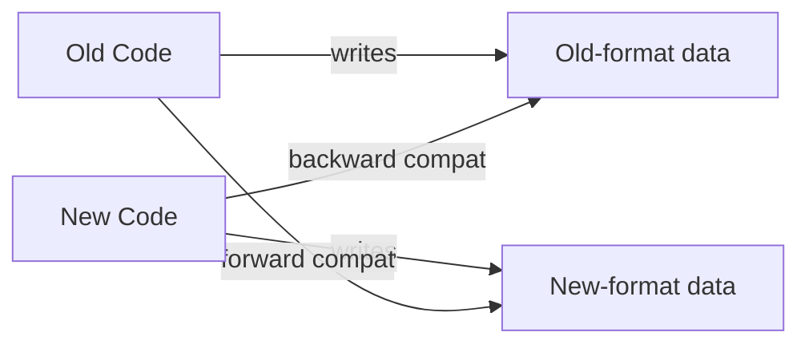
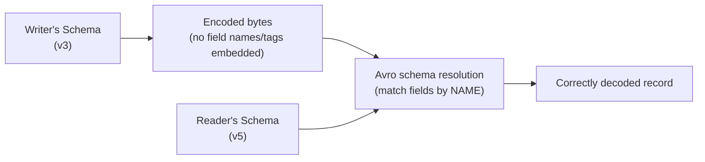
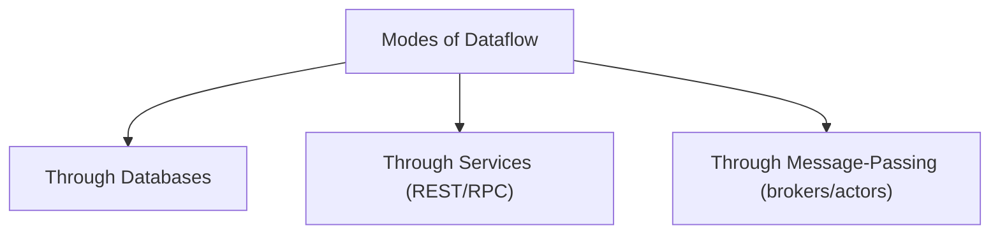

# Chapter 4 — Encoding and Evolution

> Part of a detailed, chapter-by-chapter note series on *Designing Data-Intensive Applications* (Kleppmann). See `00-index.md` for the full series map.

---

## 4.1 Why Encoding and Evolution Matter Together

Applications change constantly (Ch1's **evolvability**), and a feature change usually means a **data format change** too. How different data models handle this:

| Model | Schema enforcement |
|---|---|
| Relational | One schema in force at any point in time (changeable via `ALTER`) |
| Schema-on-read (document) | No enforcement — old and new formats can coexist freely |

⭐ **Code deploys are never instant.** Server-side apps use **rolling upgrades** (deploy to a few nodes at a time, verify, continue — no downtime, encourages frequent releases). Client-side apps are at the mercy of users who may delay updating for a long time. **Conclusion:** old and new code, and old and new data, will coexist simultaneously — you must maintain compatibility in **both directions**:

| Direction | Definition | Difficulty |
|---|---|---|
| **Backward compatibility** | Newer code can read data written by older code | Usually not hard — you (as author of new code) know the old format |
| **Forward compatibility** | Older code can read data written by newer code | Trickier — requires old code to gracefully *ignore* additions it doesn't understand |



---

## 4.2 Formats for Encoding Data

Programs work with data in two representations: **in-memory** (objects/structs/lists — optimized for CPU access, uses pointers) and a **self-contained byte sequence** for writing to a file or sending over a network (pointers make no sense to another process). Translating between them:
- **Encoding** (serialization, marshalling) — memory → bytes
- **Decoding** (parsing, deserialization, unmarshalling) — bytes → memory

> Note: "serialization" is *also* used with a completely different meaning in the context of transactions (Ch7) — the book deliberately sticks to "encoding" to avoid the clash.

### Language-Specific Formats
Java's `Serializable`, Ruby's `Marshal`, Python's `pickle`, etc. — convenient (near-zero extra code) but seriously flawed:

| Problem | Detail |
|---|---|
| **Language lock-in** | Reading the data from another language is very hard — commits you to your current language long-term |
| **Security risk** | Decoding must be able to instantiate *arbitrary classes* — if an attacker controls the byte sequence, this can enable remote code execution |
| **Compatibility is an afterthought** | Forward/backward compatibility usually poorly supported |
| **Poor efficiency** | e.g. Java's built-in serialization is notoriously slow and bloated |

⭐ **Rule of thumb:** don't use your language's built-in encoding for anything beyond transient, throwaway purposes.

### JSON, XML, and CSV (textual formats)
Human-readable, but have subtle problems:

| Issue | Detail |
|---|---|
| **Number ambiguity** | XML/CSV can't distinguish numbers from number-like strings; JSON doesn't distinguish integers from floats, and can't represent numbers with high precision — e.g. **Twitter's tweet IDs (64-bit)** lose precision when parsed by JavaScript, so Twitter's API includes each ID *twice*: once as a JSON number, once as a string, to work around it. |
| **No native binary strings** | JSON/XML handle Unicode text well but have no binary-string type; workaround is **Base64** encoding — adds **33%** to the data size and needs a schema to signal "this is really binary." |
| **Optional, complex schemas** | XML Schema and JSON Schema exist but are powerful/complex; many JSON tools skip using them, so encoding/decoding logic (numbers, binary data) often gets hardcoded instead. |
| **CSV has no schema at all** | Meaning of each column is left entirely to the application; escaping rules (commas/newlines inside values) are formally specified but not always implemented correctly by parsers. |

⭐ Despite the flaws, these formats remain hugely popular, especially as **cross-organizational data interchange formats** — when different organizations need to agree on *something*, the difficulty of achieving that agreement outweighs concerns about elegance or efficiency.

### Binary variants of JSON/XML
MessagePack, BSON, BJSON, UBJSON, Smile (for JSON); WBXML, Fast Infoset (for XML). None achieved the ubiquity of the textual originals. Since they don't prescribe a schema, they must still embed every **field name** in the encoded bytes.

- **Worked example** from the book: a 3-field JSON record (`userName`, `favoriteNumber`, `interests`) is **81 bytes** as plain JSON, and only **66 bytes** in MessagePack — a fairly modest saving, since field names still take up most of the space. The book explicitly foreshadows: schema-based binary formats will do dramatically better (32 bytes, shown below).

### Thrift and Protocol Buffers (schema-based binary encoding)
Developed at Facebook (Thrift) and Google (Protocol Buffers), open-sourced 2007-08. Both **require a schema**, and generate code (via a code-gen tool) that implements the schema in your target language.

```protobuf
// Protocol Buffers schema
message Person {
    required string user_name      = 1;
    optional int64 favorite_number = 2;
    repeated string interests      = 3;
}
```

- The **numbers after `=`** (1, 2, 3) are **field tags** — this is the crucial mechanism for schema evolution.
- Thrift's `BinaryProtocol` encodes the same example record in **59 bytes**; Thrift's `CompactProtocol` (using variable-length integers and bit-packing field-type+tag together) does better still.

**Schema evolution rules for Thrift/Protobuf:**
| Change | Compatibility rule |
|---|---|
| Add a field | Give it a **new tag number**. Old code reading new data simply ignores the new (unrecognized) tag → forward compatible. |
| Add a *required* field | ⚠️ **Breaks compatibility** — old writers won't include it, so new readers reject/fail on old data. New fields should generally be `optional` or have a default. |
| Remove a field | Can only remove **optional** fields. Never reuse a removed field's tag number in the future — old data may still exist with that tag written under the old meaning. |
| Change datatype | Risky — e.g. 32-bit → 64-bit int: new code reading old data is fine (zero-extend), but old code reading new data risks **truncation** if the value doesn't fit in 32 bits. |

- ⭐ **Protobuf has no list/array type** — instead a `repeated` marker; the encoding just repeats the same field tag multiple times. Neat side effect: you can freely evolve an `optional` (single-valued) field into a `repeated` (multi-valued) one — new code reading old data sees a 0-or-1-element list; old code reading new data just sees the *last* element.
- Thrift has a dedicated parameterized list type instead — doesn't support this single→multi evolution trick, but does support **nested lists**.

### Avro
Started **2009** as a Hadoop subproject (Thrift wasn't a good fit for Hadoop's needs). Also schema-based, but strikingly different:

```
record Person {
    string               userName;
    union { null, long } favoriteNumber = null;
    array<string>        interests;
}
```

- **No tag numbers at all.** Encoding is just concatenated values with **no field identifiers or type markers embedded** — a string is just a length prefix + UTF-8 bytes; nothing marks it as "a string" versus anything else.
- Result: the same example record encodes in just **32 bytes** — the most compact of all formats discussed.
- ⚠️ **Critical consequence:** the binary data can *only* be correctly parsed if the reader uses the **exact same schema** as the writer used (fields are positional, matched by order/schema — not self-describing at all).

### Avro's schema evolution mechanism — writer's schema vs. reader's schema
- **Writer's schema** — whatever schema version the encoding application was compiled against/using at write time.
- **Reader's schema** — whatever schema the decoding application expects.
- ⭐ **The key idea:** the writer's and reader's schemas **don't need to match — only be compatible.** The Avro library resolves differences by comparing the two schemas side by side:
  - Fields are matched **by name**, so field order can differ freely.
  - A field present in the writer's schema but absent from the reader's schema → **ignored**.
  - A field the reader expects but the writer's schema lacks → filled in with the **reader's declared default value**.



- **Compatibility rules:** you may only add/remove fields **that have a default value**.
  - Add a field with a default → old writers' data still decodes fine (default fills the gap) → **backward compatible**.
  - Add a field *without* a default → **breaks backward compatibility** (new readers can't fill the missing value for old data).
  - Remove a field without a default → **breaks forward compatibility** (old readers expecting that field find it missing from new data).
  - To allow `null` as a default you must use a **union type** (`union { null, long }` — unlike some languages, `null` isn't automatically valid for any field in Avro).

### Where is the writer's schema kept?
Since binary data has no field names, **the reader must obtain the writer's schema somehow.** Avro's answer depends on context:

| Context | Solution |
|---|---|
| Large file with many records (Hadoop-style) | Writer's schema included **once**, at the start of the file (Avro **object container files**) |
| Database with individually written records | Include a **schema version number** per record; keep a schema-version registry the reader can look up |
| Records sent over a network connection | Client and server **negotiate the schema version at connection setup**, then use it for the connection's lifetime (Avro RPC does this) |

- Keeping a **schema version database** is broadly useful regardless — it doubles as documentation and lets you check compatibility of a schema change *before* deploying it.

### ⭐ Avro's edge: dynamically generated schemas
Because Avro has **no tag numbers**, it's much friendlier to schemas generated automatically — e.g., dumping a relational database's tables to Avro files: generate one Avro record schema per table, one field per column, mapped by **name**. If the DB schema later changes (a column added/removed), you just regenerate the Avro schema and keep exporting — matching is name-based, so nothing manual is required.

With Thrift/Protobuf, someone would have to **manually assign tag numbers** to each database column, and carefully avoid ever reusing an old tag — this kind of dynamic-schema generation simply wasn't a design goal for those formats, but was for Avro.

### Code Generation and Dynamically Typed Languages
- Thrift/Protobuf's code generation is valuable in **statically typed languages** (Java, C++, C#) — compile-time type checking, IDE autocompletion.
- In **dynamically typed languages** (JavaScript, Ruby, Python) there's less benefit — no compiler to satisfy, and it's an extra friction step.
- Avro's schema-optional design shines here — since Avro object container files are **self-describing** (embed the writer's schema), you can open and process them **without any code generation at all**, similar to opening a JSON file — this is especially useful with dynamically-typed data-processing tools like **Apache Pig**.

---

## 4.3 The Merits of Schemas

Schema-based binary encodings (Protobuf, Thrift, Avro) are much simpler than XML Schema/JSON Schema (which support elaborate validation rules like regex or numeric-range constraints) — this simplicity is *why* they've achieved broad cross-language adoption.

Historical note: these ideas aren't new — **ASN.1** (1984) is a similar schema definition language, still used to encode SSL certificates (X.509) today, but considered too complex and badly documented for new applications.

**Benefits of schema-based binary encoding, summarized:**
- **More compact** than "binary JSON" variants — field names can be omitted entirely from the encoded bytes.
- **The schema is living documentation** — since it's *required* for decoding, it can't silently drift out of date the way hand-written docs can.
- **Enables pre-deployment compatibility checks** by keeping a schema database.
- **Enables compile-time type checking** for statically typed languages via code generation.

---

## 4.4 Modes of Dataflow

Now — where does encoding/decoding actually matter? Three modes:



### 1. Dataflow Through Databases
- The process **writing** to the DB encodes the data; the process (possibly a *future, differently-versioned* instance of the *same* application) **reading** it decodes.
- ⭐ **A subtlety the book stresses:** if an old application version reads a record written by a *newer* version, and then re-saves it, it must **not silently drop unrecognized fields** — otherwise those fields are lost forever, even though the newer application(s) still expect them. Schema evolution (Avro-style) lets "the entire database appear as if encoded with a single schema" even though the underlying storage is really a mixture of historical schema versions.
- **Archival storage:** database snapshots/exports (backups, warehouse loads) are usually written in one go with the *latest* schema, and are thereafter immutable — a great fit for self-describing formats like Avro object container files, and a good opportunity to convert to an analytics-friendly **columnar format like Parquet**.

### 2. Dataflow Through Services: REST and RPC
- **Client/server model:** the server exposes an API (a **service**); clients connect and request. Servers can themselves be clients of other services — this decomposition is the basis of **service-oriented architecture (SOA)**, refined/rebranded as **microservices**.
- A key **microservices design goal**: services are **independently deployable and evolvable**, owned by separate teams that can release without cross-team coordination — meaning old and new service versions coexist, so **the same forward/backward compatibility concerns from this chapter apply directly.**
- **REST vs. SOAP:**

| | REST | SOAP |
|---|---|---|
| Nature | A design *philosophy*, built on HTTP primitives (URLs for resources, HTTP verbs/caching/content negotiation) | An XML-based *protocol*, aiming to be HTTP-independent, wrapped in complex "WS-*" standards |
| Tooling | Simple; growing ecosystem, OpenAPI/Swagger for description | Heavy reliance on code generation via WSDL; poor fit for dynamic languages |
| Trend | Gaining popularity, associated with microservices | Falling out of favor outside large legacy enterprises |

### ⭐ The Problems with RPC (a major conceptual point)
RPC (remote procedure call, since the 1970s) tries to make a network call **look like a local function call** — "**location transparency**." The book is blunt: **this abstraction is fundamentally flawed**, because a network call is categorically different from a local call:

| Local function call | Network request |
|---|---|
| Predictable — succeeds/fails based only on parameters you control | Unpredictable — packet loss, remote slowness/unavailability, all outside your control |
| Returns a result, throws, or never returns | Can also **time out with no result at all** — you genuinely can't tell if it succeeded, failed, or is still in flight |
| Retrying a failed call is safe | Retrying may **duplicate an action** if the original request actually succeeded but the *response* was lost — needs deliberate **idempotence** handling |
| Roughly constant execution time | Highly variable latency (sub-ms on a good day, seconds when congested) |
| Can pass pointers/references cheaply | All parameters must be **fully encoded** into bytes — fine for primitives, awkward for large objects |
| Same language throughout | Client/server may use **different languages** — the RPC framework must translate datatypes, sometimes badly (recall JS's >2^53 integer precision problem) |

⭐ **Conclusion:** don't try to make a remote call *look* like a local one — it's a fundamentally different thing, and REST's honesty about being "just a network protocol" is part of its appeal (even though people still build RPC-style libraries on top of REST).

- **Modern RPC frameworks acknowledge this explicitly:** gRPC (Protobuf-based) supports **streams** (a call = a *series* of requests/responses over time, not just one-shot); Finagle/Rest.li use **futures/promises** to encapsulate async, failable actions and simplify fan-out to multiple services in parallel.
- **Data encoding assumption for RPC evolvability:** unlike the database case, it's reasonable to assume **servers are upgraded before clients** — so you only strictly need **backward compatibility on requests** and **forward compatibility on responses**.
- **Versioning in practice:** no universal standard — REST APIs commonly version via the URL path or the HTTP `Accept` header; some services track a client's requested API version server-side via API key.

### 3. Message-Passing Dataflow
Sits **between** RPC and databases: like RPC, low-latency delivery to another process; like a database, delivery goes through an intermediary (a **message broker**, aka message queue/message-oriented middleware) that stores the message temporarily rather than a direct network connection.

**Advantages of a message broker over direct RPC:**
- Acts as a **buffer** if the recipient is unavailable/overloaded — improves reliability.
- Can **automatically redeliver** messages to a crashed consumer, preventing loss.
- Sender doesn't need to know the recipient's IP/port — great for elastic cloud deployments.
- Supports **one-to-many** delivery (one message → multiple recipients).
- **Logically decouples** sender from recipient — sender just publishes; doesn't know/care who consumes.

- Communication is usually **one-way/asynchronous** — the sender doesn't wait for/expect a reply (a reply, if any, typically flows on a separate channel/reply-queue — echoing a request/response pattern similar to RPC).
- Popular brokers (compared in depth in Ch11): commercial (TIBCO, IBM WebSphere, webMethods) and open-source (**RabbitMQ, ActiveMQ, HornetQ, NATS, Apache Kafka**).
- Brokers generally **don't enforce a data model** — a message is just bytes + metadata, so any encoding works. If your chosen encoding is itself forward/backward compatible, publishers and consumers can be deployed independently, in any order — maximum flexibility.
- ⚠️ If a consumer republishes a message onward to another topic, it must be careful to **preserve unrecognized fields**, exactly the same concern as the database dataflow case.

### Distributed Actor Frameworks
- **Actor model** — a concurrency programming model *within a single process*: instead of raw threads/locks, logic lives in **actors**, each with private local state, communicating only via async messages (never-guaranteed delivery — can be lost in error scenarios). Since each actor processes one message at a time, it avoids classic threading hazards.
- **Distributed actor frameworks** (Akka, Orleans, Erlang OTP) extend this same programming model **across multiple nodes**, using the same message-passing mechanism whether the destination actor is local or remote.
- ⭐ Important implication: a **distributed actor framework essentially bundles a message broker and the actor programming model together** — meaning the *same encoding-evolution concerns from this chapter (rolling upgrades, backward/forward compatibility) apply just as much* when you change an actor's message format, even though the actor abstraction can make this easy to overlook.

---

## Chapter 4 Summary Table

| Format | Schema? | Compact? | Self-describing? | Notes |
|---|---|---|---|---|
| Language-specific (pickle, Java Serializable) | No | No | N/A | Avoid beyond transient use |
| JSON/XML/CSV | Optional, rarely used | No | Yes (readable) | Best for cross-org interchange |
| Binary JSON (MessagePack etc.) | No | Slightly | Yes | Modest gains only |
| Thrift/Protobuf | Required, tag-number based | Yes | No | Great for statically typed, org-internal RPC |
| Avro | Required, name-based resolution | Most compact | Only via embedded/negotiated writer's schema | Best for dynamically generated schemas |

| Dataflow mode | Direction needed |
|---|---|
| Through databases | Both backward AND forward (any code version may read data from any other version) |
| Through RPC/services | Backward compat on requests, forward compat on responses (servers upgrade first) |
| Through message brokers | Both — publishers/consumers deploy independently |

## Interview-Ready Talking Points

- Explain **why RPC is "fundamentally flawed" as an abstraction** — the book's specific list of ways a network call differs from a local one (this is a favorite interview-depth topic).
- Compare **Avro's name-based schema resolution** vs. **Protobuf/Thrift's tag-number approach** — and explain why Avro suits dynamically-generated schemas (DB dumps) better.
- State the **golden rule** for schema evolution in Protobuf/Thrift: never reuse a removed field's tag number, and never add a *required* field.
- Explain the **message broker vs. RPC vs. database dataflow** trichotomy, and where each fits.
- Be ready to connect this chapter forward: this is the *foundation* for understanding Kafka/stream processing (Ch11) and for reasoning about safe rolling upgrades in a microservices system (recurring theme across your microservices notes file).