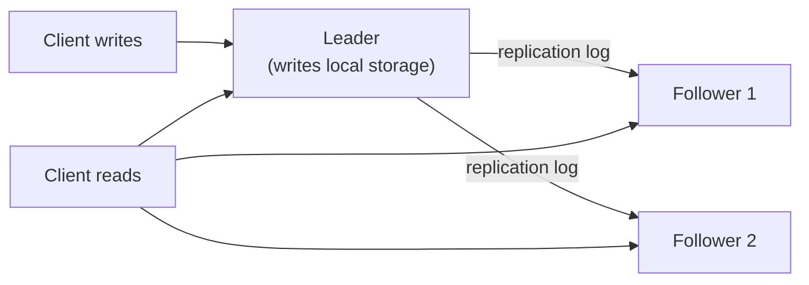
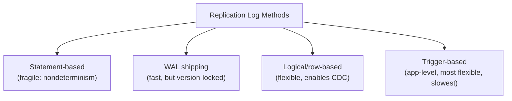
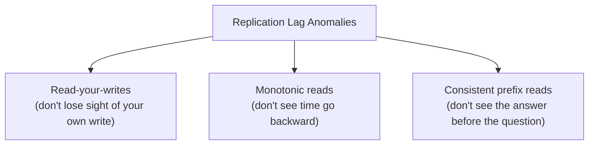
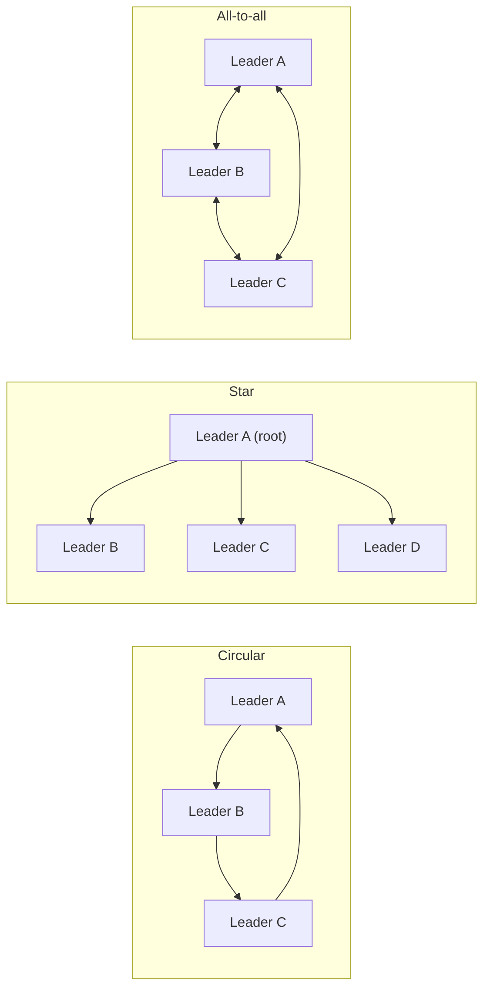
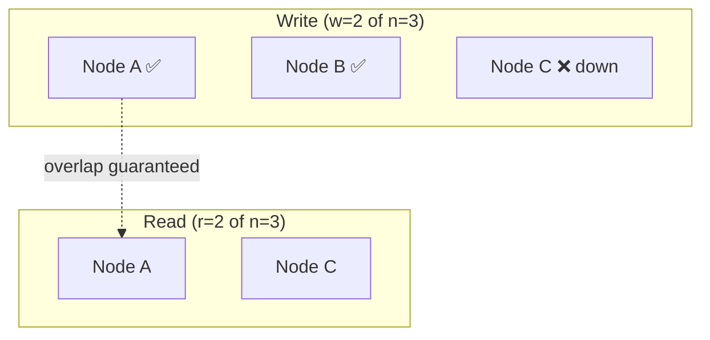

# Chapter 5 — Replication

> Part of a detailed, chapter-by-chapter note series on *Designing Data-Intensive Applications* (Kleppmann). See `00-index.md` for the full series map.

---

## 5.0 Why Replicate?

**Replication** = keeping a copy of the same data on multiple networked machines. Three reasons:

| Reason | Benefit |
|---|---|
| Geographic proximity | Reduce latency by keeping data close to users |
| Fault tolerance | Keep the system working even if parts fail (availability) |
| Read scaling | Spread read load across more machines (throughput) |

This chapter assumes the whole dataset fits on one machine (each replica = a full copy); Ch6 relaxes that with partitioning. **All the difficulty in replication is about handling *changes* to data** — if data never changed, you'd just copy it once and be done. Three replication algorithms are covered: **single-leader, multi-leader, leaderless.**

---

## 5.1 Leaders and Followers (Single-Leader Replication)

Also called **active/passive** or **master–slave replication** — the dominant approach, built into PostgreSQL, MySQL, Oracle Data Guard, SQL Server AlwaysOn, MongoDB, RethinkDB, and even message brokers like Kafka/RabbitMQ.

1. One replica = **leader** (master/primary) — all client writes go here first.
2. Other replicas = **followers** (read replicas/slaves/secondaries/hot standbys) — leader streams a **replication log** of every write; followers apply changes **in the same order** as the leader.
3. Reads can go to the leader *or* any follower; **writes are leader-only.**

### Synchronous vs. Asynchronous Replication
| | Sync | Async |
|---|---|---|
| Leader waits for follower ack? | Yes, before confirming to client | No |
| Guarantee | Follower has an up-to-date copy — safe if leader dies | Write **may be lost** if leader dies before replicating |
| Downside | If the sync follower is slow/down, **leader must block all writes** | None for leader throughput |

- Making **all** followers synchronous is impractical — any single node outage halts the whole system. Real systems typically use **semi-synchronous**: one follower synchronous, rest async; if the sync one goes down, an async one is promoted to sync — guarantees an up-to-date copy on **at least 2 nodes** (leader + 1 sync follower).
- Fully async is common when there are **many followers or geographically distributed ones** — trades durability for leader availability.
- ⭐ Research note: **chain replication** (used in Azure Storage) is a sync-replication variant designed for better performance/availability tradeoffs than naive synchronous replication.

### Setting Up New Followers
Naive file-copying doesn't work (data is constantly changing during the copy). Standard procedure:
1. Take a **consistent snapshot** of the leader (without locking the whole DB) — most DBs support this (also needed for backups).
2. Copy the snapshot to the new follower.
3. Follower connects to leader, requests all changes since the snapshot's exact log position (PostgreSQL: **log sequence number**; MySQL: **binlog coordinates**).
4. Follower applies the backlog → **caught up** → continues consuming the live stream.

### Handling Node Outages

**Follower failure — catch-up recovery:** the follower's local log remembers the last transaction it processed; on reconnect, it requests everything since then from the leader. Straightforward.

**Leader failure — failover** (much trickier). Automatic failover steps:
1. **Detect** the leader is dead — usually via **timeout** (e.g., no response for 30s). No foolproof detection exists.
2. **Choose a new leader** — via election (majority vote) or an appointed controller node; best candidate = replica with the most up-to-date data (minimizes loss). This is fundamentally a **consensus problem** (Ch9).
3. **Reconfigure the system** — clients must send writes to the new leader; if the old leader rejoins, it must be told to step down and become a follower.

**Things that can go wrong with failover:**
- **Async replication + unreplicated writes:** if the old leader rejoins after a new leader is chosen, what happens to writes the old leader had but never replicated? Usually **discarded** — may violate durability expectations.
- ⭐ **Real incident (GitHub):** an out-of-date MySQL follower was promoted to leader; its **autoincrementing primary-key counter had fallen behind**, so it reused primary keys the old leader had already assigned. Those same keys were also used in a Redis store → inconsistency → **private data leaked to the wrong users.** (Great concrete cautionary example for interviews.)
- **Split brain:** two nodes both believe they're the leader — if both accept writes with no conflict resolution, data corruption/loss is likely. Some systems auto-shutdown one node when two leaders are detected (**fencing** / **STONITH — "Shoot The Other Node In The Head"**) — but badly designed fencing can shut down *both* nodes.
- **Timeout tuning tradeoff:** longer timeout = slower recovery; shorter timeout = risk of unnecessary failovers triggered by a temporary load spike or network glitch — which can make an already-struggling system *worse*.
- Because of these risks, **some ops teams deliberately prefer manual failover** even when automatic failover is supported.

### Implementation of Replication Logs

| Method | How it works | Pros/Cons |
|---|---|---|
| **Statement-based** | Leader forwards the literal SQL statement (`INSERT`/`UPDATE`/`DELETE`) | Compact, but breaks on nondeterministic functions (`NOW()`, `RAND()`), autoincrement/order-dependent statements, and side-effecting triggers/stored procs. MySQL <5.1 used this; VoltDB makes it safe by requiring deterministic transactions. |
| **Write-ahead log (WAL) shipping** | Ship the exact low-level WAL bytes used for crash recovery (Ch3) | Used by PostgreSQL, Oracle. Tightly coupled to storage engine internals — usually **can't run different DB software versions** on leader vs. follower → **upgrades require downtime.** |
| **Logical (row-based) log replication** | A separate log format, decoupled from storage internals — a sequence of row-level records (inserted row's new values; deleted row's PK; updated row's PK + new values) | Backward compatible across storage-engine/version changes → **zero-downtime upgrades possible.** Easier for external systems to parse → the foundation of **Change Data Capture (CDC)**, covered again in Ch11. MySQL's row-based binlog uses this. |
| **Trigger-based replication** | Application-level: DB **triggers** run custom code on writes, logging changes to a table an external process reads | More flexible (can replicate a subset of data, cross to a different DB type, or add custom conflict-resolution logic) but higher overhead, more bug-prone than built-in replication. e.g. Oracle GoldenGate, Databus, Bucardo. |

---

## 5.2 Problems with Replication Lag

Read-scaling architecture (many followers, spread out reads) **only realistically works with async replication** — full sync replication to many nodes would make the whole system fragile to any single node outage. But async replication means followers can lag — leading to **eventual consistency**: if writes stop, followers *eventually* catch up (the term is deliberately vague — no upper bound on lag exists in general; under load or network trouble, lag can reach **seconds or minutes**).

Three concrete anomalies from replication lag, each with its own named guarantee:

### 1. Read-Your-Writes (Read-After-Write) Consistency
- **Problem:** user submits data (leader) then immediately views it (follower) → may not have replicated yet → **looks like data was lost.**
- **Guarantee:** if a user reloads, they always see their own submitted updates (no promise about *other* users' updates).
- **Implementation techniques:**
  - Read things the user **might have modified** from the leader; everything else from a follower (e.g., always read your *own* profile from the leader).
  - Track time since last update; for ~1 minute after, read from the leader (or monitor follower lag and skip any follower >1 min behind).
  - Client remembers the **timestamp/log-sequence-number of its last write**; system ensures the replica it reads from is at least that far along (wait, or route elsewhere).
  - **Cross-device complication:** if the same user hits your service from two devices, the "remember the last write timestamp" approach needs **centralized metadata**, since one device doesn't know what the other wrote; and multi-datacenter routing may not naturally send both devices to the same datacenter.

### 2. Monotonic Reads
- **Problem:** a user issues two reads that hit **different followers with different lag** — could see fresher data first, then staler data on the *next* read → time appears to move **backward**.
- **Guarantee:** a single user's successive reads never go backward in time (weaker than strong consistency, stronger than plain eventual consistency).
- **Implementation:** ensure each user always reads from the **same replica** (e.g., choose replica via a hash of the user ID, not randomly) — if that replica fails, reroute carefully.

### 3. Consistent Prefix Reads
- **Problem:** violates **causality** — if writes happen in a causal order (a question, then its answer), a reader observing through partitions with *different* replication lag might see the **answer before the question**, because the two writes replicated at different speeds through *different partitions.*
- **Guarantee:** if a sequence of writes happens in a certain (causal) order, anyone reading them sees them in the **same order.**
- Particularly relevant to **partitioned/sharded** databases (Ch6) — if there's no shared global ordering across partitions, this anomaly can appear. One fix: ensure causally related writes go to the **same partition** — but this can be hard to implement efficiently in general.

⭐ **Solutions requiring full application-level care are a big reason** distributed data systems increasingly try to provide **stronger transactional guarantees** so application developers don't have to reason about replication lag manually — this motivates Ch7 (Transactions) and Ch9 (Consistency and Consensus).

---

## 5.3 Multi-Leader Replication

Extends single-leader by allowing **more than one node to accept writes** — each leader simultaneously acts as a follower to the other leaders.

### Use Cases
| Use case | Why multi-leader helps |
|---|---|
| **Multi-datacenter operation** | Each datacenter has its own leader; writes process locally (lower latency, tolerant of inter-datacenter network issues); cross-datacenter replication is async in the background. |
| **Clients with offline operation** | Apps like calendar apps (need to work fully offline, e.g. **CouchDB** is designed for this) — every device is effectively its own "leader," syncing later when reconnected. |
| **Collaborative editing** | Real-time collaborative document editors (Etherpad, Google Docs) — each keystroke applied instantly to the *local* replica, async-replicated to others; small-granularity edits without locking essentially becomes a multi-leader replication problem. |

- Multi-datacenter multi-leader vs. single-leader-with-remote-datacenter comparison: multi-leader tolerates network problems between datacenters much better (each datacenter can operate independently), and can have **better perceived write performance** (writes handled by the nearby datacenter, replicated async in the background) — but this is exactly what introduces **write conflicts.**

### Handling Write Conflicts
The **big problem**: two leaders can accept **conflicting concurrent writes** to the same record — this can't happen in single-leader (writes are serialized through one node).

- **Sync vs. async conflict detection:** making conflict detection synchronous (wait for replication before confirming) defeats the whole purpose of multi-leader (accepting writes independently) — "if you want synchronous conflict detection, you might as well just use single-leader replication."
- **Conflict avoidance:** simplest strategy — ensure all writes for a given record always go through the **same leader** (e.g., route a user's writes always to their "home" datacenter). Breaks down if you need to reroute (a datacenter fails, or a user relocates).
- **Converging toward a consistent state:** since there's no defined ordering across leaders, all replicas must still eventually agree. Techniques:
  1. **Last write wins (LWW)** — give each write a unique ID (timestamp, UUID, hash); highest ID wins, others discarded. Popular but **dangerously prone to data loss.**
  2. **Replica-priority** — writes from a higher-numbered replica always win. Also implies data loss.
  3. **Merge the values** — e.g., alphabetically concatenate conflicting titles (`"B/C"`).
  4. **Record the conflict explicitly**, resolve later (possibly by prompting the user) — preserves all information.
- **Custom conflict resolution logic:** most multi-leader tools let you supply app code, run either:
  - **On write** — as soon as a conflict is detected in the replicated log (e.g. Bucardo runs a Perl snippet); can't prompt a user, must run fast in the background.
  - **On read** — conflicting versions are all stored and returned to the app on next read; app resolves (maybe by prompting the user) and writes the result back (**CouchDB** works this way).
  - ⭐ Conflict resolution typically applies **per row/document**, not per whole transaction — even a multi-write transaction gets each write independently conflict-resolved.
- ⭐ **Real-world cautionary example (Amazon):** for a period, Amazon's shopping-cart conflict-resolution logic **preserved items added but not items removed** — customers would see previously-removed items **reappear** in their cart.

### Automatic Conflict Resolution (research directions)
- **CRDTs (Conflict-free Replicated Data Types)** — data structures (sets, maps, ordered lists, counters) designed to be concurrently edited by multiple users with automatic, sensible conflict resolution (implemented in Riak 2.0).
- **Mergeable persistent data structures** — explicitly track history like Git, using **three-way merges** (vs. CRDTs' two-way merges).
- **Operational transformation** — the algorithm behind Etherpad/Google Docs; specifically designed for concurrent edits to an **ordered list** (e.g. characters in a text document).

### Multi-Leader Replication Topologies
Defines the paths by which writes propagate from one leader to another:

- **Circular/star** topologies risk a write being **infinitely relayed around the loop** if not tagged with a unique node identifier to detect/discard already-seen messages. Also fragile: **one node failure can interrupt the replication flow** between other nodes.
- **All-to-all** avoids that single point of interruption, but can suffer from **out-of-order delivery** — some network links may be faster than others, so a follower could receive an update *before* the earlier write it logically depends on. This is exactly the **consistent prefix reads** problem again, and fixing it needs a **causality-tracking technique like version vectors.**
- ⭐ Book's blunt assessment: multi-leader replication support in databases is often **buggy and easy to misuse in surprising ways** — worth carefully reading docs and thoroughly testing before relying on the guarantees you *think* you're getting.

---

## 5.4 Leaderless Replication

Abandons the leader concept entirely — **any replica can directly accept writes from clients** (or via a coordinator, but the coordinator doesn't enforce write ordering the way a leader would). Some of the earliest replicated systems were leaderless; the idea was revived by **Amazon's Dynamo** and popularized in open-source **Dynamo-style** databases: **Riak, Cassandra, Voldemort.**

> ⚠️ Naming trap the book flags: AWS's hosted **DynamoDB** is *not* leaderless — confusingly, despite the name, it uses **single-leader replication.**

### Writing When a Node Is Down
Client sends the write to **all replicas in parallel**; it's considered successful once **enough** (not necessarily all) replicas acknowledge — e.g., 2 out of 3. The client doesn't care that a temporarily-down replica missed it — **there is no failover concept** in a leaderless system.

- **Read repair:** on a read, the client queries multiple replicas in parallel, compares version numbers, and if it notices a stale reply, **writes the newer value back** to the stale replica. Works well for **frequently-read** values.
- **Anti-entropy process:** a background process continuously compares replicas and copies missing data across, **not in any particular order** — needed because a rarely-read value might never trigger read repair, and would otherwise have permanently reduced durability. (Not all systems implement this — e.g. Voldemort didn't at the time of writing.)

### Quorums for Reading and Writing

⭐ **The formal quorum condition:** with **n** replicas, every write must be acknowledged by **w** nodes, every read must query **r** nodes. **As long as `w + r > n`**, you're guaranteed the set of nodes you wrote to and the set you read from **overlap in at least one node** — so at least one of your `r` reads must see the latest write.

- Typical config: `n` odd (3 or 5), `w = r = (n+1)/2` (rounded up, i.e. a **majority**).
- You can tune this: a read-heavy, write-light workload might set `w = n, r = 1` — fast reads, but **any single node failure blocks all writes.**
- Any of `w`, `r` can be `< n`, allowing continued operation despite some nodes being down — reads/writes fail once the number of *reachable* replicas drops below the required threshold.
- **Note:** `n` doesn't have to equal the total cluster size — a value is stored on only `n` of potentially many more nodes, enabling **partitioning** (Ch6) for datasets larger than one machine.

### ⭐ Limitations of Quorum Consistency (the book's important caveats — very interview-relevant)
Even with `w + r > n`, **stale reads are still possible** in practice:
- **Sloppy quorums** (below) mean the `w` write nodes may not be the same physical nodes as the `r` read nodes — **destroying the overlap guarantee.**
- **Concurrent writes** — unclear which "happened first"; the only safe resolution is merging (see multi-leader conflict handling above); using timestamp-based last-write-wins **can lose data due to clock skew.**
- **A write concurrent with a read** — it's undetermined whether the read sees the old or new value.
- **A write that succeeds on fewer than `w` replicas** (reported as failed) is **not rolled back** on the replicas where it *did* land — so a "failed" write might still surface on a later read.
- **A node with new data fails and is restored from a stale replica** — this can silently drop the number of nodes holding the new value below `w`, breaking the quorum invariant retroactively.
- Even absent all the above, **subtle timing edge cases** can still produce a stale read (explored further under linearizability in Ch9).

⭐ **The book's blunt conclusion:** *"although quorums appear to guarantee that a read returns the latest written value, in practice it is not so simple... it's wise to not take them as absolute guarantees."* Dynamo-style DBs are fundamentally optimized for **eventual consistency** use cases, and you generally **do not** get read-your-writes, monotonic reads, or consistent prefix reads out of the box — stronger guarantees need transactions or consensus (Ch7, Ch9).
- ⭐ This is precisely the correction referenced in the companion `distributed-systems-notes.md` file — the video-based notes stated `w+r>n` more confidently than Kleppmann does here.

### Sloppy Quorums and Hinted Handoff
- Strict quorums (writing/reading from the exact designated `n` "home" nodes for a key) can reduce availability during network interruptions — even if many nodes are reachable overall, if you can't reach *enough of the specific home nodes*, you can't satisfy `w` or `r`.
- **Sloppy quorum:** during an outage, accept writes on **any `w` reachable nodes**, even if they're not among the key's usual `n` home nodes.
- **Hinted handoff:** once the proper home nodes are reachable again, the temporarily-holding node forwards the data to them, then can discard its temporary copy.
- ⭐ Increases **write availability**: as long as *any* `w` nodes are reachable, writes succeed — but explicitly **weakens the quorum guarantee**, since a "read quorum" may no longer overlap with where a sloppy write actually landed (this is not universal — it's a configurable, often-optional feature).

### Detecting Concurrent Writes
- **Last write wins (physical timestamp)** — simple but dangerous: clock skew between machines can make a causally-later write look "earlier," silently discarding it. (Deep-dived further in Ch8/Ch9 — see the companion KV-store notes file.)
- **The "happens-before" relationship & concurrency** — two operations are **concurrent** if neither knows about the other at the time it was made (regardless of physical clock time); this is what actually needs to be detected, not "which timestamp is bigger."
- **Version vectors** — the **multi-replica generalization of vector clocks** (a single version number per *replica*, not per client, collected into one vector attached to each value) — lets the database (a) distinguish overwrites from concurrent writes, and (b) correctly merge values written concurrently, without losing data. Sent to clients on reads, and clients must send back the version vector when writing so the database can tell which prior writes the new one supersedes.

---

## Chapter 5 Summary Table

| Approach | Writes accepted by | Best for | Main risk |
|---|---|---|---|
| **Single-leader** | Exactly one node | Most common OLTP use cases, simple to reason about | Failover complexity, replication lag anomalies on followers |
| **Multi-leader** | Multiple designated nodes | Multi-datacenter, offline-capable apps, collaborative editing | Write conflicts requiring resolution |
| **Leaderless** | Any replica (quorum-based) | High availability, tolerant of individual node outages | Quorum reads/writes are *not* a strict consistency guarantee in practice |

## Interview-Ready Talking Points

- Explain **why full synchronous replication to all followers is impractical**, and what "semi-synchronous" buys you.
- Walk through the **GitHub autoincrement/failover incident** as a concrete illustration of why failover is dangerous.
- Precisely define and distinguish **read-your-writes, monotonic reads, and consistent prefix reads** — these are extremely common interview follow-ups after "what is eventual consistency."
- State the **quorum formula (`w + r > n`) and then immediately list 3+ reasons it's not a bulletproof guarantee** — this shows depth beyond the "textbook" answer (sloppy quorums, concurrent writes, partial write failure, node restore-from-stale-replica).
- Explain **sloppy quorums + hinted handoff** and be explicit that they trade strict consistency for availability.
- Distinguish **statement-based vs. WAL-shipping vs. logical/row-based replication logs**, and know that **logical log replication is the foundation of Change Data Capture (CDC)**, revisited in Ch11.