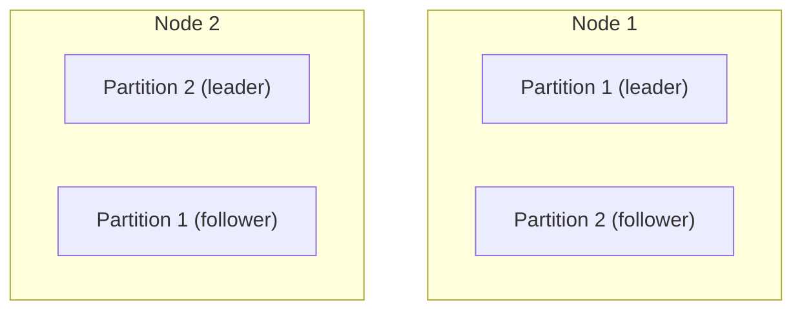
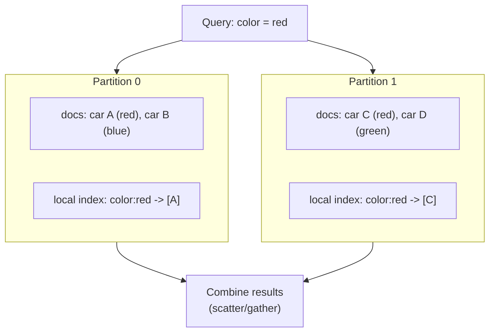
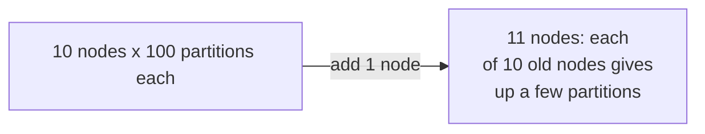
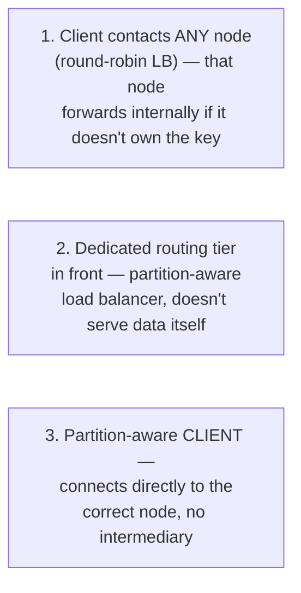

# Chapter 6 — Partitioning

> Part of a detailed, chapter-by-chapter note series on *Designing Data-Intensive Applications* (Kleppmann). See `00-index.md` for the full series map.

---

## 6.0 What and Why

**Partitioning** (aka **sharding**) = breaking a large dataset into smaller pieces, each stored on a different node — needed when a dataset (or its query throughput) is too big for **replication alone** to solve. Each partition is effectively **a small database of its own**.

> ⚠️ Terminology note: what this book calls a **partition** is called a **shard** (MongoDB/Elasticsearch/SolrCloud), a **region** (HBase), a **tablet** (Bigtable), a **vnode** (Cassandra/Riak), or a **vBucket** (Couchbase) elsewhere. Also — this "partitioning" is completely unrelated to a **network partition** (a netsplit fault, covered in Ch8) — same word, different concept.

- **Main goal: scalability.** Different partitions live on different nodes in a **shared-nothing cluster** → data spread across many disks, query load spread across many CPUs. Queries touching a single partition scale near-linearly with node count; large cross-partition queries can *sometimes* be parallelized, but it's much harder.
- Pioneered in the 1980s (Teradata, Tandem NonStop SQL), rediscovered by NoSQL and Hadoop-based warehouses. Applies to both OLTP and OLAP workloads, though tuning differs.

### Partitioning + Replication
Partitioning is normally **combined with replication** — each partition's data is stored on multiple nodes for fault tolerance, even though each *record* still belongs to exactly one partition. A node can be the **leader for some partitions** and a **follower for others** simultaneously. Everything from Ch5 about replication applies per-partition; the choice of partitioning scheme is largely **independent** of the choice of replication scheme.

---

## 6.1 Partitioning of Key-Value Data

**Goal:** spread data *and* query load **evenly** — ideally, 10 nodes handle 10x the data and 10x the throughput of one node. Uneven partitioning is called **skew**; a partition with disproportionate load is a **hot spot**.

- Naive fix: assign records to nodes **randomly** — evenly distributes data, but you then have **no way to know which node holds a given key** without querying all of them.

### Partitioning by Key Range
Assign each partition a **contiguous range of keys** (like volumes of a paper encyclopedia). If you know the boundaries, you can route directly to the right node.
- Ranges aren't necessarily evenly spaced by key *value* — they must adapt to the actual **data distribution** to stay balanced (e.g. encyclopedia volume 1 = "A-B", volume 12 = "T,U,V,X,Y,Z" — because word frequency by starting letter isn't uniform). Boundaries can be chosen manually or automatically. Used by **Bigtable, HBase, RethinkDB, MongoDB (pre-2.4)**.
- **Advantage:** keys stay **sorted** within a partition → efficient **range scans**, and the key can act like a concatenated index (fetch related records in one query).
- **Hot-spot risk:** if the key is a **timestamp**, all of *today's* writes hit the *same* partition while others idle (classic sensor-database example). **Fix:** prefix the timestamp key with something else that varies (e.g., sensor name) — now partitioning is first by sensor, then by time, spreading writes evenly, but range queries across sensors now need **one query per sensor.**

### Partitioning by Hash of Key
Apply a hash function to the key first, then assign each partition a **range of hashes**. A good hash function makes similar/skewed input keys look **uniformly distributed.**
- Hash need not be cryptographically strong — Cassandra/MongoDB use **MD5**, Voldemort uses **Fowler–Noll–Vo**. ⚠️ Built-in language hash functions (Java's `Object.hashCode()`, Ruby's `Object#hash`) are often **unsuitable** — they can return *different* hashes for the same key across different processes.
- ⭐ **On the term "consistent hashing":** the book explicitly says the *original* academic definition (Karger et al., for CDN cache load-balancing, using randomly chosen boundaries to avoid central coordination) **doesn't actually work well for databases in practice** (see Rebalancing below) — so *"it's best to avoid the term consistent hashing and just call it hash partitioning instead."* This directly qualifies the informal usage in the companion notes files.
- **Cost:** hashing **destroys the sort order** — range queries become inefficient (in MongoDB's hash-sharding mode, a range query must be sent to *all* partitions; Riak/Couchbase/Voldemort don't support primary-key range queries at all).
- **Cassandra's compromise — compound keys:** a table key can have several columns; only the **first part is hashed** (determines the partition), the rest form a **concatenated sort index** *within* that partition. E.g. key `(user_id, update_timestamp)` → different users land on different (hashed) partitions, but *within* one user's partition, updates stay sorted by time — elegant for one-to-many data (efficiently fetch "all of user X's posts in this time range").

### Skewed Workloads and Relieving Hot Spots
Hashing helps but **can't fully prevent** a hot spot if *all* reads/writes hit literally the **same key** (e.g. a celebrity's user ID during a viral event — hashing an identical key always produces the identical hash).
- **Application-level fix:** append a small random number (e.g. two decimal digits) to a known-hot key, splitting its writes across (say) 100 sub-keys/partitions.
- **Cost of this fix:** reads must now query **all 100 split keys and combine** the results — plus you need extra bookkeeping to know *which* keys are actually hot enough to warrant splitting (applying this to every key would be wasteful overhead).
- The book notes this remains a largely **manual, application-responsibility problem** — most systems don't auto-detect/compensate for it.

---

## 6.2 Partitioning and Secondary Indexes

Everything above assumes access **only by primary key**. Secondary indexes (find all cars that are red, all actions by user 123) **don't map neatly onto a partitioning scheme** — two approaches:

### Document-Partitioned Indexes ("Local Indexes")
Each partition maintains its **own** secondary index, covering only its own documents — a write only ever touches the partition owning that document.

- **Read cost:** since red cars can be scattered across every partition, a query must be sent to **all partitions and results combined** — this pattern is called **scatter/gather**, and (echoing Ch1's tail-latency-amplification point) it's **prone to tail latency amplification** even when parallelized. Widely used anyway: **MongoDB, Riak, Cassandra, Elasticsearch, SolrCloud, VoltDB.**

### Term-Partitioned Indexes ("Global Indexes")
Build **one** global secondary index covering all partitions, but the index itself must *also* be partitioned — possibly using a **different partitioning key** than the primary data (e.g., partition the index by the indexed term itself, or a hash of the term).
- Named "term" because it comes from full-text search — a **term** is the thing you're looking up (e.g. `color:red`).
- **Advantage:** reads are efficient — a client goes only to the **partition holding the relevant term**, no scatter/gather.
- **Disadvantage:** writes are **slower and more complex** — a single document write can touch **multiple index partitions** (one per distinct indexed term, each possibly on a different node) — properly, this needs a **distributed transaction** across all affected partitions, which not all databases support. In practice, **global secondary index updates are often asynchronous** — e.g., **Amazon DynamoDB** states its global secondary indexes typically update within a fraction of a second, but can lag further during infrastructure faults.

---

## 6.3 Rebalancing Partitions

**Rebalancing** = moving load (data + requests) from one node to another as the cluster changes (more throughput needed, more storage needed, or a node failed). Minimum requirements for any rebalancing strategy:
1. Load should end up shared **fairly** after rebalancing.
2. The database should **keep accepting reads/writes while rebalancing** is in progress.
3. **Move no more data than necessary** — keep rebalancing fast, minimize network/disk I/O.

### How NOT to do it: `hash mod N`
Tempting but broken: `hash(key) mod N` (N = node count) reassigns **almost every key** whenever N changes (e.g., growing from 10→11→12 nodes moves key `123456` from node 6 → node 3 → node 0) — hugely expensive rebalancing.

### Strategy 1 — Fixed Number of Partitions
Create **far more partitions than nodes** up front (e.g., 1,000 partitions across 10 nodes → ~100 each). Growing the cluster just means the new node **"steals" a few whole partitions** from each existing node — **only whole partitions move**, the partition-to-key assignment itself never changes, only the partition-to-*node* assignment.

- Reads/writes during the (slow) transfer continue using the **old assignment** until the transfer completes.
- You can even weight this by hardware: assign **more partitions to more powerful nodes.**
- Used by **Riak, Elasticsearch, Couchbase, Voldemort.**
- ⚠️ **Tradeoff:** the partition count is usually **fixed at setup** and rarely changed afterward (splitting/merging is possible in principle but operationally complex, so many systems skip it) → this number becomes your **effective max node count**, and choosing it right is hard when total dataset size is highly variable — too many partitions = per-partition management overhead; too few = each partition grows too large, making rebalancing/recovery expensive.

### Strategy 2 — Dynamic Partitioning
Better fit for **key-range partitioning**, where fixed boundaries chosen up front could easily be wrong (all data lands in one partition, others sit empty). Instead: when a partition **exceeds a configured size** (HBase default: 10 GB), **split it in two**; when a partition shrinks (deletions), **merge it with a neighbor** — conceptually similar to a B-tree's top level splitting/merging (Ch3). Used by **HBase, RethinkDB.**
- **Advantage:** partition count **adapts to actual data volume** — small dataset → few partitions (low overhead); huge dataset → each partition capped to a configurable max size.
- ⚠️ **Caveat:** an empty database starts with **just one partition** — until it's big enough to trigger its first split, **all writes hit a single node** while the rest sit idle. Fix: **pre-splitting** — configure an initial set of partitions on an empty DB (HBase, MongoDB support this), though for key-range partitioning this requires knowing the expected key distribution in advance.
- Also usable with **hash-partitioned** data, not just key-range (MongoDB ≥2.4 dynamically splits both ways).

### Strategy 3 — Partitioning Proportionally to Nodes
Used by **Cassandra and Ketama**: fix the **number of partitions per node** (e.g. Cassandra default: 256/node), so total partition count scales with **node count**, and average partition size scales with **dataset size / node count** — kept roughly stable as the cluster grows, since more data generally implies more nodes anyway.
- New node joining: randomly picks a fixed number of existing partitions to **split**, taking half of each — random per-split unfairness averages out across many partitions. (Cassandra 3.0 introduced an alternative algorithm avoiding unfair splits.)
- ⭐ This is the approach that **most closely matches the original academic "consistent hashing"** definition — random partition boundaries chosen from the hash range.

| Strategy | Partition count scales with | Used by |
|---|---|---|
| Fixed number of partitions | Fixed (independent of data/nodes) | Riak, Elasticsearch, Couchbase, Voldemort |
| Dynamic partitioning | Dataset size | HBase, RethinkDB |
| Proportional to nodes | Node count | Cassandra, Ketama |

### Automatic vs. Manual Rebalancing Operations
A **gradient**, not a binary — fully automatic (system decides and moves partitions with zero human involvement) vs. fully manual (an admin explicitly reconfigures assignment) vs. hybrid (e.g. **Couchbase/Riak/Voldemort generate a suggested reassignment automatically, but require an admin to approve/commit it**).

⭐ **Danger of full automation, illustrated with a cascading-failure scenario:** if a node is merely **temporarily overloaded and slow** (not actually dead), other nodes might conclude it's dead and **automatically rebalance load away from it** — which adds *more* load (data transfer) onto that already-struggling node and the network, potentially **making the situation worse and triggering a cascading failure.** → **A human in the loop for rebalancing** is slower but prevents this class of operational surprise.

---

## 6.4 Request Routing

Once data is partitioned across nodes, how does a client learn **which node to connect to** for a given key — especially as rebalancing constantly changes the assignment? This is a specific instance of the general **service discovery** problem.

Three high-level approaches:

- **The hard part:** whichever component makes the routing decision, **everyone must agree** on current partition→node assignment, or requests get misrouted — a **consensus problem** (Ch9).
- **Common pattern:** delegate to a dedicated **coordination service like ZooKeeper.** Every node registers itself; ZooKeeper holds the authoritative partition→node mapping; the routing tier/partition-aware client **subscribes** to changes and stays up to date automatically. Used by: **LinkedIn's Espresso (via Helix, on ZooKeeper), HBase, SolrCloud, Kafka.** MongoDB uses a similar design but with its **own** config-server + `mongos` routing daemons instead of ZooKeeper.
- **Alternative — gossip protocol:** **Cassandra and Riak** instead disseminate cluster-state changes among the nodes themselves via **gossip** (approach 1 above — any node can receive a request and internally forward it) — puts more complexity into each node, but avoids depending on an **external** coordination service.
- **Couchbase** doesn't auto-rebalance at all (simpler design); typically paired with a routing tier (`moxi`) that learns routing changes from the cluster nodes directly.
- Note: clients still need actual **IP addresses** to connect to for whichever node/routing-tier they're talking to — but since that changes far less often than partition assignment, plain **DNS** is usually sufficient for that part.

### Parallel Query Execution
Everything covered so far is single-key point lookups (plus scatter/gather) — the level most NoSQL stores support. **Massively Parallel Processing (MPP)** relational products (used for analytics/data warehousing, Ch3) go much further: an MPP query optimizer **breaks a complex query (joins, filters, grouping, aggregation) into multiple execution stages**, each potentially parallelized across many nodes — especially valuable for queries scanning large fractions of the dataset. (Techniques for this are picked up again in Ch10.)

---

## Chapter 6 Summary Table

| Dimension | Key-range partitioning | Hash partitioning |
|---|---|---|
| Sort order preserved? | Yes — efficient range scans | No — destroyed |
| Hot-spot risk | Yes, if access is clustered near sorted keys (e.g. today's timestamp) | Lower, but a single super-hot key still concentrates on one partition |
| Rebalancing style | Usually **dynamic** (split/merge on size thresholds) | Usually **fixed-count** or **proportional-to-nodes** |
| Examples | Bigtable, HBase, RethinkDB, MongoDB (pre-2.4) | Cassandra, MongoDB (≥2.4), Voldemort, Riak, Couchbase |

| Secondary index style | Read cost | Write cost |
|---|---|---|
| **Document-partitioned (local)** | Expensive — scatter/gather across all partitions | Cheap — touches only 1 partition |
| **Term-partitioned (global)** | Cheap — single partition | Expensive — may touch multiple index partitions, often async |

## Interview-Ready Talking Points

- Explain **why `hash(key) mod N` is a bad rebalancing strategy**, and contrast with the fixed-partition-count "steal partitions" approach.
- Be precise about the book's stance on "consistent hashing" — it's **not the same thing as the informal "hash ring" description** popular in system-design folklore; the *academic* definition (random boundaries, no central coordination) most closely matches Cassandra's "partitions-proportional-to-nodes" strategy specifically.
- Walk through **document-partitioned vs. term-partitioned secondary indexes** with the read-cost/write-cost tradeoff table — a very common system-design interview thread (e.g., "how would you index a distributed database?").
- Explain the **cascading-failure risk of fully automatic rebalancing** combined with automatic failure detection — a great example of "automation without care can amplify, not dampen, a problem," a recurring DDIA theme.
- Describe the **three request-routing patterns** and where a coordination service like ZooKeeper fits in.