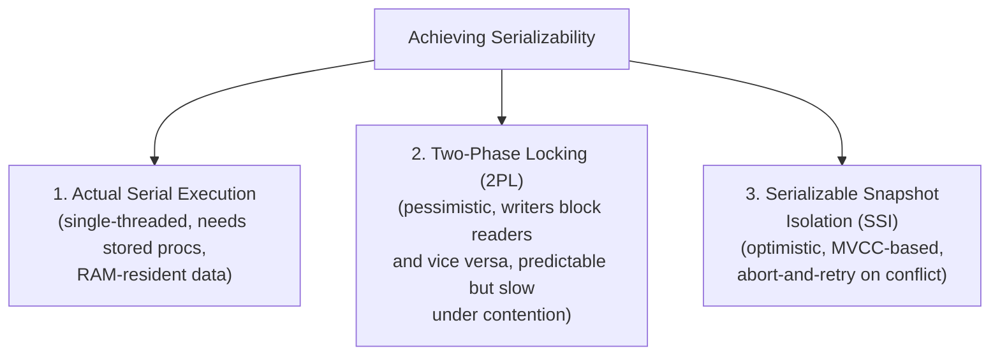

# Chapter 7 — Transactions

> Part of a detailed, chapter-by-chapter note series on *Designing Data-Intensive Applications* (Kleppmann). See `00-index.md` for the full series map.

---

## 7.0 Why Transactions?

In the harsh reality of production systems, many things can go wrong: DB software or hardware fails mid-write, an application crashes mid-sequence-of-operations, network interruptions cut the app off from the DB, several clients write concurrently causing overwrites, a client reads partially updated data, race conditions between clients cause subtle bugs.

**A transaction** is a way for an application to group several reads/writes into one logical unit — the entire transaction either **commits** (succeeds) or **aborts/rolls back** (fails) — if it fails, the application can safely **retry**. This drastically simplifies error handling: the app doesn't need to worry about *partial* failure, only "did the whole thing work or not."

- Transactions are **not a law of nature** — a deliberate simplifying **tool**, invented to present a simpler programming model to applications, so the app doesn't need to worry about certain potential error scenarios and concurrency issues.
- Not every application needs transactions — sometimes it's beneficial to weaken/drop them for higher performance/availability. Some safety properties can be achieved **without transactions.**
- ⭐ The chapter's core purpose: understand transactions in *depth*, including the range of edge cases they handle and how various databases implement them — so you can decide deliberately, not by default, whether/how to use them.

---

## 7.1 The Slippery Concept of a Transaction — ACID

**ACID**, coined 1983 by Haerder & Reuter, was meant to define the safety guarantees provided by transactions. In practice, the book is blunt: *systems that don't meet the ACID criteria are sometimes called **BASE** (Basically Available, Soft state, Eventually consistent) — an even vaguer definition than ACID, defined mostly by what it is **not**.* Also, **ACID means different, sometimes contradictory things in different databases' actual implementations** — so "ACID compliant" is more marketing than a precise, portable guarantee.

### Atomicity
- Not about concurrency (that's Isolation). Refers to what happens if a client wants to make **several writes**, but a fault occurs partway through.
- If the writes are grouped into an atomic transaction, and it can't complete (commit), the transaction is **aborted** and all its writes are **undone** — as if it never happened. Without atomicity, if an error occurs partway, it's hard to know which changes actually took effect.
- ⭐ **A better word might be "abortability"** — it's specifically about the ability to safely retry after an error, without the system ending up in an inconsistent partial state.

### Consistency
- Overloaded term with meanings all over this book (replica consistency in Ch5, CAP consistency in Ch9). In an ACID sense: it means the data must satisfy **application-defined invariants** — e.g., in accounting, credits and debits across all accounts must always be balanced.
- ⭐ **Crucial admission from the book:** *"this idea of consistency depends on the application's notion of invariants... it's the application's responsibility to define its transactions correctly... this is not something that the database can guarantee: if you write bad data that violates your invariants, the database can't stop you."* Atomicity, isolation, and durability are properties of the *database*; consistency (in this ACID sense) is a property of the *application*, only *aided* by the database via things like atomicity and isolation. **Some authors argue the "C" doesn't even belong in ACID.**

### Isolation
- Concurrently executing transactions are isolated from each other — a classic textbook example is a **race condition**: two clients concurrently increment the same counter; both read the old value, both write old+1, and one increment is **lost**.
- Formally: **serializability** — each transaction can pretend it's the only transaction running on the whole database; the DB ensures that when transactions have committed, the result is the same **as if** they'd run serially (one at a time), even though in reality they may have run concurrently.
- ⭐ The book flags upfront that serializable isolation has a **performance cost**, and many databases don't want to pay it — so they often use a **weaker level of isolation** in practice, which protects against *some* concurrency issues but not all — this is the setup for the whole "weak isolation levels" section below.

### Durability
- The promise that once a transaction commits successfully, data won't be lost, even in a hardware fault or DB crash.
- In a single-node DB, typically means data has been written to nonvolatile storage (disk/SSD), usually via a **write-ahead log** (Ch3) enabling recovery.
- In a replicated system, durability may mean the data has been **successfully copied to some number of nodes.**
- ⭐ The book is careful to note **no durability technique is perfect** — all can fail in extreme circumstances (disks/backups can be simultaneously destroyed, correlated bugs can silently corrupt data across replicas). Durability is a matter of **reducing the probability of loss**, not an absolute guarantee.

---

## 7.2 Single-Object and Multi-Object Operations

Recap: **atomicity** = safely aborting a transaction on error, discarding partial changes; **isolation** = concurrent transactions don't step on each other.

- **Multi-object transactions** are needed whenever several pieces of data must **stay in sync** — e.g., a foreign key in a relational DB must be correct; a denormalized document-DB record duplicated across multiple documents must all update together; a secondary index (logically a separate "object" from the main record) must stay consistent with the record it indexes. **Without atomicity, these can get out of sync if a write partially fails.**
- **Single-object writes:** even non-transactional systems usually provide **atomicity and isolation at the level of a single object** (e.g., a single JSON document) — implemented at the storage-engine level using techniques like a **write-ahead log for crash recovery** and a **per-object lock** for isolation (one thread at a time may operate on a given object). Some databases also provide fancier single-object atomic operations — e.g. an **increment operation** (avoiding a read-modify-write cycle) or a **compare-and-set operation** (apply a write only if the value hasn't changed since last read — this is the fundamental building block for implementing optimistic locking/preventing lost updates, expanded below).
- ⭐ The term "**ACID**", strictly speaking, refers to **multi-object** transactions supporting atomicity and isolation. Many "NoSQL" distributed databases dropped multi-object transactions because they're **hard to implement across partitions** and can get in the way of performance/availability in some scenarios (fault-tolerance and scaling tradeoffs, revisited in Ch9).

---

## 7.3 Weak Isolation Levels

⭐ **Big-picture framing:** if transactions run **serially** (one at a time), isolation is trivially guaranteed. But **serial execution would badly limit throughput** on multi-core/multi-request systems — so, for performance, most databases sacrifice full isolation and instead offer **weaker isolation levels**, which protect against *some* concurrency issues but not all — leaving developers to understand exactly what's (and isn't) guaranteed.

### Read Committed
The most basic, and one of the most popular, isolation levels — default in **Oracle 11g, PostgreSQL, SQL Server 2012.** Two guarantees:
1. **No dirty reads** — you only see data that's been **committed** (uncommitted writes from another in-progress transaction stay invisible until it commits, at which point *all* of its writes become visible at once).
2. **No dirty writes** — you only **overwrite** data that's already committed; the second of two concurrent writers must wait until the first's transaction commits/aborts.

**Why prevent dirty reads?**
- Seeing a partially-updated state (e.g., a new email arrived but the unread-counter hasn't been bumped yet) is confusing and can cause other transactions to make wrong decisions.
- If a transaction later **aborts**, anything read from its uncommitted, now-rolled-back writes was never really "real" — reasoning about the consequences becomes "mind-bending."

**Why prevent dirty writes?**
- ⭐ **Worked example** (used-car site): Alice and Bob simultaneously buy the same car. Without dirty-write prevention, the **listing update** might pick Bob as the winner while the **invoice** goes to Alice (a mismatch across two separate writes each racing independently). Preventing dirty writes avoids this specific mishap.
- ⚠️ Read Committed does **not** prevent the lost-update race (see below) — since that second write happens *after* the first has already committed, it's not a "dirty" write, just a *lost* one, for a different reason.

**Implementation:**
- Dirty writes: standard **row-level locks** — a transaction writing an object must hold an exclusive lock on it until commit/abort.
- Dirty reads: naively you could use the *same* lock for reads too, but that's a bad idea — **one long write transaction would force all concurrent readers to wait**, harming response times unpredictably. Instead: for each written object, the DB **remembers both the old committed value and the new (in-flight) value**; other transactions simply see the **old value** until the new one commits. (This is the seed of MVCC, described in depth below.)

### Snapshot Isolation and Repeatable Read
Read Committed still allows an anomaly called **read skew** (aka nonrepeatable read): if Alice has $500 in each of two bank accounts and checks both balances *while* a $100 transfer is mid-flight, she might see the pre-transfer balance of account 1 ($500) and the post-transfer balance of account 2 ($400) → **appears $100 vanished**, even though every value she read was individually committed and correct at the moment she read it.
- Usually a transient, self-correcting annoyance for a human refreshing a page — but **unacceptable for backups** (a backup running for hours could capture different parts of the DB at different logical times, permanently baking in an inconsistency) and **for analytics/integrity-check queries** scanning large parts of the DB (nonsensical results if the underlying data shifts mid-scan).

**Snapshot isolation** is the standard fix: each transaction reads from a **consistent snapshot** — all data committed as of the transaction's *start*, even if concurrently modified afterward. Supported by **PostgreSQL, MySQL/InnoDB, Oracle, SQL Server.**

**Implementation — Multi-Version Concurrency Control (MVCC):**
- Writes use locks exactly as in Read Committed (to prevent dirty writes); but **reads never need a lock at all.** ⭐ **Core principle:** *"readers never block writers, and writers never block readers"* — this is exactly why long-running analytic/backup reads can coexist smoothly with normal write traffic.
- The DB must keep **multiple committed versions of an object side by side**, since different concurrently-running transactions may need to see the database "frozen" at different points in time — hence "**multi-version**."
- **PostgreSQL's approach (illustrative):** each transaction gets a unique, always-increasing **transaction ID (txid)**. Every row carries a `created_by` (txid that inserted it) and a `deleted_by` (txid that deleted it, initially empty). An **update = internally a delete + a create** — so after an update, the table literally contains *both* the old row (marked deleted by the updating txn) and the new row (created by the same txn) — garbage collected later once no transaction could possibly still need the old version.
- **Visibility rules** — an object is visible to a reading transaction if, at the time that reader's transaction *started*: (a) the transaction that created the object had already committed, and (b) it isn't marked deleted, or if it is, that deleting transaction hadn't yet committed. Writes from transactions that started *later* than the reader, or that are still in-progress/aborted, are simply ignored.
- **Indexes under MVCC:** one option — index points to *all* versions of an object, and a query filters out invisible versions at read time (PostgreSQL optimizes this when multiple versions fit in the same disk page). Another option (**CouchDB, Datomic, LMDB**) — use an **append-only/copy-on-write B-tree** variant: every write creates new (immutable) copies of the modified pages plus all ancestor pages up to a new root; a given root *is* a full, consistent snapshot; unaffected pages are shared/untouched — no txid filtering needed at all, at the cost of needing a background compaction/GC process.

**⭐ Naming confusion (a genuinely useful interview fact):** the SQL standard predates snapshot isolation (based on 1975's System R definitions) and has no such concept — it only defines **"repeatable read,"** which superficially resembles snapshot isolation. So:
- **Oracle** calls its snapshot isolation level "**serializable**" (it is **not** truly serializable!).
- **PostgreSQL and MySQL** call theirs "**repeatable read**."
- **IBM DB2** uses "repeatable read" to mean actual **serializability.**
- The book's blunt verdict: *"nobody really knows what repeatable read means."* — always verify the *actual* guarantees a specific database version provides, never trust the isolation-level *name* alone.

---

## 7.4 Preventing Lost Updates

The **lost update problem**: a **read-modify-write cycle** (read a value, compute a new value, write it back) run by two concurrent transactions can silently **clobber** one of the modifications. Common scenarios: incrementing a counter/balance, editing part of a JSON document, two users saving an entire wiki page (last save wins, silently discarding the other's edit).

| Solution | How it works | Limitation |
|---|---|---|
| **Atomic write operations** | DB-native operation like `UPDATE counters SET value = value + 1` — avoids the read step in app code entirely; typically implemented via an exclusive lock held from read through write ("**cursor stability**"), or by forcing execution on a single thread | Not every update is expressible this way (e.g., freeform wiki text editing); ORMs make it easy to *accidentally* write an unsafe read-modify-write cycle instead |
| **Explicit locking** | App explicitly locks the row(s) it's about to update (`SELECT ... FOR UPDATE`), forcing concurrent updaters to wait | Requires careful application logic; easy to forget a needed lock somewhere |
| **Automatic detection** | DB runs read-modify-write cycles **in parallel**, but detects a lost update at commit time and **aborts** the offending transaction, forcing a retry | ⭐ **PostgreSQL's repeatable read, Oracle's serializable, and SQL Server's snapshot isolation all detect this automatically. MySQL/InnoDB's repeatable read does NOT** — some authors argue this disqualifies MySQL from truly providing "snapshot isolation" by a strict definition. This approach is attractive because it's **automatic and doesn't rely on the app remembering** to use locks or atomic ops. |
| **Compare-and-set** | `UPDATE ... WHERE id=1234 AND content='old content'` — only applies if the value hasn't changed since it was last read; if it has, the update is a no-op and must be retried | ⚠️ Only safe if the DB's `WHERE` clause reads from the **current** value, not a stale snapshot — verify this per-database before relying on it |
| **Conflict resolution in replicated DBs** | In multi-leader/leaderless replicated systems (Ch5), locks/compare-and-set don't directly apply since writes may be applied on different nodes in different orders — common approaches: allow concurrent writes to create multiple versions, then use application code or special structures (**CRDTs**) to merge them after the fact. Last-write-wins (LWW) is common but explicitly **prone to lost updates.** | |

---

## 7.5 Write Skew and Phantoms

### Write Skew — a Generalization of Lost Updates
⭐ **The canonical worked example:** a hospital app requires **at least one doctor on call at all times.** Alice and Bob are both on call; both feel sick and, at nearly the same moment, each checks "are ≥2 doctors currently on call?" — under **snapshot isolation, both checks return 2** (each sees a snapshot before the other's write), so both proceed to take themselves off call → **now 0 doctors are on call**, violating the invariant, even though neither transaction did anything individually "wrong."

- This is called **write skew.** It's **not** a dirty write (they modified *different* rows — Alice's record and Bob's record) and **not** a lost update (neither write overwrote the other). It's a distinct category: *"two transactions read the same objects, and then update some [possibly different] of those objects."*
- ⭐ **Crucially, none of the earlier lost-update remedies fully solve write skew:** atomic single-object operations don't help (multiple objects involved); automatic lost-update detection in PostgreSQL/MySQL/Oracle/SQL Server's snapshot-isolation-like levels **does not catch write skew** either. Preventing it automatically requires **true serializable isolation.**
- **Practical mitigations short of full serializability:** database-enforced constraints where possible (single-object uniqueness/foreign-key constraints work, but a multi-object constraint like "at least one doctor on call" usually needs a trigger or materialized view); or **explicitly locking the rows the decision depends on** (`SELECT ... FOR UPDATE`) before deciding.

### More Examples of Write Skew (the book's "pattern recognition" list — great for interviews)
| Scenario | The race |
|---|---|
| **Meeting room booking** | Two bookings check "no conflicting booking exists" concurrently, both see none, both insert → **double-booked room** |
| **Multiplayer game** | Locking prevents two players moving the *same* piece concurrently, but doesn't stop two players moving *different* pieces onto the *same* board square |
| **Claiming a username** | Two signups both check "is this username free?", both see yes, both create the account → *(fixable simply, via a **unique constraint**, unlike the other examples)* |
| **Preventing double-spending** | Two concurrent "spend" transactions each independently check the account has sufficient balance, both pass, but **together** they overdraw the account |

### Phantoms Causing Write Skew
⭐ **The unifying pattern behind every write-skew example:** (1) a `SELECT` checks whether some condition holds by counting/searching matching rows; (2) the app decides whether to proceed based on that result; (3) if it proceeds, its **write changes the very condition the first query was checking** — so if you re-ran the same `SELECT` after the write, you'd now get a *different* answer. This effect — **a write changing the result of another transaction's search query**, rather than modifying a row that query directly returned — is called a **phantom.**
- In the doctors example, the affected row *was* one of the rows returned by the original query, so simply locking the returned rows (`SELECT FOR UPDATE`) is enough to fix it. But in the **other four examples** (booking, game, username, spending), the conflict is over rows that **don't yet exist** at query time — there's nothing to lock with an ordinary row lock. This is exactly what motivates **predicate locks**, below.

---

## 7.6 Serializability

⭐ **The book's blunt bottom line after cataloguing all these weak-isolation anomalies:** *"there are no good tools to help us detect race conditions... the answer from researchers has been simple: use serializable isolation!"* Serializable isolation guarantees the result is **as if transactions ran one at a time, serially** — even though they may actually run concurrently — preventing **all** possible race conditions (lost updates, write skew, phantoms, everything).

**Three main implementation techniques:**

### 1. Actual Serial Execution
Literally run one transaction at a time, on a single thread — sidesteps the whole problem by definition. Once considered infeasible for good performance; became practical **around 2007** due to two shifts:
- **RAM became cheap enough** to hold the entire active dataset in memory — no waiting on disk I/O per transaction.
- Realization that **OLTP transactions are typically short**, touching only a small number of rows — long analytic reads can run separately, outside the serial loop, via ordinary snapshot isolation.

Used by **VoltDB/H-Store, Redis, Datomic.**

**Stored procedures are required:** traditional *interactive* multi-round-trip transactions (app ↔ DB, back and forth, each round trip eating network latency) would leave a single serial-execution thread mostly **idle waiting on the network** — terrible throughput. So single-threaded engines require the entire transaction logic to be submitted **upfront as a stored procedure**, executed in one shot with no external waiting. Modern implementations use real general-purpose languages instead of archaic SQL dialects (**VoltDB: Java/Groovy; Datomic: Java/Clojure; Redis: Lua**).
- ⭐ **VoltDB also reuses stored procedures for replication** — instead of shipping write data, it re-executes the *same deterministic stored procedure* on every replica — which requires the procedure to be strictly **deterministic** (special APIs needed for things like "current time").

**Scaling via partitioning:** single-threaded throughput is capped at **one CPU core.** To scale, partition the data (Ch6) so each transaction only touches **one partition** — each partition then runs its own independent single-threaded engine, giving linear scaling with core count. ⚠️ But any transaction spanning **multiple partitions** needs cross-partition coordination in lock-step — VoltDB reports **~1,000 cross-partition writes/sec**, orders of magnitude below single-partition throughput, and **this ceiling can't be raised by adding more machines.**

**Constraints for serial execution to be viable:** every transaction must be small/fast; the active dataset must fit in memory (or use **anti-caching** — abort, async-fetch the missing data, restart the transaction); write throughput must fit on one core, or be cleanly partitionable.

### 2. Two-Phase Locking (2PL)
For ~30 years, **the only** widely used serializability algorithm.

> ⚠️ **2PL ≠ 2PC** — two-phase *locking* (this section) and two-phase *commit* (Ch9, distributed atomic commit across nodes) are **completely unrelated despite the similar name.**

- Much **stronger** locking than plain dirty-write prevention: several transactions may concurrently **read** the same object as long as nobody's **writing** it — but the moment anyone wants to write, they need **exclusive access**, and:
  - If A has *read* an object, B must wait to *write* it until A finishes.
  - If A has *written* an object, B must wait to even *read* it until A finishes.
- ⭐ **Key contrast with snapshot isolation's mantra** ("readers never block writers, writers never block readers"): 2PL is the *opposite* — **writers block readers, and readers block writers.** This is precisely what buys full serializability (protection against lost updates, write skew, everything) at the cost of much more blocking.
- **Implementation:** every object has a lock, either **shared** (for reads, multiple holders OK) or **exclusive** (for writes, one holder only, blocks everything else); a read-then-write transaction can **upgrade** shared→exclusive. The defining "two-phase" structure: phase 1 = **acquiring** locks throughout execution; phase 2 = **releasing all of them at once**, only at commit/abort — never released early.
- **Deadlocks** occur frequently (A waits on B's lock, B waits on A's) — the DB automatically detects and **aborts one transaction** to break the cycle; the app must retry.
- **Performance is the big downside:** worse throughput/latency than weak isolation, both from lock overhead and — more importantly — from **drastically reduced concurrency.** Since traditional relational DBs don't cap transaction duration (built for potentially-interactive use), a slow or lock-heavy transaction can create a queue that stalls many others → **unstable, high-percentile latency** under contention. Deadlocks are also **much more frequent** under 2PL serializable isolation than under read committed, and each aborted+retried transaction wastes redone work.

**Predicate locks — solving phantoms properly:** rather than locking a specific *object*, a **predicate lock** locks **all objects (existing or not-yet-existing) matching a search condition** (e.g. `WHERE room_id=123 AND time-range-overlaps`). Any transaction wanting to insert/update/delete something must first check whether the old *or* new value would match an existing predicate lock — this is what lets 2PL correctly block a *future* conflicting insert, closing the phantom hole entirely.
- **Problem:** predicate locks perform poorly — many active locks to check against on every write.
- **Practical fix — index-range locks:** approximate the predicate by attaching a shared lock to a broader chunk of an existing index (e.g., lock the whole `room_id = 123` index bucket, or a numeric range around the queried time window) — a coarser-grained, cheaper "safe approximation" of a full predicate lock. If no suitable index exists, the DB can fall back to a **shared lock on the entire table** — safe, but very bad for concurrency.

### 3. Serializable Snapshot Isolation (SSI)
⭐ A relatively recent (first described **2008**) technique offering **full serializability at a performance cost close to plain snapshot isolation** — used in **PostgreSQL (≥9.1)** and (a similar algorithm) **FoundationDB.** The book frames this as a genuinely exciting result: it suggests serializability and good performance are **not** fundamentally at odds after all.

**Pessimistic (2PL) vs. Optimistic (SSI) concurrency control:**
| | Pessimistic (2PL) | Optimistic (SSI) |
|---|---|---|
| Philosophy | "If anything *might* go wrong, block and wait until it's safe" | "Proceed anyway, hoping for the best; check for violations only at commit time" |
| Cost under high contention | Predictable-ish, but throughput suffers from blocking | **Performs badly** — many transactions abort and must retry, which can make things *worse* if the system is already near capacity |
| Cost under low contention | Locking overhead paid regardless | **Performs well** — no blocking overhead when conflicts are rare |

- SSI builds directly on **snapshot isolation** (same MVCC read mechanics) and adds an algorithm to **detect serialization conflicts among writes and abort offending transactions.**
- **Two detection mechanisms**, both targeting the same core problem — *a transaction acting on a premise that later turns out to be stale*:
  1. **Detecting stale MVCC reads** — the DB tracks whenever a transaction's snapshot **ignored** another transaction's not-yet-committed write (per normal MVCC visibility rules). If that ignored write **later commits** before *this* transaction commits, the premise it read may no longer hold — abort at commit time. ⭐ **Why wait until commit instead of aborting immediately on the stale read?** Because at read time the DB doesn't yet know if the transaction is read-only (no risk at all) or whether the *other* transaction will itself abort — aborting eagerly would cause unnecessary aborts and defeat snapshot isolation's whole benefit for long-running reads.
  2. **Detecting writes that affect prior reads** — similar to index-range locks from 2PL, but crucially **non-blocking**: when a transaction reads via an indexed search condition, the DB notes which transactions read that index range. When another transaction later **writes** something matching that range, it acts as a **tripwire** — it just *notifies* the reading transaction(s) that their premise may now be stale, without blocking anyone. Whichever transaction **commits first wins**; the other, if it tries to commit after, gets aborted.
- **Performance tuning tradeoff:** finer-grained read/write tracking = more precise aborts (fewer unnecessary retries) but higher bookkeeping overhead; coarser tracking = cheaper but more **false-positive aborts.**
- ⭐ **Advantage over 2PL:** one transaction **doesn't need to block waiting on locks held by another** — reads and writes of different transactions don't get in each other's way the way they do under 2PL — making SSI's latency profile far more predictable, especially under contention that would otherwise cause 2PL lock-queueing.

---

## Chapter 7 Summary Table

| Isolation level | Prevents | Does NOT prevent |
|---|---|---|
| **Read Committed** | Dirty reads, dirty writes | Read skew, lost updates, write skew, phantoms |
| **Snapshot Isolation** (aka "repeatable read" in some DBs) | Read skew, dirty reads/writes | Lost updates *(unless the DB adds automatic detection — not universal)*, write skew, phantoms |
| **Serializable** (2PL, SSI, or actual serial execution) | Everything — behaves as if transactions ran one at a time | — |

| Serializability technique | Approach | Best fit |
|---|---|---|
| Actual serial execution | Single-threaded, no concurrency at all | Small, fast, RAM-resident OLTP transactions; can partition for scale |
| Two-phase locking (2PL) | Pessimistic locking; writers block readers and vice versa | Mature, widely available, but unpredictable tail latency under contention |
| Serializable Snapshot Isolation (SSI) | Optimistic, MVCC + conflict detection at commit | Best performance/serializability tradeoff when contention is low-to-moderate |

## Interview-Ready Talking Points

- Precisely restate **ACID**, and be ready to explain *why the book argues "Consistency" doesn't really belong* the way the other three letters do.
- Walk through the **used-car "dirty write" example** and the **bank-balance "read skew" example** as concrete illustrations of exactly what read committed does and doesn't fix.
- Explain **MVCC** end to end — transaction IDs, `created_by`/`deleted_by`, and the visibility rules — this is one of the most commonly probed "explain how databases actually work" interview questions.
- Give the **hospital on-call doctors write-skew example** from memory, and explain precisely why it is neither a dirty write nor a lost update.
- Explain the **phantom problem** and why it specifically requires **predicate locks / index-range locks**, not ordinary row locks.
- Compare **2PL vs. SSI** using the pessimistic/optimistic framing, and state the concrete performance tradeoff (SSI wins under low contention, can lose under high contention due to abort storms).
- Be able to state clearly: **serializable isolation prevents all race conditions; every weaker level trades off some safety for performance**, and the "right" choice is application-specific.