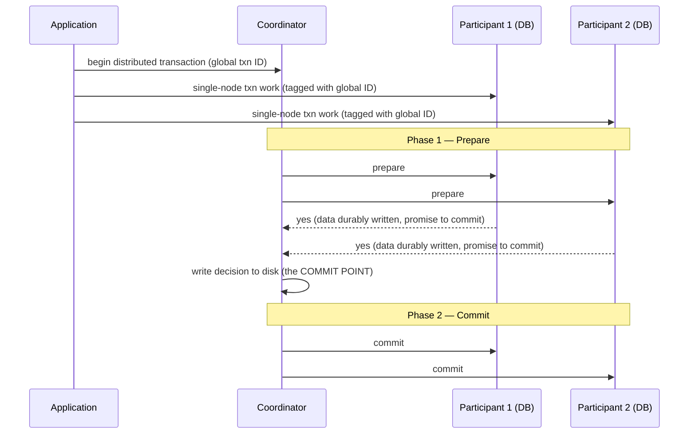

# Chapter 9 — Consistency and Consensus

> Part of a detailed, chapter-by-chapter note series on *Designing Data-Intensive Applications* (Kleppmann). See `00-index.md` for the full series map.

---

## 9.0 Framing: Abstractions for Fault Tolerance

Given everything that can go wrong (Ch8), the simplest response is to let the whole service fail and show an error. If that's unacceptable, we need **fault-tolerance abstractions** — reusable guarantees, implemented once, that let applications *pretend* certain distributed-systems problems don't exist. This is exactly the approach transactions (Ch7) took for single-node faults (atomicity hides partial failure; isolation hides concurrency).

⭐ **This chapter's central abstraction is consensus** — getting all nodes to **agree on something.** As the chapter unfolds, it turns out an enormous number of distributed-systems problems (leader election, atomic commit, uniqueness constraints, total ordering) are all **secretly the same problem**, reducible to consensus.

---

## 9.1 Consistency Guarantees — Setting the Stage

Recall (Ch5) that replicated databases inevitably show **temporary inconsistency** between replicas due to replication lag, regardless of replication method (single-leader, multi-leader, leaderless). Most systems provide at least **eventual consistency** — if writes stop, replicas *eventually* converge. ⭐ The book suggests **"convergence"** might be a better name, since it emphasizes the *guarantee* (replicas will agree eventually) rather than the vague word "eventual."

- ⭐ **The core weakness of eventual consistency, stated plainly:** it says **nothing about *when*** replicas converge — until then, reads can return "anything or nothing." This is jarringly different from a normal single-threaded variable, which never returns a stale/old value on the next read after a write — a database only superficially resembles a readable/writable variable.
- **Consistency models vs. transaction isolation levels (Ch7) — related but distinct concerns:** isolation is primarily about avoiding race conditions from **concurrently executing transactions**; distributed consistency is primarily about **coordinating replica state** in the face of delays and faults. There's overlap, but they're mostly independent axes.
- **This chapter's three-part structure:** (1) **linearizability**, one of the strongest common consistency models; (2) **ordering** in distributed systems — causality and total order; (3) how these connect to **atomic commit and the consensus problem** itself.

---

## 9.2 Linearizability

**The core idea:** make a system **behave as if there were only a single copy of the data**, and every operation on it is atomic — so the application never has to think about replicas or replication lag. Also known as **atomic consistency, strong consistency, immediate consistency, or external consistency.**

⭐ **Linearizability is fundamentally a *recency* guarantee:** once a write completes successfully, **every** subsequent read by **any** client must see that write (or something even more recent) — never a stale value from a lagging replica or cache.

**Illustrative example (the "football score" scenario):** Alice and Bob, in the same room, both check a sports site for the World Cup final result. Alice refreshes first, sees the final score, and tells Bob out loud. Bob then refreshes — but his request happens to hit a **lagging replica**, so his phone still shows the game as ongoing. This is jarring specifically because Bob's request *causally* happened after Alice's announcement — a linearizable system would guarantee Bob's read reflects at least what Alice already saw.

### Linearizability vs. Serializability — a crucial, commonly-confused distinction
| | **Serializability** | **Linearizability** |
|---|---|---|
| What it's about | An **isolation** property of **transactions** (Ch7) — multi-object reads/writes behave as if run in *some* serial order | A **recency** guarantee on reads/writes of a **single object/register** |
| Order requirement | The serial order need **not** match real-time/wall-clock order | Operations must respect actual **real-time order** |
| Prevents write skew? | Yes (by definition, if truly serializable) | **No** — linearizability doesn't group operations into transactions at all, so it does nothing to prevent write skew unless combined with other techniques |

- **A database can provide both** — this combination is called **strict serializability / strong one-copy serializability (strong-1SR).**
- Implementations of serializability based on **2PL or actual serial execution are typically also linearizable.** ⚠️ But **Serializable Snapshot Isolation (SSI) is explicitly NOT linearizable** — by design, SSI reads from a consistent *snapshot*, which deliberately excludes writes more recent than the snapshot — so a read under SSI can return data that's "stale" relative to real time, even though it's fully serializable relative to other transactions.

### Relying on Linearizability — three real use cases

1. **Locking and leader election.** Any system electing a single leader via "whoever acquires the lock first wins" needs that lock to be **linearizable** — otherwise different nodes could disagree about who holds it. **Coordination services like ZooKeeper and etcd** implement fault-tolerant linearizable operations via consensus algorithms internally (explored later in this chapter) and are commonly used to build distributed locks/leader election. (Recall from Ch8: even a correctly-implemented linearizable lock still needs **fencing tokens** to be fully safe against a paused, falsely-confident lock holder.)

2. **Constraints and uniqueness guarantees.** Enforcing "usernames must be unique," "account balances can't go negative," "don't oversell inventory," or "don't double-book a seat" **at write time** requires linearizability — conceptually, claiming a username is exactly like acquiring a lock (an atomic compare-and-set: "set this username to my user ID, provided it isn't already taken"). ⭐ **Caveat the book raises:** some constraints can be handled more loosely in practice (e.g., an overbooked flight can be resolved via compensation/rebooking after the fact) — in those cases, linearizability may not be strictly necessary. But a **hard** uniqueness constraint, of the kind typical in relational databases, genuinely requires it. (Other constraint types, like foreign keys, don't necessarily need linearizability.)

3. **Cross-channel timing dependencies.** ⭐ **The key insight generalized from the football-score example:** the linearizability violation was only *noticed* because there was an **additional, out-of-band communication channel** (Alice's voice). The same structural problem shows up in real systems: e.g., a web server writes a photo to a **file storage service**, then places a resize job on a **message queue** for a background image resizer. If the storage service **isn't** linearizable, the resizer (having received the queue message almost instantly) might fetch the image **before** it's actually visible in storage — because the message-queue channel raced ahead of the storage-replication channel. If the file storage *is* linearizable, this race can't happen. This pattern — **two separate communication channels between the same components, racing against each other** — is a recurring, easy-to-overlook source of subtle bugs.

### The Cost of Linearizability
⭐ **Worked scenario:** a multi-datacenter deployment loses network connectivity **between** datacenters (but each datacenter's internal network, and client access to each datacenter, still works fine).
- **Multi-leader replication:** each datacenter keeps operating independently — writes just queue up and sync once the network heals. **Available**, but **not linearizable** (a client in datacenter A can't see a very-recent write made in datacenter B).
- **Single-leader replication:** the leader lives in *one* datacenter. Clients connected to the **follower** datacenter, cut off from the leader, **cannot write or do a linearizable read at all** — they can still do (possibly stale) reads from the local follower, but the *application* becomes unavailable there until the network heals, if linearizability is required.

### The CAP Theorem — precisely, and with the book's caveats
⭐ **The general trade-off (independent of *how* it's implemented):**
- **Require linearizability** → some replicas, when disconnected, **must become unavailable** (wait or error) until the network heals.
- **Don't require linearizability** → each replica can keep processing requests independently even while disconnected (e.g., multi-leader) → stays **available**, but is **not linearizable.**

This is the **CAP theorem** (named by Eric Brewer, 2000; the underlying trade-off known to distributed-DB designers since the 1970s). ⭐ **The book is explicitly critical of how CAP is usually presented and used:**
- The popular framing **"Consistency, Availability, Partition tolerance — pick 2 of 3"** is **misleading**, because network partitions are a type of **fault**, not a design choice — *they will happen whether you like it or not.* A **better phrasing**: *"Consistent or Available **when Partitioned**."*
- CAP's formal scope is **very narrow** — it considers only **one** consistency model (linearizability) and only **one** kind of fault (network partitions/disconnected-but-alive nodes). It says **nothing** about network delay, dead nodes, or other real trade-offs.
- There are **multiple contradictory definitions of "availability"** floating around in CAP discussions, and the formal theorem's definition doesn't match the everyday meaning — many genuinely "highly available" systems don't technically satisfy CAP's idiosyncratic definition.
- ⭐ **The book's blunt conclusion:** *"CAP is best avoided"* — it's of **mostly historical interest** today, and has been **superseded by more precise results.** It deserves credit for kicking off the NoSQL-era exploration of the wider shared-nothing design space, but has little remaining *practical* design value.

### Linearizability and Network Delays — why so few systems actually provide it
⭐ **Surprising fact:** even **RAM on a modern multi-core CPU is not linearizable** — a write by one core isn't guaranteed to be immediately visible to a read on another core (each core has its own cache/store buffer; changes propagate to main memory asynchronously), **unless you explicitly use a memory barrier/fence.** This trade-off is made purely for **performance**, not fault tolerance — within one machine you generally do assume reliable internal communication.
- Similarly, **most distributed databases that avoid linearizability do so primarily for performance, not fault tolerance.** ⭐ *"Linearizability is slow — and this is true all the time, not only during a network fault."*
- ⭐ **A hard theoretical limit (Attiya and Welch):** the response time of linearizable reads/writes is **provably** at least proportional to the network's delay *uncertainty.* On a network with highly variable delay (i.e., basically every real network), linearizable operations are inherently going to be slow — **no faster algorithm for linearizability exists.** This is exactly why weaker consistency models remain attractive for latency-sensitive systems.

### Implementing Linearizable Systems — a survey by replication method
| Replication approach | Can it be linearizable? | Caveat |
|---|---|---|
| **Single-leader** | Potentially, if reads always go through the leader (or a leader-verified follower) | Common source of non-linearizability: a naive implementation lets stale followers serve reads, or a "leader" that's actually been demoted (split brain / no fencing) keeps serving |
| **Consensus algorithms** (ZooKeeper, etcd) | **Yes** — they're carefully designed to avoid split brain and stale reads via majority agreement | This is precisely *why* they're used for locks/leader election |
| **Multi-leader** | ⚠️ Generally **not** linearizable | Concurrent writes on different leaders make single-copy semantics impossible |
| **Leaderless, Dynamo-style (quorum `w+r>n`)** | Can be made linearizable, but at a real performance cost | Requires **synchronous read repair** before returning results, and a writer must first read the latest quorum state before writing. **Riak doesn't do synchronous read repair (for performance). Cassandra does wait for read repair on quorum reads, but loses linearizability under concurrent writes to the same key**, due to its last-write-wins conflict resolution. A linearizable **compare-and-set** specifically can't be built this way at all — it needs a true consensus algorithm. ⭐ **Book's overall verdict: "it is safest to assume that a leaderless system with Dynamo-style replication does not provide linearizability."** |

---

## 9.3 Ordering Guarantees

⭐ **Why ordering keeps reappearing across this whole book:** a linearizable register behaves as if there's a **single timeline** on which every operation has a well-defined place — this connects directly to recurring themes: the **leader's role in single-leader replication** is fundamentally to *determine an order* of writes (Ch5); **serializability** (Ch7) is about transactions behaving *as if* executed in *some* serial order; and **timestamps/clocks** (Ch8) are attempts to order events across machines.

### Causal Order Is Not a Total Order
| | Total order | Partial order (causal order) |
|---|---|---|
| Definition | **Any** two elements can always be compared | Some pairs can be compared, some are **incomparable** |
| Example | Natural numbers (13 > 5, always) | Mathematical sets ({a,b} vs. {b,c} — neither contains the other, **incomparable**) |
| In distributed systems | **Linearizability** — every operation has a single, unambiguous position on one timeline; there is no such thing as "concurrent" operations in a linearizable store | **Causality** — two operations are ordered if causally related; **concurrent** operations (neither happened-before the other) are incomparable |

- ⭐ **A linearizable datastore, by definition, has NO concurrent operations at all** — there's a single timeline, with every request handled atomically at one point on it. **Causal consistency is strictly weaker** — its "timeline" can **branch and merge** (the book explicitly compares this to a **Git commit history**: usually linear, but branching when people work concurrently, and merging when those branches combine).
- **Linearizability implies causality** — any linearizable system automatically preserves causal ordering, without any extra bookkeeping (this is *why* it neatly solved the cross-channel race in the image-resizer example above).
- ⭐ **But causal consistency is available *without* paying linearizability's full performance cost.** In fact: *"causal consistency is the strongest possible consistency model that does not slow down due to network delays, and remains available in the face of network failures."* Many systems that seem to need linearizability actually only need the weaker (and cheaper) guarantee of causal consistency — an active area of database research at the time of writing, though not yet widely production-proven.

**Capturing causal dependencies:** to preserve causality, a replica must ensure all causally-*preceding* operations have already been applied before applying a later one — waiting if a dependency hasn't arrived yet. This requires tracking "what did this node already know when it made this write" — conceptually the **same mechanism as version vectors** (Ch5's concurrent-write detection), but **generalized across the entire database**, not just a single key.

### Sequence Number Ordering
Explicitly tracking every causal dependency doesn't scale well (a write might depend on many prior reads). A cheaper alternative: **logical clocks** — sequence numbers/counters (not tied to physical time) that provide a **total order consistent with causality**: if A causally preceded B, A gets a lower sequence number; **concurrent** operations can be ordered arbitrarily between themselves, but never violate a real causal dependency.
- **Single-leader replication naturally gives you this for free** — the leader just increments a counter per write in its replication log; followers applying writes in log order stay causally consistent even while lagging.
- **Without a single leader** (multi-leader, leaderless, or partitioned), generating consistent sequence numbers is harder — approaches include: each node generates its own disjoint numbering (e.g. odd/even, or reserved bits for a node ID); attach a physical timestamp (used by LWW, with the dangers covered in Ch8); or **preallocate blocks** of sequence numbers per node.

### Lamport Timestamps — a clever, compact solution
Each operation carries a **(counter, node ID)** pair — compare by counter first, node ID as tiebreaker. ⭐ **The key trick that makes it causally consistent:** *every node and client tracks the maximum counter value it has ever seen, and includes that maximum with every request; whenever a node receives a message with a higher counter than its own, it immediately jumps its own counter forward to match.* This propagation of "the max seen so far" guarantees every causal dependency results in a strictly increasing counter along that causal chain.
- ⭐ **Lamport timestamps vs. version vectors — a commonly confused distinction:** version vectors can tell you whether two operations are **concurrent** or one is causally dependent on the other; **Lamport timestamps cannot** — they only ever give you a **total order**, discarding the concurrent/causal distinction entirely. The tradeoff: Lamport timestamps are much **more compact** (one small number vs. a full vector).

**⭐ Timestamp ordering is NOT sufficient for everything — the crucial limitation.** Even with a valid causally-consistent total order, you can't safely implement something like a **username-uniqueness constraint** with timestamps alone. Reasoning: to know your create-username operation is the *winner*, you'd need to be sure no other node is concurrently creating the same username with a *lower* timestamp that just hasn't reached you yet — and you can't know that without checking with every other node in real time (defeating fault tolerance). ⭐ **The core problem, precisely stated:** *"the total order of operations only emerges after you have collected all of the operations"* — you need to know not just an ordering, but **when that ordering is finalized.** This need is exactly what **total order broadcast** provides.

### Total Order Broadcast
A protocol guaranteeing two safety properties, always:
1. **Reliable delivery** — no messages lost; if delivered to one node, delivered to all.
2. **Totally ordered delivery** — messages delivered to every node in the **same** order.

- ⭐ **Crucial distinction from plain timestamp ordering:** total order broadcast's order is **fixed at delivery time** — once message *N* has been delivered, no message can retroactively be inserted before it. This is strictly *stronger* than timestamp ordering, and is precisely what solves the username-uniqueness problem: if you know your "claim username X" message was delivered in position 47, and no message before position 47 claimed the same username, you can safely declare victory *right then* — no need to poll every other node.
- **Consensus services (ZooKeeper, etcd) implement total order broadcast internally** — a strong hint at the deep connection between the two, made explicit later in the chapter.
- **Uses of total order broadcast:**
  - **Database replication** — if every message is a write, and every replica applies the same writes in the same order, replicas stay consistent (aside from temporary lag). This is called **state machine replication.**
  - **Serializable transactions** — combined with the "actual serial execution" idea (Ch7): if every message is a deterministic stored-procedure transaction, applying them in the same total order on every replica/partition keeps them consistent.
  - **A log, conceptually** — delivering a message is essentially "appending to a shared log" that every node reads identically — connecting directly back to replication logs, transaction logs, and write-ahead logs from earlier chapters.
  - **Implementing fencing tokens** — every lock-acquisition request is appended as a message; its **position in the log/sequence number is a valid, monotonically increasing fencing token** (ZooKeeper calls this `zxid`).

**⭐ The deepest connection of the chapter — total order broadcast IS consensus.** If you had a linearizable **increment-and-get** register (or compare-and-set), you could trivially build total order broadcast on top of it (attach the incremented value as each message's sequence number). But building *that* linearizable register reliably (surviving node failures and restoring its value) is itself hard — and **"if you think hard enough about linearizable sequence number generators, you inevitably end up with a consensus algorithm."** It's a formally proven result: **a linearizable compare-and-set/increment-and-get register and total order broadcast are both equivalent to consensus** — solve one, and you can build the other two from it.

---

## 9.4 Distributed Transactions and Consensus

⭐ Consensus sounds simple ("get several nodes to agree on something") but *"many broken systems have been built in the mistaken belief that this problem is easy to solve."* Situations needing it: **leader election** (avoiding split brain) and **atomic commit** (a multi-node/multi-partition transaction must have all participants agree: all commit, or all abort).

> **The Impossibility of Consensus (FLP result):** provably, no algorithm can *always* reach consensus if a node might crash — but this result holds in the very restrictive **asynchronous system model** (deterministic algorithm, **no clocks or timeouts allowed at all**). The moment you allow timeouts (even imperfect ones) or randomness, the impossibility is circumvented — which is why real distributed systems achieve consensus in practice despite FLP.

### Atomic Commit and Two-Phase Commit (2PC)
> ⚠️ **2PC ≠ 2PL** (again — same naming-collision warning as Ch7, worth repeating: 2PC provides *atomic commit across distributed nodes*, 2PL provides *serializable isolation*; unrelated despite the similar name.)

- **Single-node commit** (recap): the storage engine writes data durably, then appends a **commit record** to the write-ahead log — the exact moment that record hits disk is the single, unambiguous "point of no return." One device (one disk controller) makes it atomic.
- **The distributed problem:** with multiple participant nodes (a partitioned multi-object transaction, or a term-partitioned secondary index — Ch6), there's no single device that can serve as that unambiguous decision point.

**2PC protocol, precisely (using the book's own marriage-ceremony analogy: the officiant asks bride and groom individually, and only pronounces them married after *both* say "I do"):**

1. App requests a **globally unique transaction ID** from the coordinator.
2. App does single-node transaction work on each participant, tagged with that ID. Anything can still abort freely at this stage.
3. **Phase 1 (prepare):** coordinator asks every participant "can you definitely commit?" If **any** fails/times out, the coordinator aborts the whole transaction for everyone.
4. Each participant, on receiving `prepare`, must **guarantee** it can commit under all future circumstances — this means durably writing all its data to disk **and** checking constraints/conflicts *before* replying "yes." ⭐ **Replying "yes" is an irrevocable promise — the participant surrenders its own right to unilaterally abort**, though it hasn't actually committed yet.
5. Once **all** participants reply "yes," the coordinator makes the final decision and **durably writes it to its own log** — this is the true **commit point** of the whole distributed transaction (analogous to the single-node case, but now the coordinator's disk is the single device that decides).
6. **Phase 2 (commit):** the coordinator sends `commit` (or `abort`) to everyone, **retrying forever** if needed — once the coordinator has decided to commit, that decision **must** eventually be enforced everywhere, no matter how many retries it takes.

⭐ **The two "points of no return" that make 2PC actually work:** (a) a participant's "yes" vote is an **irrevocable promise** to commit if told to; (b) the coordinator's **written decision** is likewise irrevocable. These two promises are exactly what single-node atomic commit gets "for free" from writing one commit record — 2PC has to construct them explicitly across multiple machines.

### Coordinator Failure — 2PC's Achilles' heel
- If the coordinator dies **before** sending `prepare`, participants can safely abort on their own.
- ⚠️ **But once a participant has voted "yes," it is stuck** — it cannot unilaterally decide to commit *or* abort; it must wait to hear the coordinator's actual decision. If the coordinator crashes at exactly this point, the participant is left in an **"in doubt" / "uncertain"** state — it **cannot safely proceed either way** (aborting risks inconsistency with a participant that *did* receive a commit; committing risks inconsistency with one that *did* receive an abort).
- ⭐ **The only way out is waiting for the coordinator to recover** and read its durable decision log — this is *why* the coordinator's decision **must** be written to disk before phase 2 begins: it's the sole source of truth on restart for resolving any in-doubt transactions.
- **2PC is therefore called a "blocking" atomic commit protocol** — it can get stuck indefinitely waiting on a single failed coordinator. A theoretically **non-blocking** alternative (**three-phase commit, 3PC**) exists, but it requires a **bounded-delay network and bounded node response times** — assumptions that don't hold in real (Ch8-style unbounded-delay) systems, so 3PC doesn't actually solve the problem in practice. ⭐ In general, **non-blocking atomic commit requires a *perfect* failure detector** — impossible to build on an unbounded-delay network — which is exactly why 2PC, despite its known coordinator-failure weakness, remains the practical standard.

### Distributed Transactions in Practice — a mixed reputation
- ⭐ The book is candid: distributed transactions (2PC especially) are seen as providing an important guarantee that's hard to get otherwise, but are **criticized for operational problems, killing performance, and overpromising.** Many cloud services deliberately **avoid** implementing them. Reported real-world cost: **distributed transactions in MySQL run over 10x slower** than single-node ones.
- **The coordinator is itself a database that needs the same care as any other:**
  - If it's **not replicated** (single machine), it's a **single point of failure** for the entire system — its failure blocks other application servers on locks held by in-doubt transactions. Surprisingly, many real coordinator implementations aren't highly available by default.
  - It turns previously **stateless** application servers into effectively **stateful** ones — the coordinator's transaction log becomes just as durably important as the databases themselves.
  - **XA transactions** (the standard cross-vendor distributed-transaction protocol) are necessarily a **lowest common denominator** across heterogeneous systems — e.g., they can't detect cross-system deadlocks, and are incompatible with SSI (Ch7), since that would need a cross-system conflict-detection protocol.
  - ⭐ **Even for database-internal (non-XA) distributed transactions, a fundamental structural problem remains: 2PC needs *every* participant to respond before it can commit — so distributed transactions have a tendency to *amplify* failures**, directly working against the goal of fault tolerance (one dead/slow node blocks the whole transaction).

### Fault-Tolerant Consensus
**Formal consensus properties**, precisely:
| Property | Meaning |
|---|---|
| **Uniform agreement** | No two nodes decide differently |
| **Integrity** | No node decides twice |
| **Validity** | If a node decides value `v`, `v` was actually proposed by *some* node (rules out trivial "always decide null" non-solutions) |
| **Termination** | Every non-crashed node **eventually** decides some value — this is the **fault-tolerance / liveness** property |

⭐ **Without caring about fault tolerance, satisfying agreement/integrity/validity is trivial** — hardcode one "dictator" node to decide everything. This is exactly the weakness of **2PC: if the coordinator (the dictator) fails, in-doubt participants can't decide anything — 2PC does not satisfy the termination property.** The system model assumes a crashed node is **gone forever** (an evocative example the book gives: imagine an earthquake buries the datacenter under 30 feet of mud — it's simply never coming back) — under that model, any algorithm that *waits* for a specific node to recover, as 2PC does, cannot guarantee termination.

- **Consensus requires a strict majority of functioning nodes** — provably, at least `⌈(n+1)/2⌉` correctly-functioning nodes are needed, and that majority forms a **quorum.** As long as a majority is up, **safety** (agreement/integrity/validity) is always preserved, even during a severe network problem or majority *outage* — an outage can only make the system **unavailable**, never **incorrect.**
- **Most consensus algorithms assume no Byzantine faults** (consistent with Ch8's discussion — nodes are unreliable but honest).

**Consensus algorithms and total order broadcast:** the best-known fault-tolerant consensus algorithms are **Viewstamped Replication (VSR), Paxos, Raft, and Zab.** Most of them, in practice, don't just decide a *single* value — they implement **total order broadcast directly** (deciding on a whole *sequence* of values), which is more efficient than running repeated independent rounds of single-value consensus. (Paxos's version of this optimization is specifically called **Multi-Paxos.**)

**⭐ The "chicken and egg" problem — why leader election needs consensus, but consensus algorithms elect a leader:** most of these algorithms internally use a leader themselves (to sequence proposals efficiently), and that leader must periodically be re-elected. If leader election requires consensus, and total order broadcast basically *is* single-leader replication, and single-leader replication requires a leader... **how do you bootstrap the very first leader?** The book flags this as a genuinely subtle point, resolved by each algorithm's specific bootstrapping/epoch mechanism (using increasing "epoch numbers"/generation numbers with a smaller majority-vote sub-election to break ties safely) — details deliberately left out of scope here as "too intricate for this book," but the conceptual tension is worth understanding.

### Limitations of Consensus
- Voting-before-deciding is essentially a form of **synchronous replication** — many teams deliberately choose async replication instead, accepting some risk of lost committed data on failover, purely for **better performance.**
- **A strict majority is always required** — minimum 3 nodes to tolerate 1 failure, minimum 5 to tolerate 2. If a network split leaves no majority reachable anywhere, **the entire system halts**, not just the minority side.
- Most algorithms assume a **fixed** set of voting nodes — dynamically adding/removing cluster members is possible via extensions, but far less well understood than the static case.
- Consensus systems **rely on timeouts to detect a failed leader** — in environments with **highly variable network delay** (especially geographically distributed deployments), nodes can *falsely* suspect a healthy leader has failed, triggering unnecessary re-elections. This doesn't harm safety, but it can **badly hurt performance**, since the system can spend more time re-electing leaders than doing useful work. ⭐ **Raft specifically has been shown to have unpleasant edge cases** — e.g. with one consistently unreliable network link (rest of the network fine), leadership can bounce back and forth indefinitely between two nodes, or the current leader gets continually forced to resign — the system can end up **never making real progress.** Designing consensus algorithms more robust to this remains an **open research problem.**

### Membership and Coordination Services
Why do **ZooKeeper/etcd** ("distributed key-value stores" / "coordination services") bother implementing a full consensus algorithm internally, when their external API just looks like a simple database?

- They're modeled after **Google's Chubby lock service**, and are designed to hold a **small** amount of data that fits comfortably in memory (though still durably written to disk) — you would **not** want to store your whole application's dataset here. That small dataset is kept consistent across replicas via **fault-tolerant total order broadcast.**
- **Feature set that makes them uniquely useful for distributed coordination:**
  - **Linearizable atomic operations** — compare-and-set gives you a proper distributed lock (implemented as a **lease**, with an expiry so it's eventually released if the client dies).
  - **Total ordering of operations** — every operation gets a monotonically increasing transaction ID (`zxid` in ZooKeeper) and version number, which is exactly what a **fencing token** needs (tying directly back to Ch8).
  - **Failure detection** — clients maintain a long-lived session with periodic heartbeats; if heartbeats stop for longer than the session timeout, ZooKeeper declares the session dead, and can auto-release any locks it held (via **ephemeral nodes**).
  - **Change notifications** — clients can **subscribe/watch** for changes instead of polling — e.g., learning immediately when another client joins or fails.
- ⭐ **Of these four, only the linearizable atomic operations genuinely require consensus** — but it's the **combination** of all four that makes systems like ZooKeeper so uniquely valuable for building distributed coordination on top of.
- **Common real uses:** *allocating work to nodes* — e.g., electing a leader/primary among several instances of a service (useful well beyond just single-leader databases — also job schedulers and similar stateful systems); and *managing partition assignment* — deciding which node owns which partition of a database/message stream/file storage/actor system, and rebalancing (Ch6) as nodes join/leave, all achievable via atomic operations + ephemeral nodes + notifications.
- ⭐ **Practical takeaway:** implementing your own consensus algorithm from scratch has a **poor success record** — relying on a battle-tested coordination service (even via a higher-level library like **Apache Curator** on top of ZooKeeper) is strongly preferred over rolling your own.

---

## Chapter 9 Summary Table

| Concept | Core guarantee | Cost |
|---|---|---|
| **Linearizability** | Behaves as one single, up-to-date copy of data; strict recency | Slow — provably tied to network delay uncertainty; unavailable during a partition if strictly required |
| **Causal consistency** | Preserves "happened-before" ordering only | Cheap — the strongest model that stays fast and available under partition |
| **Total order broadcast** | All nodes deliver the same messages in the same, permanently-fixed order | Equivalent to consensus — same fundamental costs |
| **2PC (atomic commit)** | All distributed-transaction participants commit or all abort | Blocking on coordinator failure; amplifies failures; heavy performance cost |
| **Fault-tolerant consensus (Raft/Paxos/Zab/VSR)** | Agreement + integrity + validity + termination, tolerating minority node failure | Needs a strict majority; sensitive to network variability; complex to implement correctly |

## Interview-Ready Talking Points

- Precisely distinguish **linearizability from serializability** — this exact confusion is extremely common and catching it is a strong signal.
- Walk through the **football-score example and the image-resizer "two communication channels" example** to explain *why* cross-channel races are a subtle, easy-to-miss class of bug.
- Give the book's **critique of CAP** — "pick 2 of 3" is misleading because P isn't optional; the better framing is "Consistent or Available *when* Partitioned."
- Explain **why linearizability is inherently slow** (Attiya & Welch's result tying it to network delay uncertainty) — not just "it's slow because of coordination," but the *precise* reason.
- Distinguish **total order (Lamport timestamps) from causal/partial order (version vectors)**, and be ready to explain why timestamp ordering alone can't implement a uniqueness constraint, but total order *broadcast* can.
- Walk through **2PC's full protocol precisely**, including the two "points of no return," and explain exactly why coordinator failure leaves participants "in doubt."
- Explain the **deep equivalence between total order broadcast, linearizable compare-and-set, and consensus** — this is one of the most conceptually impressive results in the whole book and a great way to demonstrate depth.
- Know what ZooKeeper/etcd are actually *for* (small, critical coordination metadata — not general-purpose app data storage) and why their specific feature combination (atomic ops + ordering + failure detection + notifications) matters more than any single feature alone.