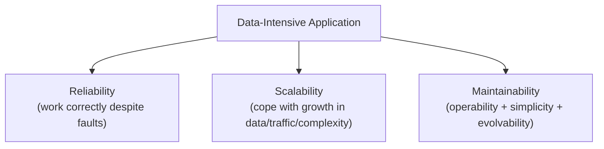
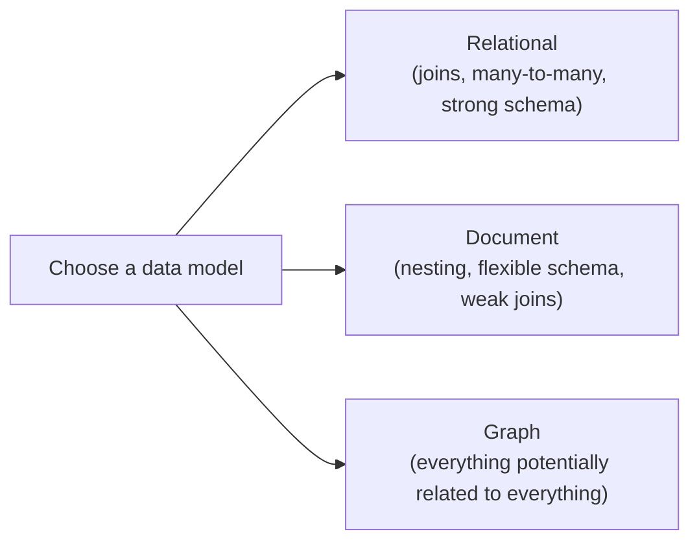
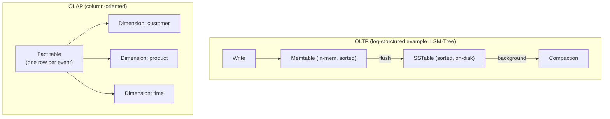
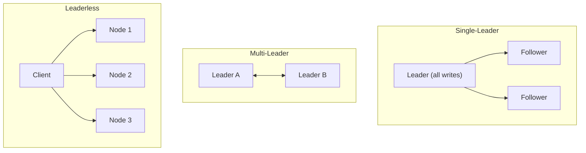
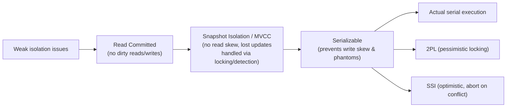

# Designing Data-Intensive Applications (Kleppmann) — Short Notes

> Condensed, chapter-by-chapter notes from the actual book content, for quick review before SDE-2 / backend-heavy interviews. The book has 3 parts and 12 chapters — this file mirrors that structure.

---

## The Book's Core Framing

A data-intensive application is normally built from standard building blocks: **databases** (store data), **caches** (speed up reads), **search indexes** (search/filter), **stream processing** (async messaging), **batch processing** (crunch accumulated data). Modern systems increasingly **combine several of these tools**, stitched together by application code — so you become not just an application developer but a **data system designer**.

The book organizes everything around **three concerns**:
- **Reliability** — working correctly even when things go wrong
- **Scalability** — reasonable ways of coping with growth
- **Maintainability** — different people can work on the system productively over time

---

# PART I — Foundations of Data Systems
*(single-machine concepts that underlie everything else)*

## Chapter 1 — Reliable, Scalable, and Maintainable Applications

### Reliability
- **Fault** ≠ **Failure**: a fault is one component deviating from spec; a failure is when the *whole system* stops providing the service. You can't reduce faults to zero — so build systems that **prevent faults from causing failures**.
- **Hardware faults** — disks/RAM/power/network fail randomly and are usually uncorrelated; mitigated with redundancy (RAID, dual power supplies, backup generators). At scale (1000s of machines), hardware faults become *frequent*, pushing systems toward **software fault-tolerance** instead of relying purely on hardware redundancy.
- **Software errors** — systematic, correlated bugs (not random) — e.g. a bug triggered by a specific input that crashes every instance simultaneously. Harder to guard against than hardware faults.
- **Human errors** — configuration errors by operators are a leading cause of outages. Mitigate via: good abstractions/APIs, sandbox environments for experimentation, thorough testing, quick+easy recovery (rollback, gradual rollout), monitoring.
- ⭐ **Chaos Monkey idea:** deliberately trigger faults (e.g. Netflix randomly killing processes) to continuously exercise your fault-tolerance machinery, increasing confidence it actually works.

### Scalability
- Scalability = *"do we have reasonable ways of coping with growth?"* — not a single number ("this system scales" is meaningless without describing load and what "coping" means).
- **Describing load:** use *load parameters* specific to the system's architecture — requests/sec to a server, read/write ratio, number of simultaneously active users, cache hit rate. **Twitter home-timeline example** (the book's running case study): two approaches —
  1. Fan-out on read — query all followees' tweets at read time (cheap write, expensive read for celebrities' fanbase reads).
  2. Fan-out on write — pre-compute/insert into each follower's timeline cache on tweet post (expensive write for celebrities with millions of followers, cheap read). Twitter combined both: fan-out on write for most users, fan-out on read for celebrities.
- **Describing performance:** two angles —
  - Increase load, keep resources fixed → how does performance degrade?
  - Increase load → how much do you need to increase resources to keep performance unchanged?
  - **Percentiles, not averages:** average response time hides how bad the worst-case experience is. Use **p50 (median), p95, p99, p999** — high percentiles ("tail latencies") directly affect your most important customers (they tend to have the most data → hit slow paths more).
- **Approaches for coping with load:** scaling up (vertical, bigger machine) vs scaling out (horizontal, distribute across machines) vs elastic (auto-scale). Stateless services are easy to scale out; stateful services (databases) are much harder — this whole book is largely about *how* to distribute stateful systems.

### Maintainability
Three design principles to aim for:
- **Operability** — make it easy for ops teams to keep the system running smoothly (monitoring, good docs, predictable behavior, minimal surprises).
- **Simplicity** — manage complexity via good **abstractions** that hide implementation detail behind clean interfaces (this is the whole point of using a database instead of hand-rolling storage).
- **Evolvability** (aka **agility** at the data-system level) — make it easy to adapt the system to changing requirements. Closely tied to simplicity: simple systems are easier to modify.

---

## Chapter 2 — Data Models and Query Languages

- Data models are **the most important design decision** in a data system — they affect not just how software is written, but how you *think about the problem*.
- **Relational model** (SQL) — data organized into relations (tables) of tuples (rows), no inherent nesting; strong for many-to-many relationships via joins. Born from business data processing (transaction processing, batch processing).
- **Document model** (MongoDB, JSON-style) — self-contained documents with nesting; good **schema flexibility**, better locality for hierarchical/tree-structured data with rare relationships. Weaker at many-to-many relationships (no native joins in most document DBs). "Are document DBs repeating history?" — the book draws a parallel to the 1970s hierarchical-model-vs-relational-model debate.
- **Object-relational mismatch:** an "impedance mismatch" between OOP objects and relational tables — needs an ORM layer to translate.
- **Graph model** — best when many-to-many relationships are common/central (social graphs, web graphs, recommendation data). Two main representations: **property graphs** (vertices+edges each with key-value properties, queried with Cypher) and **triple-stores** (subject-predicate-object, queried with SPARQL). **Datalog** is presented as the logical foundation both are built on.
- **Query languages:** *declarative* (SQL — say **what** you want, let the engine figure out **how**) vs *imperative* (traditional code — say exactly what steps to run). Declarative languages hide implementation detail, giving the query optimizer freedom to improve performance without you rewriting queries — and they parallelize more naturally.
- **MapReduce querying** — a hybrid: neither fully declarative nor fully imperative; lets you write snippets of code (map/reduce functions) that the framework calls repeatedly, but still constrained enough to be automatically parallelized across machines.

---

## Chapter 3 — Storage and Retrieval

**Central question:** what happens internally when you store data, and what does the DB do when you query it back? Storage engines split into two families:

### OLTP (Transaction Processing) storage engines
- User-facing, huge request volume, each query touches **few records**, looked up by key. **Disk seek time** is the bottleneck.
- **Log-structured school** ("only append, never overwrite in place"):
  - **Hash indexes** — in-memory hash map of key → byte offset in an append-only log file (Bitcask-style). Simple, fast for point lookups, but keys must fit in memory and range queries are inefficient.
  - **SSTables (Sorted String Tables) + LSM-Trees** — segments are kept **sorted by key**; merged via a background *compaction* process (merge-sort-like); supported by a sparse in-memory index + **Bloom filters** to avoid unnecessary disk reads for keys that don't exist. Used by LevelDB, RocksDB, Cassandra, HBase, Lucene.
  - Key idea: LSM-trees systematically turn random-access writes into **sequential writes**, giving much higher write throughput.
- **Update-in-place school:**
  - **B-Trees** — the dominant indexing structure in almost all relational DBs. Disk is broken into fixed-size **pages** (~4KB), each page references child pages, forming a tree with a fixed, typically-low **branching factor** (a few hundred), giving `O(log n)` depth (typically 3-4 levels even for large DBs). Uses a **write-ahead log (WAL)** for crash recovery since updates modify pages in place.
  - **Comparing B-Trees vs LSM-Trees:** LSM-trees are typically faster for writes (sequential I/O, less write amplification in some cases) but can have unpredictable p99 latency (compaction can interfere with foreground reads/writes) and duplicate/stale keys accumulate temporarily. B-trees give more predictable performance and strong transactional semantics (locking directly on the tree), but every write means writing the whole page.

### OLAP (Analytics) storage engines — Data Warehousing
- Business analysts run a **small number of very demanding queries** scanning **millions of rows** — bottleneck is **disk bandwidth**, not seek time.
- **Star and snowflake schemas** — a central large **fact table** (one row per event) referencing smaller **dimension tables** (who/what/where/when/how/why).
- **Column-oriented storage** — store each *column* contiguously on disk instead of each row, so an analytic query only reads the columns it actually needs. Enables strong **column compression** (bitmap encoding + run-length encoding work great since a column has few distinct values), and vectorized query execution.
- **Materialized views / data cubes** — precomputed aggregates (grid of sums/counts over dimensions) to speed up repeated aggregation queries, at the cost of write overhead and reduced flexibility.

---

## Chapter 4 — Encoding and Evolution

- Applications constantly change, so schemas evolve. Formats must support **rolling upgrades** (deploy new code gradually, node by node, without downtime), which requires:
  - **Backward compatibility** — new code can read data written by old code.
  - **Forward compatibility** — old code can read data written by new code (harder — old code must ignore fields it doesn't understand).
- **Encoding formats compared:**
  - **Language-specific** (Java serialization, Python pickle) — convenient but locked to one language, often lack good compatibility guarantees. Generally discouraged.
  - **JSON/XML/CSV** — human-readable, ubiquitous, but ambiguous about number types (JSON doesn't distinguish int/float precision well), no native binary-string support, only optional/weak schema support.
  - **Thrift & Protocol Buffers** — binary, schema-driven; every field gets a numbered **tag**; backward compatibility = never reusing an old tag; forward compatibility = new fields must be optional. Compact and fast, but requires code generation.
  - **Avro** — binary, schema-driven, but the schema is **not encoded per-field** — instead the reader must know the exact **writer's schema** (resolved at read time by comparing reader/writer schemas). Great fit for dynamically generated schemas (e.g. auto-derived from a changing DB table) since field names/orders can change freely as long as compatibility rules are followed.
- **Modes of dataflow** (where encoding actually matters):
  1. **Dataflow through databases** — process writing = encoder, process reading (possibly much later, possibly an older/newer app version) = decoder. Unknown fields written by a newer version should be *preserved* on later rewrites, not silently dropped.
  2. **Dataflow through services (REST/RPC)** — client encodes request, server decodes+processes+encodes response, client decodes response. REST favors simplicity/discoverability via HTTP; RPC frameworks (gRPC etc.) aim to make a network call look like a local function call — but the book stresses this is a **leaky abstraction**: unlike a local call, a network call can time out, be duplicated by retries, or simply fail with no result — it is fundamentally *not* the same as a local call.
  3. **Message-passing dataflow (message brokers/actors)** — asynchronous, sender doesn't wait for a response; provides some buffering and improves reliability (broker resends to a consumer if it crashes).

---

# PART II — Distributed Data
*(what changes once your data is spread across multiple machines)*

## Chapter 5 — Replication

**Why replicate:** high availability, disconnected/offline operation, latency (place data near users), scalability (spread read load).

- **Leader-based (single-leader) replication** — writes go to one leader, which streams change events to followers. Reads can go anywhere, but follower reads may be stale.
  - **Sync vs async replication:** sync = leader waits for follower ack before confirming write to client (safe but leader blocks if follower is slow/down); async = leader doesn't wait (fast but risk of data loss if leader fails before followers catch up). **Semi-synchronous** (one sync follower, rest async) is a common middle ground.
  - **Handling node outages:** follower recovery = replay from last known log position; leader failover = detect leader is dead (timeout), elect new leader, reconfigure clients — risky (can lose committed writes, or split brain if old leader comes back thinking it's still leader).
- **Problems with replication lag** (asynchronous followers can fall behind):
  - **Read-your-own-writes consistency** — a user should see their own submitted write immediately, even on a stale replica (route reads for recently-written data to the leader, or track a version/timestamp).
  - **Monotonic reads** — a user should never see data go "back in time" across successive reads (e.g. by always reading from the same replica).
  - **Consistent prefix reads** — writes that happened in a causal order should be seen in that order (don't see an answer before its question).
- **Multi-leader replication** — multiple nodes can accept writes (common for multi-datacenter setups, or offline-capable apps like calendar apps that sync later). Gains better write availability/latency but **write conflicts** become possible when two leaders modify the same data concurrently — needs conflict resolution (last-write-wins, merge, custom app logic, or CRDTs).
- **Leaderless replication** (Dynamo-style — see the companion notes file for the deep dive):
  - Client writes to **multiple** replicas directly (or via a coordinator), reads from multiple replicas and reconciles.
  - **Quorum reads/writes:** with `n` replicas, writes go to `w` nodes and reads query `r` nodes; if `w + r > n`, the read set overlaps the write set, so a read is guaranteed to see the most recent write — *under certain assumptions*. Kleppmann is explicit that this is **not** a bulletproof guarantee: edge cases include concurrent writes (unclear which "wins"), a write that succeeds on some but not all `w` nodes, or nodes with stale values not being detected/rolled back, so treat `w+r>n` as *"likely up to date," not a strict guarantee.*
  - **Sloppy quorums + hinted handoff** — if the "proper" home nodes for a key are unreachable, temporarily write to other reachable nodes and hand the data back later. Increases write availability but **breaks the strict quorum overlap guarantee** (the write quorum and read quorum may no longer intersect at all).
  - **Detecting concurrent writes** — version vectors (the multi-node generalization of the vector clocks covered in the companion notes file) are used to determine causality between writes so the system can tell "B overwrote A" apart from "A and B were concurrent."

---

## Chapter 6 — Partitioning

Partitioning ("sharding") = splitting a large dataset across multiple nodes so no single machine has to store/process all of it — usually **combined with replication**, so each partition is stored on multiple nodes for fault tolerance.

- **Partitioning by key range** — partitions own a contiguous range of sorted keys; enables efficient range scans, but risks **hot spots** if access is skewed toward keys near each other (e.g. all writes keyed by today's date hitting one partition).
- **Partitioning by hash of key** — hash the key, assign ranges of the hash space to partitions; destroys key ordering (range queries become inefficient — must query all partitions), but distributes load more evenly.
- **Skewed workloads / hot spots** — even hashing can't help if one specific key (a celebrity, a viral post) gets disproportionate traffic; may need application-level splitting of that one hot key into several sub-keys.
- **Partitioning secondary indexes:**
  - **Document-partitioned (local index)** — each partition indexes only its own documents; writes are cheap (touch one partition) but reads need **scatter/gather** across all partitions.
  - **Term-partitioned (global index)** — the index itself is partitioned by the indexed term/value; reads can hit a single partition, but writes may need to update multiple index partitions (often asynchronously).
- **Rebalancing partitions** — as data/load grows, partitions must move between nodes.
  - Avoid `hash(key) % num_nodes` — changing node count reshuffles nearly everything.
  - Better: create a **fixed number of partitions** up front (many more than nodes) and just reassign whole partitions to nodes as they're added/removed — no re-hashing of keys needed, only moving partition ownership.
  - Rebalancing can be automatic (convenient but risky — cascading failures if automation misjudges load) or manual (safer but slower).
- **Request routing** — how does a client find which node holds the partition for a key? Common patterns: contact any node and let it forward internally; use a routing tier/load balancer that's partition-aware; use a coordination service (e.g. ZooKeeper) to track partition assignment.

---

## Chapter 7 — Transactions

- **Transaction** = grouping several reads/writes into one logical unit that either fully **commits** or fully **aborts**; simplifies error handling by collapsing many partial-failure scenarios into "just retry."
- **ACID (Atomicity, Consistency, Isolation, Durability)** — coined 1983, but the book is blunt: *"ACID has unfortunately become mostly a marketing term."* Precise meanings:
  - **Atomicity** — NOT about concurrency (that's Isolation). It's about **abortability**: if a fault occurs mid-transaction, all its writes are undone — "all or nothing."
  - **Consistency** — an *application-level* invariant (e.g. "debits = credits" in accounting) that transactions help maintain, but ultimately it's the application's responsibility, not really a database guarantee in the same sense as the other three letters.
  - **Isolation** — concurrently executing transactions shouldn't interfere with each other, ideally as if they ran serially, one at a time.
  - **Durability** — once committed, data won't be lost even if the system crashes (write-ahead logs, replication, etc.)
  - Systems that don't meet ACID are sometimes labeled **BASE** (Basically Available, Soft state, Eventual consistency) — a vague, mostly negative-definition term ("not ACID").
- **Weak isolation levels** (real databases rarely give you full serializability by default — it's slow):
  - **Read committed** — prevents *dirty reads* (seeing uncommitted writes) and *dirty writes* (overwriting uncommitted writes). Does NOT prevent read skew across multiple reads in the same transaction.
  - **Snapshot isolation (repeatable read)** — each transaction reads from a consistent snapshot taken at its start, via **MVCC (multi-version concurrency control)**. Prevents read skew, but doesn't prevent all write anomalies.
  - **Lost updates** — two concurrent read-modify-write cycles clobber each other; prevented via atomic update operations, explicit locking (`SELECT ... FOR UPDATE`), or automatic detection in some snapshot-isolation implementations.
  - **Write skew** — a transaction reads data, makes a decision based on it, and writes — but by commit time the premise is stale (e.g. two doctors both check "is someone else on call?" and both go off duty). Only **true serializability** prevents this.
  - **Phantoms** — a write changes the result of another transaction's *search query* rather than modifying an object it already read — trickier to guard against, needs **index-range locks**.
- **Serializability** — the strongest isolation: transactions behave as if executed **one at a time**, in some serial order. Three implementation approaches:
  1. **Actual serial execution** — literally run transactions one at a time on a single thread (feasible if each transaction is small/fast and fits in memory — used by VoltDB/Redis-style single-threaded engines).
  2. **Two-phase locking (2PL)** — readers block writers and vice versa via shared/exclusive locks held until commit. The long-standing default, but has poor performance under contention (lock waits, deadlocks).
  3. **Serializable snapshot isolation (SSI)** — an *optimistic* approach: transactions run without blocking on snapshot isolation, but the system detects at commit time whether the execution was actually non-serializable, and aborts if so. Much better throughput under most workloads than 2PL.

---

## Chapter 8 — The Trouble with Distributed Systems

The defining characteristic of distributed systems: **partial failure** — some parts of the system can fail while others keep working, and you can't always tell which state you're in.

- **Unreliable networks** — a sent packet may be lost, delayed, or the *reply* may be lost — so if you don't get a response, you genuinely cannot tell whether the request succeeded, failed, or is still in flight. **Timeouts** are the practical (imperfect) tool used to detect a possibly-dead node, but they can't distinguish "node is dead" from "node/network is just slow" — a false suspicion of failure is always possible.
- **Unreliable clocks:**
  - **Time-of-day clocks** (`wall clock`) — can jump backward/forward (NTP resync, leap seconds) — bad for measuring durations or ordering events across machines.
  - **Monotonic clocks** — always move forward, good for measuring elapsed durations *on the same machine*, but meaningless for comparing timestamps *across* machines.
  - Relying on synchronized clocks (e.g. for "last write wins" conflict resolution) is dangerous: clock drift/skew can silently discard the "actually later" write.
- **Process pauses** — a process (thread) can be paused for an arbitrarily long time (stop-the-world GC, VM live-migration pause, OS context-switching, swapping/paging, SIGSTOP) — during which other nodes may correctly conclude it's dead, then the paused process wakes up and continues as if nothing happened, potentially violating assumptions (e.g. still believing it holds a lock it no longer holds).
- **Knowledge, Truth, and Lies:**
  - A node cannot necessarily trust its own judgment (it might be the one that's paused/partitioned, not everyone else) — **the truth is defined by the majority**, not by any individual node's local view. This is why quorum-based/consensus algorithms matter.
  - **Fencing tokens** — a monotonically increasing number issued whenever a lock/lease is granted; downstream systems reject any request carrying an older token than one already seen — protects against a "zombie" node (one that was paused, believed it still held the lock, and wakes up to act on stale authority).
  - **Byzantine faults** — nodes that don't just crash but actively lie/send corrupted or malicious messages. Most datacenter distributed systems (the ones covered in this book) **assume non-Byzantine (crash-stop) faults** — Byzantine fault tolerance is mainly relevant in aerospace/blockchain-style adversarial settings.

⭐ **Book's core message of this chapter:** if you can avoid distributing your system and keep everything on one machine, do it — distributed systems are inherently harder to reason about. But scalability, fault tolerance, and low-latency geographic placement sometimes make a distributed system unavoidable.

---

## Chapter 9 — Consistency and Consensus

- **Linearizability** — makes replicated data *behave as if there were only one copy*, with all operations appearing to take effect atomically at some single point in time (like a single-threaded variable). Very intuitive/easy to reason about, but **expensive** — especially across datacenters with high network latency, since achieving it fundamentally requires coordination.
- **Causality / causal consistency** — a weaker but often "good enough" and much cheaper alternative: only orders events that are causally related ("happened before"); concurrent, unrelated events can be seen in different orders on different nodes without violating the guarantee. Version history looks like a branching/merging timeline rather than one single line. **Lamport timestamps** are one common technique for capturing causal order.
  - ⭐ Important limitation the book flags: capturing causal order alone is **not sufficient** for things like enforcing a *uniqueness constraint* (e.g. "usernames must be unique") — you need a way to know definitively that no other node is concurrently doing the same thing, which requires actual **consensus**.
- **Consensus** — getting all nodes to agree on a decision that is then irrevocable. The book shows several problems are provably **equivalent to consensus**: linearizable compare-and-set, atomic transaction commit, total order broadcast, distributed locks/leases, group membership, uniqueness constraints. If you solve one, you've effectively solved them all.
- **Two-Phase Commit (2PC)** — coordinates an atomic commit across multiple nodes/databases: phase 1 = "prepare" (all participants vote), phase 2 = "commit/abort" based on votes. The book's key criticism: it's **blocking** — if the coordinator crashes after phase 1 (participants have voted "yes" and are holding locks), participants are stuck indefinitely waiting for the coordinator to tell them what to do.
- **Fault-tolerant consensus algorithms** (Paxos, Raft, Zab, etc.) — unlike 2PC, these use a majority-voting approach and can make progress as long as a majority of nodes are up, avoiding the single-coordinator blocking problem. This is what tools like **ZooKeeper** package up and offer as an "outsourced" consensus/coordination/failure-detection service.
- ⭐ Big-picture point: a single-leader database *avoids* running consensus on every write (the leader just decides), but still needs consensus for **leader election/failover** — so leader-based systems don't eliminate the need for consensus, they just push it to a less-frequent event.

---

# PART III — Derived Data
*(systems that compute one dataset from another — batch and stream processing)*

## Chapter 10 — Batch Processing

- Roots trace back to the **Unix philosophy**: small tools that "do one thing well," composed via **pipes**, operating on **immutable inputs** and producing outputs meant to become another program's input.
- **MapReduce** carries this philosophy to a distributed filesystem (HDFS): mappers extract/transform records, the framework partitions+sorts+merges by key ("shuffle"), reducers aggregate per key.
- Two problems every batch framework must solve:
  - **Partitioning** — mapper output is repartitioned by key so related records (same key) land on the same reducer.
  - **Fault tolerance** — MapReduce materializes intermediate state to disk after each stage (slower in the happy path, but easy to recover a single failed task without restarting the whole job). Later **dataflow engines** (Spark, Tez, Flink) keep more intermediate state in memory for speed, recomputing more on failure, but use deterministic operators to make that recomputation safe.
- **Join algorithms** (the book's deep dive — very interview-relevant, mirrors distributed-DB join strategies generally):
  - **Sort-merge join** — both inputs partitioned+sorted by the join key so matching records land together, then merged like a zipper.
  - **Broadcast hash join** — one input is small enough to fit in memory as a hash table; broadcast that hash table to every mapper processing the large input, avoiding a shuffle for the large side.
  - **Partitioned hash join** — if both inputs are already partitioned the same way by the join key, each partition's join can run independently without shuffling either side.
- **Restricted programming model** (mappers/reducers assumed stateless with no side effects besides their designated output) is a deliberate design choice: it lets the framework retry failed tasks safely and discard partial/duplicate output, giving strong "exactly as if no faults occurred" semantics — much stronger guarantees than typical online request-handling code gets "for free."
- **Bounded vs unbounded input** — the defining trait of batch jobs is that the input is **bounded** (a known, fixed-size dataset) so the job can eventually finish. This sets up the contrast with stream processing (next chapter).

---

## Chapter 11 — Stream Processing

Stream processing = batch processing's philosophy applied continuously to **unbounded** (never-ending) data.

- **Message brokers, two flavors:**
  - **AMQP/JMS-style brokers** — assign individual messages to consumers, delete once acknowledged. Good fit for task queues where processing order doesn't matter much and old messages don't need to be replayed.
  - **Log-based brokers (Kafka-style)** — messages retained on disk in an ordered, partitioned log; a consumer tracks its position via an **offset** and can rewind/replay. Parallelism achieved through partitioning (same idea as the KV-store notes' Kafka section). This approach mirrors **database replication logs** and **LSM-tree storage** conceptually.
- **Databases as streams:**
  - **Change Data Capture (CDC)** — treat a database's write-ahead log/changelog as an event stream that other systems (search indexes, caches, analytics) can subscribe to, keeping derived data continually up to date.
  - **Event sourcing** — instead of storing current state, store the full **history of state-changing events**; current state is derived by replaying/folding the event log. Gives a full audit trail and lets you rebuild derived views from scratch.
  - **Log compaction** — periodically discard all but the latest event *per key* in a log, so the log itself can serve as a durable snapshot of "current state," without needing to keep the full unbounded history forever.
- **Processing streams — uses:**
  - **Complex event processing** — search for patterns across a stream of events (e.g. fraud detection rules).
  - **Stream analytics** — windowed aggregations (rolling averages, counts per minute).
  - **Materialized view maintenance** — keep a derived view (cache, index, aggregate) continuously up to date as the underlying data changes.
- **Reasoning about time** — a recurring hard problem: **event time** (when it actually happened) vs **processing time** (when your system saw it) can diverge significantly (network delays, retries, offline devices syncing later). **Stragglers** — events that arrive after you assumed a time window was already complete — force a choice between waiting longer (higher latency) or risking incomplete/incorrect windowed results.
- **Stream joins**, three kinds:
  - **Stream-stream join** — match related events across two (or the same) activity streams within a time window (e.g. click + purchase within 30 min).
  - **Stream-table join** — enrich each stream event by looking it up against a (continuously updated) database changelog.
  - **Table-table join** — join two changelogs together; result is itself a stream of changes to the joined materialized view.
- **Fault tolerance in streaming** — since a streaming job runs forever and outputs continuously (unlike a batch job you can just rerun), techniques include **microbatching**, **checkpointing**, **transactions spanning input+output**, and **idempotent writes** — this last one echoes the idempotency theme from the microservices notes file.

---

## Chapter 12 — The Future of Data Systems

*(This is Kleppmann's synthesis chapter — more opinion/forward-looking, but still highly quotable in interviews for showing systems-thinking maturity.)*

- **Data integration problem:** no single tool serves every use case well, so real applications compose multiple specialized systems (search index + cache + main DB + analytics). The book's proposed unifying idea: designate certain systems as the **system of record** (source of truth) and derive everything else (indexes, caches, materialized views, ML features) from it via **batch and/or stream processing**, keeping the derivations **asynchronous and loosely coupled** so a problem in one derived system can't cascade into the others.
- **"Unbundling the database"** — the idea that what a traditional monolithic database does internally (maintain indexes, materialized views, replication) is conceptually the same as what you do when you compose several specialized systems around a stream of change events — just "unbundled" into separate loosely-coupled tools glued together by dataflow instead of bundled inside one engine.
- **Aiming for correctness without distributed transactions:**
  - **End-to-end argument** — some correctness guarantees can only truly be enforced at the application/client level (e.g. true exactly-once semantics), not fully delegated to lower network/database layers — echoes the idempotency-key technique from the microservices notes.
  - **Enforcing constraints asynchronously** — rather than a blocking distributed transaction, use end-to-end operation IDs (idempotency keys) to make retries safe, check constraints asynchronously, and either make the client wait for confirmation or proceed optimistically and "apologize" (compensate) if a conflict is later detected. This is explicitly framed as **more scalable and robust** than traditional distributed transactions, and closer to how real-world business processes already operate.
  - **Trust, but verify** — use audits (e.g. Merkle-tree-style integrity checks, similar in spirit to the anti-entropy mechanism in the companion KV-store notes) to detect corruption/bugs after the fact, rather than assuming distributed coordination alone guarantees perfect correctness.
- **Ethics section (Doing the Right Thing)** — the book closes by stressing engineers bear responsibility for how data systems are used: risks include algorithmic decisions that are hard to appeal, discrimination baked into models, normalization of surveillance, and data breaches. Kleppmann's closing point: as data/software's societal impact grows, engineers should actively consider the human consequences of the systems they build, not just the technical correctness.

---

## Cross-Reference

This file summarizes DDIA's own content chapter-by-chapter. For the deeper implementation-level mechanics of a Dynamo-style KV store (consistent hashing, vector clocks, gossip, Merkle trees, LSM storage internals) and the broader microservices/backend interview landscape (Raft, Sagas, Kafka internals, caching, resilience patterns, system-design framework), see the companion files:
- `distributed-systems-notes.md`
- `microservices-backend-interview-notes.md`

## Quick Self-Test (say these out loud before an interview)

- What's the difference between a fault and a failure? *(component deviates from spec vs whole system stops serving users)*
- Why does the book call ACID "mostly a marketing term"? *(inconsistent meanings across vendors, especially "isolation")*
- What's the actual difference between snapshot isolation and serializability? *(SI prevents read skew/lost updates but not write skew; only serializability prevents write skew & phantoms)*
- Why can't `w + r > n` alone guarantee strong consistency in a leaderless system? *(concurrent writes, partial write success, and sloppy quorums/hinted handoff can all break the overlap guarantee)*
- Why is 2PC considered risky/unpopular at scale? *(blocking — a crashed coordinator after phase 1 leaves participants stuck holding locks indefinitely)*
- What's the core idea behind "unbundling the database"? *(treat derived data — indexes, caches, views — as continuously updated via streams/batch from a system of record, instead of one monolithic engine doing it all internally)*