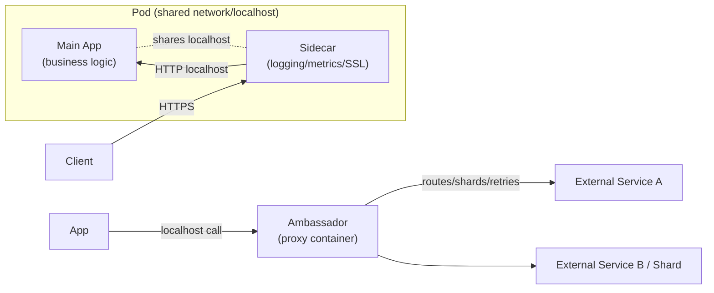
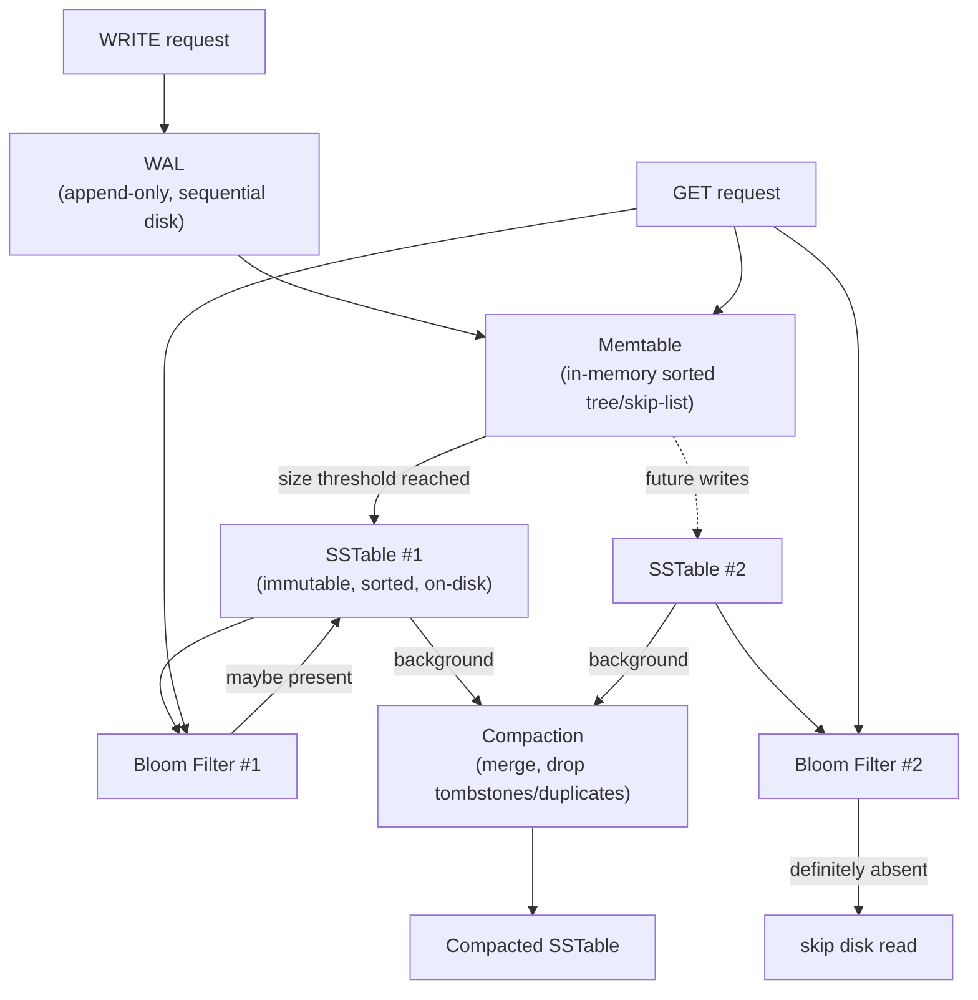
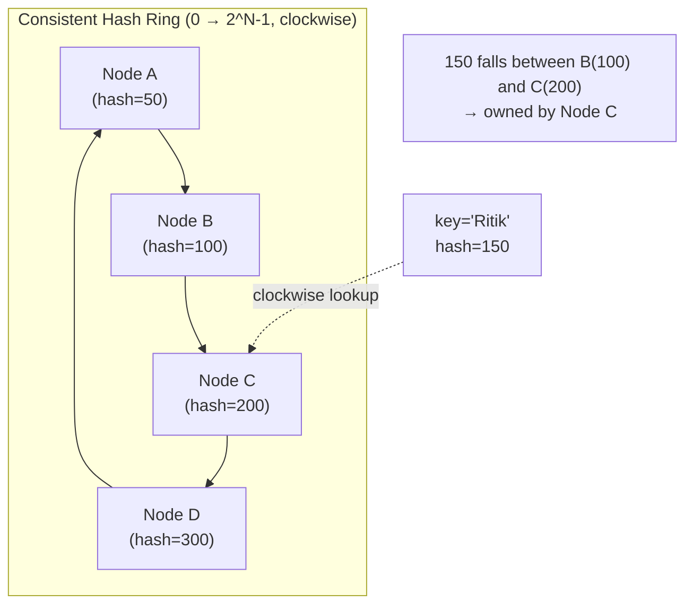
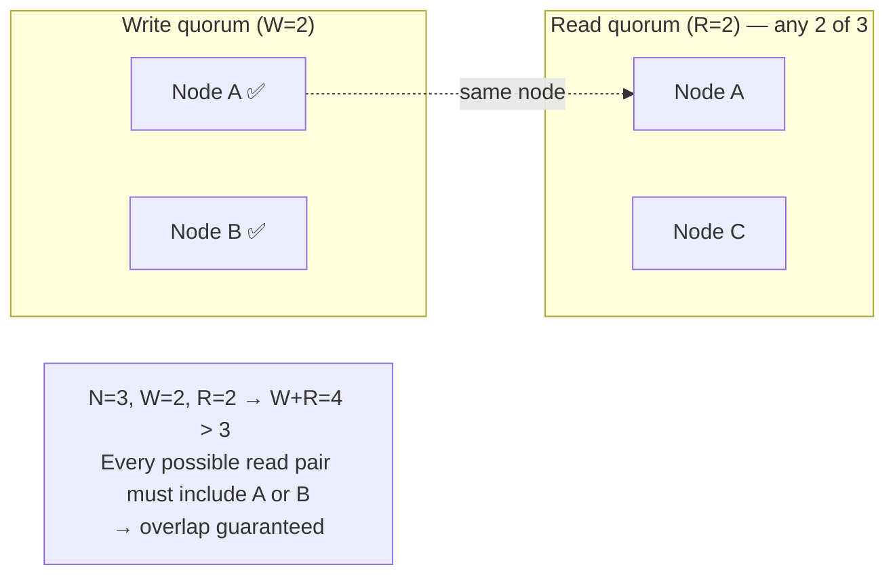
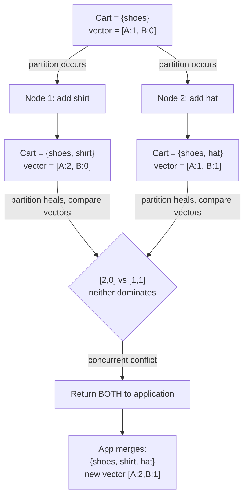
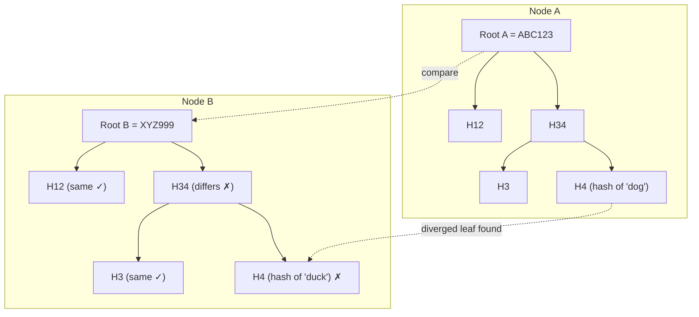
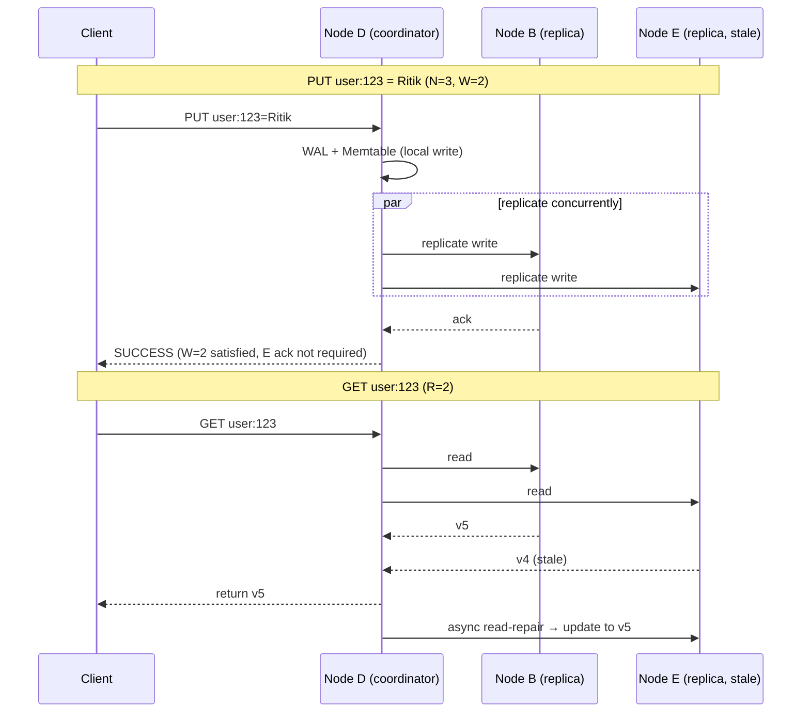

# Distributed Systems — Interview Notes (SDE-2 prep)

> Condensed from: *Designing Distributed Systems* (Brendan Burns) + 2 video transcripts on Dynamo-style KV stores.

---

## 1. Why Distributed Systems Exist

One machine can't give you: high availability, huge scale, fault tolerance, low latency, global reach.
So we spread work across many machines → but this introduces new problems:

| Problem | Meaning |
|---|---|
| Network failures | machines can't talk |
| Partial failures | one service dies, rest continue |
| Latency | network is slow |
| Synchronization | machines must coordinate |
| Consistency | data may differ across nodes |
| Deployment | updating many servers safely |

**Big idea of the book:** stop reinventing the wheel — use reusable **patterns** + **shared vocabulary** + **reusable components** (same idea as OOP design patterns, but for systems).

---

## 2. Container/Kubernetes Patterns (Part 1 — Single Node)

### Sidecar Pattern
- Two containers on one **pod**: main app (business logic) + sidecar (helper).
- Sidecar extends the app without touching its source code.
- **Example:** legacy HTTP-only app + nginx sidecar → nginx handles HTTPS, app stays HTTP on localhost.
- Other uses: logging, monitoring, metrics, SSL termination, config sync.
- ⭐ Interview line: *"Sidecar = language-independent, reusable way to add cross-cutting functionality without modifying the main app."*

### Ambassador Pattern
- A proxy container between your app and the outside world. App only talks to `localhost`.
- Handles: routing, service discovery, retries, sharding, failover, canary routing.
- **Why it matters:** app stays simple — doesn't need to know shard count, DB location, etc.
- Real systems built on this idea: **Envoy, Istio, API gateways, DB proxies, service meshes.**

### Sharding (introduced here)
- One DB can't hold everything → split by key range across servers.
- Problem: app now needs "which shard has this key?" logic → push that into the Ambassador instead of hardcoding it in the app.

### Service Discovery
- IPs/locations change constantly (restarts, scaling, cloud). Ambassador dynamically discovers and connects to the right service so the app just calls `localhost`.

### Request Splitting / Canary Release
- e.g. 90% traffic → stable, 10% → experimental. Handled by the ambassador, app untouched.



**Key mental shift:** distributed systems = composable, reusable pieces (LEGO/UNIX philosophy), not ad-hoc hacks.

---

## 3. Building a Distributed KV Store (Dynamo-style) — the meat of the interview material

### 3.1 Core requirement set (Dynamo-style / AP system)
- Thousands of nodes, PBs of data, millions of QPS, single-digit ms latency
- **No master** (avoids election/consensus complexity on crash)
- **Availability > Consistency** during a network partition → this is an **AP** system (CAP theorem)

### 3.2 Network Partition ≠ Machine Crash
- Partition = machines are alive but **can't communicate**.
- Causes: broken cables, router/switch failure, firewall misconfig, packet loss.
- Both sides of a partition can be perfectly healthy — the *network* failed, not the machine.

---

### 3.3 Storage Engine (LSM-Tree family) — very high-yield for interviews

```
WRITE → WAL (durability) → Memtable (fast sorted in-memory) 
      → flush at threshold → SSTable (immutable, sorted, on-disk)
      → background Compaction (merge SSTables, drop old/duplicate/deleted data)
      → Bloom Filter (skip SSTables that definitely don't have the key)
```



| Component | Purpose |
|---|---|
| **WAL** (Write-Ahead Log) | Append-only, sequential disk write for crash recovery. Replayed on restart. |
| **Memtable** | In-memory sorted structure (tree/skip-list) for O(log n) fast reads/writes. |
| **SSTable** (Sorted String Table) | Immutable, sorted, disk file created when memtable is flushed. |
| **Compaction** | Merges multiple SSTables, keeps latest values, drops tombstones/duplicates. |
| **Tombstone** | A logical delete marker (can't physically delete immediately — older SSTables may still have the value). |
| **Bloom Filter** | Probabilistic: says "definitely not present" or "maybe present" — **never** false negative, **can** false positive. Avoids unnecessary disk reads. |

⭐ Why WAL ≠ Memtable: WAL = durability (crash recovery), Memtable = speed (fast access). Two different jobs.
⭐ Why sequential writes: random disk I/O is slow (even on SSD); append-only logs avoid seeks.

---

### 3.4 Partitioning — Consistent Hashing

- Naive: `node = hash(key) % num_nodes` → breaks badly when nodes are added/removed (almost all keys remap → massive data movement).
- **Consistent hashing:** hash both keys and nodes onto a ring (0 to 2^N−1). A key belongs to the **first node clockwise** from its hash position.
- Adding/removing a node only affects its immediate neighbors on the ring — minimal data movement.

**Problem:** uneven node placement on the ring → unbalanced load.
**Fix — Virtual Nodes:** each physical node gets hashed to many points on the ring (e.g. 100 virtual nodes per server) → smoother, more even distribution; failure of one node redistributes many *small* chunks instead of one *huge* chunk.



*Virtual nodes: instead of 1 point per physical node, each server hashes to ~100 scattered points on the ring → even load, and a node failure spreads its data across many small ranges instead of one huge chunk.*

---

### 3.5 Replication & Coordinator

- **N** = replication factor (number of copies of a key), independent of total cluster size.
- **Leaderless replication:** no permanent leader. Whichever node owns the key (via the hash ring) becomes the **coordinator** *for that one request* — not a cluster-wide leader.
- ⭐ Interview correction: say **"coordinator"**, never "leader" — coordinator role changes per-key/per-request; this is what keeps the system decentralized.

---

### 3.6 Quorum — the most interview-famous formula

- **N** = replicas, **W** = replicas that must ack a write, **R** = replicas consulted on a read.
- **Golden rule:** `W + R > N` ⇒ read set and write set are guaranteed to overlap (at least one common replica) → read can discover the latest write.

| Config | W+R vs N | Behavior |
|---|---|---|
| N=3, W=1, R=1 | 2 ≤ 3 | No guaranteed overlap → **fast but can return stale data** (eventual consistency) |
| N=3, W=2, R=2 | 4 > 3 | Guaranteed overlap → **fresher reads, higher latency/coordination cost** |

⭐ **Important correction (don't say this in interview):** `W+R > N` = "strong consistency." That's an oversimplification.
✅ **Correct framing:** it guarantees **quorum overlap** under the model — it does *not* by itself guarantee linearizability. True strong consistency also needs version ordering, conflict resolution, and read/write coordination semantics (see Raft/Paxos later).



---

### 3.7 Conflict Resolution — why not just use timestamps?

- **Last-Write-Wins (LWW)** via physical timestamp is tempting but dangerous: **clock skew** between machines means a causally-later write can have a smaller timestamp.
- **Vector Clocks** fix this by tracking per-node counters, e.g. `[A:2, B:1]`.
  - Compare component-wise:
    - One vector ≥ other in *every* component → **not concurrent**, it's a causal descendant.
    - Neither dominates (some components higher, some lower) → **concurrent / conflicting** writes.
  - Vector clocks answer *"does version B know about version A?"* — not *"which happened later by the clock."*
- **On conflict:** DB can return **both versions** to the application, which resolves it using domain logic (e.g. shopping cart → merge items instead of picking one blindly).
- This is **eventual consistency**: if writes stop, all replicas *eventually* converge — not "always inconsistent."



---

### 3.8 Failure Handling (background mechanisms)

| Mechanism | Problem it solves |
|---|---|
| **Gossip Protocol** | No central manager for liveness info; nodes periodically exchange heartbeat/state info with random peers → failure info spreads organically. Failure detection is really **suspicion**, not certainty (can't distinguish "dead" from "slow/partitioned"). |
| **Hinted Handoff** | A replica is *temporarily* down → another node stores the write on its behalf with a "hint" of the true owner; hands it off when the owner returns. Prioritizes availability over rejecting the write. |
| **Read Repair** | On a read, if one replica returns a stale version, update it asynchronously in the background after returning the fresh value to the client. |
| **Merkle Trees** | For *permanent*/long-term divergence between replicas. Tree of hashes over the dataset — compare root hashes first (cheap); if different, descend only into the differing branches to find the exact divergent key(s) — avoids comparing/transferring the entire dataset. |


*Compare roots → mismatch → descend only into differing branch → isolate the one divergent key ("dog" vs "duck") instead of transferring the whole dataset.*

---

### 3.9 Extra real-world problems (great follow-up interview questions)

- **Hot Key / Hot Partition:** one key gets massive traffic (e.g. "trending_video") → overwhelms the few nodes owning it.
  - Fixes: cache it, replicate it more widely, or split it into sub-keys (`trending:1`, `trending:2`...) and aggregate.
- **Data-center / rack awareness:** don't place all N replicas in the same rack/AZ — one facility failure would wipe out every copy. Spread replicas across failure domains (racks/AZs).

---

## 4. Full Request Walkthrough (mental model to rehearse)

**PUT("user:123", "Ritik")**
1. Client → Load Balancer → App server
2. `hash("user:123")` → position on ring, e.g. 150
3. Ring lookup → owning node (e.g. Node D) → **D becomes coordinator**
4. N=3 replicas selected (e.g. D, B, E)
5. Vector clock incremented (coordinator's counter)
6. D writes locally (WAL → Memtable), sends to B and E concurrently
7. Wait for **W** acks (e.g. W=2) → return SUCCESS to client

**GET("user:123")**
1. Hash key → find replicas (D, B, E)
2. Query **R** replicas, compare versions/vector clocks
3. If all agree → return value
4. If one is stale → return latest, **read-repair** the stale replica async
5. If versions are concurrent (vector clocks incomparable) → return **both** to app for resolution



---

## 5. Core Definitions to Separate (commonly confused)

- **Replication** (how many copies) ≠ **Consistency** (what a reader may observe) — 3 replicas doesn't stop stale reads.
- **WAL** ≠ **Replication** — WAL protects *local* crash recovery only, not cross-machine copies.
- **Coordinator** ≠ **Leader** — coordinator role is per-request, not a permanent cluster-wide role.
- **Availability** vs **Partition tolerance** vs **Consistency** — CAP theorem tradeoff, not identical concepts.

---

## 6. The 10 Must-Remember Concepts

1. Consistent Hashing — deterministic key ownership, minimal reshuffling on node change
2. Virtual Nodes — many ring positions per physical node → even load
3. Replication Factor (N) — number of copies
4. Leaderless Replication — no permanent master
5. Quorum (N, W, R) — `W + R > N` → overlap
6. Eventual Consistency — replicas converge over time
7. Vector Clocks — causal versioning, conflict detection
8. Gossip — decentralized failure/liveness propagation
9. Hinted Handoff — temporary failure recovery
10. Merkle Trees — efficient divergence detection/anti-entropy

**+ Storage engine chain:** WAL → Memtable → SSTable → Compaction → Bloom Filter

---

## 7. One-Sentence Summary (say this to open a system-design answer)

> "Build a highly available KV store by partitioning keys across a consistent-hash ring (with virtual nodes), replicating each key across N nodes with no fixed leader, using tunable read/write quorums for consistency, vector clocks to detect concurrent writes, and background anti-entropy (gossip, hinted handoff, read repair, Merkle trees) for failure recovery — backed by an LSM-tree-style storage engine (WAL/Memtable/SSTable/Compaction/Bloom filters) locally on each node."

---

## 8. Quick Q&A Drill (self-test)

- **Q: Why not just use `hash(key) % N` for partitioning?**
  A: Adding/removing a node changes `N`, remapping almost all keys → massive data movement. Consistent hashing only affects neighboring ranges.

- **Q: Does `W + R > N` guarantee strong consistency?**
  A: No — it guarantees quorum *overlap*, which helps freshness, but true linearizability needs more (version ordering, coordination semantics).

- **Q: Why vector clocks over timestamps?**
  A: Physical clocks can be skewed across machines, so "later timestamp" ≠ "causally later." Vector clocks track causal history per node instead.

- **Q: What's the difference between hinted handoff and read repair?**
  A: Hinted handoff = write-side fix for a *temporarily unavailable* replica. Read repair = fixing a *stale* replica discovered during a read.

- **Q: Bloom filter false positive vs false negative?**
  A: Can false-positive ("maybe present" when it's not), **never** false-negative ("definitely absent" is always true).