# Distributed Systems + Microservices + Backend — Full Interview Notes (SDE-2 / high-paying SDE roles)

> Companion to `distributed-systems-notes.md` (Dynamo-style KV store deep dive). This file covers the **broader landscape** interviewers pull from: consensus, transactions, messaging, caching, microservices patterns, databases, and the system-design interview framework itself.

---

## 1. CAP Theorem & Consistency Models (foundation — always comes up)

- **CAP:** under a network **P**artition, you must choose between **C**onsistency and **A**vailability. You always keep P (partitions *will* happen) — the real choice is **CP vs AP**.
  - **CP** example: ZooKeeper, etcd, most relational DBs in strict mode — reject requests rather than serve stale/conflicting data.
  - **AP** example: Dynamo, Cassandra, DNS — always respond, may be stale.
- **PACELC** (extension): even *without* a partition, you trade **L**atency vs **C**onsistency. `if Partition: A or C, Else: L or C`.
- **Consistency models (strongest → weakest):**
  1. **Linearizability** — operations appear instantaneous, in real-time order (strongest, most expensive)
  2. **Sequential consistency** — all nodes see ops in the *same* order, not necessarily real-time order
  3. **Causal consistency** — causally related ops are ordered; unrelated ops can differ
  4. **Eventual consistency** — replicas converge if writes stop (weakest, cheapest)
- ⭐ Interview line: *"Pick the weakest consistency model that still satisfies the business requirement — stronger consistency always costs latency/availability."*

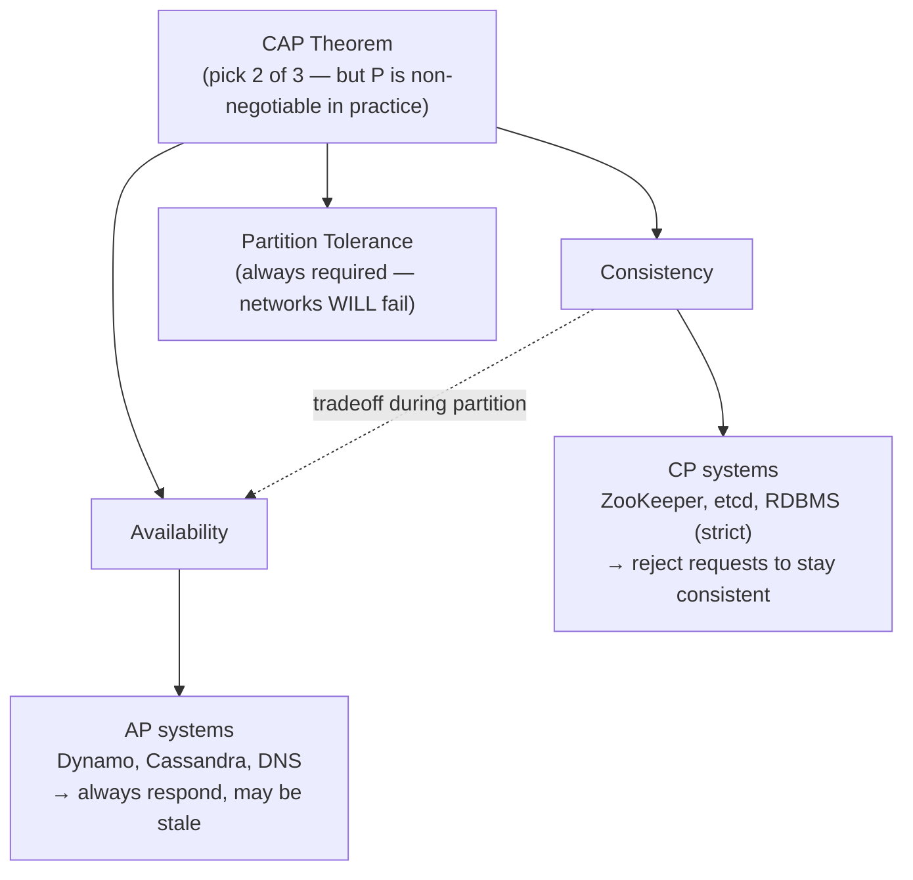

---

## 2. Consensus Algorithms (Raft / Paxos) — go-to follow-up after quorum/vector-clocks

- **Why needed:** quorum + vector clocks give you *availability-first* conflict handling. Sometimes you need the cluster to actually **agree on one single value/order** (e.g. leader election, config store, distributed lock) — that's consensus.
- **Paxos:** the original proof-of-concept algorithm; correct but notoriously hard to understand/implement (multiple roles: proposer, acceptor, learner).
- **Raft:** designed to be *understandable*. Same guarantees as Paxos but split into clear sub-problems:
  - **Leader election** — nodes vote; a candidate needs a majority to become leader; randomized election timeouts avoid split votes.
  - **Log replication** — leader appends entries to its log, replicates to followers, commits once a **majority** acknowledge (this is why odd cluster sizes like 3/5/7 are common).
  - **Safety** — only logs that are committed on a majority can never be lost, even across leader crashes.
- **Where used:** etcd (Kubernetes' backing store), Consul, CockroachDB, TiDB.
- ⭐ Distinguish from Dynamo's quorum model: Raft gives you **linearizable, strongly consistent** single-value agreement (CP); Dynamo's `W+R>N` only gives you **quorum overlap**, not true consensus (AP).

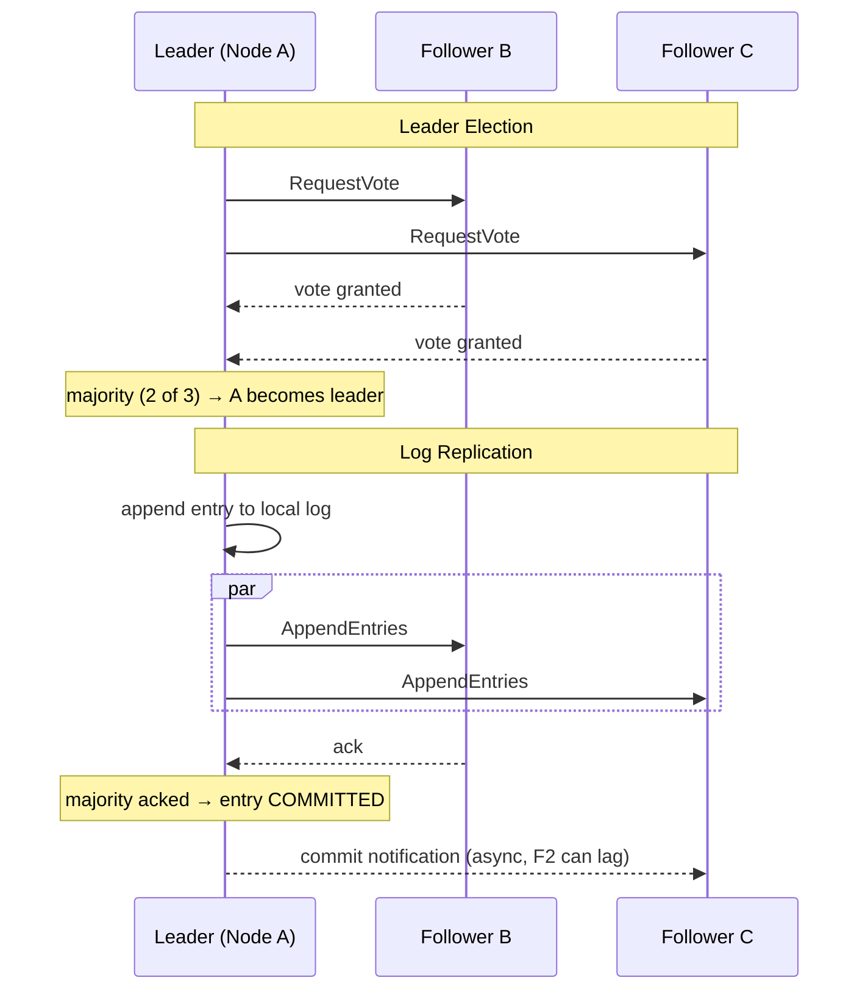

---

## 3. Distributed Transactions

### Two-Phase Commit (2PC)
- **Phase 1 (prepare):** coordinator asks all participants "can you commit?" — each locks resources and votes yes/no.
- **Phase 2 (commit/abort):** if all said yes → coordinator tells everyone to commit; if any said no → abort everyone.
- **Problem:** blocking — if the coordinator crashes after phase 1, participants are stuck holding locks indefinitely. Not partition-tolerant, poor for microservices at scale.

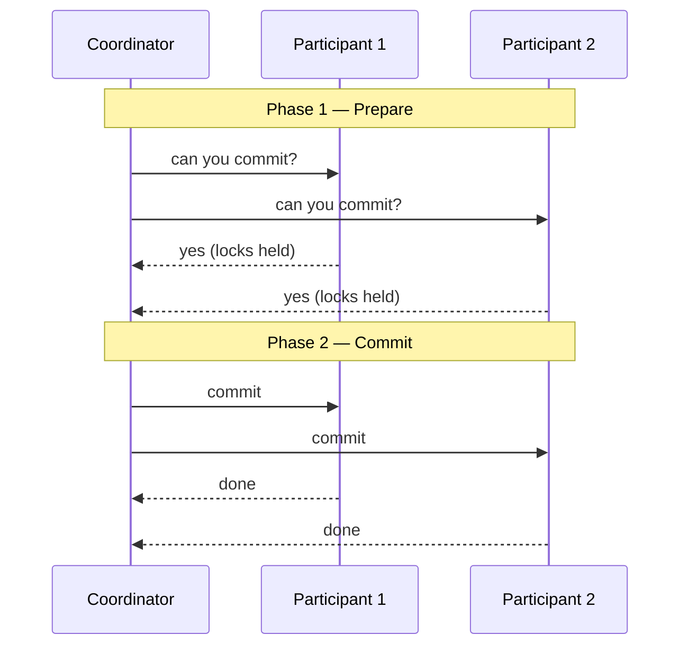

### Saga Pattern (the microservices answer to distributed transactions)
- Break a transaction into a sequence of **local transactions**, each with a **compensating action** to undo it if a later step fails.
- Two coordination styles:
  - **Choreography** — each service publishes an event, next service reacts (no central coordinator; simpler but harder to trace/debug at scale).
  - **Orchestration** — a central saga orchestrator tells each service what to do next (easier to reason about, single point of coordination logic).
- Example: Order Service → Payment Service → Inventory Service → Shipping Service. If Inventory fails, trigger `RefundPayment` + `CancelOrder` compensations.
- ⭐ Interview line: *"2PC gives atomicity but sacrifices availability/blocking; Sagas trade strict atomicity for availability and eventual consistency — the standard microservices tradeoff."*

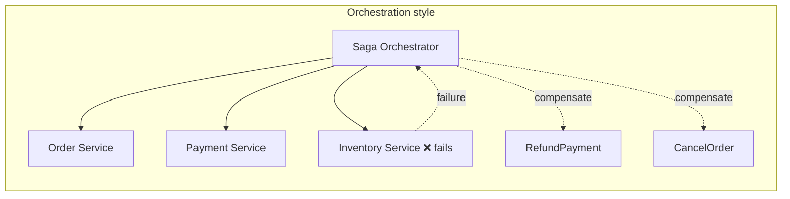

### Outbox Pattern
- Problem: how do you atomically (a) update your DB and (b) publish an event/message, without a distributed transaction spanning DB + message broker?
- Solution: write the event to an **outbox table** in the *same local DB transaction* as your business write. A separate relay process (or CDC/Debezium) reads the outbox and publishes to the broker, guaranteeing **at-least-once** delivery without dual-write inconsistency.

---

## 4. Messaging / Event-Driven Systems

- **Message queue vs Pub/Sub:**
  - Queue (e.g. SQS, RabbitMQ) — one consumer processes each message (point-to-point).
  - Pub/Sub (e.g. Kafka, SNS) — many consumers/subscribers can independently receive the same event.
- **Kafka fundamentals** (very commonly asked):
  - **Topic** → split into **partitions** for parallelism; each partition is an ordered, append-only log.
  - **Ordering** is guaranteed *within* a partition only, not across the whole topic.
  - **Consumer groups** — each partition consumed by exactly one consumer within a group (enables horizontal scaling of consumption).
  - **Offset** — consumer's position/checkpoint in the log; committing offsets controls at-least-once vs at-most-once semantics.
  - Replication factor + **ISR (in-sync replicas)** for durability, similar spirit to the N/W/R quorum idea from Dynamo.

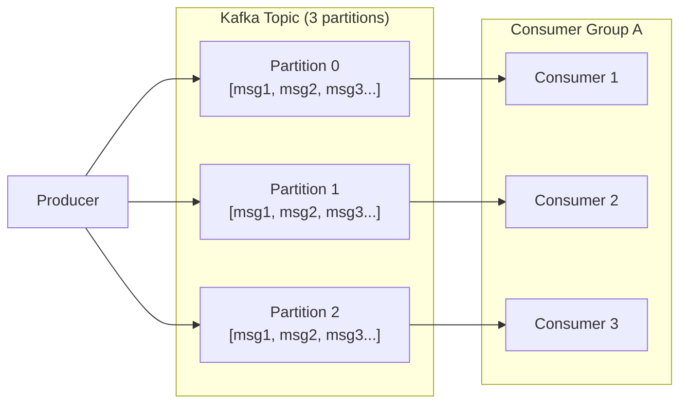
*Ordering guaranteed only within a partition. Each partition maps to exactly one consumer per group → horizontal scaling of consumption.*
- **Delivery guarantees:**
  - **At-most-once** — may lose messages, never duplicates.
  - **At-least-once** — never loses messages, may duplicate (most common default; requires **idempotent consumers**).
  - **Exactly-once** — hardest, usually achieved via idempotency keys + dedup, not a magic transport guarantee.
- **Idempotency:** design consumers to safely process the same message twice (e.g. use a unique `messageId`/`executionId`, upsert instead of insert, check-then-act with a dedup table).
- **Dead Letter Queue (DLQ):** messages that repeatedly fail processing get routed here instead of blocking the queue forever — lets you inspect/replay failures without stalling the pipeline.

---

## 5. Caching (near-guaranteed interview topic)

- **Where to cache:** client, CDN, API gateway/edge, application-level (in-process), distributed cache (Redis/Memcached), DB query cache.
- **Cache strategies:**
  - **Cache-aside (lazy loading)** — app checks cache, on miss reads DB and populates cache. Most common; simple but first request always misses.
  - **Write-through** — write goes to cache and DB together; reads are always fresh but writes are slower.
  - **Write-behind (write-back)** — write goes to cache first, DB updated asynchronously; fast writes, risk of data loss if cache dies before flush.
  - **Read-through** — cache itself is responsible for loading from DB on miss (abstracted from app).
- **Eviction policies:** LRU (most common), LFU, FIFO, TTL-based expiry.
- **Cache invalidation problems** (the classic "two hard things in CS" joke):
  - **Thundering herd / cache stampede** — a hot key expires and thousands of requests hit the DB simultaneously. Fix: locking/single-flight on refresh, staggered TTLs with jitter, or serving stale-while-revalidate.
  - **Cache penetration** — repeated queries for a key that doesn't exist (bypasses cache every time). Fix: cache the "not found" result briefly, or use a Bloom filter to short-circuit lookups for known-absent keys.
- **CDN**: edge caching for static assets; also useful for API responses that are cacheable and geographically distributed.

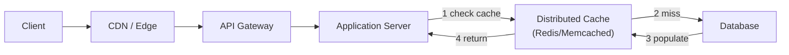
*Cache-aside flow: check cache → miss → read DB → populate cache → return. Watch for stampede (many misses at once on a hot key) and penetration (repeated misses for nonexistent keys).*

---

## 6. Load Balancing & API Layer

- **L4 (transport layer)** — routes based on IP/port, fast, doesn't understand HTTP.
- **L7 (application layer)** — routes based on URL/headers/cookies, enables smarter routing (canary, A/B, path-based).
- **Algorithms:** round robin, weighted round robin, least connections, consistent hashing (sticky sessions / cache locality), random with power-of-two-choices.
- **Health checks:** active (LB pings a `/health` endpoint) vs passive (LB observes real traffic failures).
- **API Gateway** — single entry point for microservices: auth, rate limiting, request routing, response aggregation, protocol translation (REST↔gRPC). Same *conceptual role* as the Ambassador pattern from the book, at the edge of the whole system instead of a single pod.
- **Service Mesh** (Istio/Linkerd) — moves cross-cutting concerns (mTLS, retries, circuit breaking, observability) into a sidecar proxy for *every* service-to-service call, not just north-south traffic. Literally the Sidecar pattern applied system-wide.
- **Service Discovery:** client-side (client queries a registry like Consul/Eureka and picks an instance itself) vs server-side (a LB/gateway does the lookup, client just calls a stable endpoint).

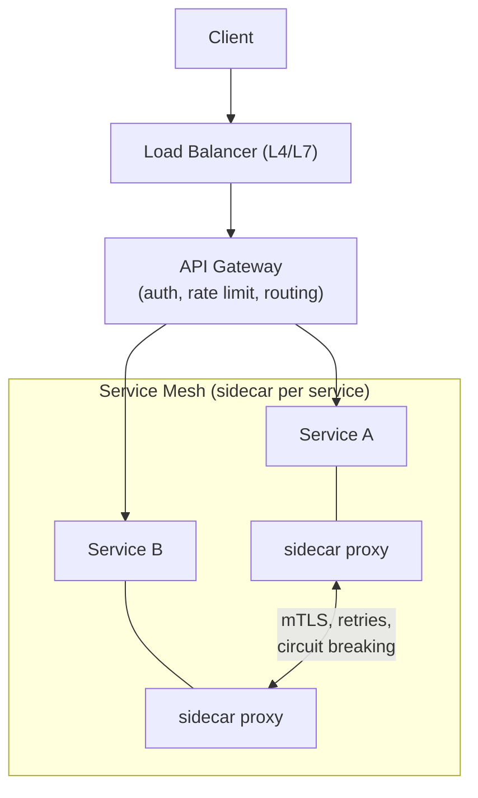

---

## 7. Microservices Resilience Patterns

- **Circuit Breaker** — after N consecutive failures calling a downstream service, "trip" the breaker and fail fast (or fallback) instead of piling up latency/retries on a struggling service. States: Closed → Open → Half-Open (test recovery) → Closed.

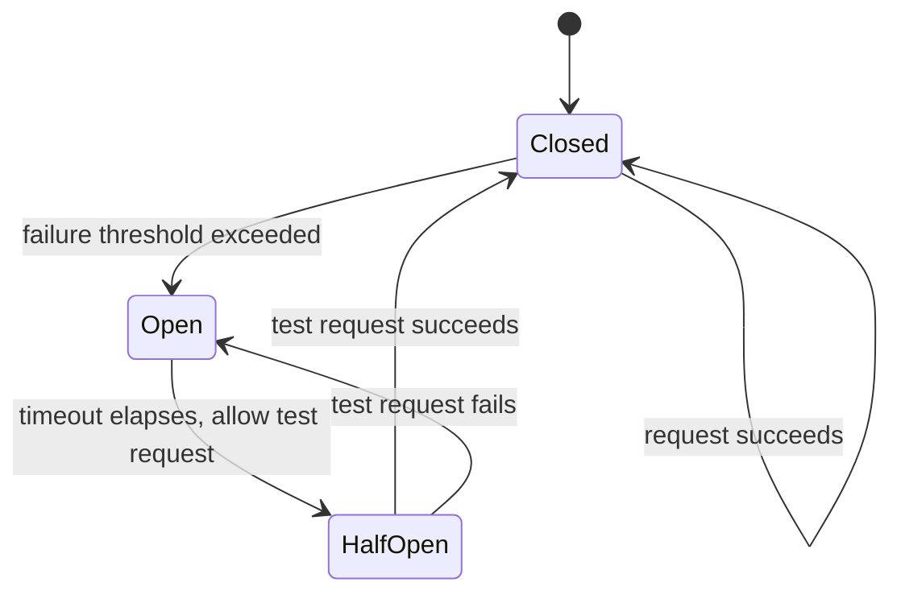
- **Retry with backoff + jitter** — exponential backoff prevents synchronized retry storms; jitter randomizes timing to spread load.
- **Timeouts** — every network call needs one; without it, a slow downstream dependency can exhaust your thread/connection pool (cascading failure).
- **Bulkhead pattern** — isolate resources (thread pools/connection pools) per downstream dependency so one slow dependency can't starve the whole service (named after ship compartments that stop flooding from spreading).
- **Rate limiting algorithms:**
  - **Token bucket** — bucket refills at fixed rate, allows bursts up to bucket size.
  - **Leaky bucket** — smooths traffic to a constant outflow rate, no bursts.
  - **Fixed window counter** — simple but allows 2x burst at window boundaries.
  - **Sliding window log/counter** — more accurate, more memory/compute cost.
- **Backpressure** — a way for a fast producer to slow down when a slow consumer can't keep up (vs. dropping messages or unbounded queueing → OOM).
- **Graceful degradation** — serve a reduced/cached experience instead of a full failure when a non-critical dependency is down.

---

## 8. Databases at Scale

- **Vertical vs horizontal scaling** — bigger machine vs more machines (sharding/replication).
- **Replication:**
  - **Leader-follower (primary-replica)** — writes go to leader, reads can be served by replicas (read scaling); replication can be sync (safer, slower) or async (faster, risk of replica lag/data loss on failover).
  - **Multi-leader** — writes accepted at multiple nodes, needs conflict resolution (similar problem space to vector clocks).
  - **Leaderless** — Dynamo-style, covered in the companion notes file.

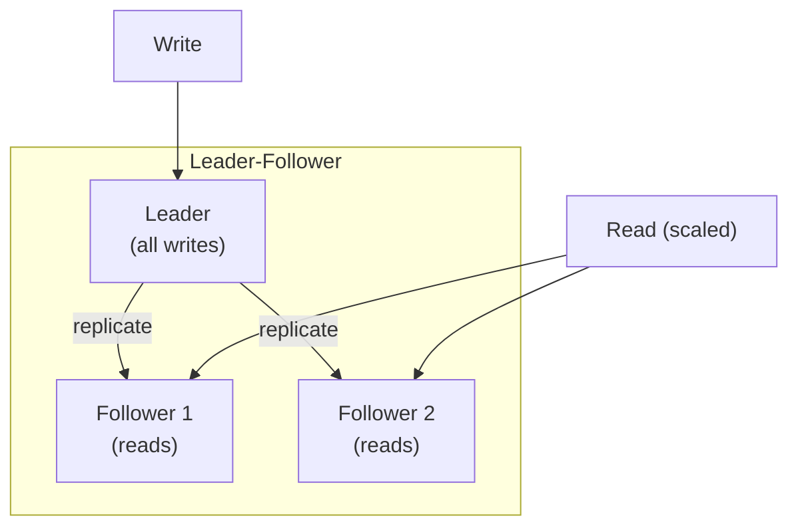
*Sync replication = safer, slower. Async = faster, risk of replica lag/data loss on failover.*
- **Sharding strategies:** range-based (simple, risk of hotspots), hash-based (even distribution, harder range queries), directory-based (a lookup service maps key→shard, flexible but adds a hop).
- **Replica lag** — async replicas can serve stale reads; solutions: read-your-writes consistency (route a user's own reads to the leader briefly after a write), monotonic reads.
- **SQL vs NoSQL:** SQL = strong schema/joins/ACID transactions, vertical+read-replica scaling sweet spot. NoSQL (document/KV/column/graph) = flexible schema, horizontal scaling, often trades consistency for availability/partition tolerance.
- **Indexing basics:** B-tree (range queries, default in most RDBMS), hash index (O(1) exact match, no range queries), the LSM-tree storage engine (see companion file) trades read amplification for write throughput — this is *why* Cassandra/RocksDB/LevelDB use it.
- **ACID vs BASE:**
  - ACID (Atomicity, Consistency, Isolation, Durability) — traditional relational guarantee.
  - BASE (Basically Available, Soft state, Eventual consistency) — the NoSQL/AP counter-philosophy.
- **Connection pooling** — reusing DB connections instead of opening one per request; a very common real-world bottleneck/interview question.

---

## 9. Observability (often the "how would you debug this in prod" question)

- **Three pillars:**
  - **Logs** — discrete events, good for detailed debugging, expensive to query at scale.
  - **Metrics** — numeric time series (latency, error rate, throughput = the "RED" method: Rate, Errors, Duration; or "USE": Utilization, Saturation, Errors for resources).
  - **Traces** — follow a single request across many services (distributed tracing — e.g. OpenTelemetry, Jaeger, Zipkin). Uses a **trace ID** propagated through headers across every hop, with **spans** for each service's portion of the work.
- **SLI / SLO / SLA:**
  - SLI = the measured indicator (e.g. p99 latency)
  - SLO = the internal target (e.g. p99 < 200ms, 99.9% uptime)
  - SLA = the external contractual promise (often looser than the SLO, with penalties)
- **Alerting on symptoms, not causes** — alert on user-facing signals (error rate, latency) rather than every internal metric, to avoid alert fatigue.

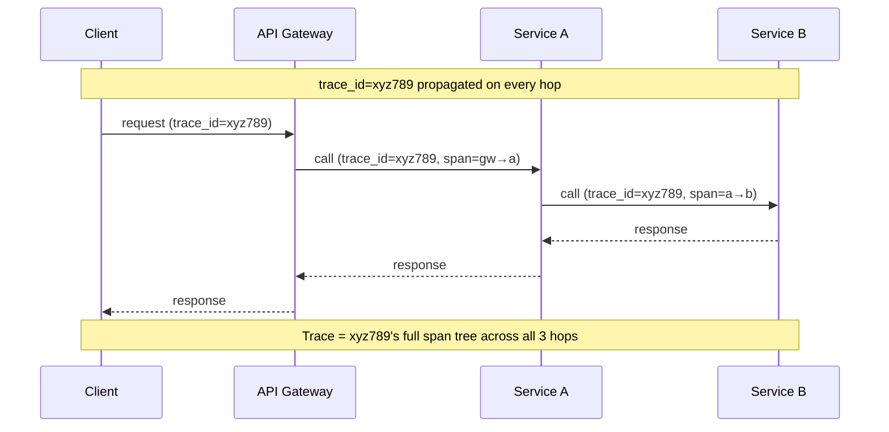

---

## 10. Idempotency & Exactly-Once-ish Delivery (ties back to the KV-store notes)

- Any network call can be retried (client timeout ≠ server didn't process it) → **every write endpoint that can be retried must be idempotent.**
- Common technique: client generates a unique **idempotency key** per logical operation; server stores `(key → result)` and returns the cached result on retry instead of reprocessing.
- Same underlying idea as the scheduler's `executionId` and Kafka consumer dedup — a recurring theme across the whole stack.

---

## 11. Security Basics That Come Up in Backend/System-Design Rounds

- **AuthN vs AuthZ** — authentication (who are you, e.g. OAuth2/JWT) vs authorization (what can you do, e.g. RBAC/ABAC).
- **JWT** — stateless, self-contained token (good for horizontal scaling, but revocation is awkward — usually solved with short expiry + refresh tokens, or a blocklist).
- **mTLS** — mutual TLS for service-to-service auth inside a mesh (both sides present certs).
- **Rate limiting per API key/user** — prevents abuse, often implemented at the gateway (ties back to §7).

---

## 12. Scalability Numbers Worth Having Intuition For

- Rough latency intuition (order of magnitude, not exact): L1 cache ~ns, RAM access ~100ns, SSD read ~100µs, network round trip same datacenter ~0.5ms, cross-region ~100ms+, disk seek (HDD) ~10ms.
- Back-of-envelope skill matters more than exact numbers: interviewers want to see you can estimate QPS, storage, and bandwidth from stated DAU/traffic assumptions, and use that to justify sharding/caching/replication choices.

---

## 13. How to Structure a System Design Interview Answer (framework)

1. **Clarify requirements** — functional (what must it do) + non-functional (scale, latency, consistency needs, read/write ratio).
2. **Back-of-envelope estimation** — QPS, storage, bandwidth → informs whether you even need sharding/caching.
3. **High-level design** — draw boxes: client → LB → API gateway → services → cache → DB → message queue, etc.
4. **Deep dive** into 1-2 components the interviewer cares about (usually the hard part: data model, partitioning scheme, consistency choice).
5. **Bottlenecks & tradeoffs** — explicitly state what you're trading (CAP choice, consistency model, cost) and why, given the requirements from step 1.
6. **Failure scenarios** — "what if this node dies," "what if this queue backs up" — shows you think about the unhappy path, not just the happy path.

⭐ The single biggest signal at SDE-2+ level: **naming the tradeoff explicitly** ("I'm choosing AP here because X matters more than Y for this use case") rather than presenting one design as if it has no downsides.

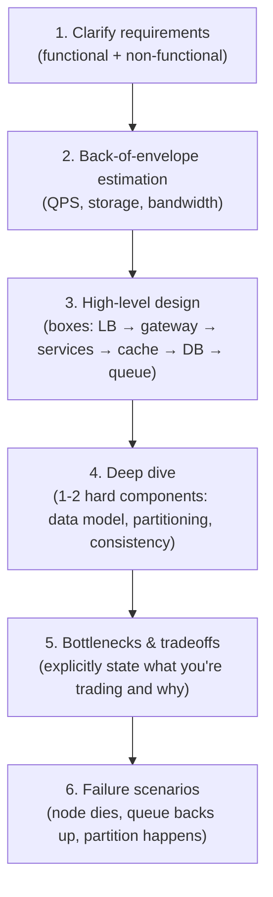

---

## 14. Classic System Design Prompts to Practice (map back to the concepts above)

- URL shortener → hashing, DB choice, caching, ID generation strategies (counter, hash, Snowflake-style IDs)
- Rate limiter → §7 algorithms
- News feed / timeline → fan-out on write vs fan-out on read, caching hot users
- Chat system → WebSockets, message ordering, delivery guarantees, presence (you've already built one — revisit it with these concepts)
- Distributed task scheduler → partitioning tasks, leader election for scheduling, idempotent execution (you've already built one — this is your strongest talking point, walk through *your own* design decisions using this vocabulary)
- Distributed cache → consistent hashing, eviction, replication
- Notification system → queues, fan-out, retries/DLQ
- Distributed KV store / Dynamo clone → see the companion notes file, this is the deepest one

---

## 15. Cross-Reference to Companion File

See `distributed-systems-notes.md` for: consistent hashing + virtual nodes, quorum (`W+R>N`), vector clocks, gossip protocol, hinted handoff, Merkle trees, and the WAL/Memtable/SSTable storage engine — those are the deep internals; this file is the surrounding system-design landscape they sit inside of.