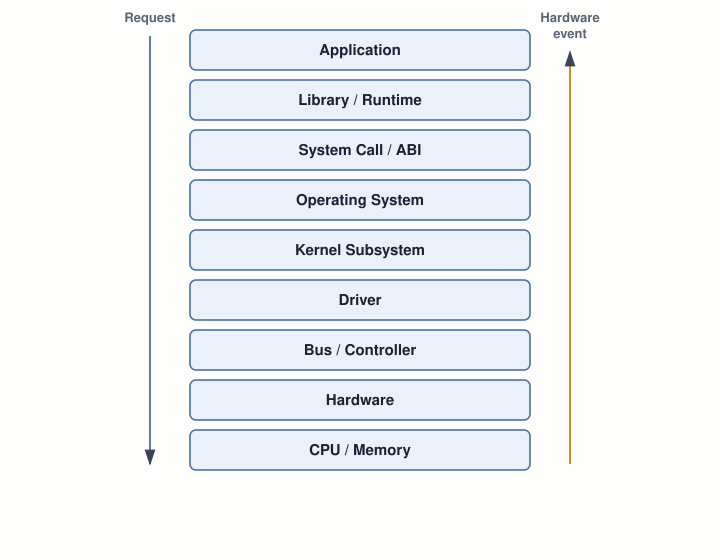

# 01 — Computer Systems Foundation

## Layer map for this file

```
┌──────────────────────────────────────────────┐
│ 1. BOOK: Blundell's five stated goals (Ch.1)  │
│    — including the one the draft breaks       │
├──────────────────────────────────────────────┤
│ 2. SUPPORTING: the abstraction stack, the      │
│    hardware/software boundary                  │
├──────────────────────────────────────────────┤
│ 3. MODERN: same shape, 2026 mechanisms         │
└──────────────────────────────────────────────┘
```

Book coverage: **Seed** — Chapter 1 is a short motivating intro, not
a technical chapter.

## Prerequisites

None — this is the first file. Assumed background: C/C++, data
structures, Linux CLI. No systems-level knowledge assumed.

---

## [BOOK] Chapter 1's Five Promises

Blundell states the book's scope as five concrete goals, targeting
x86 with no OS present at all:

| # | Goal | Where this course covers it |
|---|---|---|
| 1 | How a computer boots | file `06` |
| 2 | Low-level programming with no OS | files `03`–`05` |
| 3 | Configuring the CPU for extended functionality (protected mode) | file `08` |
| 4 | Bootstrapping higher-level-language code | files `11`–`13` |
| 5 | Building "fundamental OS services" — drivers, filesystems, multi-tasking | files `14`–`20` |

Goal 5 is the one to hold onto: it's the exact list of things the
draft's own table of contents promises later (§6.3–6.6, all of
Chapter 7) and then never writes a word of. That gap is not a defect
in this course's plan — it's a fact about the source material, named
here on page one so nothing later feels like a surprise.

---

## [CORE CONCEPT] The Abstraction Stack

Every file after this one zooms into exactly one rung of this ladder.
Two directions matter equally: a request moving down, and a hardware
event moving back up.



Nothing about this diagram is book content — it's the map this whole
course is organized around. Files `01`–`13` build the bottom four
rungs by hand; files `14`–`24` build everything from Driver up to
Operating System; files `25`+ turn to a real production system
(Linux) already occupying every rung at once.

## [CORE CONCEPT] Code and Data Are the Same Kind of Bits

A CPU does one thing forever: fetch the next instruction, decode it,
execute it, repeat. It has no built-in way to tell "this byte is an
instruction" from "this byte is data" — both are just bits in memory.
What makes a byte an instruction is nothing more than the program
counter happening to point at it. Hold onto this — it's the reason a
512-byte boot sector can freely mix code and data (file `02`), the
reason a disassembler can be fooled by a string literal (file `10`),
and the reason BIOS's own bootability check is as crude as it is
(file `06`).

---

## [MODERN SYSTEM] Same Stack, 2026 Mechanisms

| Layer | Book's era (2010) | Modern (2026) |
|---|---|---|
| Firmware | BIOS | UEFI (file `07`) |
| CPU mode | 16-bit real → 32-bit protected | + 64-bit long mode (file `08`) |
| Cores | implicitly single-core | multicore/SMP (file `24`) |
| Isolation | ring 0 only | ring 3 user mode (file `21`) |
| Extra layers | none | virtualization, containers (files `28`, `29`) |

---

## Practical Experiment

No VM needed yet.

1. `uname -a` — architecture and kernel version.
2. `lscpu` — cores, threads, byte order (endianness — file `02` uses
   this directly).
3. `dmesg | head -60` — find the line where firmware hands off to the
   kernel.
4. Confirm `qemu-system-x86_64 --version` and `nasm -v` both work —
   needed starting file `02`.

## Debugging

Every debugging session in this course starts with the same question,
applied to the stack diagram above: **which layer does this symptom
actually live in?** Pick the tool for that layer — that choice comes
before any specific tool technique.

## Source Code

None yet.

---

## Common Misconceptions

- **"The OS is the kernel."** The kernel is one privileged component;
  "OS" usually also means the drivers and services around it.
- **"Code and data are physically different things in the machine."**
  Same bits — only the CPU's current interpretation differs.
- **"A computer needs an OS to run at all."** It needs *something* at
  its reset vector — that could be a full kernel, or 16 bytes that
  loop forever (file `06`).

## Interview Questions

**Basic:** What is the fetch-decode-execute cycle?
**Intermediate:** Give one example of something that's part of "the
OS" but not part of "the kernel."
**Advanced:** Why isn't a simple embedded thermostat's control loop
called "an operating system"?
**Systems Design:** Which layer(s) in the stack diagram could a
unikernel legitimately collapse, and what does it give up?
**Debugging:** "The API call is slow" — what's the first question
that narrows down which layer is actually slow?
**Explain what happens when...:** you press the power button, up to
the first thing shown on screen?

## Active Recall

1. Name the stack's layers, hardware to application.
2. Blundell's five Chapter 1 goals — which one does the draft not
   deliver on?
3. Why can't a CPU tell code from data by inspecting bits?

## Answers

1. Hardware/CPU/Memory → Firmware → Bootloader → Kernel → Drivers →
   Syscalls → Libraries → Applications.
2. Booting; low-level programming with no OS; protected mode;
   bootstrapping a higher-level language; **drivers/filesystems/
   multi-tasking — not delivered** (§6.3–7.2 are empty in the draft).
3. Because a byte is an instruction only by virtue of the program
   counter pointing at it in fetch mode — nothing in the bits
   themselves marks it either way.

---

## What You Should Now Understand

- Blundell's five stated goals, and which one the draft breaks.
- The abstraction stack, in both directions, that every later file
  zooms into.
- Why "code vs. data" is a matter of CPU state, not bit content.

---

**Next:** file `02-binary-hex-memory-representation.md`.
