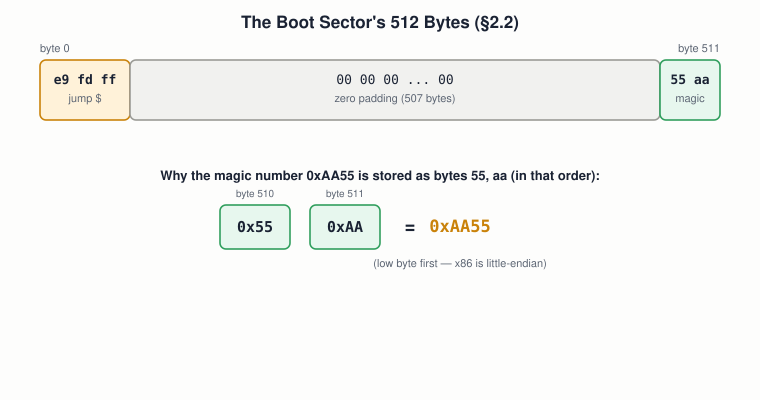

# 02 — Binary, Hex, and Memory Representation

## Layer map for this file

```
┌──────────────────────────────────────────────┐
│ 1. BOOK: the boot sector's own hex dump and   │
│    its little-endian magic number (§2.2,      │
│    §2.4)                                       │
├──────────────────────────────────────────────┤
│ 2. SUPPORTING: base conversion, two's         │
│    complement, ASCII                           │
├──────────────────────────────────────────────┤
│ 3. MODERN: xxd/gdb hex conventions, network    │
│    byte order, UTF-8                           │
└──────────────────────────────────────────────┘
```

Book coverage: **Full** for hex, binary, and endianness (§2.2, §2.4).

## Prerequisites

File `01`.

---

## [BOOK] The Boot Sector's Own Bytes



Three facts, all directly from §2.2:

- **`e9 fd ff`** *is* the infinite-loop instruction — not a symbol for
  it, the actual bytes.
- **`55 aa`**, the last two bytes, are the **magic number** BIOS
  checks for before treating a sector as bootable.
- Described as the 16-bit value `0xAA55`, but stored **low byte
  first** — proof, in the book's own example, that **x86 is
  little-endian**.

## [BOOK] Why Hex Exists at All (§2.4)

A computer only has two distinguishable states, so numbers are
strings of bits — and converting a long bit string to decimal means
summing weighted place values across the whole thing. Hex sidesteps
this because **one hex digit is exactly 4 bits**, so conversion is
digit-by-digit, no running total:

```
1101 1110 1011 0110      binary, grouped into nibbles
  D    E    B    6       → one hex digit each
```

The book's size vocabulary: **bit** (1), **byte** (8 bits), **short/
int/long** (16/32/64 bits), and **word** — defined as "whatever the
current CPU mode's native size is." Worth a flag: Intel's own manuals
fix *word* at 16 bits always, calling a 32-bit value a *doubleword*
regardless of mode. Not an error in the book — just don't carry its
looser usage into reading real ISA documentation (file `04`).

---

## [CORE CONCEPT] Two's Complement (Not in the Book)

The book never uses negative numbers — every boot-sector value is an
address, a count, or an opcode. You'll need this the moment C arrives
(file `11`): negative numbers are represented by inverting the
positive value's bits and adding 1, which lets one adder circuit
handle both signed and unsigned arithmetic. One gotcha: an 8-bit
signed byte runs `-128` to `127` — one more negative value than
positive, since `0` claims a slot that would otherwise be positive.

## [CORE CONCEPT] ASCII, in One Line

The boot sector's `"Hello"` works only because each character is
*also* just a byte (`'H'` = `0x48`). The printable-characters column
in a hex dump (today's experiment) is this exact idea, applied.

---

## [MODERN SYSTEM] Where This Shows Up Today

- `xxd`/`hexdump -C` — the direct descendant of the binary editor
  Blundell used by hand.
- `gdb`'s `x/xb`, `x/xw` — inspect live memory as raw hex.
- **Network byte order** (TCP/IP) is **big-endian**, specifically
  because hosts disagree on native order — the protocol has to name
  one. Same underlying fact as the boot sector's magic number, applied
  to a different problem.
- **UTF-8** is ASCII's superset: every ASCII byte (0–127) is valid
  UTF-8 unchanged.

---

## Practical Experiment

1. Convert `1101111010110110` to hex by hand (nibble grouping), check
   with `python3 -c "print(hex(0b1101111010110110))"`.
2. Prove endianness on your own machine:
   ```c
   #include <stdio.h>
   int main() {
       unsigned int x = 0xAABBCCDD;
       unsigned char *b = (unsigned char *)&x;
       for (int i = 0; i < 4; i++) printf("byte %d: %02x\n", i, b[i]);
   }
   ```
   Expect `dd cc bb aa` — least-significant byte first.
3. `xxd /bin/ls | head -5` — find the ELF magic (`7f 45 4c 46`,
   literally `.ELF` in ASCII) at byte 0.

## Debugging

An endianness mismatch looks like "the value is backwards," never
like an error message. Fix: know the *producer's* endianness (x86-64
memory: little; a network packet: big) and the *tool's* — `xxd`/`gdb`
show raw byte order, no reinterpretation.

## Source Code

`endian.c` above.

---

## Common Misconceptions

- **"`0x50` equals `50`."** `0x50` is 80 decimal — the prefix isn't decoration.
- **"Word always means 16 bits."** True in Intel's manuals; not in
  this book's own usage.
- **"Endianness is a legacy concern."** The machine you're reading
  this on is almost certainly little-endian, proven above.

## Interview Questions

**Basic:** Why isn't `0x50` equal to `50`?
**Intermediate:** Explain little vs. big endian with a 4-byte value.
**Advanced:** Why doesn't the reordering that affects the 2-byte magic
number also apply to the single bytes `e9`, `fd`, `ff` earlier in the
same sector?
**Systems Design:** Why do protocols like TCP/IP mandate a fixed byte
order instead of leaving it to the host?
**Debugging:** You expect `00 00 00 01` and see `01 00 00 00` — first
hypothesis?
**Explain what happens when...:** `int x = 1;` is compiled and you
inspect `x`'s raw bytes on x86-64?

## Active Recall

1. The boot sector's three byte regions.
2. Why hex converts cleanly to/from binary and decimal doesn't.
3. The book's "word" vs. Intel's formal definition.
4. What two's complement buys hardware designers.

## Answers

1. Jump instruction (`e9 fd ff`), zero padding, magic number (`55 aa`).
2. One hex digit = exactly 4 bits; decimal requires summing weighted
   place values across the whole string.
3. Book: native size of the current mode. Intel: word is always 16
   bits, regardless of mode.
4. One adder circuit handles both signed and unsigned values — no
   separate code path needed.

---

## What You Should Now Understand

- The book's boot-sector hex dump, byte by byte.
- Why x86 is little-endian — demonstrated, not just asserted.
- Two's complement, ahead of needing it in file `11`.

---

**Next:** file `03-cpu-and-instruction-set.md`.
