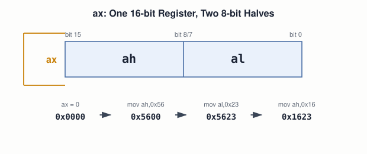

# 03 — The CPU and Instruction Set

## Layer map for this file

```
┌──────────────────────────────────────────────┐
│ 1. BOOK: four registers, ah/al splitting, the │
│    book's own "Hello" decoded byte by byte    │
│    (§3.3.2–3.3.3)                              │
├──────────────────────────────────────────────┤
│ 2. SUPPORTING: ISA as contract, opcode+operand │
│    anatomy, register categories                │
├──────────────────────────────────────────────┤
│ 3. MODERN: x86-64 registers, Intel vs. AT&T    │
│    syntax, System V ABI, Linux syscalls        │
└──────────────────────────────────────────────┘
```

Book coverage: **Seed** (§3.3.2). Note: this course covers CPU/ISA
fundamentals before booting (file `06`) — the reverse of the book's
own order, deliberately.

## Prerequisites

Files `01`, `02`.

---

## [BOOK] Four Registers, One Byte-Splitting Trick

x86 has four general-purpose registers — `ax`, `bx`, `cx`, `dx` —
each a 16-bit word, readable/writable with no real delay (unlike
memory). Each splits into independent 8-bit halves:



One flagged warning worth carrying forward: **operand order isn't
universal** — NASM's Intel syntax (`mov dest, src`) isn't the only
convention. More in Modern Context below.

## [BOOK] The "Hello" Boot Sector, Decoded

The book gives you the assembly *and* its literal machine code side
by side (§3.3.3):

| Assembly | Bytes | Meaning |
|---|---|---|
| `mov ah, 0x0e` | `b4 0e` | `B4` = "mov ah, imm8" |
| `mov al,'H'` / `int 0x10` | `b0 48  cd 10` | `B0`="mov al,imm8"; `CD`="int" |
| `mov al,'e'` / `int 0x10` | `b0 65  cd 10` | `0x65` = ASCII `'e'` |
| `mov al,'l'` / `int 0x10` | `b0 6c  cd 10` | ×2 |
| `mov al,'o'` / `int 0x10` | `b0 6f  cd 10` | |
| `jmp $` | `e9 fd ff` | `E9` = near jump |

Every byte here is explainable by hand with an opcode table and the
ASCII table from file `02` — no hidden layer between this hex and the
screen printing `Hello`.

**The pattern worth naming:** before `int 0x10`, `ah`/`al` are set —
this is **register-based parameter passing**. BIOS reads its
arguments out of registers you agreed, by convention, to set first.
The full interrupt mechanism is file `14`'s job; the pattern itself
recurs at every layer of this course.

---

## [CORE CONCEPT] ISA vs. Implementation

An ISA is a contract: the instructions a CPU family supports and
their exact encodings. "x86" names the ISA; a specific chip is one
*implementation* — internals can differ hugely between two chips that
run identical x86 programs correctly.

## [CORE CONCEPT] Opcode + Operand, Variable-Length

`b4` (opcode: move immediate byte into `ah`) + `0e` (operand) = 2
bytes; other x86 instructions run to 5+ bytes. x86 is
**variable-length** — a disassembler must decode one instruction at a
time to know where the next one starts.

## [CORE CONCEPT] Registers Beyond General-Purpose

The book shows only general-purpose registers here. Named for later:
**instruction pointer** (file `09`), **stack pointer** (file `10`),
**flags register** (file `05`), **segment registers** (file `09`),
**control registers** (file `08`).

---

## [RELATED KNOWLEDGE] Intel Syntax vs. AT&T Syntax

| | Intel (NASM, this book) | AT&T (`objdump` default) |
|---|---|---|
| Order | `mov dest, src` | `mov src, dest` (reversed) |
| Registers | `ax` | `%ax` |
| Immediates | `0x0e` | `$0x0e` |

`mov ah, 0x0e` in AT&T: `mov $0xe, %ah`. This trips up almost everyone
switching from a NASM-based book to `objdump -d` output — today's
experiment triggers it on purpose so it's never a surprise again.

## [RELATED KNOWLEDGE] CISC vs. RISC

x86's variable-length, do-a-lot-per-instruction style is classic
**CISC**. ARM32's fixed 4-byte-always instructions are classic
**RISC** — simpler decode, at the cost of code density. Modern x86-64
chips actually decode CISC instructions into simpler internal
micro-ops before executing (file `33`).

---

## [MODERN SYSTEM] Same Idea, Much Wider

`rax`/`eax`/`ax`/`ah`/`al` are nested views of *one* physical
register — the same byte-splitting trick, two levels further. x86-64
adds `r8`–`r15` on top, registers the book's 16-bit world never had.

## [MODERN SYSTEM] Register-Passing, Grown Up

- **System V AMD64** (file `10`): first six args in `rdi, rsi, rdx,
  rcx, r8, r9`.
- **Linux `syscall`**: number in `rax`, args in fixed registers, then
  `syscall` — structurally identical to `mov ah,0x0e` / `int 0x10`
  (file `21`).

---

## [ADVANCED / BEYOND THE BOOK] Register Renaming

On an out-of-order CPU, `rax` in your assembly isn't one fixed
physical cell — the CPU dynamically maps architectural names onto a
larger pool of physical registers so independent instructions can run
out of order. Invisible to your code; deferred to file `33`.

---

## Practical Experiment

1. Look up opcodes `B4`, `B0`, `CD`, `E9` and confirm the table above.
2. Reproduce it:
   ```
   nasm hi.asm -f bin -o hi.bin && xxd hi.bin | head -2
   ```
3. Disassemble both ways and compare:
   ```
   ndisasm -b16 hi.bin | head -5
   objdump -D -b binary -m i8086 hi.bin | head -15
   ```
   Spot the Intel-vs-AT&T differences directly.
4. `gdb -p $(pgrep -n bash)` → `info registers` — find `rax`, locate
   where `ax`/`al` sit inside it using the register-split diagram
   above.

## Debugging

"Wrong character printed" → check `al` at the moment `int 0x10`
fires, not the interrupt call itself. Inspect the register, not the
symptom — the same instinct `gdb`'s `info registers` and `strace`'s
argument display scale up to later.

## Source Code

`hi.asm`, `hi.bin`, and its two disassemblies.

---

## Common Misconceptions

- **"A register is a fast memory address."** No — physically separate
  storage, not part of the addressable memory space.
- **"`mov`'s operand order is universal."** Assembler-dependent — NASM
  vs. AT&T disagree, and `objdump -d` defaults to AT&T.
- **"x86 has four registers."** The book introduces four because
  that's all a first boot sector needs; x86-64 has sixteen
  general-purpose ones plus more.

## Interview Questions

**Basic:** Register vs. RAM location — what's structurally different?
**Intermediate:** Trace `ax` through `mov ax,0` → `mov ah,0x56` →
`mov al,0x23` → `mov ah,0x16`.
**Advanced:** Why is x86 called variable-length, and what does that
cost a hardware decoder?
**Systems Design:** Fixed-width or variable-width encoding for a new
ISA — what are you optimizing for either way?
**Debugging:** A boot sector prints `Hj` instead of `Hi` — first
thing to inspect?
**Explain what happens when...:** a `write()` syscall executes — how
does its register setup mirror `mov ah,0x0e`/`int 0x10`?

## Active Recall

1. The four registers and their width.
2. `ax`'s value after `mov ax,0`→`mov ah,0x56`→`mov al,0x23`→`mov
   ah,0x16`.
3. Decode `b0 48 cd 10`.
4. Intel vs. AT&T — which does `objdump -d` default to?

## Answers

1. `ax`,`bx`,`cx`,`dx` — 16 bits each.
2. `0x0000` → `0x5600` → `0x5623` → `0x1623`.
3. `mov al, 0x48` (`'H'`) then `int 0x10`.
4. AT&T — source-first, `%`-prefixed registers, `$`-prefixed immediates.

---

## What You Should Now Understand

- The book's four registers and its own "Hello" boot sector, decoded
  byte by byte.
- ISA vs. implementation, and why x86's encoding is variable-length.
- That NASM and `objdump` disagree on syntax — confirmed on your own
  machine.
- "Load registers, transfer control" as one idea running from BIOS to
  Linux syscalls.

---

**Next:** file `04-x86-architecture.md`.
