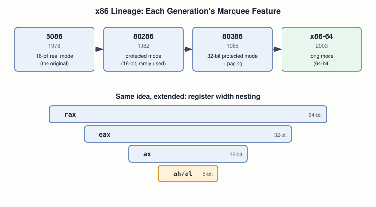

# 04 — The x86 Architecture

## Layer map for this file

```
┌────────────────────────────────────────────────┐
│ 1. BOOK: x86 as the explicit target (Ch.1),    │
│    and §3.2's own backward-compatibility       │
│    argument for real-mode boot                 │
├────────────────────────────────────────────────┤
│ 2. SUPPORTING: the 8086→x86-64 lineage, why    │
│    backward compatibility is x86's defining    │
│    design philosophy                           │
├────────────────────────────────────────────────┤
│ 3. MODERN: x86-64/AMD64/Intel64 naming, ARM64  │
│    and RISC-V as contrasting philosophies      │
└────────────────────────────────────────────────┘
```

Book coverage: **Seed** — stronger than it first looks. Chapter 1
names x86 as the target; §3.2 explicitly states the
backward-compatibility reasoning this whole file is built around.

## Prerequisites

Files `01`–`03`.

---

## [BOOK] Backward Compatibility, in the Book's Own Words

§3.2's actual claim: chip makers keep newer CPUs compatible with
older software by having every CPU still emulate the oldest family
member — the 8086 — which is why it's important that CPUs boot
initially in 16-bit real mode, requiring an explicit switch up into
32-bit (or 64-bit) protected mode. That's the book itself naming
backward compatibility as the reason for real-mode boot, with a
passing nod to 64-bit it never technically develops.



---

## [CORE CONCEPT] The Fact That Makes the Book Not Obsolete

> **x86 never removes an old mode when it adds a new one — it only
> adds a way to opt into the new one.**

A brand-new 64-bit CPU, today, powers on in 16-bit real mode — the
exact mode the diagram's 1978 chip had. Getting to a running 64-bit
kernel is a deliberate walk-up: real mode → protected mode → paging
set up → long mode. Files `06`–`08` teach you the first two rungs of
that ladder by hand; a modern machine climbs the same ladder in
milliseconds, via firmware and the kernel's own boot code instead.

## [CORE CONCEPT] What's Coming, Mapped

| Concept | Full coverage |
|---|---|
| Real mode | file `08` |
| Protected mode, GDT | file `08`, `09` |
| Long mode | file `08`, `22` |
| Segment registers | file `09` |
| Control registers | file `08` |

---

## [RELATED KNOWLEDGE] x86-64 / AMD64 / Intel 64 / x64

All the same 64-bit extension: **AMD64** (AMD's name, most common
technically), **Intel 64** (Intel's implementation, originally
EM64T), **x64** (Microsoft's shorthand). Linux's `uname -m` reports
`x86_64` — one more spelling of the same thing.

## [RELATED KNOWLEDGE] 80286 Protected Mode Was a Dead End

The 80286 technically had protected mode three years before the
80386, but 16-bit and awkward to leave once entered — little real
adoption. Unqualified "protected mode" (this book included) always
means the 80386's 32-bit version.

---

## [MODERN SYSTEM] x86-64 Isn't the Only Game Anymore

**ARM64/AArch64** — fixed-width RISC, dominant in phones, Apple's
current Macs, and growing in cloud servers (AWS Graviton). **RISC-V**
— an open, royalty-free ISA gaining real adoption. Neither changes
anything this course teaches — x86-64 almost certainly runs the
machine you're using right now — but worth knowing "CPU" no longer
implicitly means "x86."

---

## [ADVANCED / BEYOND THE BOOK] What x86 Grew That the Book Never Touches

Decades of bolted-on extensions the book's scalar-integer world never
needs: **SSE/AVX/AVX-512** vector instructions, and internal
**micro-op translation** (CISC decoded to RISC-like micro-ops before
execution). Both deferred to file `33`.

---

## Practical Experiment

1. `uname -m` — `x86_64` or `aarch64`?
2. `cat /proc/cpuinfo` — find the `lm` flag (literally: **long mode
   supported**). Note `vendor_id`, `cpu family`, `model`.
3. If you have access to more than one machine, compare `uname -m`
   across them.
4. Hold this for file `06`: you'll check `CR0`'s PE bit in the QEMU
   monitor immediately after boot and watch it read `0` — direct
   proof of "even a modern CPU starts in real mode."

## Debugging

**Architecture mismatch** is its own bug category: `file <binary>`
names its target architecture; compare against `uname -m`. A mismatch
*is* the entire bug — "Exec format error" needs no further
investigation into logic.

## Source Code

None new — orientation file. Save your `/proc/cpuinfo` output for
file `33`.

---

## Common Misconceptions

- **"A new 64-bit CPU starts in 64-bit mode."** No — real mode, every
  boot, walked up explicitly by software.
- **"Protected mode and 32-bit mode arrived together."** 80286 added
  protected mode (16-bit, awkward); 80386 added the 32-bit version
  everyone means by the term.
- **"x86 and x86-64 are basically the same thing."** x86-64 is a
  distinct extension — a 32-bit-only chip physically cannot run
  64-bit code.

## Interview Questions

**Basic:** Where does the name "x86" come from?
**Intermediate:** Why does a brand-new 64-bit CPU still power on in
16-bit real mode?
**Advanced:** 80286 vs. 80386 protected mode — what's the practical
difference?
**Systems Design:** Without backward compatibility as a constraint,
how might an x86-64 boot sequence simplify — what would be lost?
**Debugging:** "Exec format error" — first two commands?
**Explain what happens when...:** a laptop powers on, before any
bootloader runs — what mode, and why?

## Active Recall

1. What each of 8086/80286/80386/x86-64 added.
2. Why a modern CPU still boots in real mode.
3. Three synonyms for the 64-bit extension.

## Answers

1. 8086: real mode. 80286: protected mode (16-bit, little-used).
   80386: 32-bit protected mode + paging. x86-64: long mode.
2. Backward compatibility — every chip must still work as the
   original 8086 did until software explicitly requests more.
3. AMD64, Intel 64, x64 — Linux calls it `x86_64`.

---

## What You Should Now Understand

- Why Blundell's choice of x86 wasn't arbitrary.
- The one fact that keeps the book's real-mode material live on your
  own hardware today.
- The x86-64/AMD64/Intel64/x64 naming mess, resolved.

---

**Next:** file `05-assembly-language.md`.
