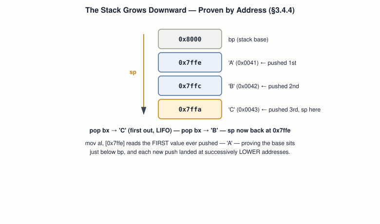

# 05 — Assembly Language

## Layer map for this file

```
┌────────────────────────────────────────────────┐
│ 1. BOOK: §3.3–3.4 in full, the richest         │
│    section of the draft — four Questions       │
│    preserved as real exercises                 │
├────────────────────────────────────────────────┤
│ 2. SUPPORTING: the flags register as implicit  │
│    state, the stack as overflow storage,       │
│    "a function call IS call+ret+stack"         │
├────────────────────────────────────────────────┤
│ 3. MODERN: System V ABI, compiler-generated    │
│    cmp/jump/call, pusha/popa's removal, ROP    │
└────────────────────────────────────────────────┘
```

Book coverage: **Full**. Correction note: an earlier version of this
file mis-stated the result of the stack example below (claimed the
final read printed `'C'`; it actually prints `'A'`). Fixed here,
verified against the source text directly.

## Prerequisites

Files `01`–`04`.

---

## [BOOK] Labels Are Named Offsets (§3.4.1–3.4.2)

BIOS always loads the boot sector at **`0x7c00`** — not `0x0`, which
is still BIOS's own interrupt-vector territory. The book's "find the
byte" experiment tries four ways to print a data byte:

| Attempt | Code | Result | Why |
|---|---|---|---|
| 1 | `mov al, the_secret` | ✗ | loads the *offset itself* as a value |
| 2 | `mov al, [the_secret]` | ✗ | dereferences, but from address 0, not 0x7c00 |
| 3 | `mov bx,the_secret` / `add bx,0x7c00` / `mov al,[bx]` | ✓ | manually adds the load address |
| 4 | `mov al, [0x7c1e]` | ✓ | hand-counted absolute address |

`[org 0x7c00]` is what makes attempts 3–4 unnecessary — it tells the
assembler the final load address so it resolves every label
automatically.

> **Question 1 (book):** predict the output once `[org 0x7c00]` is
> added, and explain why.

## [BOOK] Strings Are Bytes Plus a Convention (§3.4.3)

```asm
my_string:
  db "Booting OS", 0
```

`db` writes raw bytes. The trailing `0` is **null-termination** — the
same convention C uses — since nothing else marks where the string
ends.

## [BOOK] The Stack, Proven Downward (§3.4.4)

`bp` = stack base, `sp` = current top. Two surprises: 16-bit mode's
stack only moves **16-bit values**, and it grows **downward** — each
`push` *decreases* `sp`.



The book's exact proof:

```asm
mov bp, 0x8000  \  mov sp, bp
push 'A'  \  push 'B'  \  push 'C'      ; each padded to 16 bits

pop bx \ mov al, bl \ int 0x10          ; prints 'C' — LIFO, last in first out
pop bx \ mov al, bl \ int 0x10          ; prints 'B'

mov al, [0x7ffe] \ int 0x10             ; prints 'A' — the FIRST value pushed,
                                         ; still sitting just below bp
```

Reading `0x7ffe` directly returns **`'A'`**, not `'C'` — the value
pushed *first* landed at the *highest* address (closest to `bp`), and
each subsequent push landed lower. That's the actual proof of
downward growth: the base holds the oldest entry, not the newest.

> **Question 2 (book):** what prints, in what order, and at what
> absolute address is `'C'` stored? Modify the code to confirm.

## [BOOK] Control Structures Are Jumps (§3.4.5)

```asm
cmp ax, 4
je  then_block
mov bx, 45        ; else
jmp the_end
then_block:
  mov bx, 23
the_end:
```

`cmp` sets the flags register; a following conditional jump
(`je/jne/jl/jle/jg/jge`) reads it.

> **Question 3 (book):** convert a three-way if/else-if/else into
> assembly using `cmp` and these jumps.

## [BOOK] From a Naive Jump to call/ret (§3.4.6)

A naive "function" (`jmp` there, `jmp` back to one fixed label) can
only ever return to that one place. `call` fixes this: push the
return address, then jump; `ret` pops it and jumps back — callable
from anywhere. `al` carries the parameter, the same register-passing
idea from file `03`. `pusha`/`popa` save/restore every general
register — a callee's etiquette for not clobbering the caller's state.

## [BOOK] Include Files (§3.4.7)

`%include "file.asm"` is pure textual paste — the direct ancestor of
C's `#include` (file `11`).

## [BOOK] Putting It Together (§3.4.8–3.4.9)

> **Question 4 (book):** write `print_string.asm` — takes a string
> address in `bx`, prints until the null terminator, saves/restores
> what it touches. Used for both "Hello, World!" and "Goodbye!" from
> one boot sector.

---

## [CORE CONCEPT] The Flags Register: Implicit State

`cmp` produces no value you can name — it sets bits in the flags
register that the *next* instruction reads. Same idiom BIOS uses for
disk-read errors (file `06`, via the carry flag).

## [CORE CONCEPT] A Function Call *Is* call + ret + the Stack

Whatever language you write calls in, by the time it runs, it's
exactly this mechanism. Everything a compiler adds on top — real
parameter conventions, register preservation rules — is *convention*,
layered on nothing more than `call`, `ret`, and the stack (file `10`).

---

## [RELATED KNOWLEDGE] Null-Termination Wasn't the Only Option

Length-prefixed strings (classic Pascal) make length lookup instant
at the cost of a maximum length; null-termination has no length limit
but can't store an embedded zero. Both tradeoffs still matter today.

## [RELATED KNOWLEDGE] pusha/popa Didn't Survive Into 64-bit Mode

x86-64 **removed both instructions entirely** — modern code saves
only what it actually needs, one register at a time.

---

## [MODERN SYSTEM] The Same Shapes, Compiler-Generated

`if (x == 4) y = 23; else y = 45;` compiles to the same `cmp`/`je`
shape shown above — verify it yourself today. Function calls compile
to `call`/`ret` with a real, formalized convention (System V AMD64,
file `10`) automating what `pusha`/`popa` do by hand.

## [ADVANCED / BEYOND THE BOOK] The Same Mechanism, Weaponized

`ret` unconditionally trusts whatever's on top of the stack. If an
attacker corrupts the stack and controls that value, they control
where execution goes — the basis of **return-oriented programming
(ROP)**. No how-to here — just naming that this file's mechanism is
also what a large exploit class rides on (file `31`).

---

## Practical Experiment

1. Assemble "find the byte," confirm `'X'` sits at offset `0x1e`:
   `nasm findbyte.asm -f bin -o findbyte.bin && xxd findbyte.bin | head -2`
2. Assemble the stack example, `ndisasm -b16 stack.bin | head -20`,
   confirm each `push` encodes as a 16-bit operation.
3. Compile and compare against a real compiler:
   ```c
   int classify(int x) { if (x == 4) return 23; else return 45; }
   ```
   `gcc -O0 -c classify.c && objdump -d classify.o` — find the
   `cmp`/`je`/`jmp` shape (remember: AT&T syntax, file `03`).
4. Write `print_string.asm` for real (Question 4); disassemble to
   sanity-check before file `06` lets you boot it.

## Debugging

The book's own Questions *are* the debugging method here: predict by
tracing register/flag state by hand, then check against a real
disassembly. The classic trap: assuming the stack grows *upward* —
compute `bp + offset` instead of `bp - offset` and you'll confidently
inspect the wrong address.

## Source Code

`findbyte.asm`, `stack.asm`, `classify.c`, your `print_string.asm`.

---

## Common Misconceptions

- **"The stack grows upward."** Downward — proven above by reading
  `0x7ffe` directly and finding the *first* pushed value there.
- **"You can push a single byte in 16-bit mode."** No — always a full
  16-bit word.
- **"A function call is different hardware from a jump."** `call` =
  jump + push return address; `ret` = pop into the instruction pointer.
- **"`cmp` produces a printable value."** It only sets flags bits; no
  named value exists until a conditional jump reads them.

## Interview Questions

**Basic:** Structural difference between `jmp` and `call`?
**Intermediate:** Prove the stack's growth direction, as the book does.
**Advanced:** What exactly does `cmp ax,4` compute, and where does it live?
**Systems Design:** Stack-based return address vs. a fixed link
register (some RISC designs) — tradeoffs?
**Debugging:** The stack example prints garbage instead of `'A'` —
first thing to check?
**Explain what happens when...:** one C function calls another, down
to `call`/`ret` and the stack?

## Active Recall

1. Why do attempts 1 and 2 of "find the byte" fail, for different reasons?
2. What does `[org 0x7c00]` do?
3. What does reading `0x7ffe` after two pops actually prove, and what
   does it print?
4. What happened to `pusha`/`popa` in x86-64?

## Answers

1. Attempt 1 loads the offset as a value; attempt 2 dereferences
   correctly but from the wrong base (0, not 0x7c00).
2. Tells the assembler the load address so every label resolves to a
   correct absolute address automatically.
3. It proves the stack's base holds the *first* value pushed (not the
   most recent) — it prints `'A'`.
4. Removed entirely in long mode — modern code saves registers
   individually instead.

---

## What You Should Now Understand

- The book's "find the byte" puzzle and its four attempts, cold.
- The stack's growth direction, *correctly* proven this time.
- `call`/`ret` + the stack as the entire mechanism behind every
  function call in any language.

---

**Next:** file `06-boot-process.md`.
