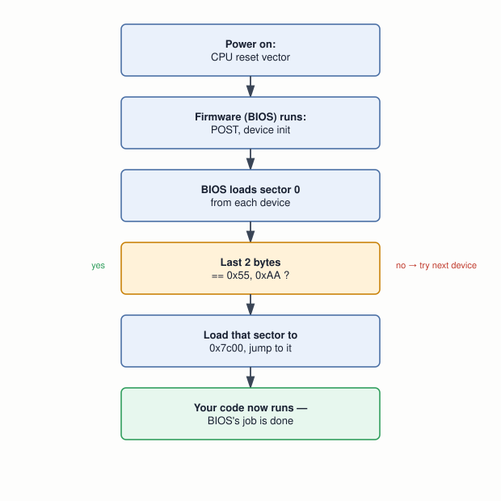

# 06 — The Boot Process

## Layer map for this file

```
┌──────────────────────────────────────────────┐
│ 1. BOOK: how BIOS finds a sector (§2.1), the  │
│    magic number and infinite loop (§2.2), CPU │
│    emulation with Bochs/QEMU (§2.3)           │
├──────────────────────────────────────────────┤
│ 2. SUPPORTING: firmware as a concept, magic    │
│    numbers as a general pattern, the MBR       │
│    partition table the book's example skips    │
├──────────────────────────────────────────────┤
│ 3. MODERN: QEMU+KVM blurring the book's        │
│    emulation/virtualization line                │
└──────────────────────────────────────────────┘
```

Book coverage: **Full**. This is the payoff file — you boot your own
code for the first time.

## Prerequisites

Files `01`–`05`.

---

## [BOOK] How BIOS Finds Something to Run



BIOS has **no filesystem concept** — it can only read fixed-size
sectors from fixed physical locations. Its check for "is this
bootable" is deliberately crude: do the sector's last two bytes equal
`0x55, 0xAA`? First device found with a match wins. As the book puts
it: this is where you seize control of the computer.

## [BOOK] Why the Infinite Loop Isn't Decorative

Without `jmp $` at the end, the CPU keeps executing whatever random
bytes follow — it will "tear off" running garbage until it crashes,
reboots, or — worst case — happens to trigger a real BIOS routine that
formats a disk. Nothing stops it, because nothing *can*, at this
level. The book names exactly two ways to test a boot sector, and
prefers the second: a real disk, or an emulator. **This course follows
that preference absolutely — nothing here ever touches a real disk's
boot sector.**

## [BOOK] Emulation vs. Virtualization, and the Tools (§2.3)

**Emulation** (Bochs, QEMU) simulates CPU state in software — slower,
far better for development, since it can be paused and inspected at
every step. **Virtualization** (VMware, VirtualBox, at the book's time
of writing) runs guest instructions more directly on the real CPU —
faster.

```
# bochsrc
floppya: 1_44=boot_sect.bin, status=inserted
boot: a
```
```
qemu <your-image>
```

The book's own built-in experiment: corrupt the magic number, re-run
Bochs, watch it refuse to boot. You're doing exactly that below.

---

## [CORE CONCEPT] Firmware, as a General Idea

BIOS is one historical implementation of **firmware** — code
permanently stored in a chip, running before any OS, to initialize
hardware and hand off control. Every computer needs *some* firmware;
file `07` covers today's answer.

## [CORE CONCEPT] Magic Numbers Are Everywhere

BIOS's "check two fixed bytes" is the boot-sector instance of a
pattern used constantly: a fixed signature at a known offset lets
software self-identify data without external metadata. File `02`'s
own experiment already found one: ELF's `7f 45 4c 46`.

---

## [RELATED KNOWLEDGE] The Partition Table the Book's Example Skips

Blundell's boot sector uses all 510 bytes before the magic number for
its own code — valid for a bare floppy image. A real **MBR** hard
disk reserves bytes 446–509 of that same sector for a 4-entry
partition table, leaving only 446 bytes for actual boot code (file
`17`). The book's simplicity here is real, not a shortcut you'll hit
later without warning.

## [RELATED KNOWLEDGE] POST, Named

The "low-level hardware tests" the book mentions is the **Power-On
Self-Test** — the beep codes and memory counts on older PCs, still
happening (invisibly, briefly) behind a modern vendor logo screen.

---

## [MODERN SYSTEM] The Emulation/Virtualization Line Has Blurred

QEMU today does *both*: pure software emulation (**TCG**, matching the
book's description exactly) or **KVM-accelerated** near-native speed,
via Linux's KVM module talking to the CPU's hardware virtualization
extensions. QEMU+KVM together is the literal engine behind most cloud
VMs (file `28`). For this course's own experiments, plain QEMU (no
`-enable-kvm`) is the right choice — debuggability over speed.

---

## Practical Experiment

1. Assemble file `05`'s Question 4 solution: `nasm boot_sect.asm -f
   bin -o boot_sect.bin`.
2. Boot it: `qemu-system-i386 -fda boot_sect.bin`. Watch it print, then
   hang on the infinite loop — by design.
3. Boot the same image in Bochs using the `bochsrc` above.
4. **The book's own experiment:** flip the last two bytes to `00 00`,
   re-run, watch it refuse to boot.
5. **The book's warning, made real:** remove the trailing `jmp $`,
   reassemble, boot in QEMU. Watch execution run into the zero padding
   and the magic-number bytes themselves — safe, VM-only, and exactly
   the failure mode described above.

## Debugging

1. **No output at all:** check the magic number and file size.
2. **Wrong output:** BIOS found your code fine — the bug is your logic
   (file `05`'s disassembly tools apply).
3. **Unexpected hang/reset:** check for a missing/misplaced `jmp $` or
   a bad jump target (file `05`'s addressing lesson).

## Source Code

`boot_sect.asm`/`.bin`, plus a corrupted-magic-number copy — keep as a
matched pair.

---

## Common Misconceptions

- **"BIOS reads a file."** No filesystem concept exists at all.
- **"Any 512-byte program boots."** Only if the last two bytes are
  exactly `55 AA`.
- **"Emulation and virtualization are the same thing."** Real
  technical distinction, though modern QEMU does both.

## Interview Questions

**Basic:** Why can't BIOS just "open the OS file"?
**Intermediate:** What exact check makes a sector bootable, and what
are the limits of a check that simple?
**Advanced:** What does the book say happens without the closing
infinite loop, and why?
**Systems Design:** What would you add to BIOS's check to make it more
robust — and is that roughly what UEFI does (file `07`)?
**Debugging:** QEMU shows nothing at all — first two checks?
**Explain what happens when...:** a PC powers on with a bootable
floppy, through to your first instruction executing?

## Active Recall

1. Why can't BIOS use a filesystem?
2. The exact bytes/position that make a sector bootable.
3. What happens without the trailing infinite loop, and why?

## Answers

1. It has no filesystem concept — only fixed-size sectors at fixed
   physical locations.
2. Bytes 510–511 must equal `0x55, 0xAA`.
3. Execution runs into random memory, potentially crashing, resetting,
   or triggering a destructive BIOS routine — the CPU can't tell
   "meaningful code" from "garbage" either way.

---

## What You Should Now Understand

- Why "BIOS reads a file" is the wrong mental model, entirely.
- The magic number and infinite loop are both load-bearing — proven
  by breaking them safely.
- You've now actually booted your own code.

---

**Next:** file `07-bios-uefi-bootloaders.md`.
