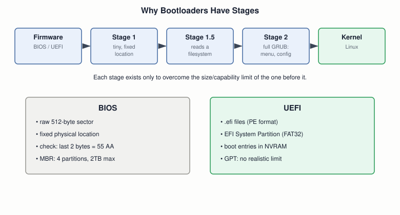

# 07 — BIOS, UEFI, and Bootloaders

## Layer map for this file

```
┌──────────────────────────────────────────────┐
│ 1. BOOK: BIOS is already fully covered (file  │
│    06). The one new seed: the book's own      │
│    kernel loader (§5.2.2, built in file 13)   │
│    is a real two-stage bootloader in miniature│
├──────────────────────────────────────────────┤
│ 2. SUPPORTING: why bootloaders need stages,    │
│    GRUB's stage structure, initramfs           │
├──────────────────────────────────────────────┤
│ 3. MODERN: UEFI and GPT as genuinely different │
│    protocols, not a version bump               │
└──────────────────────────────────────────────┘
```

Book coverage: **Seed/None**. BIOS needs no re-teaching. UEFI, GPT,
and multi-stage bootloaders don't exist in the draft at all.

## Prerequisites

File `06`.

---

## [BOOK] The One Seed

File `13` builds it in full, but it's worth naming here: Blundell's
boot sector later (§5.2.2) reads additional disk sectors containing a
separately-assembled C kernel and jumps into them. That's a genuine
two-stage bootloader — a tiny, fixed stage 1 that finds and loads a
stage 2 with far more capability. GRUB is the same idea, at scale.

---

## [CORE CONCEPT] Why Bootloaders Have Stages



A classic MBR's boot code area is ~446 bytes — nowhere near enough to
parse a filesystem, show a menu, or load a multi-megabyte kernel. Each
stage exists purely to overcome the previous one's limit.

## [CORE CONCEPT] Booting Is the Abstraction Stack, Playing Out in Milliseconds

Firmware → stage 1 → stage 2 → kernel → init/systemd → user space:
file `01`'s layered stack, applied to the first moments of a running
machine.

---

## [RELATED KNOWLEDGE] initramfs Solves a Chicken-and-Egg Problem

The kernel might need a driver just to *access* the disk its real root
filesystem lives on. **initramfs** is a small temporary filesystem,
loaded alongside the kernel, with just enough drivers to mount the
real one — a problem the book's single-purpose toy kernel never faces.

## [RELATED KNOWLEDGE] Chainloading

One bootloader can hand off to a completely different one (GRUB →
Windows's own loader, on dual-boot). A name worth knowing, nothing more.

---

## [MODERN SYSTEM] UEFI Is a Different Protocol, Not a Version Bump

| | BIOS | UEFI |
|---|---|---|
| Executes | raw 512-byte sector | `.efi` files (PE format) |
| Finds it via | fixed physical sector | named boot entries → files on an ESP (FAT32) |
| Bootability check | last 2 bytes = `55 AA` | can cryptographically verify a signature |
| Partitioning | MBR (4 partitions, 2 TB) | GPT (no realistic limit) |

UEFI is filesystem-aware and format-aware from its very first
instruction; BIOS is neither. That difference is exactly what makes
**Secure Boot** possible — you can verify a signature on a well-formed
executable, not on "512 undifferentiated bytes" (full treatment: file
`34`).

---

## [ADVANCED / BEYOND THE BOOK] Worth Knowing Exists

**Network boot (PXE)** skips local storage entirely. **coreboot/
libreboot** are open-source BIOS/UEFI replacements, valued for
auditability and speed.

---

## Practical Experiment

1. `ls /sys/firmware/efi` — exists? You're on UEFI. Errors? Legacy
   BIOS/CSM.
2. If UEFI: `efibootmgr -v` — find the default boot entry.
3. `sudo fdisk -l` (MBR-style) vs. `sudo gdisk -l /dev/sdX` (GPT-style)
   on a disk you can access — note GPT's GUIDs vs. MBR's one-byte codes.
4. Optional, with OVMF available: boot file `06`'s raw boot sector via
   UEFI instead —
   `qemu-system-x86_64 -bios /usr/share/OVMF/OVMF_CODE.fd -fda boot_sect.bin`
   — it won't boot the same way. Direct proof these are different
   protocols, not a version number.

## Debugging

"Won't boot after installing a second OS" is almost always one
mismatch: partition scheme (MBR/GPT) vs. boot mode (BIOS/UEFI).
Checklist: `ls /sys/firmware/efi`, then `gdisk -l`/`fdisk -l`, then
confirm they're paired correctly.

## Source Code

None new — save your `efibootmgr -v` / `gdisk -l` output for file `34`.

---

## Common Misconceptions

- **"UEFI is just newer BIOS."** Structurally different protocol —
  executable, filesystem-aware, signature-capable.
- **"GPT needs UEFI, MBR needs BIOS."** The common pairing, not a
  hard rule.
- **"A bootloader and a boot sector are the same thing."** A boot
  sector is one fixed 512 bytes; a bootloader can be — and in GRUB's
  case is — several stages.

## Interview Questions

**Basic:** Boot sector vs. bootloader — what's the practical difference?
**Intermediate:** Why can't GRUB fit entirely in the MBR's boot code area?
**Advanced:** What's structurally different about how UEFI decides
what to execute, versus BIOS?
**Systems Design:** BIOS's raw-sector approach vs. UEFI's signed
executable approach — what does each buy you?
**Debugging:** Dual-boot shows "No bootable device" — first two checks?
**Explain what happens when...:** a UEFI laptop boots, through GRUB
handing off to the kernel?

## Active Recall

1. The book's own hidden two-stage bootloader — where's it built?
2. Why can't a real bootloader fit in the MBR alone?
3. Three structural differences, BIOS vs. UEFI.
4. Two limits GPT removes from MBR.

## Answers

1. §5.2.2's kernel loader — file `13`.
2. ~446 bytes isn't enough to parse a filesystem, show a menu, or load
   a large kernel.
3. Raw sector vs. structured executable; fixed physical location vs.
   named entries on a filesystem; two-byte check vs. cryptographic
   signature verification.
4. Four-partition limit and the ~2 TB disk-size limit.

---

## What You Should Now Understand

- The book's own kernel loader (file `13`) is a real two-stage
  bootloader in miniature.
- Why bootloaders need multiple stages, and how GRUB structures them.
- UEFI as a genuinely different boot protocol — confirmed on your own
  machine, not just asserted.

---

**Next:** file `08-real-mode-protected-mode-long-mode.md`.
