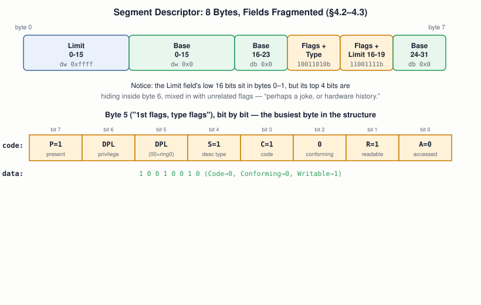
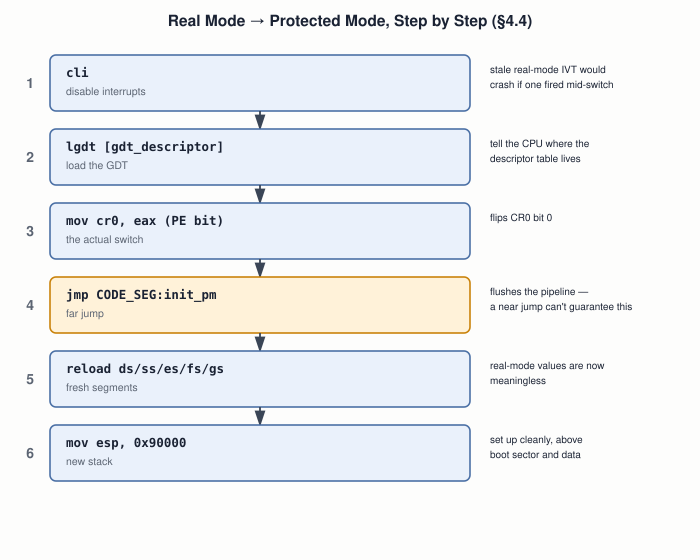

# 08 — Real Mode, Protected Mode, and Long Mode

## Layer map for this file

```
┌────────────────────────────────────────────────┐
│ 1. BOOK: real mode's limits (§3.2), why BIOS   │
│    stops working (§4.1), the GDT (§4.2–4.3),   │
│    the full switch sequence (§4.4–4.5)         │
├────────────────────────────────────────────────┤
│ 2. SUPPORTING: privilege rings, the null-      │
│    descriptor-as-safety-net pattern, why       │
│    pipelining forces a far jump                │
├────────────────────────────────────────────────┤
│ 3. MODERN: long mode's real requirements, and  │
│    why most of this GDT ceremony is vestigial  │
│    on a modern 64-bit Linux box                │
└────────────────────────────────────────────────┘
```

Book coverage: **Full** for real/protected mode (all of Ch.4). **None**
for long mode.

## Prerequisites

Files `01`–`07`.

---

## [BOOK] Why BIOS Stops Working the Moment You Switch (§4.1)

BIOS's own routines are 16-bit real-mode code — calling them after the
switch means they'll misinterpret your new GDT-based segments and
likely crash the machine. Consequence: **a protected-mode OS must
write its own driver for every device**, starting with the screen —
writing directly to memory-mapped VGA text memory at `0xb8000`
(2 bytes per cell: ASCII + attribute), instead of `int 0x10`.

## [BOOK] The GDT: A Completely Different Mechanism (§4.2–4.3)

A segment register stops being a multiplier (file `09`) and becomes an
**index into the Global Descriptor Table**. Each 8-byte entry:



The book's own **basic flat model**: code and data segments fully
overlapping, covering all 4 GB — zero real protection, no paging,
deliberately minimal. The **null descriptor** (first entry, 8 zero
bytes) is mandatory: any accidental use of segment 0 raises a CPU
exception instead of silently misbehaving — a CPU exception in the
interrupt-mechanism sense (file `14`), explicitly *not* the same idea
as a Java exception, same word, different thing.

## [BOOK] Making the Switch (§4.4–4.5)



The full §4.5 boot sector chains this together: print "Started in
16-bit Real Mode" via BIOS, switch, land in 32-bit code, print
"Successfully landed in 32-bit Protected Mode" via direct VGA writes,
hang. **Both messages printing is the proof the switch worked** — one
could only come from BIOS, the other only from code that doesn't use
it at all.

---

## [CORE CONCEPT] Privilege Rings, Named for the First Time

The descriptor's privilege field (0–3) is your first concrete look at
x86 rings. The book uses ring 0 exclusively — building a real ring 3
(file `21`) is one of the biggest "beyond the book" undertakings in
the capstone.

## [CORE CONCEPT] "Protected" Doesn't Mean "Automatically Protected"

The book's own flat model gives **zero** real protection — overlapping
segments, everything at ring 0. Protection is something you configure
deliberately; files `21`–`22` pick this up for real.

## [CORE CONCEPT] The Null Descriptor Is a Design Pattern

"Reserve slot zero so a forgotten initialization fails loudly" recurs
later: a deliberately unmapped page at virtual address 0 is exactly
why dereferencing a null pointer in C faults cleanly (file `22`)
instead of silently corrupting memory.

---

## [RELATED KNOWLEDGE] Real Mode Is Mostly, Not Entirely, One-Way

`CR0`'s PE bit *can* be cleared to return to real mode, and "unreal
mode" tricks exist. Not needed elsewhere in this course — just worth
not overclaiming irreversibility.

## [RELATED KNOWLEDGE] Control Registers vs. MSRs

`CR0`–`CR4` are architectural, loaded with `mov`. Long mode needs
something from a different, larger category — **Model-Specific
Registers**, accessed only via `rdmsr`/`wrmsr`. The one that matters:
`EFER`.

---

## [MODERN SYSTEM] Long Mode's Real Requirements

Paging is **mandatory** for long mode — the book's protected mode runs
fine unpaged; long mode cannot.

```
Protected mode (unpaged, as the book leaves it)
   → build minimal page tables
   → enable PAE (CR4 bit)
   → load CR3 with the page table base
   → set EFER's LME bit (via wrmsr, not mov)
   → enable paging (CR0's PG bit)
   → far jump into a 64-bit code segment
   → true long mode
```

Every x86-64 Linux machine performs some version of this, every boot
— file `22` builds the page tables that make it possible.

## [MODERN SYSTEM] Most of This GDT Ceremony Is Now Vestigial

On a running 64-bit Linux system, long mode forces `cs`/`ds`/`es`/`ss`
bases to `0` and limits to maximum — segmentation for general memory
access is effectively off. Only `fs`/`gs` survive, repurposed for
thread-local storage. **Paging does the real protection work today**
(file `22`), not the GDT. You needed the GDT to get *into* a mode
where paging can exist — but it's not still doing protection work on
your laptop right now.

## [MODERN SYSTEM] The TSS, Named for Later

GDT entries can also describe a **Task State Segment** — unused here
(ring 0 only), but needed the moment file `21` builds a real ring 3 →
ring 0 transition, so the CPU knows which kernel stack to switch to.

---

## [ADVANCED / BEYOND THE BOOK] Where Protection Actually Went

**SMEP**/**SMAP** stop the kernel from executing or touching user
memory even by mistake; **5-level paging** extends the address space
further. Both build on paging (file `22`), not segments.

---

## Practical Experiment

1. Assemble and boot the full §4.5 example (main file + its four
   `%include`s). **Both messages printing is your proof.**
2. In Bochs's debugger: breakpoint right after `mov cr0, eax`, inspect
   `cr0` (PE bit flipped), step the far jump, confirm `cs = 0x8`.
3. **Break it on purpose:** change the far jump to a near one, boot,
   observe the failure — anything from a hang to a full reset is
   expected.
4. **Corrupt the null descriptor** (nonzero bytes) and re-run the
   working version — notice nothing visibly changes, because correct
   code never accidentally uses segment 0.

## Debugging

A **triple fault** — an exception during exception handling that
itself fails, forcing a full reset — is this file's signature failure
mode. Checklist: missing `cli`? Wrong `CODE_SEG`/`DATA_SEG` offset?
Near jump instead of far? Forgot to reload segment registers after the
jump? Bochs's debugger (`b`, `s`, `info registers`, `sreg`) is the
right tool for all four — the direct ancestor of file `27`'s GDB
workflow.

## Source Code

The full §4.5 example, plus your broken-near-jump and
corrupted-null-descriptor variants — a matched correct/broken set.

---

## Common Misconceptions

- **"Protected mode automatically protects your program."** The
  book's flat model gives zero real protection.
- **"The far jump is just how you 'go to' the new code."** It exists
  specifically to flush the pipeline — a near jump doesn't guarantee this.
- **"CR0 is all you need for any mode switch."** Long mode also needs
  paging active first and a bit set in an MSR — a different register
  category entirely.

## Interview Questions

**Basic:** Which single bit, in which register, switches real mode to
protected mode?
**Intermediate:** Why is the null descriptor mandatory, and what
happens if it's used?
**Advanced:** Why must the jump after enabling protected mode be far,
not near?
**Systems Design:** Using only the GDT (no paging), how would you
configure segments for genuine protection — what would it cost?
**Debugging:** A protected-mode switch triple-faults — three specific
things to check?
**Explain what happens when...:** an x86-64 Linux machine boots,
through real, protected, and long mode?

## Active Recall

1. Why does BIOS stop working after the switch?
2. What does the null descriptor guard against?
3. The switch sequence, in order, with each step's reason.
4. What does long mode require that the book's protected mode doesn't?

## Answers

1. BIOS is 16-bit real-mode code; it will misinterpret the new
   GDT-based segments and likely crash.
2. A forgotten/stale segment register accidentally left at index 0 —
   using it deliberately raises an exception instead of silent
   misbehavior.
3. `cli` (avoid stale-IVT interrupt) → `lgdt` → set `CR0` PE bit → far
   jump (flush pipeline) → reload segment registers → new stack → hand
   off to 32-bit code.
4. Paging active beforehand (mandatory, not optional), plus a bit in
   the `EFER` MSR.

---

## What You Should Now Understand

- Why BIOS breaks after the switch, and what a protected-mode OS must
  do about it.
- The GDT's real byte-level structure, and why "protected" isn't
  "automatically protected."
- The full switch sequence, verified live in an emulator.
- That most of this GDT ceremony is vestigial on a real 64-bit Linux
  machine today — paging does the actual work.

---

**Next:** file `09-memory-and-addressing.md`.
