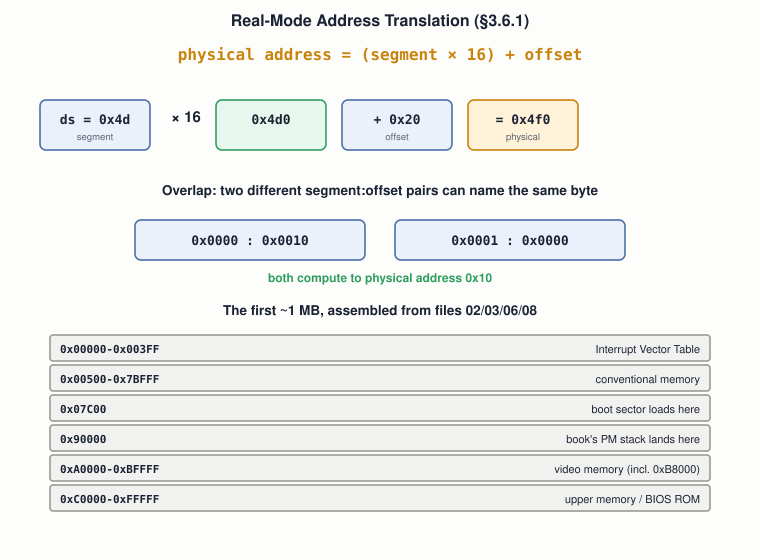

# 09 — Memory and Addressing

## Layer map for this file

```
┌────────────────────────────────────────────────┐
│ 1. BOOK: real-mode segment:offset in full      │
│    (§3.6.1) — including a third, proper        │
│    resolution of file 05's puzzle              │
├────────────────────────────────────────────────┤
│ 2. SUPPORTING: logical vs. linear vs. physical │
│    address as precise, distinct terms          │
├────────────────────────────────────────────────┤
│ 3. MODERN: paging collapses this whole story   │
│    into one step; the A20 line                 │
└────────────────────────────────────────────────┘
```

Book coverage: **Full** for real-mode addressing. This file does
**not** re-teach the GDT — that's file `08` — it exists to give
real-mode addressing its own treatment and line both schemes up
side by side.

## Prerequisites

Files `01`–`08`.

---

## [BOOK] The Formula, and Why It Exists (§3.6.1)

Every register tops out at `0xffff` — 64 KB max. The 8086's fix: four
segment registers (`cs`,`ds`,`ss`,`es`) combine with an offset:



**Genuine CPU restriction:** `mov ds, 0x1234` is illegal — segment
registers load only from another register, never an immediate
directly.

## [BOOK] Resolving File 05's Puzzle a Third Way

```asm
mov ax, 0x7c0
mov ds, ax
mov al, [the_secret]   ; correct — no [org], no manual add
```

`0x7c0 × 16 = 0x7c00` — same destination as file `05`'s two other
solutions, a third tool for getting there.

## [BOOK] Overlap: The Confusing Part

Since a segment always starts at a multiple of 16, incrementing it by
1 only moves the start by 16 bytes — so `0x0000:0x0010` and
`0x0001:0x0000` name the *same* physical byte. No canonical
representation exists.

## [BOOK] The Ceiling

Largest segment (`0xffff`) × 16 + largest offset (`0xffff`) =
`0x10ffef` — a little over 1 MB. Exactly why file `08`'s protected
mode needed a completely different mechanism.

---

## [CORE CONCEPT] Three Precise Names for an Address

- **Logical (segmented) address** — what your instruction names:
  segment:offset (real mode) or selector:offset (protected mode).
- **Linear address** — the result of segment translation alone,
  *before* paging.
- **Physical address** — what finally hits the memory bus, after
  paging (if active) translates the linear address again.

The book never uses paging — so in every one of its examples, **linear
= physical**, always. That distinction only becomes unavoidable once
file `22` turns paging on.

---

## [RELATED KNOWLEDGE] The Segment-Register Restriction's Origin

Traces to the 8086's own instruction encoding — segment loads were a
more restricted category from the first x86 chip on, kept ever since
for compatibility (file `04`, again, in miniature).

## [RELATED KNOWLEDGE] The "640K" Legend

Real mode's ~1 MB ceiling — a direct consequence of this formula, not
an arbitrary choice — is the same fact behind the famous "conventional
memory" limitation that shaped early PC software.

---

## [MODERN SYSTEM] Paging Collapses the Whole Story

File `08` already noted x86-64 forces segment bases to `0`. Combined
with mandatory paging, logical and linear addresses become the same
value — the only real translation left is **virtual → physical, via
paging alone**. One step, instead of the book's two historical
schemes. See it directly: `cat /proc/self/maps` — every address there
is virtual; no segment:offset step exists at all.

## [ADVANCED / BEYOND THE BOOK] The A20 Line

Early 8086-compatible chips wrap real-mode addresses at the 1 MB mark
by default (a specific address line disabled for backward
compatibility) — almost every other OS-dev tutorial has to "enable
A20" to access memory above 1 MB from real mode. The book's finished
examples never touch memory above 1 MB, which is almost certainly why
this never comes up in the draft.

---

## Practical Experiment

1. Hand-verify `0x4d × 16 + 0x20 = 0x4d0`.
2. Assemble the segment-register resolution of "find the byte" —
   confirm it prints `'X'` with neither `[org]` nor a manual add.
3. Prove the overlap claim: write through `0x0000:0x0100`, read back
   through `0x0010:0x0000`, in Bochs or QEMU — same byte.
4. `cat /proc/self/maps` on your own machine — no segment:offset in
   sight anywhere.

## Debugging

"I wrote to address X but it didn't change" is almost never a failed
write — it's a *different* segment register than assumed being in
effect (data defaults to `ds`, strings often `es`, stack always `ss`,
invisible in the instruction text unless overridden explicitly). Check
which register a given instruction defaults to, not your arithmetic.

## Source Code

The segment-register "find the byte" solution, and the overlap-proof
program — alongside file `05`'s two other solutions.

---

## Common Misconceptions

- **"A physical address has one canonical segment:offset form."**
  False — the ×16 overlap means many pairs alias one address.
- **"Segment registers load like general-purpose ones."** False —
  `mov ds, <immediate>` is illegal.
- **"Logical, linear, and physical are three names for one thing."**
  Only when paging is off. Once it's on (file `22`), they diverge for real.

## Interview Questions

**Basic:** The exact real-mode address translation formula?
**Intermediate:** Why can two different segment:offset pairs name the
same byte?
**Advanced:** Linear vs. physical address — why does the book never
need to distinguish them?
**Systems Design:** Retrofitting more addressable memory onto a
16-bit-register CPU — segmentation, or something else? What does
overlap cost you?
**Debugging:** `mov [0x20], ax` doesn't seem to take — first thing to check?
**Explain what happens when...:** `mov ax, [0x20]` executes, down to
the physical memory access?

## Active Recall

1. The formula.
2. Why `mov ds, 0x1234` is illegal.
3. Two segment:offset pairs that alias the same address.
4. The real-mode ceiling, and why that exact number.

## Answers

1. `physical = (segment × 16) + offset`.
2. Segment registers only load from another register, never an
   immediate directly.
3. `0x0000:0x0100` and `0x0010:0x0000` — both `0x100`.
4. ~1 MB (`0x10ffef`) — largest segment (`0xffff`) × 16 + largest
   offset (`0xffff`).

---

## What You Should Now Understand

- The real-mode formula, cold, plus the specific CPU restriction on
  segment loads.
- Precise logical/linear/physical vocabulary — and exactly where they
  diverge.
- The real-mode memory map, assembled from files `02`/`03`/`06`/`08`.
- Why a modern system's addressing story is simpler than the book's —
  one step, via paging alone.

---

**Next:** file `10-stack-heap-and-calling-conventions.md`.
