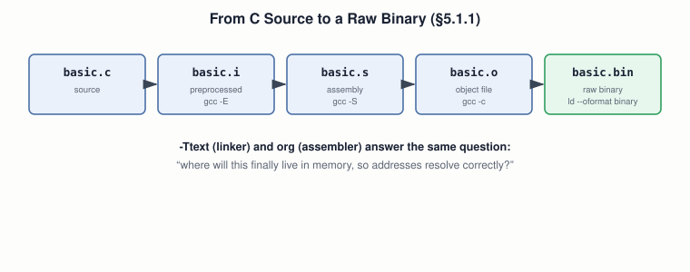

# 11 — C Compilation and Machine Code

## Layer map for this file

```
┌─────────────────────────────────────────────────┐
│ 1. BOOK: compiler → object file → linker →      │
│    raw binary, using the book's own basic.c     │
│    (§5.1.1)                                     │
├─────────────────────────────────────────────────┤
│ 2. SUPPORTING: the pipeline's real stages,      │
│    relative vs. absolute addresses,             │
│    -ffreestanding as standardized C terms       │
├─────────────────────────────────────────────────┤
│ 3. MODERN: raw-binary extraction still ships    │
│    real bootloaders; Compiler Explorer          │
└─────────────────────────────────────────────────┘
```

Book coverage: **Full** (§5.1.1). Sequencing note: file `10` already
ran `gcc -c`/`objdump -d` before this file explains what those do —
a deliberate reordering; this file now fills that gap in.

## Prerequisites

Files `01`–`10`.

---

## [BOOK] From C to a Raw Binary



```c
int my_function() { return 0xbaba; }
```

**Compile:** `gcc -ffreestanding -c basic.c -o basic.o` — an object
file is *annotated* machine code: real bytes, plus **relative**
addresses a later linking step needs.

**Look inside** (`objdump -d basic.o`, AT&T syntax — file `03`'s
warning, now on your first real object file):
```
push %ebp
mov %esp,%ebp
mov $0xbaba,%eax
pop %ebp
ret
```

**Link to a raw binary:** `ld -o basic.bin -Ttext 0x0 --oformat binary
basic.o` — a linker's job is to stitch object files together and
convert every relative reference into a final absolute one. The book
is explicit about *why* raw binary: a normal OS-hosted executable
deliberately *keeps* metadata (so a crash reporter can say "line 3 of
basic.c" instead of "address 0x12345678") — but a bare CPU has no
concept of metadata at all; it executes every byte, headers included.
`--oformat binary` strips everything but pure, executable bytes.

**Disassemble the result** (`ndisasm -b 32 basic.bin`) — the same five
instructions, now in the NASM-like form you already know from file
`10`. What matters here isn't the instructions — it's the **pipeline**
that produced them.

---

## [CORE CONCEPT] The Pipeline, Named in Full

`gcc -c` hides three stages in one command:

```
source.c → [preprocess: gcc -E] → source.i
         → [compile: gcc -S]    → source.s (assembly)
         → [assemble: gcc -c]   → source.o (object file)
         → [link: ld]           → final binary
```

## [CORE CONCEPT] `-Ttext` Is the Linker's `org`

`[org 0x7c00]` (file `05`) and `-Ttext 0x0` answer the exact same
question — "where will this finally live, so addresses resolve
correctly?" — at two different tool stages: assembler vs. linker.

## [CORE CONCEPT] `-ffreestanding`: Standardized C, Not a GCC Quirk

The C standard itself distinguishes a **hosted** implementation
(assumes a standard library and OS) from a **freestanding** one
(assumes neither) — exactly right for a kernel, bootloader, or
firmware.

---

## [RELATED KNOWLEDGE] "elf32-i386" Wasn't Decoration

`objdump`'s output already named the real format GCC produced: **ELF**
— the Linux standard to this day. File `12` opens up its actual
internal structure.

## [RELATED KNOWLEDGE] Disassembly as Legitimate Reverse Engineering

The book notes, accurately, that anyone can disassemble a binary with
no source at all — mainstream, legitimate work in security research
and understanding legacy code, not a niche use of what you just learned.

---

## [MODERN SYSTEM] Raw Binary Extraction Still Ships Real Products

`--oformat binary` isn't a historical curiosity — real bootloaders
(parts of GRUB itself) and embedded firmware still extract raw
binaries exactly this way today, for exactly the book's reason: no OS
underneath to interpret anything richer.

## [MODERN SYSTEM] Compiler Explorer

Everything §5.1.1 does by hand has a modern, instant, web-based
version: **godbolt.org** — paste C, pick a compiler/architecture/
optimization level, watch the assembly update live.

## [MODERN SYSTEM] Real OS-Dev Usually Cross-Compiles

The book uses the host `gcc` plus `-ffreestanding`. A longer-lived
project typically builds a dedicated cross-compiler (`i686-elf-gcc`)
to make host-OS assumptions structurally impossible to pull in by
accident.

---

## [ADVANCED / BEYOND THE BOOK] Link-Time Optimization

Modern toolchains blur the clean "compile separately, then link"
picture — **LTO** defers optimization until link time, enabling
cross-file inlining a per-file compile step can't see.

---

## Practical Experiment

1. Reproduce the full pipeline exactly (commands above); confirm each
   stage's output.
2. Compile a version of `basic.c` that calls `printf` with
   `-ffreestanding` — expect a linker error (no standard library
   assumed). Remove the flag — links cleanly.
3. Pull the hidden stages apart: `gcc -E`, `gcc -S`, `gcc -c basic.s`
   — compare `basic.s` directly against `objdump -d basic.o`.
4. Link the same object file at two addresses (`-Ttext 0x0` vs.
   `-Ttext 0x7c00`); `diff` the results on a version with a global
   variable, where embedded addresses should actually shift.

## Debugging

**"Undefined reference to X"** is now fully explainable: the linker
found a relative reference to `X` but no definition anywhere it was
given — either the defining file wasn't compiled in, or (as in the
experiment above) `X` was never going to exist under
`-ffreestanding`. A kernel crashing immediately on boot is worth
checking against this file's `-Ttext` lesson: a mismatch with the
bootloader's actual load address breaks every baked-in absolute
address, the same way a bad `[org]` broke file `05`.

## Source Code

`basic.c`, `.o`, `.bin`, `.s`, `.i`, and the two differently-linked
binaries.

---

## Common Misconceptions

- **"An object file is already runnable."** No — relocatable, with
  unresolved relative addresses.
- **"`-ffreestanding` disables optimizations."** Unrelated concerns —
  it's about hosted-environment assumptions, not optimization level.
- **"`-Ttext` and `org` do different things."** Same problem, two tool
  stages.

## Interview Questions

**Basic:** Object file vs. final binary — what's the difference?
**Intermediate:** What does `-ffreestanding` actually change?
**Advanced:** What does linking do to a set of object files' internal
addresses?
**Systems Design:** Why hasn't `--oformat binary`-style raw extraction
become obsolete?
**Debugging:** "Undefined reference to foo" — precisely what could and
couldn't the linker do?
**Explain what happens when...:** `gcc -o program program.c` runs —
name every distinct tool involved, in order?

## Active Recall

1. What an object file has that a final binary doesn't, and vice versa.
2. What `-ffreestanding` tells the compiler not to assume.
3. The four pipeline stages and their isolating flags.
4. What `[org]` and `-Ttext` have in common.

## Answers

1. Object file: relative addresses, unresolved metadata. Final binary
   (raw): fully resolved absolute addresses, no non-executable
   metadata at all.
2. That a hosted C runtime/standard library exists.
3. Preprocess (`-E`) → compile to assembly (`-S`) → assemble (`-c`) →
   link (`ld`).
4. Both tell a tool the final load address so addresses resolve
   correctly — one at the assembler level, one at the linker level.

---

## What You Should Now Understand

- The book's full pipeline, and exactly what each command/flag does.
- The pipeline's real stages, named individually.
- Why `-Ttext` and `org` are the same idea at two tool layers.
- That raw-binary extraction is still how real bootloaders ship today.

---

**Next:** file `12-linking-loading-and-elf.md`.
