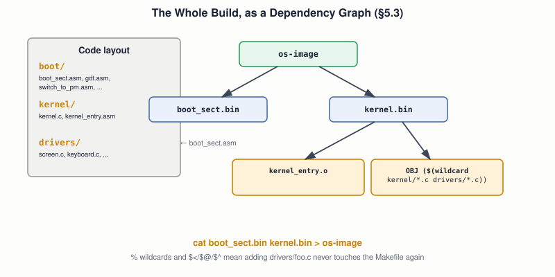

# 13 — Kernel Entry and Kernel Architecture

## Layer map for this file

```
┌────────────────────────────────────────────────┐
│ 1. BOOK: bootstrapping the kernel from disk    │
│    (§5.2.2), and the full Make-driven build,   │
│    from one rule to a real, organized code     │
│    base (§5.3–5.3.1)                           │
├────────────────────────────────────────────────┤
│ 2. SUPPORTING: why Make exists at all, what    │
│    "incremental rebuild" actually means        │
├────────────────────────────────────────────────┤
│ 3. MODERN: this course's own recurring build   │
│    commands, collected into one real tool      │
└────────────────────────────────────────────────┘
```

Book coverage: **Full** (§5.2.2, §5.3–5.3.1). File `12` already
covered *why* `kernel_entry.asm` needs to exist and be linked first;
this file covers how the kernel actually **gets onto disk and boots**,
and how the whole project's build is automated and organized.

## Prerequisites

Files `01`–`12`.

---

## [BOOK] Loading the Kernel From Disk (§5.2.2)

The boot sector's job grows by one step: after switching to protected
mode, it must first **read the kernel off disk into memory** before
it can jump to it. The book reads a generous **15 sectors** starting
right after the boot sector, into `KERNEL_OFFSET` (`0x1000`) — using
the same BIOS disk-read mechanism file `17` covers in full. Worth
noting the book's own reasoning for reading more than strictly needed:
over-reading costs nothing; **under-reading would silently truncate
the kernel** the moment it grows past whatever fixed number of sectors
was hardcoded — a small, deliberate margin against a future, easy-to-make
mistake.

## [BOOK] One Rule, Then a Real Build (§5.3)

Make's basic idea, stated simply: describe how to turn one file into
another, and let dependencies (by file modification time) decide what
actually needs rebuilding.

```make
kernel.o : kernel.c
	gcc -ffreestanding -c kernel.c -o kernel.o
```

Chained rules are where it earns its keep — running `make kernel.bin`
transitively rebuilds only what's stale:

```make
kernel.bin : kernel_entry.o kernel.o
	ld -o kernel.bin -Ttext 0x1000 kernel_entry.o kernel.o --oformat binary
kernel.o : kernel.c
	gcc -ffreestanding -c kernel.c -o kernel.o
kernel_entry.o : kernel_entry.asm
	nasm kernel_entry.asm -f elf -o kernel_entry.o
```

Edit only `kernel.c` and re-run — Make reruns exactly two commands,
not three, because `kernel_entry.o` is still current. The automatic
variables `$<` (first dependency), `$@` (the target), `$^` (all
dependencies) remove the repetition:

```make
kernel.bin : kernel_entry.o kernel.o
	ld -o $@ -Ttext 0x1000 $^ --oformat binary
kernel.o : kernel.c
	gcc -ffreestanding -c $< -o $@
```

A **phony target** doesn't build a file at all — `clean` just deletes
generated output; an `all` target at the top (Make's default with no
argument given) typically just lists the real target it should build.

## [BOOK] A Real Code Base (§5.3.1)

The book organizes the project the way Linux and Minix do:



- **`boot/`** — everything boot-sector-related: `boot_sect.asm`,
  `gdt.asm`, `switch_to_pm.asm`, and friends.
- **`kernel/`** — `kernel.c`, `kernel_entry.asm`, and anything not
  device-specific.
- **`drivers/`** — hardware-specific code (file `16` lives here).

Two Make features make this scale without editing the Makefile every
time a new file is added:

```make
C_SOURCES = $(wildcard kernel/*.c drivers/*.c)
OBJ = ${C_SOURCES:.c=.o}

%.o : %.c ${HEADERS}
	gcc -ffreestanding -c $< -o $@
```

`$(wildcard ...)` finds every matching source file automatically;
`${C_SOURCES:.c=.o}` derives the object-file list by substitution; the
`%.o : %.c` **pattern rule** replaces one explicit rule per file with
a single generic one. Add `drivers/keyboard.c` later (file `16`) and
the Makefile needs zero changes. The final assembly step:

```make
os-image : boot/boot_sect.bin kernel.bin
	cat $^ > os-image
```

— the whole operating system, at this stage, is just the concatenation
of two binaries: the boot sector, then the kernel, one after the other
on disk.

---

## [CORE CONCEPT] What "Incremental Build" Actually Checks

Make's entire mechanism is one comparison: a target's file
**modification timestamp** against its dependencies'. Older or
missing target → rebuild; newer → skip. No understanding of what
changed *inside* a file — purely a timestamp check, which is also
exactly why touching a file with no real changes (`touch kernel.c`)
still triggers a rebuild.

---

## [MODERN SYSTEM] Your Own Build Commands, Collected

Nearly every practical experiment since file `05` has been typing a
handful of `nasm`/`gcc`/`ld` commands by hand. This file's Makefile is
where those commands stop being retyped and become one call:
`make run`. Real projects (including this course's own eventual
capstone, file `38`) almost never hand-type a multi-step build more
than a few times before automating it exactly this way — Make is
still in wide use today, alongside newer tools (CMake, Ninja, Cargo,
etc.) built on the same dependency-graph idea.

---

## Practical Experiment

1. Write the single `kernel.o : kernel.c` rule, run `make kernel.o`
   twice in a row — see the second run report nothing to do.
2. Build the chained three-rule version; edit only `kernel.c`; confirm
   Make reruns exactly two of the three commands.
3. Rewrite it using `$<`/`$@`/`$^`, confirm identical behavior.
4. Reorganize your own files into `boot/`/`kernel/`/`drivers/`, write
   the wildcard + pattern-rule Makefile, add a trivial second C file to
   `drivers/`, and confirm it gets picked up with **zero** Makefile edits.
5. `make run` — the whole pipeline from source to a booted QEMU/Bochs
   session, one command.

## Debugging

A stale build masquerading as a code bug is a real, recurring
annoyance: if Make's timestamp comparison is fooled (a clock skew, a
dependency listed incorrectly), you can debug code that isn't actually
what's running. `make -n` (dry run — print commands without executing)
and `rm -fr *.o *.bin && make` (nuke and rebuild) are the two fastest
ways to rule this out before chasing a phantom bug.

## Source Code

Your own `boot/`, `kernel/`, `drivers/` layout and Makefile — this is
the scaffold every later file's driver/kernel code will drop into.

---

## Common Misconceptions

- **"Make understands what changed inside a file."** No — purely a
  modification-timestamp comparison against dependencies.
- **"Reading extra, unused disk sectors for the kernel is wasteful."**
  The book's own reasoning: it's free insurance against a kernel that
  later outgrows a hardcoded sector count.
- **"A phony target like `clean` is a real file Make tracks."** It's
  never actually created — Make just runs its commands whenever
  invoked.

## Interview Questions

**Basic:** What comparison does Make actually perform to decide
whether to rebuild a target?
**Intermediate:** What do `$<`, `$@`, and `$^` each expand to?
**Advanced:** Why does the book deliberately read more disk sectors
than the current kernel needs?
**Systems Design:** What would you lose by hardcoding every object
file explicitly instead of using `$(wildcard ...)` and pattern rules?
**Debugging:** `make` reports "nothing to do" but your code change
clearly isn't reflected in the running binary — what's your first move?
**Explain what happens when...:** you run `make run` on the book's
final Makefile, from the first command executed to Bochs opening?

## Active Recall

1. What single comparison does Make use to decide what to rebuild?
2. What do `boot/`, `kernel/`, and `drivers/` each hold?
3. Why read 15 sectors for a kernel that currently fits in far fewer?
4. What does `os-image : boot/boot_sect.bin kernel.bin` followed by
   `cat $^ > os-image` actually produce?

## Answers

1. Whether the target's file is older than (or missing relative to)
   its listed dependencies, by modification timestamp.
2. `boot/`: boot-sector assembly. `kernel/`: the kernel's main code
   and non-device-specific logic. `drivers/`: hardware-specific code.
3. To avoid silently truncating the kernel later, once it grows beyond
   whatever number of sectors was hardcoded — over-reading costs
   nothing now.
4. The two compiled binaries concatenated, byte for byte, into one
   disk image — the boot sector first, the kernel immediately after.

---

## What You Should Now Understand

- How the kernel actually gets from disk into memory and control.
- Make's real mechanism (timestamps, not content understanding), and
  why chained rules, automatic variables, wildcards, and pattern rules
  each earn their place.
- The book's own code organization, which every later driver/kernel
  file in this course now has a home in.

---

**Next:** file `14-interrupts-exceptions-and-traps.md`.
