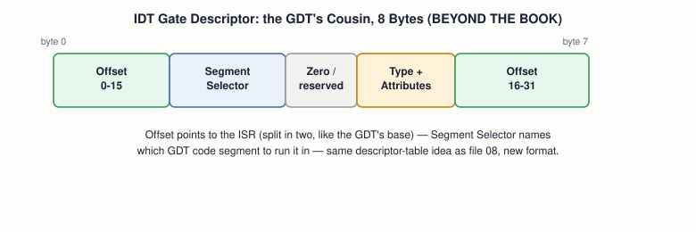

# 14 — Interrupts, Exceptions, and Traps

## Layer map for this file

```
┌─────────────────────────────────────────────────┐
│ 1. BOOK: real-mode software interrupts (§3.3.1  │
│    already covered, files 03/05/06) — §6.3      │
│    "Handling Interrupts" is a section HEADING   │
│    with NO body text in the draft               │
├─────────────────────────────────────────────────┤
│ 2. BEYOND THE BOOK: the IDT, the 8259 PIC and   │
│    why it must be remapped, a real ISR          │
├─────────────────────────────────────────────────┤
│ 3. MODERN: APIC/IOAPIC, MSI, Linux's IRQ        │
│    subsystem                                    │
└─────────────────────────────────────────────────┘
```

**Book coverage: Stub.** This is the first file where that matters a
great deal. Blundell's Chapter 1 promises "device drivers" as a course
goal (file `01`); the Chapter 6 table of contents lists §6.3 "Handling
Interrupts" right after the finished screen driver — and the section
is empty. Nothing below claiming to build a real interrupt handler is
Blundell's — it's built the way the book's own draft would have had
to, using standard x86 references, clearly separated from what's
actually in the PDF.

## Prerequisites

Files `01`–`13`.

---

## [BOOK] What the Book Actually Gives You Here

Two seeds, both already used elsewhere: the real-mode **interrupt
vector table** at physical address `0` (files `02`, `03`) and
`int 0x10`/`int 0x13` as **software interrupts** — a program
deliberately requesting a BIOS service (files `03`, `06`). File `08`
added one more fragment: triggering the null descriptor "raises a CPU
exception... not to be confused with exceptions in a language like
Java" — naming the mechanism, once, without ever building a handler
for it. That's the complete inventory. Nothing about a 32-bit IDT, a
PIC, or an ISR appears anywhere in the finished draft.

---

## [BEYOND THE BOOK] The IDT: Protected Mode Needs Its Own Table

The real-mode IVT is a simple array of far pointers at a fixed
address — meaningless the instant you switch modes, for the same
reason BIOS's own routines break (file `08`). Protected mode needs its
own structure, built the same way the GDT was: a table of
descriptors, loaded with a dedicated instruction (`lidt`, the `lgdt`
of interrupts).



Each entry points to a handler routine (split across two offset
fields, same fragmentation idea as the GDT's base address) and names
which GDT code segment to run it in — the interrupt mechanism and the
protected-mode mechanism from file `08`, wired together.

## [BEYOND THE BOOK] The 8259 PIC and the Collision That Forces Remapping

This is the single most notorious early-OS-dev gotcha, and Blundell's
book — by never getting here — is one of the few tutorials in this
space that never has to warn you about it:


The **8259 Programmable Interrupt Controller** ships, by default,
mapping hardware IRQ lines onto interrupt vectors 8–15 — vectors the
CPU itself permanently reserves for exceptions (8 = double fault, 13 =
general protection, 14 = page fault). Left unconfigured, a timer tick
(IRQ0) and a double fault would trigger the *exact same* interrupt
vector. **Remapping** means reprogramming the PIC, via its command and
data I/O ports (file `15`), to use vectors 32–47 instead — done once,
during setup, before any hardware interrupt is ever unmasked.

## [BEYOND THE BOOK] A Real ISR's Shape

An interrupt can occur between *any* two instructions — unlike a
function call, an ISR has no idea what the interrupted code was doing.
Its shape reflects that:

```
1. Save every register that might be in use (nothing can be assumed)
2. Run the actual handler logic (often just calling into C)
3. Restore every register, exactly
4. Send an End-Of-Interrupt (EOI) to the PIC — or it won't fire again
5. iret  — not ret
```

`iret` pops three things (instruction pointer, code segment, *and*
flags) instead of `ret`'s one, precisely because an interrupt can
land mid-instruction-stream and must restore the exact CPU state that
existed the moment it fired, flags included.

---

## [RELATED KNOWLEDGE] The Full Taxonomy

- **Hardware interrupt** — a device signals the CPU asynchronously (a
  key press, a timer tick).
- **Software interrupt** — deliberate, via `int n` (`int 0x10`, file `03`).
- **Exception** — the CPU itself signals a problem executing the
  current instruction (divide-by-zero, invalid opcode).
- **Fault** — an exception where the faulting instruction can be
  retried after the handler runs (a page fault, file `22`, is the
  canonical example).
- **Trap** — an exception reported *after* the instruction completes.
- **Abort** — severe enough that the faulting instruction generally
  can't be identified or resumed at all.

## [RELATED KNOWLEDGE] Masking

`cli`/`sti` (file `08` already used `cli`) toggle the CPU's interrupt
flag — masking hardware interrupts entirely for genuinely critical
sections, at the cost of missing anything that would have fired during
that window if it isn't held pending.

---

## [MODERN SYSTEM] The PIC's Modern Replacement

Modern systems use the **APIC** (Advanced PIC) and **IOAPIC**, offering
far more vectors, per-CPU targeting (essential once file `24`'s
multiple cores exist), and priority handling the 8259 never had. The
legacy PIC is often still present and initialized first, purely for
backward compatibility, before a modern kernel switches to the APIC.

## [MODERN SYSTEM] Linux's IRQ Subsystem

A driver calls `request_irq()` to register a handler; `/proc/interrupts`
shows live counts per IRQ line and CPU — the direct, practical
descendant of this file's ISR concept, at production scale. **MSI/
MSI-X** (Message-Signaled Interrupts) let a PCIe device skip physical
IRQ lines entirely, instead writing to a specific memory address to
signal the CPU directly — the modern default for most fast devices.

---

## [ADVANCED / BEYOND THE BOOK] Deferred Work

Real kernels split interrupt handling into a fast, minimal top half
(exactly what this file describes) and **deferred work** — softirqs,
tasklets, or threaded IRQs — that runs the expensive parts later,
outside the interrupt context, to keep interrupts-disabled windows as
short as possible. **Interrupt storms** and **IRQ affinity** (pinning
an interrupt to a specific CPU core) are real production concerns
built entirely on top of what this file covers.

---

## Practical Experiment

1. Build a minimal IDT (even just a few entries pointing at a single
   generic handler) and load it with `lidt` in your protected-mode
   kernel from file `13`.
2. Remap the PIC using the standard command/data port sequence (file
   `15` gives you the port I/O primitives) — verify by deliberately
   *not* remapping first and observing a spurious/incorrect vector
   fire, then fixing it.
3. Write one ISR stub in assembly (save registers, call a C function
   that just increments a counter, restore registers, send EOI, `iret`).
4. On a real Linux machine: `cat /proc/interrupts` — watch specific
   counters increase as you move the mouse or type.

## Debugging

An unhandled or misconfigured interrupt is one of the fastest routes
to a **triple fault** (file `08`) in a hobby kernel — an interrupt
fires with no valid IDT entry, or an ISR forgets to send EOI (the PIC
never fires that line again), or forgets `iret` (execution never
correctly resumes). Bochs's debugger remains the right tool: single-step
through the transition into and out of a handler, exactly as file
`08` did for the protected-mode switch.

## Source Code

Your minimal IDT setup, PIC remap routine, and one generic ISR stub —
genuinely new code with no book original to check it against.

---

## Common Misconceptions

- **"Interrupts and exceptions are the same mechanism with different
  names."** Related, but distinct triggers — one external and
  asynchronous, one internal to the currently executing instruction.
- **"You can just reuse `ret` at the end of an interrupt handler."**
  No — `iret` restores flags too, and skipping it leaves CPU state
  wrong for whatever runs next.
- **"The PIC's default vector assignment is just a minor
  inconvenience."** It's a direct collision with reserved CPU
  exception vectors — unusable until fixed, not merely suboptimal.

## Interview Questions

**Basic:** Difference between a hardware interrupt and a software interrupt?
**Intermediate:** Why must the 8259 PIC be remapped before use?
**Advanced:** Why does `iret` restore three things where `ret`
restores one?
**Systems Design:** Why do modern systems still initialize the legacy
PIC before switching to the APIC, instead of skipping it entirely?
**Debugging:** An ISR runs once and then never fires again — what did
it forget?
**Explain what happens when...:** a keyboard key is pressed, from the
electrical signal through to a running handler?

## Active Recall

1. What does the book actually give you toward this topic, and what
   does it not?
2. Why do IRQ0-7's default vectors collide with something important?
3. What does remapping actually change?
4. Why does an ISR need `iret`, not `ret`?

## Answers

1. Real-mode software interrupts and the IVT, plus one passing mention
   of "CPU exception" — no IDT, PIC, or ISR anywhere in the draft.
2. They default to vectors 8–15, which the CPU permanently reserves
   for its own exceptions (double fault, general protection, page fault).
3. It reprograms the PIC (via I/O ports) to use vectors 32–47 for
   hardware IRQs instead, leaving 0–31 exclusively for CPU exceptions.
4. An interrupt can land between any two instructions; `iret` restores
   the instruction pointer, code segment, *and* flags — the full state
   `ret` alone can't recover.

---

## What You Should Now Understand

- Exactly how much of this topic the book covers (very little) and
  where the real content in this file comes from instead.
- The IDT as the GDT's cousin, and why protected mode needs its own
  interrupt table at all.
- The PIC remapping collision — the single most notorious early-OS-dev
  gotcha, and why Blundell's book never has to mention it.
- A real ISR's shape, and why `iret` is not optional.

---

**Next:** file `15-device-io-and-dma.md`.
