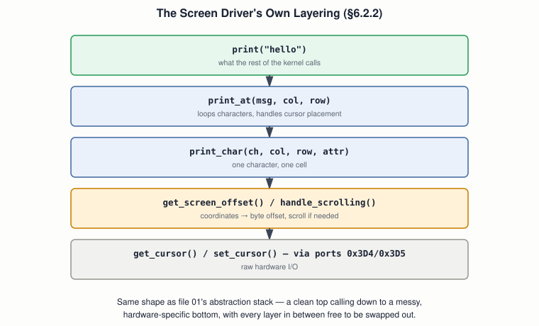

# 16 — Device Drivers

## Layer map for this file

```
┌─────────────────────────────────────────────────┐
│ 1. BOOK: the complete, working screen driver,   │
│    print()/print_at()/print_char()/             │
│    clear_screen(), and VGA cursor control via   │
│    ports (§6.2.1–6.2.2) — §6.4 "Keyboard        │
│    Driver" and §6.5 "Hard-disk Driver" are      │
│    section HEADINGS with no body text           │
├─────────────────────────────────────────────────┤
│ 2. BEYOND THE BOOK: a real keyboard driver —    │
│    IRQ1, scancodes, a translation table         │
├─────────────────────────────────────────────────┤
│ 3. MODERN: the Linux driver model, character    │
│    vs. block devices                            │
└─────────────────────────────────────────────────┘
```

Book coverage: **Full** for the screen driver. **Stub** for keyboard
and disk — the draft's table of contents names both; the body text
for both is empty.

## Prerequisites

Files `01`–`15`.

---

## [BOOK] The Screen Driver, Layer by Layer

The book explicitly frames the goal: stop scattering `0xb8000` writes
through kernel code (file `08`'s approach) and build a real
abstraction — `print("hello")`, `clear_screen()` — that hides the
hardware entirely and could be swapped for a different display driver
later without touching the rest of the kernel.



`get_screen_offset(col, row)` is pure arithmetic — row 3, column 4 is
byte offset `(3 × 80 + 4) × 2 = 488` from the start of video memory
(two bytes per cell, file `08`). `print_char` writes the character and
its attribute byte directly, using memory-mapped I/O — but the
**cursor** is different: it's a genuine hardware feature controlled
only through I/O ports, not memory.

## [BOOK] The Cursor: An Indexed-Register Pattern, Named

The VGA controller exposes far more internal registers than it has
port addresses for, so it reuses two ports as an **index/data pair**:
write a register number to the control port (`0x3D4`), then read or
write that specific register's value through the data port (`0x3D5`).
Register 14 is the cursor position's high byte, register 15 its low
byte:

```c
port_byte_out(REG_SCREEN_CTRL, 14);
int offset = port_byte_in(REG_SCREEN_DATA) << 8;
port_byte_out(REG_SCREEN_CTRL, 15);
offset += port_byte_in(REG_SCREEN_DATA);
return offset * 2;   // hardware reports characters; we track bytes
```

This index/data pattern isn't a VGA-specific trick — you'll see the
same shape again on real disk controllers (file `17`).

## [BOOK] The Full Interface, Built From These Pieces

`print_char` → `print_at` (loops characters, places the cursor) →
`print` (convenience wrapper for the common case) → `clear_screen`
(writes a blank cell everywhere, resets the cursor) — each layer doing
strictly less than the one below knows how to do, and knowing nothing
about the layer two levels down. `handle_scrolling` — the book's last
piece of finished code — shifts every row up by one row's worth of
bytes once printing reaches the bottom, clearing the newly-exposed
last row.

## [BOOK] Where the Draft Actually Stops

§6.4 "Keyboard Driver" and §6.5 "Hard-disk Driver" are, in the PDF,
section titles and nothing else. Chapter 1's promised "device drivers"
(file `01`) is delivered exactly once, for the screen — everything
below for the keyboard is constructed, not transcribed.

---

## [BEYOND THE BOOK] A Keyboard Driver's Actual Shape

A key press raises **IRQ1** (file `14`'s remapped vector 33). The
handler reads one byte — a **scancode**, not an ASCII character — from
port `0x60`. Each physical key has two scancodes: one when pressed
(**make code**) and one when released (**break code**, typically the
make code with the high bit set), which is how a driver knows the
difference between "held down" and "tapped." Translating a scancode to
a usable character is nothing more than a lookup table indexed by
scancode, tracking modifier key (shift/ctrl/alt) state separately,
since the *same* key sends different scancodes depending on keyboard
layout and scan-code set in use.

```
IRQ1 fires → read port 0x60 → scancode
   → table lookup → ASCII (or a modifier-state update)
   → send EOI (file 14) → iret
```

---

## [RELATED KNOWLEDGE] Why a Driver Interface File at All

The book splits `screen.c` (implementation) from `screen.h`
(interface) — the rest of the kernel includes only the header, so the
*implementation* is genuinely swappable without touching any calling
code. This is the concrete, small-scale version of what a real OS's
whole driver model exists to guarantee at scale.

---

## [MODERN SYSTEM] Linux's Driver Model

Linux formalizes exactly the split the book stumbled into by good
instinct: a **character device** (keyboard, serial port) transfers a
stream of bytes with no fixed block size; a **block device** (disk,
file `17`) transfers fixed-size blocks and supports seeking to an
arbitrary position. Every driver registers a set of operations (open,
read, write, ioctl) the kernel calls generically — the same
"`print()` doesn't need to know it's talking to VGA" idea, formalized
across every device category, not just the screen.

---

## Practical Experiment

1. Build the book's full screen driver into your file `13` kernel;
   print several lines past the bottom of the screen and confirm
   scrolling works.
2. Deliberately break `get_screen_offset`'s arithmetic (off-by-one in
   the row/column formula) and observe characters land in the wrong
   cell — then fix it, confirming you understand exactly what the
   formula computes.
3. Implement a minimal keyboard ISR: read port `0x60` on IRQ1, and
   just print the raw scancode's hex value to the screen (using your
   own driver!) for every key pressed — no translation table yet,
   just proving the interrupt and port read work.
4. Extend it with a small table translating a handful of scancodes
   (letter keys only) to ASCII, and print real characters as you type.

## Debugging

A "keyboard does nothing" bug almost always narrows to one of three
places: the PIC was never correctly remapped/unmasked for IRQ1 (file
`14`), the ISR never sends EOI (so it fires once and never again), or
the scancode table has the wrong indexing (off-by-one, or make vs.
break code confusion). Test each in isolation — raw scancode printing
first, translation only once that's confirmed working.

## Source Code

`drivers/screen.h`, `drivers/screen.c` (the book's own), plus your new
`drivers/keyboard.c` — dropped straight into file `13`'s wildcard-driven
build with no Makefile changes needed.

---

## Common Misconceptions

- **"A keyboard sends ASCII characters."** It sends scancodes — raw,
  keyboard-layout-and-hardware-specific codes; ASCII translation is
  entirely the driver's job.
- **"The cursor is just another memory-mapped write, like a
  character."** It's a genuine hardware register, reached only via
  the index/data port pair — not part of the `0xb8000` memory range.
- **"Splitting a `.h` from a `.c` is just a style convention."** It's
  what makes the implementation swappable at all without touching
  every caller — the same reason the book bothers to do it.

## Interview Questions

**Basic:** What's the difference between a make code and a break code?
**Intermediate:** Why does the VGA cursor need two ports instead of one?
**Advanced:** Walk the full path from a keypress to a printed character.
**Systems Design:** Why does Linux split character devices from block
devices instead of one generic "device" interface?
**Debugging:** A keyboard driver's interrupt fires exactly once, then
never again — most likely cause?
**Explain what happens when...:** you press a letter key on a real
Linux machine, from the electrical signal to the character appearing
in a terminal?

## Active Recall

1. What does the book actually deliver for "device drivers," versus
   what it promises?
2. What formula converts (col, row) to a video memory offset?
3. What's the index/data port pattern, and where does the book use it?
4. What's the difference between a scancode and ASCII?

## Answers

1. A complete, working screen driver; keyboard and disk driver
   sections exist only as empty headings.
2. `(row × 80 + col) × 2`.
3. Write a register number to a control port, then read/write that
   register's value through a separate data port — used for VGA cursor
   control (ports `0x3D4`/`0x3D5`).
4. A scancode is a raw, hardware/layout-specific code identifying a
   physical key event (press or release); ASCII is a character
   encoding the driver must translate scancodes into.

---

## What You Should Now Understand

- The book's screen driver as a complete, real example of layered
  abstraction — the same shape as file `01`'s stack, in ~80 lines of C.
- The index/data port pattern, which recurs on real hardware beyond VGA.
- Exactly where the book stops delivering on "device drivers," and
  what a real keyboard driver needs that the draft never builds.

---

**Next:** file `17-storage-and-block-io.md`.
