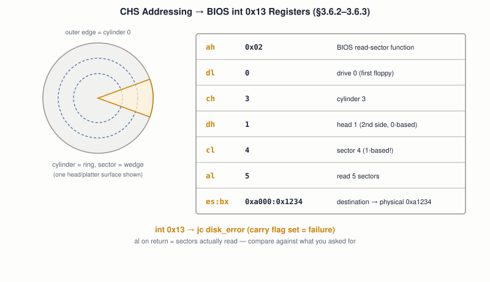

# 17 — Storage and Block I/O

## Layer map for this file

```
┌──────────────────────────────────────────────────┐
│ 1. BOOK: CHS geometry and the full BIOS          │
│    int 0x13 disk-read routine, including         │
│    error handling (§3.6.2–3.6.3) — §6.5          │
│    "Hard-disk Driver" is a heading with no       │
│    body text                                     │
├──────────────────────────────────────────────────┤
│ 2. BEYOND THE BOOK: a real ATA/IDE PIO driver,   │
│    once BIOS is no longer available              │
├──────────────────────────────────────────────────┤
│ 3. MODERN: LBA, AHCI, NVMe, the Linux block      │
│    layer                                         │
└──────────────────────────────────────────────────┘
```

Book coverage: **Full** for CHS/BIOS disk reads. **Stub** for an
actual hard-disk driver.

## Prerequisites

Files `01`–`16`.

---

## [BOOK] CHS: A 3D Coordinate System for Spinning Metal

A disk platter spins under a read/write head; the book's own geometric
description names three coordinates:



- **Cylinder** — distance from the platter's outer edge (the same ring
  across every stacked platter, hence "cylinder").
- **Head** — which surface, since a platter can be read/written on
  both sides.
- **Sector** — position along that circular track, conventionally 512
  bytes.

## [BOOK] One BIOS Call Hides Every Bus Technology

Real disks connect over genuinely different bus technologies
(ATA/IDE, SATA, SCSI, USB), each with its own access details — and
even different device *types* need different handling (a floppy
motor must be explicitly started, file `15`; a hard disk automates
more on its own controller). BIOS's `int 0x13` (`ah = 0x02`)
abstracts all of it into one interface, exactly as `int 0x10`
abstracted the screen (file `03`). The book's worked example, exactly
as shown: `dl=0` (first floppy), `ch=3` (cylinder 3), `dh=1` (head 1,
0-based), `cl=4` (sector 4 — **1-based**, the one field that isn't
zero-indexed), `al=5` (read 5 sectors), destination in `es:bx` —
`0xa000:0x1234`, which file `09`'s own formula resolves to physical
address `0xa1234`.

## [BOOK] Checking the Read Actually Worked

BIOS can fail for good reasons (bad sector, missing disk, an
out-of-range request) and signals this the same implicit way file
`05`'s `cmp` does: the **carry flag**, checked with `jc` (jump if
carry). `al` on return holds the *actual* sectors read, not
necessarily what was requested — worth comparing explicitly, since a
partial read with no carry flag set is still a real failure mode:

```asm
int 0x13
jc disk_error
cmp al, 5          ; did we get all 5 sectors we asked for?
jne disk_error
```

## [BOOK] Where the Draft Actually Stops

§6.5 "Hard-disk Driver" exists only as a table-of-contents entry — no
body text. Everything below constructs what BIOS can no longer do for
you once file `08`'s protected-mode switch has happened, exactly the
same problem file `16` solved for the keyboard.

---

## [BEYOND THE BOOK] A Real Driver, With No BIOS to Call

Past real mode, `int 0x13` is gone along with every other BIOS
service (file `08`). A protected-mode disk driver has to speak
**ATA/IDE** directly — a fixed set of I/O ports (`0x1F0`–`0x1F7` on
the primary bus), each a device register: sector count, LBA
address bytes, a command register, and a status register polled
before every operation. Reading a sector becomes: write the target
address and sector count to those ports, write a "read sectors"
command byte, poll the status port until the device signals "data
ready," then read 256 words from the data port — no interrupt-driven
version yet, and no CHS at all (see LBA, next).

---

## [RELATED KNOWLEDGE] LBA Replaces CHS Almost Everywhere

**Logical Block Addressing** — a single, flat sector number instead of
a cylinder/head/sector triple — is what BIOS's own `int 0x13`
extensions and essentially every modern drive actually use internally;
CHS on a modern disk is a compatibility fiction translated by the
drive's own firmware, not physical geometry at all anymore.

---

## [MODERN SYSTEM] AHCI and NVMe

**AHCI** standardizes how the OS talks to SATA controllers via
memory-mapped command structures instead of the old ATA port-by-port
dance. **NVMe** — built for SSDs directly on PCIe — goes further:
multiple parallel command queues (thousands of outstanding requests,
versus ATA's essentially one-at-a-time model) and heavy use of DMA
(file `15`) and interrupts (file `14`) rather than CPU-polled status
registers, because an SSD has no seek time to hide latency behind.

## [MODERN SYSTEM] The Linux Block Layer

Every driver above sits underneath one unifying abstraction in Linux:
the **block layer** — request queues, I/O schedulers, and a common
block-device interface, so a filesystem (file `18`) never needs to
know whether it's ultimately talking to ATA, AHCI, or NVMe.

---

## Practical Experiment

1. Reproduce the book's exact register setup in a boot-sector program;
   read a known sector and print a byte from it to confirm the load
   address matches file `09`'s segment:offset math.
2. Deliberately request an out-of-range sector; confirm the carry flag
   gets set and your `jc disk_error` path runs.
3. Deliberately request more sectors than actually exist near the end
   of a small disk image; compare `al`'s returned count against what
   you asked for — a partial-read failure with no carry flag.
4. On a real Linux machine: `sudo hdparm -I /dev/sda | grate -i lba`
   (or similar) — confirm your own drive reports LBA addressing, not CHS.

## Debugging

A disk read that "succeeds" (no carry flag) but returns garbage is
almost always a **destination addressing** bug, not a disk bug — check
`es:bx` resolves (file `09`'s formula) to where you actually think it
does, especially after any segment register changes elsewhere in the
boot sector. A read that fails intermittently, only near the end of a
disk, is worth checking against the exact CHS geometry the emulator or
real disk reports — an off-by-one in 1-based sector numbering is a
classic, exactly-this-file mistake.

## Source Code

The book's disk-read boot sector with full error handling, plus your
out-of-range and partial-read test cases.

---

## Common Misconceptions

- **"Sector numbering starts at 0 in CHS."** Sectors are the one
  1-based field — cylinders and heads are 0-based.
- **"BIOS returning without the carry flag set always means success."**
  Check `al`'s actual count too — a partial read can occur without CF set.
- **"CHS describes real physical geometry on a modern drive."** It's a
  compatibility translation performed by the drive's own firmware;
  LBA is what's actually used underneath.

## Interview Questions

**Basic:** What do Cylinder, Head, and Sector each describe?
**Intermediate:** Which CHS field is 1-based, and why does that matter
in practice?
**Advanced:** How does BIOS signal a disk read failure, and what's
the one field worth double-checking even when no failure is signaled?
**Systems Design:** Why does NVMe use multiple parallel command queues
instead of ATA's largely one-at-a-time model?
**Debugging:** A disk read reports success but the buffer contains
garbage — first thing to check?
**Explain what happens when...:** a modern SSD services a read
request, from the NVMe command queue to data arriving in memory?

## Active Recall

1. What do the three CHS coordinates each represent?
2. How does BIOS signal a disk read failure, precisely?
3. What replaced CHS almost everywhere, and why?
4. What does a protected-mode disk driver have to do that a real-mode
   one never needs to, regarding BIOS?

## Answers

1. Cylinder: distance from the platter's edge. Head: which surface.
   Sector: position along the circular track.
2. The carry flag is set on failure; `al` holds the actual number of
   sectors read, which should also be checked against what was requested.
3. LBA (Logical Block Addressing) — a flat sector number, matching how
   drives actually address storage internally today; CHS on a modern
   drive is a compatibility fiction.
4. It must talk to the disk controller directly via I/O ports (e.g.
   ATA/IDE) — BIOS's `int 0x13` is real-mode-only and unavailable once
   protected mode is active.

---

## What You Should Now Understand

- CHS addressing and the exact BIOS register setup to read a sector,
  connected directly back to file `09`'s address-translation formula.
- Why disk read errors need two checks (carry flag *and* actual sector
  count), not one.
- What a real driver has to do once BIOS is gone, and how far modern
  NVMe has moved from the book's polling, port-by-port world.

---

**Next:** file `18-filesystems.md`.
