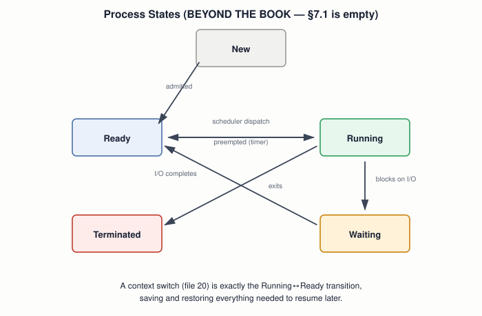

# 19 — Processes and Threads

## Layer map for this file

```
┌────────────────────────────────────────────────┐
│ 1. BOOK: none. §7.1 "Single Processing" is a.  │
│    section heading with zero body text — the   │
│    entire draft only ever runs one flow of     │
│    execution, forever, at ring 0               │
├────────────────────────────────────────────────┤
│ 2. BEYOND THE BOOK: process vs. program vs.    │
│    thread, the PCB, process states             │
├────────────────────────────────────────────────┤
│ 3. MODERN: Linux's task_struct, fork/exec      │
└────────────────────────────────────────────────┘
```

**Book coverage: Stub.** Chapter 1 names "multi-tasking processing"
among its five goals; §7.1 delivers nothing. Everything the book
actually builds — from file `13` on — is one continuous flow of
execution with no concept of "a process" at all.

## Prerequisites

Files `01`–`18`.

---

## [BOOK] What "Single Processing" Would Have Meant

Nothing is written under this heading, but the phrase itself is worth
noting precisely: every kernel this course has built so far *is*
single processing, in the most literal sense — one program, one flow
of control, running until it halts. That's not a simplification of
"a process" — it's the complete absence of the concept. There's
nothing to *switch away from*, because nothing else is ever waiting.

---

## [BEYOND THE BOOK] Process ≠ Program ≠ Thread

Three words worth being precise about, since casual use blurs them
constantly:

- **Program** — static: a file on disk (an ELF binary, file `12`),
  code and data with no execution state at all.
- **Process** — a *running instance* of a program: its own address
  space, open file handles, and everything needed to eventually resume
  it after being paused.
- **Thread** — the actual unit a scheduler runs: a process can own
  several threads, each with its own registers and stack, all sharing
  that one process's address space.

A process is the container; a thread is what's actually executing. A
single-threaded process (everything in this book, if it had processes
at all) makes the distinction invisible — which is exactly why the
book never needed to draw it.

## [BEYOND THE BOOK] The Process Control Block

For an OS to pause a process and correctly resume it later, it must
save *everything* needed to make "later" indistinguishable from
"never stopped" — general registers, the instruction pointer, the
stack pointer, and (once file `22`'s paging exists) which page table
this process uses. This bundle is the **Process Control Block (PCB)**
— conceptually nothing more than file `05`'s `pusha` taken to its
logical conclusion: instead of a callee saving a few registers for
itself temporarily, the *entire CPU state* is saved somewhere durable,
because unlike a function return, nothing guarantees this process runs
again in the next few instructions — maybe not for a long time.

## [BEYOND THE BOOK] Process States



**Running → Ready** and back is exactly what a **context switch**
(file `20`) performs — save the running process's full state (the
PCB), load a different one's, resume it. **Running → Waiting**
happens the moment a process needs something it doesn't have yet (disk
I/O, file `17`; a keypress, file `16`) — there's no point burning CPU
time on a process that can't make progress until an interrupt (file
`14`) says otherwise.

---

## [RELATED KNOWLEDGE] Why the Distinction Barely Existed Before Multitasking

This isn't a gap unique to Blundell's book — any single-program
computing environment (early mainframes running one job at a time,
this book's own kernel) has no practical need for "process" as a
concept separate from "the program." The vocabulary earns its keep
only once more than one flow of execution needs to coexist — precisely
what file `20` builds.

---

## [MODERN SYSTEM] Linux's `task_struct`

Linux's real PCB is the `task_struct` — a genuinely large structure
carrying PID, state, scheduling info, a pointer to the process's page
tables, open file descriptors, signal handlers, and far more than this
book's toy world would ever need. **`fork()`** creates a new process by
duplicating the calling one's `task_struct` and address space (with
copy-on-write, file `22`, to avoid actually copying memory that isn't
modified); **`exec()`** replaces a process's own program image
in-place with a different one, without creating a new process at all —
the classic "fork then exec" pattern behind every shell command you've
ever run.

---

## Practical Experiment

1. `ps -eLf` on your own Linux machine — the `LWP` column shows
   individual threads; find a process with more than one.
2. `cat /proc/<pid>/status` for any running process — find `State:`
   and match it against the diagram's states.
3. Write a tiny C program that calls `fork()`, prints its own PID in
   both the parent and child, and observe two processes now running
   concurrently from one that started.

## Debugging

A process stuck in `Waiting` (`D` state in Linux's `ps` output, for
"uninterruptible sleep") that never returns to `Ready` is a real,
common production symptom — usually a hung I/O device or an NFS mount
that's stopped responding. Recognizing the state itself, from this
file's diagram, is the first diagnostic step before hunting further.

## Source Code

None new — this file is conceptual, laying groundwork file `20`
implements.

---

## Common Misconceptions

- **"Process and program are interchangeable words."** A program is
  static code on disk; a process is a specific running instance of it,
  with its own state.
- **"A process only ever has one thread."** True in this book's world
  (there's no such concept at all); false in general — most real
  processes are multi-threaded.
- **"Context switch and process termination are related mechanisms."**
  A context switch pauses and later resumes a process; termination
  ends it permanently — genuinely different events in the state diagram.

## Interview Questions

**Basic:** What's the difference between a program and a process?
**Intermediate:** What does a Process Control Block need to store, and why?
**Advanced:** Why does a process blocked on I/O move to Waiting instead
of just staying in Running and polling?
**Systems Design:** Why do modern OSes support multiple threads per
process instead of only multiple single-threaded processes?
**Debugging:** A process is stuck in uninterruptible sleep — what does
that state actually mean?
**Explain what happens when...:** a shell runs a command — trace it
through `fork()` and `exec()`?

## Active Recall

1. What does the book actually deliver toward "processes"?
2. Process vs. thread — what's the container, and what's the unit of execution?
3. What does a PCB need to save, and why does a function's own
   register-saving convention (file `05`) fall short of it?
4. Name the five classic process states.

## Answers

1. Nothing — §7.1 is an empty heading; the entire draft is single
   processing in the most literal sense.
2. A process is the container (address space, resources); a thread is
   the actual scheduled unit of execution within it.
3. Full CPU state — all registers, instruction pointer, stack pointer,
   and (once paging exists) the page table pointer; a function's
   `pusha` saves only what it personally needs and only briefly, not
   indefinitely.
4. New, Ready, Running, Waiting, Terminated.

---

## What You Should Now Understand

- Exactly what "single processing" in the book's own stub heading
  actually means — the complete absence of the concept, not a
  simplified version of it.
- Process vs. program vs. thread, precisely distinguished.
- The PCB as `pusha` generalized to "save everything, indefinitely."
- The process state diagram that file `20`'s context switch and
  scheduler are built directly on top of.

---

**Next:** file `20-scheduling-and-context-switching.md`.
