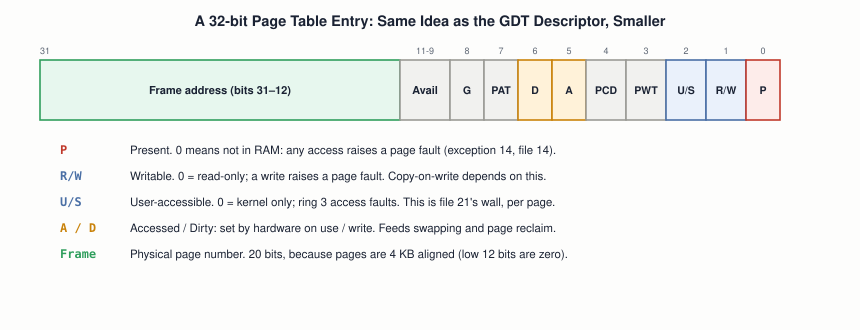

# 22 — Virtual Memory

## Layer map for this file

```
┌─────────────────────────────────────────────────┐
│ 1. BOOK: none. The book's protected mode runs   │
│    with paging OFF, on purpose (§4.2). But      │
│    files 08, 09, 10, and 21 each left a         │
│    thread hanging that only paging ties off     │
├─────────────────────────────────────────────────┤
│ 2. CORE CONCEPT: page tables, the MMU and TLB,  │
│    page faults, per-process address spaces      │
├─────────────────────────────────────────────────┤
│ 3. MODERN: /proc/pid/maps, huge pages, NUMA,    │
│    KPTI                                         │
└─────────────────────────────────────────────────┘
```

Book coverage: **None.** This is the biggest single piece of
machinery the book's flat model deliberately leaves out, and the one
every modern OS is built around.

## Prerequisites

Files `01`–`21`, especially `08`, `09`, `14`, `19`, `21`.

---

## The Threads This File Ties Off

| Earlier file | What it said | What paging answers |
|---|---|---|
| `08` | Long mode requires paging; on modern systems paging, not the GDT, does protection | *how* paging protects |
| `08` | A deliberately unmapped page at address 0 is why null dereferences fault cleanly | how a page can be "unmapped" |
| `09` | Linear address = physical address only because the book never enables paging | the second translation step |
| `10` | Stack and heap live in different regions of a process's address space | what "address space" means |
| `19` | A PCB holds "which page table this process uses" | why each process has its own |
| `21` | The kernel must validate user pointers | what "valid" is checked against |

---

## [BOOK] What's Actually Here

Nothing. The finished draft's protected mode uses the flat model with
paging off — every address is used exactly as written, and any code can
touch any byte. That's the honest starting point: an OS with no memory
isolation at all.

---

## [CORE CONCEPT] The Idea: Every Address Is a Lie, on Purpose

With paging on, the addresses your code uses are **virtual**. Memory
is carved into fixed-size **pages** (4 KB), physical RAM into
same-sized **frames**, and a **page table** records which virtual page
currently maps to which frame. Two processes can both use virtual
address `0x400000` and touch entirely different physical bytes,
because each has its own page table.


The walk, step by step: `CR3` holds the physical address of the
top-level table. The top 10 bits of the virtual address pick an entry
in it; that entry points to a second-level table; the next 10 bits pick
an entry there; that entry holds the frame's physical address; the low
12 bits are the byte offset inside that frame. Two levels instead of
one flat table because a flat table for a 32-bit space would need a
million entries per process — most of which map nothing. The tree only
allocates the branches actually in use.

## [CORE CONCEPT] The Page Table Entry



Same idea as file `08`'s GDT descriptor — packed bit fields, one
entry per page — with the bits that matter most being the protection
ones: **Present**, **Read/Write**, **User/Supervisor**. This is where
"ring 3 can't touch kernel memory" (file `21`) is actually enforced on
a modern system: not by the GDT, but by the U/S bit in every page's
entry.

## [CORE CONCEPT] MMU and TLB: Who Does the Walking

The **MMU** (Memory Management Unit) is the hardware that performs
every translation, on every memory access, automatically — no
instruction is involved. Walking two or four table levels in memory
for every access would be ruinously slow, so the **TLB** (Translation
Lookaside Buffer) caches recent translations; most accesses hit the
TLB and skip the walk entirely. Writing `CR3` (switching to another
process's page tables) flushes most of the TLB — which is a real part
of why context switches (file `20`) cost what they do.

## [CORE CONCEPT] The Page Fault: Paging's Central Trick

When the MMU can't complete a translation — **Present** is 0, or the
access violates R/W or U/S — it raises **exception 14**, a page fault
(the interrupt machinery from file `14`), with the faulting virtual
address placed in `CR2`. The OS's handler decides what happens next:

```
Page fault (exception 14, address in CR2)
   │
   ├─ address not part of any valid region  → kill process (SIGSEGV)
   ├─ valid, but never touched yet          → allocate a frame, map it, resume
   ├─ valid, but was swapped to disk        → read it back in, map it, resume
   └─ write to a copy-on-write page         → copy the page, remap writable, resume
```

Most page faults are *not* errors. They're how the OS gets to fill in
memory lazily, at the last possible moment.

---

## [RELATED KNOWLEDGE] What Paging Buys You

- **Isolation** — a process can't name another process's memory at all;
  it isn't in its page tables.
- **Lazy allocation (demand paging)** — `malloc` or `mmap` reserves
  *virtual* range immediately; a physical frame is only assigned on the
  first touch.
- **Copy-on-write** — `fork()` (file `19`) marks all pages read-only
  and shared between parent and child; the first write to any page
  faults, and only then is that one page copied. This is why `fork` is
  cheap.
- **Sharing** — one physical copy of a shared library, mapped into many
  processes' address spaces.
- **Swap** — pages can be evicted to disk and faulted back in.
- **Contiguity for free** — a large virtual buffer doesn't need
  contiguous physical frames.

## [RELATED KNOWLEDGE] Per-Process Address Spaces and Context Switches

File `19` said a PCB holds the page-table pointer. Now the reason is
concrete: a context switch between processes (file `20`) also loads
`CR3`. Switching between *threads of the same process* doesn't — they
share an address space, so it's cheaper. That difference is the
practical cost gap between thread switches and process switches.

---

## [MODERN SYSTEM] Seeing It on Linux

`/proc/<pid>/maps` is a live listing of a process's virtual regions:
address range, permissions (`r`/`w`/`x`/`p`), backing file. The `[heap]`
and `[stack]` entries are file `10`'s two regions, finally visible;
the `rwxp` bits are the R/W and execute controls above, per region.
**Huge pages** (2 MB or 1 GB) let one TLB entry cover far more memory,
cutting TLB misses for large workloads. **NUMA** systems (file `24`)
make "which physical frame" matter for speed, since memory attached to
another CPU socket is slower to reach.

## [MODERN SYSTEM] Paging as a Security Boundary — and Its Cost

The Meltdown vulnerability (file `21` mentioned it) led Linux to adopt
**KPTI** (kernel page-table isolation): keeping kernel mappings out of
the user-mode page tables almost entirely, at a real performance cost
(more `CR3` switches, more TLB pressure). A concrete example of paging
being the actual enforcement layer for the rings-and-boundaries story
from files `08` and `21`.

---

## [ADVANCED / BEYOND THE BOOK] Worth Naming

**5-level paging** extends x86-64's virtual space beyond 48 bits.
**PCID** tags TLB entries per address space so a `CR3` switch doesn't
need a full flush. **Page cache** unification: file contents are cached
in the same frames `mmap` maps into processes — file `18`'s
filesystems and this file meet there.

---

## Practical Experiment

1. `cat /proc/self/maps` — find `[heap]`, `[stack]`, the executable
   itself, and shared libraries. Read the permission column on each.
2. **Watch lazy allocation.** Write a C program that `malloc`s 1 GB,
   prints its resident memory (`grep VmRSS /proc/self/status`), then
   writes to every 4096th byte and prints it again. RSS barely moves
   after `malloc`, then climbs as you touch pages.
3. **Count faults.** Run that program under `/usr/bin/time -v` or
   `perf stat -e page-faults` — minor faults track pages touched.
4. **Trigger a real one.** `int *p = 0; *p = 1;` — segfault. Run it
   under `gdb`; note the faulting address is `0`, the unmapped page
   from file `08`'s null-pointer discussion.
5. **In your file `13` kernel:** build a page directory and one page
   table identity-mapping the first 4 MB; load `CR3`; set bit 31 of
   `CR0`; confirm the kernel keeps running. Then map a new virtual page
   to a chosen frame, write through the virtual address, read through the
   physical one. Install a handler on vector 14 that prints `CR2`.

## Debugging

The user's own chain, now complete end to end:

```
application touches a bad address
   ↓
MMU walk fails (Present=0, or R/W or U/S violated)
   ↓
CPU raises exception 14, faulting address into CR2
   ↓
kernel's page fault handler finds no valid mapping
   ↓
kernel sends the process SIGSEGV
   ↓
"Segmentation fault" — or a core dump
```

When debugging a segfault: the faulting address alone tells a lot.
Near `0` means a null pointer; a huge or garbage value means a wild
pointer; an address just past a valid region means an off-by-one on a
buffer. In your own kernel, a page fault that fires unexpectedly
right after enabling paging almost always means the code currently
executing isn't itself mapped — identity-map before you enable.

## Source Code

Your identity-mapping code, the `CR0`/`CR3` sequence, and the vector-14
handler — new code with no book equivalent to compare against.

---

## Common Misconceptions

- **"A page fault means something went wrong."** Most are routine:
  first touch of lazily allocated memory, or a copy-on-write copy.
- **"`malloc(1 GB)` uses 1 GB of RAM."** It reserves virtual space;
  physical frames arrive on first touch, as the experiment shows.
- **"Virtual memory means swapping to disk."** Swap is one optional
  use of it. Paging exists for isolation and lazy allocation even on
  systems with no swap at all.
- **"Virtual and physical addresses are the same thing."** File `09`'s
  warning, now fully justified: with paging on, they're different
  values connected by a table walk.

## Interview Questions

**Basic:** What's the difference between a virtual and a physical address?
**Intermediate:** Why is a page table a multi-level tree instead of one
flat array?
**Advanced:** What does the TLB cache, and why does switching `CR3`
hurt it?
**Systems Design:** Why is `fork()` cheap even for a process using
gigabytes of memory?
**Debugging:** A program segfaults at address `0x0` — what does that
tell you, and how would you confirm it?
**Explain what happens when...:** a program touches a page it has never
touched before, from the load instruction through to the loaded value?

## Active Recall

1. Which earlier files left threads that paging ties off?
2. Name the three fields a 32-bit virtual address splits into.
3. What does the page fault handler do for a valid-but-untouched page?
4. Why does copy-on-write make `fork` cheap?

## Answers

1. `08` (long mode requires paging, null page), `09` (linear ≠ physical
   with paging), `10` (stack/heap regions), `19` (PCB's page table
   pointer), `21` (validating user pointers).
2. A 10-bit directory index, a 10-bit table index, a 12-bit page offset.
3. Allocates a physical frame, maps it into the page table, and resumes
   the faulting instruction.
4. Parent and child initially share every page read-only; only pages
   actually written to are ever copied, one at a time, on demand.

---

## What You Should Now Understand

- Paging as the mechanism behind isolation, lazy allocation, and
  copy-on-write — not just "virtual memory means swap."
- The two-level page walk and the bit layout of one entry, with the
  protection bits identified.
- Why a page fault is a normal, central event and not just an error.
- How five earlier files' loose threads all connect here.

---

**Next:** file `23-concurrency-and-synchronization.md`.
