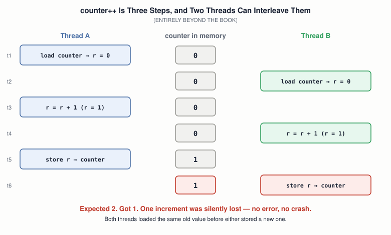
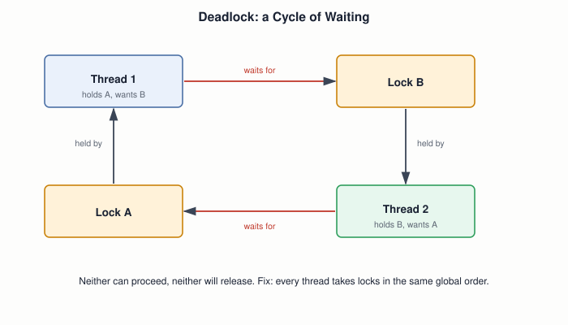

# 23 — Concurrency and Synchronization

## Layer map for this file

```
┌──────────────────────────────────────────────────┐
│ 1. BOOK: none. One unnamed seed: the `cli` in    │
│    file 08's mode switch is a critical           │
│    section — the book just never calls it one    │
├──────────────────────────────────────────────────┤
│ 2. CORE CONCEPT: races, atomicity, critical.     │
│    sections, spinlocks vs. mutexes, deadlock     │
├──────────────────────────────────────────────────┤
│ 3. MODERN: Linux locks, futex, sanitizers        │
└──────────────────────────────────────────────────┘
```

Book coverage: **None.** The book's kernel is one flow of execution,
so nothing can interleave with anything. Files `14` and `20` change
that — an interrupt handler or a preemptive scheduler can now run
*between any two instructions* — which is exactly when this file's
problems appear, even on a single CPU.

## Prerequisites

Files `01`–`22`, especially `14`, `19`, `20`.

---

## [BOOK] The One Unnamed Seed

File `08`'s protected-mode switch begins with `cli` — the book's stated
reason: if an interrupt fired mid-switch, the CPU would use stale
real-mode state and crash. That is a **critical section**: a stretch
of code that must not be interleaved with other code touching the same
state. The book uses the technique once, without the vocabulary. This
whole file is that one `cli`, generalized.

---

## [CORE CONCEPT] The Race Condition

`counter++` looks like one operation. On most CPUs it's three: load
the value, add one, store it back. Two threads can interleave those
steps:



Nothing crashed. No error was reported. The answer is just wrong — and
wrong only sometimes, depending on exactly when the scheduler (file
`20`) or an interrupt (file `14`) happened to strike. That combination
of *silent* and *intermittent* is what makes races the hardest bugs in
this course.

A precise nuance worth having: on x86, `add [counter], 1` is a *single
instruction*, so an interrupt on one CPU can't split it — but on a
multi-core machine (file `24`), two CPUs can still race on it, unless
the instruction carries the `lock` prefix. Whether something is safe
depends on **who else can run at the same time**, not just how the code
looks.

## [CORE CONCEPT] Making Steps Indivisible: Atomicity

The fix is to make the read-modify-write **atomic** — indivisible from
every other observer's point of view. Three tools, from cheapest to
heaviest:

| Tool | How it works | Works on | Cost |
|---|---|---|---|
| **`cli` / `sti`** (files `08`, `14`) | mask interrupts around the critical section | one CPU only | very cheap; must keep the window tiny |
| **Atomic instructions** (`lock add`, `xchg`, `cmpxchg`) | the hardware guarantees indivisibility, even across CPUs | any number of CPUs | cheap for a single variable |
| **Locks** (spinlock, mutex) | build on atomics to protect a *region* of code | any number of CPUs | depends on contention |

`xchg` with a memory operand is implicitly locked on x86 — which makes
a working **spinlock** almost trivial to write:

```asm
acquire:
    mov  eax, 1
.retry:
    xchg eax, [lock_var]     ; atomically: swap eax and memory
    test eax, eax
    jnz  .retry              ; old value was 1 → someone else holds it, spin
    ret
release:
    mov  dword [lock_var], 0
    ret
```

## [CORE CONCEPT] Spin or Sleep?

Waiting for a lock has two strategies, and the choice is really about
file `19`'s state diagram:

- **Spinlock** — stay Running and burn CPU until the lock frees. No
  state change, no context switch. Right when the critical section is
  short and the wait will be shorter than a context switch would cost.
- **Mutex** — move to **Waiting** (file `19`) and let the scheduler run
  something else; woken when the lock frees. Right when the holder
  might take a while.

A constraint that follows directly from file `14`: **an interrupt
handler can't sleep.** It has no process to put into Waiting. So code
that runs in interrupt context can only ever use spinlocks (or atomics).

And a trap specific to single-CPU kernels like yours: **spinning on one
CPU can only wait for something that can't run while you spin.** If the
lock holder was preempted, the spinner just burns its time slice
accomplishing nothing — so on a single CPU, kernels simply disable
interrupts instead.

## [CORE CONCEPT] Deadlock



Deadlock needs all four of these at once (the **Coffman conditions**):
mutual exclusion, hold-and-wait, no preemption of held locks, and
circular wait. Break any one and it can't happen. The practical
weapon is breaking the last: **impose a global lock order** — every
thread that needs both A and B takes A first, always.

---

## [RELATED KNOWLEDGE] The Interrupt-Plus-Spinlock Trap

A subtle, real bug class: code holds a spinlock with interrupts
*enabled*; an interrupt fires on the *same CPU*; its handler tries to
take the *same lock*. The handler spins forever waiting for a holder
that can't run until the handler returns. Deadlock, with one lock and
one CPU. The fix is to disable local interrupts *while holding* any
lock an interrupt handler might also take — the reason Linux has
`spin_lock_irqsave`.

## [RELATED KNOWLEDGE] Semaphores and Condition Variables

A **semaphore** is a counter with atomic "wait" (decrement, sleeping if
zero) and "signal" (increment, waking a waiter) — generalizing a mutex
to *N* permits. A **condition variable** lets a thread sleep until some
condition on shared data becomes true, always paired with a mutex.
Names worth recognizing; both are built from the primitives above.

---

## [MODERN SYSTEM] Linux's Locking Toolbox

`spinlock_t`, `mutex`, `atomic_t`, and the `_irqsave` variants above
cover most kernel code. In user space, `pthread_mutex_t` is built on
the **futex** system call: the uncontended case is handled entirely in
user space with an atomic instruction, and only when there's real
contention does it make a syscall (file `21`) to sleep — so the common
case never pays for crossing the user/kernel boundary at all.

Linux's **lockdep** watches the order in which locks are acquired at
runtime and reports potential deadlock cycles *before* they ever
actually deadlock — the global-lock-order rule above, mechanically
enforced.

## [MODERN SYSTEM] Tools for Finding Races

`gcc -fsanitize=thread` (ThreadSanitizer) and Valgrind's `helgrind`
instrument a running program and report races directly — the fastest
way to turn "wrong sometimes" into "here are the two lines that
conflict."

---

## [ADVANCED / BEYOND THE BOOK] Memory Ordering

Modern CPUs (and compilers) reorder memory operations for speed, so one
core may observe another's writes in a different order than they were
issued. Atomics and lock operations include the necessary **memory
barriers**; plain loads and stores don't. This is also why C's
`volatile` is **not** a synchronization tool — it stops the compiler
from caching a value in a register, and does nothing about hardware
ordering or atomicity. Full treatment in file `33`.

**RCU** (read-copy-update) is Linux's answer to read-heavy shared data:
readers take no lock at all. Named here only so the term isn't foreign.

---

## Practical Experiment

1. **Produce a real race.** Two pthreads each incrementing a shared
   counter 1,000,000 times, no protection. Compile with `-O0` (or
   declare it `volatile` so the compiler can't hoist it into a
   register). Expected 2,000,000 — observe less, and a different number
   each run.
2. **Fix it three ways** and compare timings: `pthread_mutex_t`;
   `__atomic_fetch_add`; a hand-written spinlock. Note which is fastest
   and *why* (uncontended atomic vs. lock vs. syscall-capable mutex).
3. `gcc -fsanitize=thread` on the racy version — read the report.
4. **In your file `13` kernel:** have the main loop and the timer ISR
   (file `20`) both increment one shared counter. Observe lost updates,
   then protect the main-loop side with `cli`/`sti` and confirm the
   count becomes exact.
5. Write a two-lock deadlock on purpose (opposite acquisition order),
   confirm it hangs, then fix it with a global order.

## Debugging

Races resist debugging because observing them changes them —
print statements and debuggers alter timing enough to make the bug
vanish. A systematic approach:

1. **Make it fail more often** — a stress loop, more threads, run
   under load.
2. **Use a tool, not intuition** — ThreadSanitizer, or lockdep in a
   kernel.
3. **Shrink the shared state** — find *which* variable is touched by
   two flows of control, then ask who protects it.
4. **For hangs:** get every thread's stack (`gdb`'s `thread apply all
   bt`) and look for a cycle — thread 1 waiting in lock B while holding
   A is deadlock diagnosed from the outside.

## Source Code

Your racy counter, its three fixed variants, the assembly spinlock, and
the deliberate deadlock — a matched broken/fixed set.

---

## Common Misconceptions

- **"If the program is single-threaded there are no races."** Not once
  an interrupt handler or signal handler touches shared data — that's
  concurrency without a second thread.
- **"`volatile` makes a variable thread-safe."** It only stops compiler
  caching; it provides no atomicity and no hardware ordering.
- **"`counter++` is one operation."** It's read, modify, write — and
  the gaps between are where races live.
- **"A spinlock is always faster than a mutex."** Only for short waits;
  a long spin wastes an entire CPU doing nothing.

## Interview Questions

**Basic:** What is a race condition, in one sentence?
**Intermediate:** Why can't an interrupt handler use a mutex?
**Advanced:** Why can a single-instruction `add [mem], 1` still race
on a multi-core machine?
**Systems Design:** When would you choose a spinlock over a mutex, and
what must be true of the critical section?
**Debugging:** A service hangs with no CPU usage. How do you tell if
it's a deadlock, and what do you look for?
**Explain what happens when...:** two threads call `pthread_mutex_lock`
on the same mutex — trace the uncontended case and the contended one?

## Active Recall

1. What was the book's one (unnamed) critical section?
2. Why does `counter++` race?
3. Spinlock vs. mutex — what's the state-diagram difference?
4. Name the four conditions for deadlock, and the practical one to break.

## Answers

1. The `cli` at the start of the real-to-protected-mode switch (file
   `08`).
2. It's load, add, store — two threads can both load the old value
   before either stores, so one update is lost.
3. A spinlock keeps the thread Running and burns CPU; a mutex moves it
   to Waiting so the scheduler can run something else.
4. Mutual exclusion, hold-and-wait, no preemption, circular wait; break
   circular wait with a global lock ordering.

---

## What You Should Now Understand

- Why concurrency bugs are silent, intermittent, and appear even on a
  single CPU once interrupts or preemption exist.
- Atomicity, and the ladder from `cli` to atomics to locks.
- Spin vs. sleep as a choice grounded in file `19`'s states and file
  `14`'s interrupt-context limits.
- Deadlock as a cycle, and lock ordering as the practical cure.

---

**Next:** file `24-multiprocessor-and-smp-systems.md`.
