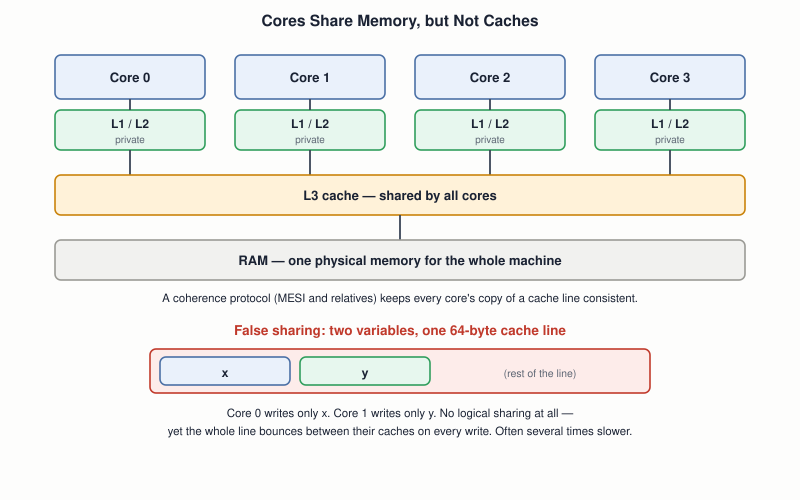

# 24 — Multiprocessor and SMP Systems

## Layer map for this file

```
┌─────────────────────────────────────────────────┐
│ 1. BOOK: none. The whole draft assumes one      │
│    CPU. File 20 already flagged that the        │
│    book's "multi-processing" heading means      │
│    multitasking — this file is the OTHER        │
│    meaning of the word                          │
├─────────────────────────────────────────────────┤
│ 2. CORE CONCEPT: how extra cores boot, cache    │
│    coherence and false sharing, why locking     │
│    changes, per-core scheduling                 │
├─────────────────────────────────────────────────┤
│ 3. MODERN: NUMA, hybrid cores, taskset, perf    │
└─────────────────────────────────────────────────┘
```

Book coverage: **None.** Nothing in the draft even implies more than one
CPU. And to be clear about scope: SMP is **not** part of the staged
capstone in file `38` — your toy OS stays single-core. This file exists
so you understand what every real machine, and every real Linux kernel,
is doing that your toy OS isn't.

## Prerequisites

Files `01`–`23`, especially `04`, `14`, `20`, `22`, `23`.

---

## [BOOK] What's Here

An assumption, never stated: one CPU. Every `cli` in the book (files
`08`, `23`) is sufficient protection precisely because nothing else can
run at the same time. Both of those quietly stop being true on a
multi-core machine.

---

## [CORE CONCEPT] Four Words That Get Mixed Up

| Term | Means | Example |
|---|---|---|
| **Multitasking** | one CPU time-shares many processes | file `20`'s round-robin |
| **Multiprocessing / SMP** | several CPUs run at once, sharing one memory, under one OS | a modern laptop |
| **Multicore** | several CPUs on one chip | nearly all current CPUs |
| **SMT / Hyper-Threading** | one physical core presents two *logical* CPUs, sharing its execution hardware | Linux lists both as separate CPUs |

**SMP** (symmetric multiprocessing) means the cores are all equal peers
running one OS instance over one shared physical memory. That's the
model behind everything below.

## [CORE CONCEPT] Extra Cores Boot the Whole Ladder Again

File `04`'s central fact was that every x86 CPU powers on in 16-bit real
mode. That applies to *each core*, not just the first one:


Only the **bootstrap processor (BSP)** runs at power-on; the other cores
(**application processors**, APs) sit halted, waiting. The BSP finds out
how many exist from firmware tables, then wakes each with an **INIT**
followed by a **SIPI** (Startup Inter-Processor Interrupt) sent through
the **local APIC** — the modern successor to file `14`'s PIC. The SIPI
carries a vector selecting a 4 KB-aligned page below 1 MB, and the AP
begins executing there in real mode. The kernel has to have placed a
small "trampoline" of code at that spot that walks the AP up through
file `08`'s real → protected → long sequence, then gives it its own
stack, descriptor tables, and page tables. The boot-sector idea from
file `06` happens again, once per extra core.

## [CORE CONCEPT] Interrupts Between Cores

File `14`'s PIC has no idea multiple CPUs exist. The **APIC** system
fixes this: each core has a **local APIC**, and an **I/O APIC** routes
device interrupts to chosen cores. Cores can also interrupt each
other with **inter-processor interrupts (IPIs)** — and one of the most
important uses ties directly to file `22`: when one core changes a page
mapping, other cores' TLBs may still cache the old translation, so the
kernel sends an IPI forcing them to flush it. That's called a **TLB
shootdown**, and it's a real, measurable cost of changing mappings on a
big machine.

## [CORE CONCEPT] Caches Are Per-Core, Memory Is Shared



Each core has private caches, so the same memory can sit in several
caches at once. A **cache coherence protocol** (MESI: each line is
Modified, Exclusive, Shared, or Invalid in each cache) keeps them
consistent automatically, in hardware. That solves *staleness*. It does
**not** make your multi-step operations atomic, or order them
predictably — that's still file `23`'s job (locks, atomics, and the
memory-ordering warning).

It also introduces a purely performance problem with no single-core
equivalent: **false sharing**. Coherence works per **cache line** (64
bytes on x86), not per variable. If core 0 writes `x` and core 1 writes
`y`, and both sit on one line, the line ping-pongs between their caches
on every write — though the two threads share no data logically. Padding
the variables onto separate lines can make the same code several times
faster.

## [CORE CONCEPT] Why File 23's Locks Get Harder

- `cli` no longer protects anything across cores: it masks interrupts
  on *this* core only. A critical section now needs a real
  **spinlock** (or atomics) that other cores respect.
- The scheduler (file `20`) can't have one global run queue without
  every core fighting over its lock. Linux gives **each core its own
  run queue**, and periodically **load-balances** tasks between them —
  trading some fairness for far less contention.
- **Per-CPU data** — giving each core its own copy of frequently-used
  counters and structures — avoids sharing (and locking, and false
  sharing) altogether. It's one of the kernel's main scalability tools.

---

## [RELATED KNOWLEDGE] Amdahl's Law: Why More Cores Isn't Linear

If a fraction *p* of a job can be parallelized across *n* cores, the
best possible speedup is **1 / ((1 − p) + p/n)**. With 90% parallel
work on 8 cores: 1 / (0.1 + 0.1125) ≈ **4.7×**, not 8×. Even infinite
cores cap at 10×. The serial 10% dominates — which is why lock
contention, shared queues, and false sharing matter so much.

## [RELATED KNOWLEDGE] x86's Memory Model Is Relatively Forgiving

x86 guarantees fairly strong ordering (stores aren't reordered with
other stores, loads aren't reordered with other loads; only a store
followed by a load to a different address can appear swapped). ARM's is
weaker, so the same racy code may appear to work on x86 and fail on ARM
(file `04`'s architecture comparison, with real consequences). Full
treatment: file `33`.

---

## [MODERN SYSTEM] Seeing It on Your Own Machine

- `lscpu` — sockets, cores per socket, **threads per core** (the SMT
  count), and NUMA node layout.
- `cat /proc/interrupts` — file `14`'s counter table, now with **one
  column per CPU**: you can see which core is servicing which device.
- `taskset -c 0 ./prog` — pin a process to core 0 (uses the
  `sched_setaffinity` syscall). `mpstat -P ALL 1` shows per-core load.
- `perf c2c` — a tool built specifically to find false sharing.

## [MODERN SYSTEM] NUMA

On multi-socket servers, memory is physically attached to a specific
socket. Reaching your *own* socket's memory is fast; another socket's is
noticeably slower. That's **NUMA** (non-uniform memory access). Linux's
default is "first touch": a page is allocated on the node of the core
that first writes it — the lazy allocation from file `22`, now with a
*where* as well as a *when*. `numactl --hardware` shows the layout.

---

## [ADVANCED / BEYOND THE BOOK] Worth Naming

**Hybrid CPUs** (Intel's performance + efficiency cores; ARM
big.LITTLE) put cores of different speeds on one chip, so the scheduler
must decide *which kind* of core suits a task. **CPU hotplug** lets
cores be taken offline and back at runtime. **Interrupt affinity**
(`/proc/irq/N/smp_affinity`) pins a device's interrupts to particular
cores — a routine tuning step for high-speed networking (file `30`).

---

## Practical Experiment

1. `lscpu` and `cat /proc/cpuinfo | grep -c processor` — confirm the
   count; find "Thread(s) per core" and work out physical cores vs.
   logical CPUs.
2. **See affinity.** Run `taskset -c 0 sh -c 'while :; do :; done' &`
   and watch `mpstat -P ALL 1` — exactly one core saturates. Kill it.
3. **Measure false sharing.** Two threads, each incrementing its own
   `volatile long` 100 million times. Version A: the two counters
   adjacent in one struct. Version B: a 64-byte pad between them.
   Time both — B is often several times faster, though the threads
   never touch each other's data.
4. **Watch a second core sit idle.** Boot your file `13` kernel with
   `qemu-system-i386 -smp 2 ...`. Only the BSP runs your code; the other
   core stays halted, waiting for a SIPI your kernel never sends —
   proof of the boot picture above.
5. `cat /proc/interrupts` before and after heavy disk or network
   activity — see which CPU column moves.

## Debugging

"I added threads and it got slower" has a short list of suspects, and a
tool for each:

```
Is one core pegged while others idle?    → serial bottleneck (Amdahl); mpstat -P ALL 1
Are threads waiting on one lock?          → contention; perf / lock profiling
Are they writing to nearby memory?        → false sharing; perf c2c
Is memory on the wrong NUMA node?         → numastat, numactl
```

For hangs specific to SMP kernels: one core stuck in a spinlock while
holding interrupts off is a classic "soft lockup" — Linux's watchdog
prints a report naming the CPU and its stack.

## Source Code

No new toy-kernel code — this file's code is the false-sharing
benchmark and the QEMU `-smp` experiment.

---

## Common Misconceptions

- **"More cores means proportionally faster."** Amdahl's law, lock
  contention, and false sharing all say no.
- **"Multiprocessing and multitasking are the same thing."** One is
  many CPUs at once; the other is one CPU taking turns.
- **"A hyper-thread is a full extra core."** It shares one core's
  execution hardware; the gain is typically far less than 2×.
- **"Cache coherence means I don't need locks."** It keeps one
  location's copies consistent; it doesn't make multi-step updates
  atomic or ordered.
- **"All cores start together."** Only the BSP runs at power-on; the
  rest wait for an explicit SIPI.

## Interview Questions

**Basic:** Multitasking vs. multiprocessing — what's the difference?
**Intermediate:** What does an application processor do between being
powered and running kernel code?
**Advanced:** What is false sharing, and why can it appear even when
threads share no data?
**Systems Design:** Why does Linux keep a run queue per core instead of
one global queue?
**Debugging:** A parallel job scales fine to 4 threads and gets slower
at 16 — list three causes and how you'd tell them apart.
**Explain what happens when...:** one core unmaps a page that three
other cores have cached in their TLBs?

## Active Recall

1. Which meaning of "multi-processing" was file `20`, and which is this?
2. How is an AP woken, and what mode does it start in?
3. Why is `cli` insufficient for mutual exclusion on SMP?
4. What is a TLB shootdown?

## Answers

1. File `20`: multitasking on one CPU. This file: several CPUs running
   simultaneously.
2. The BSP sends INIT then SIPI through the local APIC; the AP starts in
   16-bit real mode at a 4 KB page below 1 MB.
3. It masks interrupts only on the local core; other cores keep
   running and can still touch the same data.
4. An IPI forcing other cores to flush stale TLB entries after a page
   mapping changes.

---

## What You Should Now Understand

- The precise vocabulary: multitasking, SMP, multicore, SMT.
- That each extra core repeats file `06`'s and `08`'s boot ladder from
  real mode — the book's material is per-core, not once per machine.
- Coherence vs. atomicity, and false sharing as the performance trap
  between them.
- Why file `23`'s tools needed strengthening, and where NUMA and
  per-core scheduling come in.

---

**Next:** file `25-linux-kernel-architecture.md` — the bridge chapter, where every toy-OS concept gets mapped to its Linux counterpart.
