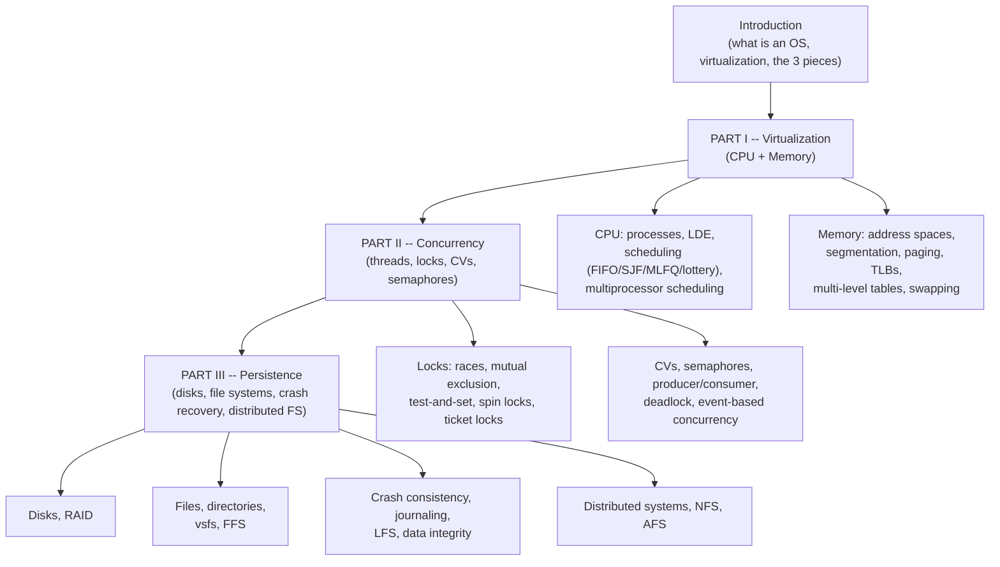

# Operating Systems: Three Easy Pieces — Detailed Notes Index

> A deep-dive, grouped-by-theme note series on Remzi & Andrea Arpaci-Dusseau's *Operating Systems: Three Easy Pieces* (OSTEP), built directly from the book's own text, examples, and code. Organized around the book's own three-part structure — Virtualization, Concurrency, Persistence.

---

## How to Use This Series

- **First pass / learning the material:** read in order — each file builds on ideas from the ones before it (address translation before paging; paging before swapping; locks before condition variables; file systems before crash consistency).
- **Exam/interview cramming:** every file ends with an **"Interview/Exam-Ready Talking Points"** section — read just those across all 11 files for a fast, high-signal refresher.
- **Looking something up:** use the chapter map below.
- **Companion material:** the distributed-systems-focused parts of this series (Ch47-49) connect directly to the DDIA-based notes already in this workspace (`distributed-systems-notes.md`, `microservices-backend-interview-notes.md`) — RPC's leaky abstraction and idempotency both reappear there in a different context.

---

## The Book's Structure at a Glance

---

## Chapter Map

| # | File | Book chapters | Core content |
|---|---|---|---|
| 1 | `01-introduction-and-processes.md` | Ch1-2, 4-5 | What an OS does, virtualization/concurrency/persistence previews, the process abstraction, process states, `fork()`/`wait()`/`exec()` and why they're split |
| 2 | `02-cpu-scheduling.md` | Ch6-10 | Limited direct execution (traps, timer interrupts, context switches), FIFO/SJF/STCF/Round Robin, MLFQ, lottery/stride scheduling, multiprocessor scheduling |
| 3 | `03-address-spaces-and-translation.md` | Ch13-16 | Address spaces, `malloc`/`free` and common memory bugs, base-and-bounds dynamic relocation, segmentation and external fragmentation |
| 4 | `04-free-space-and-paging.md` | Ch17-20 | Free-space allocation strategies (best/worst/first-fit, buddy allocation), paging fundamentals, TLBs, multi-level page tables |
| 5 | `05-beyond-physical-memory.md` | Ch21-23 | Swap space, page faults, AMAT, page-replacement policies (Optimal, FIFO, LRU, Clock), thrashing, VAX/VMS case study |
| 6 | `06-concurrency-and-locks.md` | Ch26-28 | Threads, the canonical race-condition example, critical sections, thread API, building locks (test-and-set, CAS, ticket locks, queue-based) |
| 7 | `07-cv-semaphores-bugs-events.md` | Ch30-33 | Condition variables, the producer/consumer bug progression, semaphores, deadlock (4 conditions + prevention), event-based concurrency |
| 8 | `08-io-disks-and-raid.md` | Ch36-38 | I/O devices (polling/interrupts/DMA), hard disk mechanics, disk scheduling, RAID levels 0/1/4/5 |
| 9 | `09-files-and-file-systems.md` | Ch39-41 | Files/directories, hard vs. symbolic links, vsfs implementation (inodes, multi-level index), FFS and locality-aware placement |
| 10 | `10-crash-consistency-lfs-integrity.md` | Ch42-44 | fsck, data/metadata journaling, log-structured file systems (imap, garbage collection), disk failure modes, checksums, scrubbing |
| 11 | `11-distributed-systems-nfs-afs.md` | Ch47-49 | Unreliable/reliable communication, RPC, NFS (statelessness, idempotency, cache consistency), AFS (whole-file caching, callbacks) |

---

## The Big Ideas That Run Through the Whole Book

A handful of concepts and rhetorical "tips" reappear across many chapters — recognizing them is what separates "read the book" from "understood the book":

- **Mechanism vs. policy, everywhere.** Context switching (mechanism) vs. scheduling algorithm (policy); page-fault handling (mechanism) vs. replacement algorithm (policy); TLB hardware (mechanism) vs. which entry to evict (policy). Separating "how" from "which" is the book's core modularity principle, introduced in Ch4 and never abandoned.
- **Limited direct execution, generalized.** The CPU (Ch6), memory (Ch15/18), and even files (statelessness in NFS) are all virtualized using the same basic pattern: let the common case run at (near) native hardware speed, with a narrow, well-defined trap/exception mechanism for the OS to regain control only when it actually needs to.
- **Amortize fixed costs over larger units.** Time slices vs. context-switch overhead (Ch7); LSM-style segment buffering in LFS (Ch43); large sequential disk transfers vs. seek/rotation cost (Ch37) — the same "batch more work per fixed-overhead event" idea recurs constantly.
- **Indirection solves (almost) everything.** Virtual memory itself, the page table, the inode, LFS's imap, NFS's file handle — each is a layer of indirection that lets something move or change location without breaking every reference to it. Wheeler's quote (Ch43) about indirection — and its limits — is worth remembering.
- **Optimism vs. pessimism, as a recurring design axis.** Spin locks vs. queue-based sleeping locks (Ch28); 2PL vs. SSI-style optimistic concurrency (mirrored in the DDIA notes); AFS's polling (v1) vs. callback/push model (v2) — deciding whether to assume the common case is safe (and detect/recover if wrong) or guard against it upfront (at a steady cost) is a recurring trade-off.
- **Idempotency is a cheap substitute for hard coordination.** NFS's entire crash-recovery story rests on idempotent operations plus blind retry — the same idea reappears (independently) in the DDIA-based notes on stream-processing fault tolerance.
- **Every "guarantee" has a real, nameable cost.** Journaling trades extra writes for fast recovery; RAID-5 trades write complexity for capacity efficiency; multi-level page tables trade lookup latency for memory savings. The book is consistently explicit about *exactly* what is being traded for what — that precision is worth imitating when explaining any of these concepts yourself.

---

## A Note on the Book's Own Style

OSTEP is unusually direct about **naming its own rhetorical devices** — "The Crux of the Problem" boxes state the central question each chapter is answering; "Tip" and "Aside" boxes call out generalizable engineering wisdom (Voltaire's Law, Patterson's Law, "there's no free lunch," "think like a malicious scheduler"). These notes preserve many of those named tips verbatim because they're genuinely useful shorthand for explaining *why* a design choice was made, not just *what* it is — and they tend to be exactly what a good exam or interview answer reaches for to justify a design trade-off.