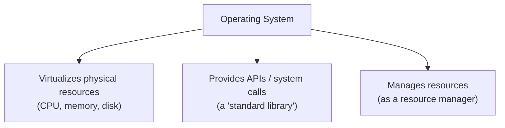
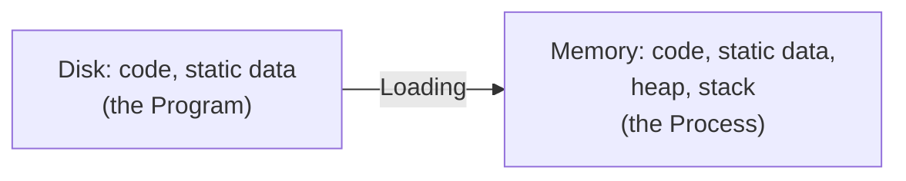
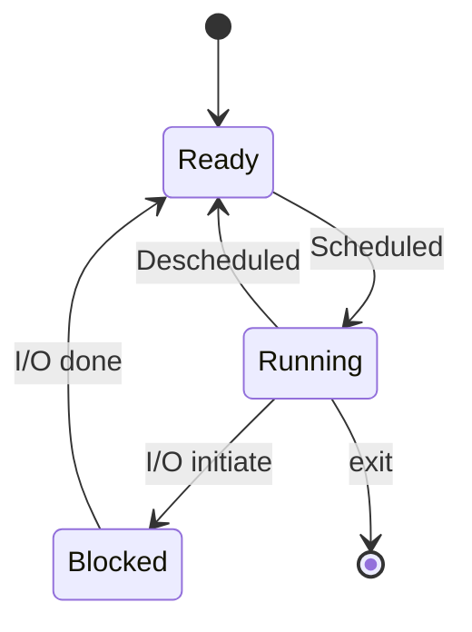

# OSTEP Notes 1 — Introduction, The Process, and the Process API

> Detailed notes on *Operating Systems: Three Easy Pieces* (Arpaci-Dusseau). Covers Ch1-2 (Introduction), Ch4 (The Process abstraction), Ch5 (Process API: fork/wait/exec). See `00-index.md` for the full series map.

---

## 1. What Is an Operating System?

A running program does one simple thing at bottom: it **executes instructions** — the processor fetches, decodes, and executes them, one after another (the **Von Neumann model**). Everything else the OS does exists to make this simple model **easy and safe to use at scale.**

⭐ **The OS's core technique: virtualization.** It takes a **physical resource** (CPU, memory, disk) and transforms it into a more general, powerful, easy-to-use **virtual** form. This is why the OS is sometimes called a **virtual machine.**



- The OS exposes a few hundred **system calls** applications use to invoke its services — this is why it's also thought of as providing a **standard library.**
- Because virtualization lets many programs share the CPU, memory, and disk simultaneously, the OS is also a **resource manager.**

> ⭐ **The book's own framing of its "crux of the problem" boxes:** throughout the book, shaded boxes labeled *"The Crux of the Problem"* call out the specific question a chapter is trying to answer. These are worth reading even when skimming — they're the book's own compressed summary of what actually matters in each chapter.

### Virtualizing the CPU — a first taste (Ch2)
Running one CPU-bound program (`cpu.c`, an infinite loop printing a string) is boring. But running **four instances simultaneously** (`./cpu A & ./cpu B & ./cpu C & ./cpu D &`) shows all four apparently running "at once," even on a single-CPU machine. This is the OS **time-sharing** the one physical CPU — running one process, stopping it, running another, and so on, fast enough to create the illusion of many virtual CPUs. This is **virtualizing the CPU** — Part I of the book.

### Virtualizing Memory — a first taste
Physical memory is just **an array of bytes**, addressed by location. A program (`mem.c`) that `malloc()`s an integer and repeatedly increments it, when run in **multiple instances simultaneously**, shows each instance allocating memory at the **exact same address** (e.g. `00200000`) yet updating its own value **completely independently.** Each process has its own private **virtual address space**, which the OS maps onto physical memory — a memory reference in one process cannot affect another's (or the OS's own) address space, even though physical memory is really one shared resource underneath. This is **virtualizing memory** — the second half of Part I.

### Concurrency — a first taste
A multi-threaded program (`threads.c`) spawns two threads, each incrementing a **shared counter** `loops` times in a loop:
```c
volatile int counter = 0;
int loops;

void *worker(void *arg) {
    int i;
    for (i = 0; i < loops; i++) {
        counter++;
    }
    return NULL;
}
// main(): Pthread_create(&p1,...); Pthread_create(&p2,...);
//         Pthread_join(p1,...);   Pthread_join(p2,...);
```
- With `loops = 1000`, the final counter is reliably `2000` (as expected).
- With `loops = 100000`, the result is **wrong and nondeterministic** — e.g. `143012` one run, `137298` the next. ⭐ **Why:** `counter++` is not atomic — it compiles to **three instructions** (load counter into a register, increment the register, store it back). If the two threads' instruction sequences interleave badly, one thread's increment can be **lost.** This is exactly the subject of Part II (Concurrency).

### Persistence — a first taste
Unlike CPU/memory, DRAM is **volatile** — data vanishes on power loss/crash. **Persistence** requires durable I/O devices (hard drives, SSDs) and software (the **file system**) to manage them reliably. Unlike CPU/memory virtualization, the OS does **not** give each process a private virtual disk — files are meant to be **shared** (e.g., an editor writes a `.c` file, the compiler reads it and writes an executable, which is then run).
```c
int fd = open("/tmp/file", O_WRONLY | O_CREAT | O_TRUNC, S_IRWXU);
int rc = write(fd, "hello world\n", 13);
close(fd);
```
Under the hood, the file system must decide **where on disk** to place new data, track it in on-disk structures, and — critically — survive a crash mid-write via techniques like **journaling** or **copy-on-write** (Part III topics).

### Design Goals of an OS
| Goal | What it means |
|---|---|
| **Abstraction** | Make the system convenient/easy to use — the foundational tool of all of CS (C over assembly, assembly over gates, gates over transistors) |
| **Performance** | Minimize virtualization overhead — extra instructions, extra memory/disk space |
| **Protection / isolation** | Prevent one process (malicious or buggy) from harming another, or the OS itself |
| **Reliability** | The OS must run non-stop — if it fails, every application fails with it |
| **Energy-efficiency, security, mobility** | Secondary but increasingly important goals depending on deployment context |

### A Little History
- **Early OSes were just libraries** — common I/O routines, nothing more; **batch processing** was the norm (a human operator ran a queue of jobs; interactive use was too costly).
- **Protection emerged next** — once the OS started managing hardware directly, code running "as the OS" needed to be treated specially/trusted differently than ordinary application code — the seed of the **kernel/user-mode** distinction covered in the next file.
- Multiprogramming, timesharing, and eventually modern general-purpose multitasking OSes (UNIX, and its many descendants) followed as hardware got cheap enough to support interactive, simultaneous use by many programs/users.

---

## 2. The Abstraction: The Process

⭐ **Definition:** a **process** is simply **a running program.** The program itself, sitting on disk as bytes, is lifeless; the OS is what transforms it into something active.

> **The Crux: How to provide the illusion of many CPUs?** With only a few physical CPUs, how does the OS make it seem like there's a nearly endless supply?

**The technique: time sharing.** Run one process for a while, stop it, run another — repeat. The cost is performance (each process runs more slowly when sharing); the benefit is the illusion of many virtual CPUs.

- **Mechanisms** — low-level methods implementing a piece of functionality (e.g., a **context switch**: how to stop one program and start another).
- **Policies** — the algorithms making decisions on top of mechanisms (e.g., a **scheduling policy**: *which* program to run next).
- ⭐ **Tip: separate policy from mechanism.** Mechanism answers a *how* question; policy answers a *which* question. Keeping them separate is a form of modularity — you can change a scheduling policy without touching the context-switch mechanism underneath it.

### What Constitutes a Process — Machine State
To fully describe a process at any instant, you need its **machine state**:
| Component | What it is |
|---|---|
| **Address space** | The memory the process can address — its instructions and the data it reads/writes |
| **Registers** | General-purpose registers, plus special ones: **program counter (PC)** (aka instruction pointer) — which instruction runs next; **stack pointer** and **frame pointer** — manage the stack for function calls |
| **I/O state** | E.g., a list of currently-open files |

### Process Creation, in Detail
Before a program can run, the OS must:
1. **Load** its code and static data from disk into the process's address space (Figure 4.1: `Disk (code, static data) → Loading → Process (code, static data, heap, stack) in Memory`). ⭐ Early/simple OSes load everything **eagerly** (all at once, upfront); modern OSes load **lazily** — only as pieces are actually needed (this requires the paging/swapping machinery covered in the memory-virtualization files).
2. **Allocate a run-time stack**, and initialize it with `argc`/`argv` for `main()`.
3. **Allocate heap space** for `malloc()`/`free()` — starts small, grows as the program requests more.
4. **Set up I/O** — on UNIX, every process gets **3 open file descriptors by default**: standard input, output, error.
5. **Transfer control** to the program's entry point, `main()`, via a specialized mechanism (covered in the next file, on limited direct execution).



### Process States
A simplified process can be in one of **three states**:

| State | Meaning |
|---|---|
| **Running** | Currently executing instructions on a processor |
| **Ready** | Ready to run, but the OS has chosen not to run it right now |
| **Blocked** | Performed some operation (e.g., initiated I/O) that makes it unable to run until an external event occurs |



**Worked trace — two CPU-only processes:**
| Time | Process0 | Process1 | Notes |
|---|---|---|---|
| 1-4 | Running | Ready | Process0 finishes at t=4 |
| 5-8 | – | Running | Process1 finishes at t=8 |

**Worked trace — Process0 does I/O partway through:**
| Time | Process0 | Process1 | Notes |
|---|---|---|---|
| 1-3 | Running | Ready | Process0 initiates I/O at t=3 |
| 4-6 | Blocked | Running | Process0 blocked → OS runs Process1 instead |
| 7-8 | Ready | Running | I/O completes at t=7; Process1 finishes at t=8 |
| 9-10 | Running | – | Process0 finally runs and finishes |

⭐ Note the OS made **two nontrivial decisions** here: (1) run Process1 while Process0's I/O is pending — this improves **resource utilization** by keeping the CPU busy instead of idling; (2) **not** immediately switching back to Process0 the instant its I/O completed. These decisions are exactly the domain of the **scheduler** (covered in the next file).

### Data Structures — the Process List / PCB
The OS tracks a **process list** (or process table) for every process, recording each one's state, plus enough info to **restart** it later. The **xv6** teaching kernel's `struct proc` is a good concrete illustration:
```c
// the registers xv6 saves/restores to stop and restart a process
struct context {
    int eip; int esp; int ebx; int ecx;
    int edx; int esi; int edi; int ebp;
};

enum proc_state { UNUSED, EMBRYO, SLEEPING, RUNNABLE, RUNNING, ZOMBIE };

struct proc {
    char *mem;                   // Start of process memory
    uint sz;                     // Size of process memory
    char *kstack;                // Bottom of kernel stack for this process
    enum proc_state state;       // Process state
    int pid;                     // Process ID
    struct proc *parent;         // Parent process
    void *chan;                  // If non-zero, sleeping on chan
    int killed;                  // If non-zero, have been killed
    struct file *ofile[NOFILE];  // Open files
    struct inode *cwd;           // Current directory
    struct context context;      // Switch here to run process
    struct trapframe *tf;        // Trap frame for the current interrupt
};
```
- **`context`** holds a stopped process's register values — restoring them (a **context switch**, detailed in the next file) resumes the process exactly where it left off.
- ⭐ Note the extra state **ZOMBIE**: many OSes have a state for a process that has **exited but not yet been cleaned up** — this allows the parent (via `wait()`, below) to inspect its exit status before it's fully removed from the system. This is also literally why a "zombie process" in UNIX terminology means an exited-but-unreaped child.
- **Init process:** every UNIX system has one process, `init`, that is either the **first** one run at boot or an **ancestor** of every other process — useful for the OS to have a canonical top of the process tree.

---

## 3. Interlude: The Process API — `fork()`, `wait()`, `exec()`

> **The Crux: how to create and control processes?** What interfaces should the OS present for process creation and control, so they're both usable and powerful?

UNIX's answer is famously unusual: process creation is split across **two** system calls, `fork()` and `exec()`, with `wait()` to synchronize with a child. This split (rather than one single "run this program" call) turns out to be a deliberately brilliant design, explained below.

### `fork()` — creating an (almost) exact copy of the caller
```c
#include <stdio.h>
#include <stdlib.h>
#include <unistd.h>

int main(int argc, char *argv[]) {
    printf("hello world (pid:%d)\n", (int) getpid());
    int rc = fork();
    if (rc < 0) {           // fork failed
        fprintf(stderr, "fork failed\n");
        exit(1);
    } else if (rc == 0) {   // child (new process)
        printf("hello, I am child (pid:%d)\n", (int) getpid());
    } else {                // parent
        printf("hello, I am parent of %d (pid:%d)\n", rc, (int) getpid());
    }
    return 0;
}
```
Output (one possible interleaving):
```
hello world (pid:29146)
hello, I am parent of 29147 (pid:29146)
hello, I am child (pid:29147)
```
⭐ **What actually happens:** `fork()` creates a new process (the **child**) that is an **almost exact copy** of the calling process (the **parent**) — its own address space, its own registers, its own PC — **as if it had also just called `fork()` itself.** The child does **not** start at `main()` — it starts *right after the `fork()` call returned*, which is why "hello world" only prints once (it ran before the fork).
- ⭐ **The key differentiator:** the **return value** of `fork()` differs between the two: the child gets `0`; the parent gets the child's actual **PID.** This is precisely what lets one piece of code (via the `if/else`) cleanly handle both cases.
- ⭐ **The output order is nondeterministic** — since both processes now exist independently, the CPU scheduler decides which runs first; on a single CPU, either could print first, and you cannot assume a fixed order. (This is the same fundamental nondeterminism that makes concurrent programming hard — Part II.)

### `wait()` — synchronizing with a child
```c
} else {              // parent
    int wc = wait(NULL);
    printf("hello, I am parent of %d (wc:%d) (pid:%d)\n", rc, wc, (int) getpid());
}
```
`wait()` (or its more general sibling `waitpid()`) blocks the calling process until **one of its children finishes.** Adding this makes the output **deterministic**: the child is now *guaranteed* to print first, because even if the parent runs first, it will immediately block in `wait()` until the child has run and exited.

### `exec()` — replacing the current program's image
```c
} else if (rc == 0) {  // child
    printf("hello, I am child (pid:%d)\n", (int) getpid());
    char *myargs[3];
    myargs[0] = strdup("wc");    // program: "wc" (word count)
    myargs[1] = strdup("p3.c");  // argument: file to count
    myargs[2] = NULL;            // marks end of array
    execvp(myargs[0], myargs);   // runs word count
    printf("this shouldn't print out");
}
```
⭐ **What `exec()` does:** given an executable name and arguments, it loads code (and static data) from that executable and **overwrites** the *current* process's code segment and static data — heap, stack, and the rest of the address space are **re-initialized.** ⭐ **Crucially, it does NOT create a new process** — it transforms the *currently running* process into a *different* running program. After a successful `exec()`, it's as if the original program never ran at all — and a successful call **never returns.**

> ⚠️ There are actually six variants: `execl()`, `execle()`, `execlp()`, `execv()`, `execve()`, `execvp()` — differing in how the argument list and environment are passed. Consult the man pages for the exact differences.

### Why Split `fork()` and `exec()`? — the elegant motivating reason
⭐ This odd split is **exactly** what makes it easy to build a **UNIX shell.** A shell is just an ordinary user program: it prints a prompt, reads a command, and then:
1. Calls `fork()` to create a child process.
2. The child calls some `exec()` variant to run the requested command.
3. The parent calls `wait()` to block until the child finishes, then loops back to the prompt.

⭐ **The trick:** because `fork()` and `exec()` are *separate* calls, the shell gets to run **code in between them** — after creating the child, but before replacing its program image. This is exactly how shell features like **I/O redirection** are implemented:
```c
int rc = fork();
if (rc == 0) {          // child: redirect stdout to a file, THEN exec
    close(STDOUT_FILENO);
    open("./p4.output", O_CREAT | O_WRONLY | O_TRUNC, S_IRWXU);
    char *myargs[3] = { strdup("wc"), strdup("p3.c"), NULL };
    execvp(myargs[0], myargs);
} else {
    int wc = wait(NULL);
}
```
⭐ **Why this works:** UNIX file descriptors are assigned starting from the **lowest available number.** Closing `STDOUT_FILENO` (fd 1) frees that slot; the very next `open()` call is guaranteed to be handed fd 1 — so every subsequent write to "standard output" (e.g. via `printf()` inside the soon-to-be-`exec()`'d program) transparently goes to the file instead of the screen. This is *precisely* how `wc p3.c > newfile.txt` works in a real shell. **UNIX pipes** (`|`) work via the same basic principle, using `pipe()` to connect one process's output to another's input.

⭐ **Tip: Lampson's Law — "Get it right."** The book credits this design to Lampson's dictum: *"Neither abstraction nor simplicity is a substitute for getting it right."* There are many possible ways to design a process-creation API; UNIX's designers, by splitting `fork()`/`exec()`, simply found the right one — simple, and enormously powerful once you see what it enables.

### Other Elements of the Process API (brief)
- **Kill / signals:** interfaces to forcibly terminate a runaway process, or to send other **signals** a process can choose to catch/handle/ignore (`Ctrl-C`, `Ctrl-Z`, etc.).
- **Miscellaneous control:** suspend/resume a process.
- **Status:** query how long a process has run, or what state it's in.
- **Users and permissions:** most systems support multiple users, with per-user permissions governing which processes/files a given user can kill/access.

---

## Summary Table

| Concept | One-line definition |
|---|---|
| **Process** | A running program — code + machine state (memory, registers, I/O state) |
| **Virtualizing the CPU** | Time-sharing one/few physical CPUs to create the illusion of many virtual ones |
| **Mechanism vs. policy** | *How* to do something (e.g. context switch) vs. *which* choice to make (e.g. scheduling) |
| **Process states** | Running / Ready / Blocked, transitioned by scheduling decisions and I/O events |
| **`fork()`** | Creates an almost-exact copy of the calling process; returns 0 to child, child's PID to parent |
| **`wait()`** | Blocks the parent until a child exits; makes ordering deterministic |
| **`exec()`** | Replaces the *calling* process's program image entirely; never returns on success |

## Interview/Exam-Ready Talking Points

- Explain **why `fork()` returns two different values** and how that single design choice lets one piece of code handle both parent and child paths.
- Walk through **exactly why splitting `fork()` and `exec()` makes shell I/O redirection trivial** — this is the single most commonly asked "why is UNIX process creation designed this way" question.
- Be ready to draw the **three-state process diagram** from memory, and trace through a worked example involving an I/O-blocking transition.
- Explain the difference between the **process list/PCB** and the **process itself** — the PCB is the OS's *bookkeeping* about a process, not the process's own memory/registers while running.
- Know that a process's **machine state** = address space + registers (including PC, SP) + I/O state (open file descriptors) — this triad reappears constantly (e.g., in context-switch discussions in the next file).