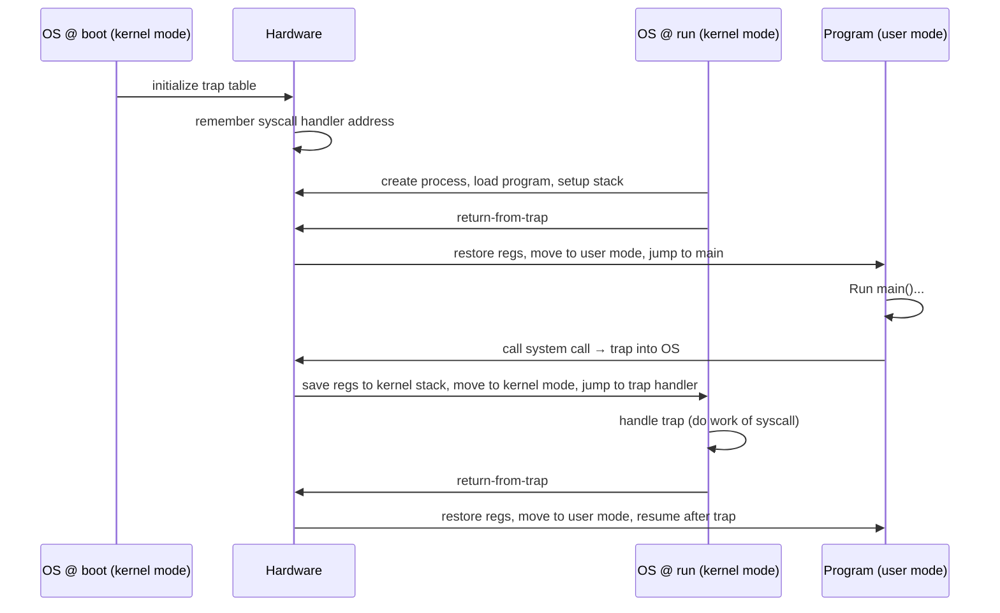
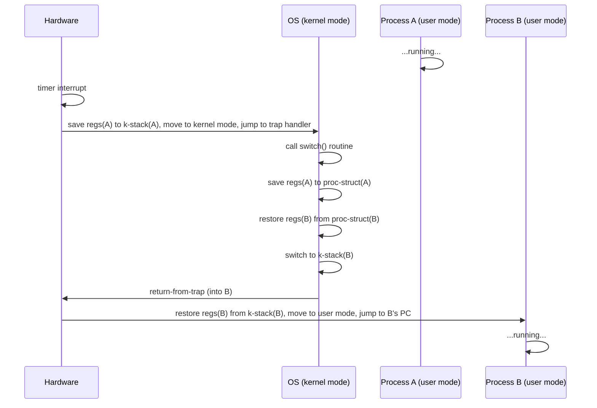

# OSTEP Notes 2 — CPU Virtualization: Mechanism and Scheduling Policies

> Covers Ch6 (Limited Direct Execution), Ch7 (Scheduling Intro), Ch8 (MLFQ), Ch9 (Proportional-Share/Lottery), Ch10 (Multiprocessor Scheduling). See `00-index.md` for the full series map.

---

## Part A: Mechanism — Limited Direct Execution

> **The Crux: how to efficiently virtualize the CPU with control?** The OS must virtualize the CPU efficiently *while retaining control* — needing both hardware and OS support.

### The Basic Idea: Direct Execution
Just run the program **directly on the CPU.** The OS creates a process-list entry, allocates memory, loads the program, sets up the stack with `argc`/`argv`, clears registers, and jumps to `main()`. This is fast (native hardware speed) — but raises two problems.

### Problem #1: Restricted Operations
> **The Crux:** a process must be able to do I/O and other restricted operations, **without** having complete control of the system.

⭐ **The solution: two processor modes.**
| Mode | What runs here | Can do |
|---|---|---|
| **User mode** | Application code | Restricted — attempting a privileged instruction (e.g. raw I/O) raises an exception; OS typically kills the process |
| **Kernel mode** | The OS itself | Anything — privileged instructions, direct hardware access |

**System calls — the sanctioned gateway from user to kernel mode:**
- A user program executes a special **trap instruction**, which simultaneously (a) jumps into the kernel and (b) raises the privilege level to kernel mode.
- The OS does the requested privileged work, then executes a **return-from-trap** instruction, which returns control to the user program **and** lowers the privilege level back to user mode.
- ⭐ **Why system calls look like ordinary C function calls:** they *are* procedure calls — into the C library — which internally uses an agreed-upon calling convention (arguments/syscall-number placed on the stack or in registers) and then executes the trap instruction. The hand-written assembly for this is buried in the C library, so application code never has to write it directly.
- ⭐ **The trap table — why a process can't just jump anywhere into the kernel:** letting user code specify an arbitrary kernel address to jump to would be catastrophic (e.g., jumping straight past a permission check). Instead, at **boot time**, the kernel (running in privileged mode) tells the hardware — via a privileged instruction — exactly which handler code to run for each kind of trap (system call, disk interrupt, keyboard interrupt, etc.). The hardware remembers this **trap table** until the next reboot. Installing/changing the trap table is itself a **privileged operation** — user code attempting it is refused.



### Problem #2: Switching Between Processes
> **The Crux:** if a process is running, the OS by definition is *not* running — so how can the OS ever regain control to switch to another process?

**Two approaches:**

| Approach | Mechanism | Weakness |
|---|---|---|
| **Cooperative** (old Mac OS, Xerox Alto) | The OS trusts processes to periodically **yield** the CPU via system calls, or transfer control when they do something illegal (divide-by-zero, illegal memory access → trap) | A process stuck in an infinite loop with no system call **never** gives control back — the only recourse is to **reboot the machine** |
| **Non-cooperative** (modern systems) | A **timer interrupt** fires every so many milliseconds; when it does, the currently running process is halted and a pre-configured OS interrupt handler runs, **unconditionally** regaining control | Requires timer hardware support, which the OS must configure (and start) at boot — itself a privileged operation |

⭐ **Timer interrupt is essential** — it's exactly what allows the OS to remain in ultimate control even of misbehaving/malicious/infinite-looping processes.

### Saving and Restoring Context — the Context Switch
Once the OS has regained control (cooperatively or via timer), the **scheduler** decides whether to keep running the current process or switch to another. If switching: a **context switch** — save a few register values of the current process (onto its kernel stack or into its process structure) and restore the register values of the next one.

⭐ **Two distinct sets of register saves/restores happen, easy to conflate:**
1. **Implicit hardware save on the timer interrupt** — the running process's *user* registers are automatically saved (onto *its own* kernel stack) by the hardware, exactly as with a regular trap.
2. **Explicit software save during `switch()`** — the OS additionally saves *kernel* registers into the process structure, and restores the *next* process's kernel registers from *its* structure — this is what actually moves the system from "as if it just trapped in from A" to "as if it just trapped in from B."



The actual xv6 context-switch assembly (`swtch()`) is short: save the old IP/stack pointer/registers into the `old` struct, then load them all back from `new`, and `ret` — the final `ret` literally returns into the *new* process's saved instruction pointer, completing the switch.

- ⭐ **Aside — timing:** on 1996 hardware (200MHz), a system call took ~4µs and a context switch ~6µs; modern hardware does sub-microsecond. Note that not all OS overhead tracks CPU clock speed — much of it is **memory-bandwidth-bound**, and memory bandwidth hasn't improved nearly as fast as CPU speed over time.
- **Concurrency concern flagged, deferred to Part II:** what happens if a timer interrupt fires *during* trap handling, or one interrupt occurs while handling another? (Answer, briefly: the OS can disable interrupts during interrupt processing, plus use locking — fully explored in the Concurrency notes file.)

---

## Part B: Scheduling — Introduction

> **The Crux: how to develop a scheduling policy?** What workload assumptions, metrics, and basic approaches matter?

### Workload Assumptions (deliberately unrealistic at first, relaxed progressively)
1. Each job runs for the same amount of time.
2. All jobs arrive at the same time.
3. Once started, each job runs to completion.
4. All jobs only use the CPU (no I/O).
5. The run-time of each job is known in advance.

### Scheduling Metrics
- **Turnaround time:** `T_turnaround = T_completion − T_arrival`. A **performance** metric.
- **Response time:** `T_response = T_firstrun − T_arrival`. Matters once interactive, time-shared use became common.
- **Fairness** is a separate concern, often in direct tension with performance.

### FIFO (First In, First Out)
Simple, easy to implement, and (under assumptions 1-5) performs fine. **Breaks down once job lengths vary:**
- 3 jobs A(100s), B(10s), C(10s), arriving together, run in order A→B→C: average turnaround = **110s** (`(100+110+120)/3`).
- ⭐ This is the **convoy effect** — short jobs queue up behind one long job, like a grocery line stuck behind someone with three overflowing carts.

### SJF (Shortest Job First)
Run the shortest job first, then next shortest. For the same A/B/C example, running B→C→A gives average turnaround = **50s** (`(10+20+120)/3`) — more than 2x better. ⭐ **Provably optimal** *given the current assumptions* (all jobs arrive together). But SJF is **non-preemptive** — if a short job arrives *just after* a long one has started, it still must wait for the long one to fully finish (convoy effect returns): A(100s, arrives t=0), B & C(10s each, arrive t=10) under SJF → average turnaround ≈ **103.3s.**

### STCF (Shortest Time-to-Completion First) / PSJF
Relax assumption 3 (run to completion) — add **preemption.** Whenever a new job arrives, the scheduler compares its length against the *remaining* time of the currently running job, and runs whichever is shortest. In the example above: A is preempted the instant B/C arrive; B and C run to completion; A resumes. Result: average turnaround = **50s** (`((120-0)+(20-10)+(30-10))/3`) — provably optimal under these looser assumptions.

### Response Time and Round Robin
STCF is great for turnaround time but **terrible for response time** — with 3 same-length jobs arriving together, the 3rd job might wait through the other two's *entire* runtime before ever getting scheduled once.

⭐ **Round Robin (RR / time-slicing):** run each job for a fixed **time slice** (scheduling quantum), then move to the next job in the queue; repeat until all are done.
- 3 jobs, 5s each, with a 1s time slice: RR's average response time = **1s** (`(0+1+2)/3`) vs. SJF's **5s** (`(0+5+10)/3`).
- ⭐ **The time-slice-length trade-off:** shorter slices → better response time, but the **cost of context switching** (register save/restore, *plus* flushing/rebuilding CPU cache/TLB/branch-predictor state) starts to dominate if the slice is too short. E.g., a 1ms context switch cost with a 10ms slice wastes 10% of CPU time; stretch the slice to 100ms and the waste drops below 1% — but response time worsens correspondingly. ⭐ **Amortization** is the general technique: make the expensive fixed cost (switching) a smaller fraction of the total by doing more useful work between occurrences of it.
- ⭐ **RR is nearly the worst possible policy for turnaround time** — same 3x5s-job example gives an average turnaround of **14s** under RR (vs. 5s under SJF). This is an **inherent trade-off**: fairness (small-timescale equal sharing) directly costs turnaround time, and vice versa. *"You can't have your cake and eat it too."*

### Incorporating I/O
Relax assumption 4. When a job issues I/O, it **blocks** — the CPU should run something else in the meantime, or utilization is wasted (Figure: naively running A-then-B leaves the CPU **idle** during A's I/O waits). ⭐ **The standard fix:** treat each **CPU burst** between I/O operations as an independent "job" for scheduling purposes. Under STCF, a short CPU burst (A's 10ms sub-job) is scheduled ahead of a long one (B's 50ms burst), letting the system **overlap** — running B's CPU work *while A's I/O is in flight* — dramatically improving overall resource utilization.

### No More Oracle — the SJF/STCF Problem
Assumption 5 (job lengths known in advance) is the least realistic of all — a real scheduler is **not omniscient.** This unsolved problem sets up MLFQ, next.

---

## Part C: The Multi-Level Feedback Queue (MLFQ)

> **The Crux: how to schedule without perfect knowledge?** Minimize response time for interactive jobs *and* turnaround time, without knowing job lengths up front.

⭐ **The core idea: learn from the past to predict the future.** MLFQ observes how a job **behaves** as it runs and adjusts its priority accordingly, rather than assuming it knows job length in advance.

### Basic Structure and Rules
Multiple distinct **queues**, each a different priority level; a job runs on whichever queue it currently sits in, using **round robin** among jobs at the same level.

- **Rule 1:** If Priority(A) > Priority(B), A runs (B doesn't).
- **Rule 2:** If Priority(A) = Priority(B), A and B run in round robin.

### Attempt #1 — Changing Priority Based on Behavior
- **Rule 3:** A new job enters at the **highest** priority (topmost queue).
- **Rule 4a:** If a job **uses its entire time slice**, its priority is **reduced** (moves down a queue).
- **Rule 4b:** If a job **gives up the CPU before the slice ends** (e.g., for I/O), it **stays at the same level.**

**Behavior this produces:**
- **A long-running CPU-bound job** steadily sinks from the top queue to the bottom, one time-slice-exhaustion at a time.
- **A short job** arriving at the top queue completes (within 1-2 time slices) before ever sinking far — ⭐ **MLFQ thereby approximates SJF without knowing job lengths in advance**: it optimistically assumes every new job *might* be short, and only demotes it once it proves otherwise by actually running a long time.
- **An I/O-bound interactive job** that repeatedly yields before its slice expires (Rule 4b) **stays at the top** — exactly the behavior you want for responsiveness.

### Problems With Attempt #1
1. **Starvation:** if there are enough interactive jobs, they can collectively consume 100% of CPU time, and long-running jobs at the bottom **never run at all.**
2. **Gaming the scheduler:** a sneaky process can issue a bogus I/O operation *just before* its time slice ends, relinquishing the CPU (satisfying Rule 4b) while nearly monopolizing CPU time at high priority.
3. **Behavior change over time:** a job that starts CPU-bound but later becomes interactive is stuck at low priority under the current rules, even once its behavior genuinely changes.

### Attempt #2 — The Priority Boost
- **Rule 5:** After some time period `S`, move **every** job in the system to the topmost queue.
- ⭐ **Fixes both starvation (guaranteed periodic access to the CPU at top priority) and stale-behavior tracking (a now-interactive job gets properly re-evaluated).**
- ⚠️ **The catch:** choosing `S` is a genuine **"voo-doo constant"** (Ousterhout's Law) — too large and long jobs can starve between boosts; too small and interactive jobs lose their fair share as CPU-bound jobs keep re-entering the top queue.

### Attempt #3 — Better Accounting (anti-gaming)
- **Rule 4 (replaces 4a/4b):** the scheduler tracks **total CPU time used at the current level**, regardless of how many times the job yielded and resumed. Once that time allotment is exhausted, the job is demoted — **whether it used the time in one burst or many small ones.**
- This closes the gaming exploit entirely: yielding right before the slice ends no longer resets the accounting.

### Tuning and Real-World Variants
- Most real MLFQs vary time-slice **length per queue** — short slices (≤10ms) at high (interactive) priority levels, long slices (100s of ms) at low (CPU-bound) levels.
- **Solaris's Time-Sharing (TS) class:** default ~**60 queues**, slice length rising from ~20ms (top) to a few hundred ms (bottom), boost roughly every 1 second — configurable via tables.
- **FreeBSD 4.3** computes priority via a **decay-usage formula** instead of explicit rules/boosts.
- Some schedulers reserve the very highest priority levels for **OS work only**; many expose user-adjustable hints (`nice`) to bias a job's priority up or down.

⭐ **Summary line:** MLFQ has multiple levels of queues, and uses **feedback** (observed behavior) to set priority — *"history is its guide."*

---

## Part D: Proportional-Share (Lottery / Stride) Scheduling

> **The Crux: how to share the CPU proportionally?** Instead of optimizing turnaround/response time, guarantee each job a target **percentage** of CPU time.

### Lottery Scheduling — Basic Concept
- **Tickets** represent a process's share of a resource. If A has 75 tickets and B has 25 (out of 100 total), the *goal* is A gets 75% of the CPU, B gets 25%.
- Every so often (e.g., each time slice), hold a **lottery**: pick a random winning ticket number out of the total; the process holding that ticket range runs.
```c
int counter = 0;
int winner = getrandom(0, totaltickets);
node_t *current = head;
while (current) {
    counter = counter + current->tickets;
    if (counter > winner) break;      // found the winner
    current = current->next;
}
// 'current' is the winner: schedule it...
```
⭐ **Why randomness is a genuinely good design choice** (the book gives three reasons): (1) it **avoids nasty corner cases** that deterministic algorithms can hit (e.g., LRU cache replacement performs *pessimally* on certain cyclic-access workloads — random has no such adversarial worst case); (2) it's **lightweight**, needing minimal per-process state (just a ticket count, vs. a traditional fair-share scheduler's detailed usage accounting); (3) it's **fast** — generating a random number is cheap.
- ⚠️ **Only probabilistically correct, not exact** — over a short run, B might get only 20% instead of 25%; the longer the two compete, the closer the *actual* ratio converges to the *target* ratio. Unfairness `U = T_first_job_completes / T_second_job_completes` is close to 1 only once job lengths are long enough (many time slices).

### Ticket Mechanisms
| Mechanism | Purpose |
|---|---|
| **Ticket currency** | A user can allocate their own tickets among their own jobs in an arbitrary "local currency"; the system converts to a global value automatically (e.g., User A gives 500/500 of *their own* 1000 to jobs A1/A2 → 50/50 globally; User B gives all 10 of *their* 10 to B1 → 100 globally) |
| **Ticket transfer** | A process can temporarily hand its tickets to another — useful in client/server settings, where a client boosts a server's priority while it works on the client's behalf |
| **Ticket inflation** | A (trusted) process can temporarily raise/lower its own ticket count to signal need, without inter-process communication — only sensible among mutually trusting processes, since an untrusted greedy process could otherwise inflate itself to dominate the machine |

### The Unsolved "Ticket-Assignment Problem"
Lottery scheduling doesn't tell you **how many tickets each job should get** — that remains an open design question, typically punted to "assume the users/administrators know best."

### Stride Scheduling — Deterministic Fair Share
Waldspurger's deterministic alternative, since randomness alone doesn't guarantee exact proportions (especially over short runs):
- Each job's **stride** = `large_number / tickets` (e.g., dividing 10,000 by ticket counts 100/50/250 gives strides 100/200/40 for A/B/C).
- Each job also tracks a **pass** value, starting at 0.
```c
current = remove_min(queue);        // pick client with minimum pass value
schedule(current);                  // let it run for one quantum
current->pass += current->stride;   // advance its pass by its stride
insert(queue, current);             // put back into the queue
```
- **Always run whichever job has the lowest `pass` value**; after running, increment that job's `pass` by its stride. A job with a *smaller* stride (more tickets) accumulates `pass` more slowly, so it gets picked *more often* — exactly proportional to its ticket share, **deterministically**, no randomness involved.
- ⭐ **Why lottery scheduling is still sometimes preferred despite being less precise:** stride scheduling needs **global state** (every job's current `pass` value) to make each decision — this makes it awkward to handle a job **newly entering** the mix (what pass value should it start at, relative to already-running jobs?). Lottery scheduling has **no such global-state problem** — a new job simply enters with its ticket count, and the very next lottery naturally accounts for it. This is a genuine, non-obvious advantage of embracing randomness.
- The Linux **Completely Fair Scheduler (CFS)** is mentioned as another modern approach in this same proportional-share family, using weighted virtual-runtime tracking rather than lottery/stride mechanics specifically — worth knowing by name even where this edition doesn't detail its internals.

---

## Part E: Multiprocessor Scheduling (Advanced)

> **The Crux: how to schedule jobs on multiple CPUs?** What new problems arise beyond single-CPU scheduling?

### Background — Caches and Cache Coherence
Each CPU typically has a small, fast **cache** holding copies of frequently-used data (exploiting **temporal locality** — recently accessed data will likely be accessed again soon — and **spatial locality** — nearby data is likely to be accessed soon too).

⭐ **The multi-CPU cache-coherence problem, concretely:** CPU 1 reads value `D` at address `A` into its cache, modifies it to `D′` (written back to main memory *later*, since write-back is slow), then the OS **migrates the process to CPU 2.** CPU 2 has no cached copy of `A`, so it fetches straight from main memory — getting the **stale value `D`**, not `D′`. This is the **cache coherence problem.**
- **Hardware's fix — bus snooping:** each CPU's cache watches (**"snoops"**) the shared memory bus for updates to addresses it holds cached; on seeing a relevant write, it either **invalidates** its own stale copy or updates it.

### Don't Forget Synchronization
Cache coherence alone does **not** make concurrent access to shared data structures safe. A worked example: two threads on two different CPUs both execute the classic linked-list-removal sequence concurrently — each reads the current `head` into its own **stack-local** `tmp` variable (so both see the *same* head, unaware of each other) — both then try to "remove" the same node, corrupting the list. ⭐ **This is exactly why mutual-exclusion primitives (locks) are required** even with perfect hardware cache coherence — coherence guarantees *visibility* of memory updates, not *atomicity* of multi-step operations. (Fully explored in the Concurrency notes file.)

### Cache Affinity
⭐ A process, having built up state in one CPU's cache (and TLB, branch predictors, etc.), runs **faster if kept on that same CPU** in the future rather than being bounced to a different one, which would force it to rebuild that cached state from scratch. Multiprocessor schedulers should try to preserve this **affinity** where possible, even while still needing to balance load.

### Single-Queue Multiprocessor Scheduling (SQMS)
The simplest extension: one global scheduling queue, shared across all CPUs. Easy to build atop an existing single-CPU scheduler.
- ⚠️ **Problem 1 — scalability:** the shared queue needs **locking** to stay correct under concurrent access from multiple CPUs; as CPU count grows, lock contention overhead grows too, eating into useful work.
- ⚠️ **Problem 2 — poor cache affinity:** if each CPU just grabs "the next job" off the shared queue, jobs **bounce constantly between CPUs** (e.g., job A might run on CPU0, then CPU1, then CPU2... in successive time slices) — exactly the opposite of cache-friendly behavior. Mitigating this (deliberately keeping most jobs affinity-pinned, migrating only a few) is possible but adds real implementation complexity.

### Multi-Queue Multiprocessor Scheduling (MQMS)
Each CPU gets its **own** independent scheduling queue (each perhaps running its own round robin or other discipline internally). A new job is placed on one queue via some heuristic (random, or "whichever queue is shortest").

⭐ **Advantages over SQMS:** inherently more **scalable** (no single shared lock/queue as CPU count grows), and **cache affinity comes for free** (a job generally stays on the CPU whose queue it landed on).

⚠️ **The new problem it introduces: load imbalance.** If jobs finish unevenly across queues, one CPU can end up **overloaded** while another sits **partially or fully idle** — e.g., with jobs A/C on CPU0's queue and B/D on CPU1's, if C finishes, CPU0's remaining job A gets a full CPU to itself while CPU1 splits time between B and D (A gets **2x** the CPU share of B/D — not the intended equal split). In the worst case (both A and C finish), **CPU0 goes fully idle** while CPU1's queue still has work.

**The fix: migration.**
- Simple case (one CPU idle, one has jobs): migrate one job over — problem solved with a single move.
- Trickier case (CPU0 has 1 job, CPU1 has 2, but neither is idle): a **single** migration doesn't fully rebalance; the fix is **continuous migration** — periodically swap jobs between queues (e.g., alternate which job sits on which CPU over time) so that, averaged over time, load stays balanced.
- ⭐ **Work stealing** — the standard mechanism for deciding *when* to migrate: a (source) queue that's running low on jobs occasionally **peeks** at another (target) queue; if the target is notably fuller, the source **steals** one or more jobs from it. ⚠️ **Tuning trade-off:** peeking too often incurs high overhead (defeats MQMS's scalability advantage); peeking too rarely risks prolonged load imbalance — another instance of the recurring "how often to check" tuning dilemma seen elsewhere in the book (e.g., MLFQ's boost interval `S`).

---

## Summary Table

| Chapter | Core mechanism/policy | Key trade-off |
|---|---|---|
| **Limited Direct Execution** | User/kernel mode + trap table + timer interrupt | Performance (direct execution) vs. control (restricted ops, forced reclaim of CPU) |
| **FIFO / SJF / STCF** | Run jobs by arrival order / shortest job / shortest remaining time | Great turnaround time, terrible response time (non-preemptive variants also suffer convoy effect) |
| **Round Robin** | Fixed time-slice rotation | Great response time, terrible turnaround time; slice length trades responsiveness vs. context-switch overhead |
| **MLFQ** | Multiple priority queues, demote on full-slice use, periodic boost | Approximates SJF/RR without knowing job length in advance, at the cost of many tunable "voo-doo constants" |
| **Lottery / Stride** | Ticket-proportional random draw / deterministic pass-value tracking | Probabilistic-but-simple (lottery) vs. exact-but-stateful (stride); ticket *assignment* remains unsolved |
| **Multiprocessor (SQMS/MQMS)** | Shared vs. per-CPU queues | Scalability + cache affinity (MQMS) vs. load imbalance requiring migration/work-stealing |

## Interview/Exam-Ready Talking Points

- Explain **why system calls need a trap table set up at boot**, and precisely why user code can't just jump to an arbitrary kernel address.
- Walk through the **two distinct register-save events** during a timer-interrupt-triggered context switch (hardware-implicit vs. OS-explicit) — this distinction is frequently glossed over but is a strong signal of real understanding.
- Derive **turnaround vs. response time trade-offs** for FIFO/SJF/STCF/RR from first principles with a worked numeric example — this is the classic OS-course exam question.
- Explain **how MLFQ approximates SJF without knowing job length**, and enumerate the 3 problems (starvation, gaming, behavior change) that motivate its successive rule refinements.
- Explain **why lottery scheduling's randomness is a genuine engineering strength**, not just "good enough" — the three specific reasons (avoiding adversarial worst cases, minimal state, speed) are worth reciting precisely.
- Give the **cache coherence vs. synchronization distinction** clearly: coherence (hardware) ensures a *consistent view* of memory across caches; it does **not** make multi-step shared-data operations atomic — that still requires locks.
- Explain the **SQMS vs. MQMS trade-off** (scalability + cache affinity vs. load imbalance) and how **work stealing** resolves it.