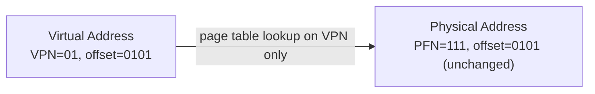
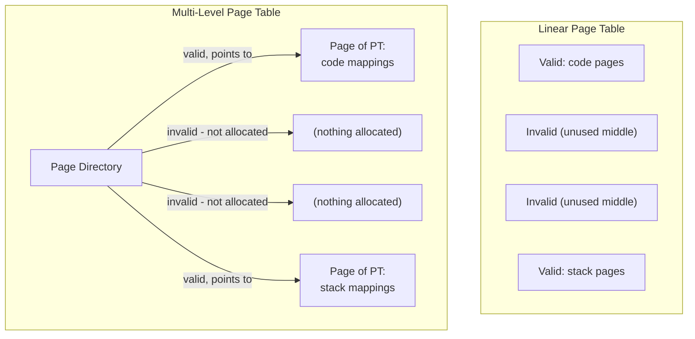

# OSTEP Notes 4 — Free-Space Management and Paging

> Covers Ch17 (Free-Space Management), Ch18 (Paging: Introduction), Ch19 (Paging: TLBs), Ch20 (Paging: Smaller Tables). See `00-index.md` for the full series map.

---

## Part A: Free-Space Management

> **The Crux:** how should free space be managed when satisfying variable-sized requests, minimizing fragmentation, with reasonable time/space overhead?

This chapter applies both to a user-level `malloc` library (managing heap pages) and to an OS managing physical memory under **segmentation.** The hard case is **variable-sized** free chunks (fixed-size chunks, as in paging, are comparatively easy — just keep a list and hand out the first entry). Assumptions: managing a single contiguous region; once handed to a client, memory cannot be relocated (so no compaction is possible at this level, unlike in a garbage-collected language).

### Splitting and Coalescing
Given a 30-byte heap with a 10-byte free / 10-byte used / 10-byte free layout, the free list has two 10-byte entries.
- **Splitting:** a request smaller than any single free chunk (e.g., 1 byte) causes the allocator to take a free chunk, hand back just the requested piece, and keep the (now smaller) remainder on the free list.
- **Coalescing:** when a chunk is freed, if it's physically adjacent to existing free chunk(s), **merge them into one larger chunk** immediately — otherwise a heap that's entirely free could still appear fragmented into many small pieces on the free list, unable to satisfy a large request even though total free space would suffice.

### Tracking Allocated-Region Size — the Header
`free(void *ptr)` takes **only a pointer** — no size. The library must independently know how big the freed chunk is. **Solution:** a small **header**, stored just *before* the pointer returned to the caller:
```c
typedef struct __header_t {
    int size;   // size of allocated region (not including header)
    int magic;  // sanity-check value
} header_t;

void free(void *ptr) {
    header_t *hptr = (void *)ptr - sizeof(header_t);
    assert(hptr->magic == 1234567);   // sanity check
    // ... add (hptr, hptr->size + sizeof(header_t)) back to free list ...
}
```
⭐ **Important consequence:** a request for `N` bytes actually needs a free chunk of `N + sizeof(header_t)` bytes — the header itself consumes space.

### Embedding the Free List
Since the allocator can't call `malloc()` for its own bookkeeping (that would be circular), the free list is built **inside the free space itself** — each free chunk's first few bytes double as a `node_t { size, next }` struct, literally embedding the linked list within the memory it describes.

### Growing the Heap
Most allocators start small and request more memory from the OS via `sbrk` when they run low — the OS finds free physical pages, maps them into the process's address space, and returns the new heap-end address.

### Basic Allocation Strategies
| Strategy | Rule | Trade-off |
|---|---|---|
| **Best fit** | Search the *whole* list; return the **smallest** chunk that's still big enough | Minimizes wasted space per allocation, but requires a full (slow) search, and tends to leave many tiny leftover slivers |
| **Worst fit** | Return the **largest** available chunk | Intended to avoid tiny leftovers, but studies show it performs poorly — high search cost *and* high fragmentation |
| **First fit** | Return the **first** chunk found that's big enough | Fast (no exhaustive search) — but can "pollute" the front of the list with small fragments; address-sorted ordering helps by easing coalescing |
| **Next fit** | Like first fit, but resumes searching from **where it left off last time** | Similar performance to first fit, spreads search more evenly across the list |

**Worked example** — free list `[10, 30, 20]`, request for 15:
- Best fit → picks the 20-chunk (smallest that fits) → leaves `[10, 30, 5]`
- Worst fit → picks the 30-chunk (largest) → leaves `[10, 15, 20]`
- First fit → also picks the 30-chunk here (first one ≥15) → same result as worst-fit in this specific case, but at lower search cost

### Other Approaches
- **Segregated lists:** if an application makes frequent requests of one particular size, maintain a **dedicated free list** just for that size — allocation/free become fast (no search) and fragmentation for that size class nearly vanishes. ⭐ **Solaris's slab allocator** (Jeff Bonwick) extends this: pre-allocates **object caches** for frequently-needed kernel objects (locks, inodes), requesting whole "slabs" from a general allocator as needed, and — cleverly — keeps freed objects in their **pre-initialized state**, avoiding repeated init/destroy overhead per object.
- **Buddy allocation:** conceptually treat free memory as one block of size `2^N`. To satisfy a request, **recursively halve** the free space until the smallest power-of-two block that still fits is found.
```
                      64 KB
                     /     \
                    /       \
                32 KB       32 KB
               /    \
              /      \
          16 KB     16 KB
          /  \
         /    \
      8 KB    8 KB   <- allocated (for a 7KB request)
```
  - ⭐ **Why buddy allocation is elegant:** coalescing on `free()` is trivial and cheap — when an 8KB block is freed, just check whether its **"buddy"** 8KB block is also free; if so, merge into 16KB, then check *that* block's buddy, and so on recursively. The buddy of any block is trivially computable because **buddy pairs' addresses differ by exactly one bit** (the bit position determined by tree level).
  - ⚠️ Cost: only **power-of-two** sized blocks are ever handed out → **internal fragmentation** (a 7KB request consumes a full 8KB block, wasting 1KB inside the allocation).

---

## Part B: Paging — Introduction

> **The Crux:** how can we virtualize memory using pages, avoiding segmentation's problems, with minimal space/time overhead?

⭐ **Core idea:** instead of variable-sized logical segments, chop the address space into **fixed-size pages**, and physical memory into equal-size **page frames.** Because units are fixed-size, the OS's free-space bookkeeping becomes trivially simple — just a list of free frames, hand out the first one. **No external fragmentation** at all (a huge advantage over segmentation), and **no assumptions about how the address space is used** (unlike segmentation's code/heap/stack convention) — much more **flexible.**

### Worked Example
A tiny 64-byte address space (four 16-byte pages: VP 0-3) placed into a 128-byte physical memory (eight page frames), with a **page table** recording: `VP0->PF3, VP1->PF7, VP2->PF5, VP3->PF2`.

**Splitting a virtual address into VPN + offset:** for a 64-byte address space with 16-byte pages, we need 6 bits total; the **top 2 bits** select one of 4 pages (VPN), the **bottom 4 bits** are the **offset** within that page.
```
   VPN      offset
  Va5 Va4 | Va3 Va2 Va1 Va0
```
**Worked translation** — access virtual address 21 (`010101` in binary):
```
VPN = 01 (= 1)         offset = 0101 (= 5)
```
Look up VPN 1 in the page table -> PFN 7 (`111`). ⭐ **Only the VPN is translated — the offset passes through unchanged** (it's the same byte position *within whichever frame* the page lands). Final physical address: concatenate PFN with offset -> `111 0101` = 117 decimal.


### Where Are Page Tables Stored?
⭐ **Page tables can be HUGE.** A typical 32-bit address space with 4KB pages needs a **20-bit VPN** -> 2^20 (~1 million) possible translations per process. At 4 bytes/PTE, that's **4MB per process** — and **400MB** for 100 processes, just for translation metadata! (A 64-bit address space would be dramatically worse.)
- Because they're so large, page tables **cannot live in dedicated on-chip MMU hardware** the way a small base/bounds register pair could. Instead, they're stored **in regular (OS-managed) physical memory** — one per process.

### What's Actually In a Page Table Entry (PTE)
The simplest structure: a **linear page table** — just an array, indexed directly by VPN.

| PTE field | Purpose |
|---|---|
| **Valid bit** | Is this VPN actually mapped/in-use? ⭐ Unused regions (the gap between heap and stack) are simply marked invalid — no physical frame is wasted on them, which is exactly how paging supports **sparse address spaces** cheaply |
| **Protection bits** | Read/write/execute permissions — violating access raises a trap |
| **Present bit** | Is this page currently in physical memory, or has it been **swapped out** to disk? (covered in the next notes file) |
| **Dirty bit** | Has this page been modified since being loaded? |
| **Reference/accessed bit** | Has this page been accessed recently — used for page-replacement decisions (also next notes file) |

### Paging Is Also Too Slow — the Fundamental Cost
For **every** memory reference (instruction fetch, load, or store), the hardware must first do an **extra memory access** to fetch the relevant PTE from the page table, *before* it can even compute the physical address to actually access:
```c
VPN = (VirtualAddress & VPN_MASK) >> SHIFT;
PTEAddr = PageTableBaseRegister + (VPN * sizeof(PTE));
PTE = AccessMemory(PTEAddr);         // <-- extra memory reference!
if (PTE.Valid == False)      RaiseException(SEGMENTATION_FAULT);
else if (!CanAccess(PTE.ProtectBits)) RaiseException(PROTECTION_FAULT);
else {
    offset = VirtualAddress & OFFSET_MASK;
    PhysAddr = (PTE.PFN << SHIFT) | offset;
    Register = AccessMemory(PhysAddr);   // the actual access
}
```
⭐ Every logical memory access now costs **two** physical memory accesses — a potential **2x (or worse) slowdown.** This is the second major problem paging must solve (the first being space overhead, above) — and it's exactly what motivates the **TLB**, next.

---

## Part C: Paging — Faster Translations (TLBs)

> **The Crux:** how can we make address translation fast, without unacceptable overhead?

⭐ **Solution: cache frequently-used translations** in a small, dedicated, on-chip hardware structure — the **translation-lookaside buffer (TLB)**, technically an address-translation cache, but universally called a TLB for historical reasons. TLBs are why paging-based virtual memory is fast enough to be practical at all.

### Basic TLB Algorithm
```c
VPN = (VirtualAddress & VPN_MASK) >> SHIFT;
(Success, TlbEntry) = TLB_Lookup(VPN);
if (Success == True) {                    // TLB HIT
    if (CanAccess(TlbEntry.ProtectBits)) {
        Offset = VirtualAddress & OFFSET_MASK;
        PhysAddr = (TlbEntry.PFN << SHIFT) | Offset;
        Register = AccessMemory(PhysAddr);
    } else RaiseException(PROTECTION_FAULT);
} else {                                    // TLB MISS
    // walk the page table (hardware or software, see below),
    // fetch the PTE, install it in the TLB, retry the instruction
}
```
- A **TLB hit** avoids the extra page-table memory access entirely — dramatically faster.
- A **TLB miss** requires the (much slower) full page-table walk described in Part B, **plus** inserting the new translation into the TLB.

### Worked Example — Array Access and Locality
Iterating over `int array[1000]` (4 bytes/int, 16-byte pages -> 4 ints/page):
- `a[0]` -> **TLB miss** (first touch of its page); `a[1]`, `a[2]`, `a[3]` -> **hits** (same page, translation now cached).
- `a[4]` -> **miss** again (new page); `a[5]`, `a[6]`, `a[7]` -> hits; `a[8]` -> miss; `a[9]` -> hit.
- Overall pattern: `miss, hit, hit, miss, hit, hit, hit, miss, hit, hit` -> **70% hit rate** here purely from **spatial locality.** A subsequent loop re-touching the same array would see an even better rate, thanks to **temporal locality** — this is exactly the **general caching tip** the book emphasizes: exploit locality, keep the cache small (for speed) and rely on hit rate, not size, for performance.

### Who Handles a TLB Miss — Hardware vs. Software?
| Approach | Who walks the page table | Architecture examples |
|---|---|---|
| **Hardware-managed TLB** | The CPU itself, using a known fixed page-table format and a page-table base register (e.g., x86's `CR3`) | Older CISC designs (x86) |
| **Software-managed TLB** | On a miss, the hardware just raises an exception; a dedicated OS **trap handler** walks the page table (in whatever format the OS chooses), updates the TLB with a privileged instruction, and retries the faulting instruction | Modern RISC designs (MIPS, SPARC) |

⭐ **Advantage of software-managed TLBs:** **flexibility** (the OS can use *any* page-table data structure it likes, no hardware format constraint) and **simplicity** (the hardware only needs to raise an exception, not walk anything itself).
- ⚠️ **Subtlety:** the return-from-trap for a TLB-miss handler must resume at the **instruction that caused the trap** (to retry it, now expecting a hit) — different from a system-call return-from-trap, which resumes at the instruction *after* the trap.
- ⚠️ **Subtlety:** the OS must ensure the TLB-miss handler code itself doesn't recursively trigger more TLB misses (e.g., by keeping handler code unmapped/always-resident, or reserving a few permanently-valid "**wired**" TLB entries for it).

### TLB Contents
A typical TLB (32-128 entries) is **fully associative** — any translation can sit in any slot, and the hardware searches all entries **in parallel.** Each entry: `VPN | PFN | valid | protection bits | (other fields, e.g. ASID, dirty bit)`.

### TLB Issue: Context Switches
⭐ **The problem:** TLB entries are only meaningful for the process that was running when they were cached — VPN 10 might map to PFN 100 for process P1 but PFN 170 for process P2. Without disambiguation, a context switch risks using the **wrong** translation.

| Fix | Mechanism | Cost |
|---|---|---|
| **Flush on every context switch** | Set all TLB valid bits to 0 (explicit privileged instruction, or automatic on page-table-base-register change) | Guaranteed correctness, but every process incurs a fresh wave of TLB misses each time it's scheduled |
| **Address-Space Identifier (ASID)** | Tag every TLB entry with an ASID (like a lightweight PID, e.g., 8 bits); on a context switch, set a privileged register to the new process's ASID | TLB entries from multiple processes can **coexist**, avoiding the flush cost — much better performance for frequent switching |

- **Shared pages** (e.g., a shared code library) can have **two different VPNs** (one per process) both pointing to the **same PFN**, each tagged with its own ASID — this is exactly how memory-saving code sharing across processes works at the TLB level too.

### TLB Replacement Policy
When the (small, fixed-size) TLB is full and a new entry must be inserted, something must be evicted — **LRU (least-recently-used)** and **random** are common policies (deeper page-replacement policy discussion is in the next notes file, on "Beyond Physical Memory").

---

## Part D: Paging — Smaller Tables

> **The Crux:** page tables are correct but *space-inefficient* (Part B's problem). How do we shrink them without losing paging's other benefits?

### Simple Idea: Bigger Pages
Fewer, larger pages -> fewer VPN bits needed -> smaller page table. ⚠️ Trade-off: bigger pages waste more space **within** a page that isn't fully used by the process — **internal fragmentation** (echoing the buddy-allocator issue in Part A). Real systems generally prefer smaller pages for this reason, sometimes with optional **multiple page sizes** (e.g., huge pages) for special high-performance cases.

### Hybrid Approach: Paging + Segmentation
Use **one page table per logical segment** (code/heap/stack), each with its **own base and bounds register.** The bounds register tracks the **highest valid page** in that segment — so unused space between heap and stack simply never needs page-table entries allocated for it at all.
```c
SN = (VirtualAddress & SEG_MASK) >> SN_SHIFT;
VPN = (VirtualAddress & VPN_MASK) >> VPN_SHIFT;
AddressOfPTE = Base[SN] + (VPN * sizeof(PTE));
```
⭐ Genuine space savings, but two real downsides: (1) it **still assumes segmentation's usage pattern** — a large, sparsely-used heap can still waste significant page-table space; (2) since page tables themselves now vary in size (segment-dependent), **external fragmentation reappears**, this time for page-table allocation itself. ⭐ **Tip: use hybrids** — combining two good ideas (paging + segmentation) captures much of each one's strength, though rarely *all* of it.

### Multi-Level Page Tables — the Real Solution
⭐ **Core idea:** chop the (linear) page table itself into **page-sized chunks**; if an *entire* chunk (page) of PTEs is invalid (i.e., covers only unused address-space regions), **don't allocate it at all.** Track which chunks exist via a new structure, the **page directory** — one **page directory entry (PDE)** per chunk of the page table, each with a valid bit and (if valid) a pointer to where that chunk lives in physical memory.



⭐ **Semantics of a PDE's valid bit:** it means **"at least one PTE in the page-table chunk this PDE points to is valid"** — *not* "this specific PTE is valid" the way a linear-page-table entry's bit would mean.

**Worked two-level translation example:** virtual address `0x3F80` (`11 1111 1000 0000`), with a page directory indexed by the top 4 VPN bits and a page-table chunk indexed by the next 4:
1. Top 4 bits `1111` -> index **15** into the page directory -> points to a valid page-table chunk at (say) PFN 101.
2. Next 4 bits `1110` -> index **14** into *that* chunk -> PTE says physical frame **55.**
3. Concatenate PFN 55 with the offset (`000000`) -> final physical address.

**Advantages:**
- ⭐ **Space proportional to actual usage** — a sparse address space only allocates page-table chunks for the parts that are actually in use (the worked example above needs just **3** pages total — 1 directory + 2 chunks — instead of a full linear table's many pages).
- **Easier physical memory management:** each chunk fits neatly in one page, so the OS can allocate/grow page-table space **incrementally**, one free page at a time — unlike a linear page table, which must be one large **contiguous** allocation (hard to find for something like a 4MB table).

⭐ **The cost — a time-space trade-off:** looking up a translation now potentially requires **multiple sequential memory accesses** (one per level, to walk the tree) before even reaching the real data — more than a flat linear table's single lookup. This is a textbook **time-space trade-off**: multi-level tables save substantial memory at the cost of extra lookup latency **on a TLB miss** (a TLB hit, as always, sidesteps this entirely, since the full translation is already cached).

### More Than Two Levels
A very large/sparse address space (e.g., 64-bit) may need the page directory *itself* to be so large that **it too** must be split across multiple pages, requiring yet another directory level on top — yielding **three or more levels** in practice. The general translation algorithm just repeats the "index this level, follow the pointer, index the next level" pattern recursively down the tree.

### Inverted Page Tables (briefly)
An alternative that flips the structure entirely: instead of one table **per process** with one entry per virtual page, keep a **single, global table** with one entry **per physical frame**, recording which process and which VPN currently occupies it. This saves substantial memory (one table total, not one per process) but makes lookups harder — a linear scan (or a hashed structure over it) is needed to find a given process's VPN, rather than a direct array index.

---

## Summary Table

| Chapter | Key structure | Solves | Introduces |
|---|---|---|---|
| **Free-space management** | Free list (split/coalesce), best/worst/first-fit, segregated lists, buddy allocation | Variable-sized allocation with minimal fragmentation | Trade-offs between search cost, fragmentation, and internal waste (buddy) |
| **Paging (intro)** | Fixed-size pages + linear page table | No external fragmentation; flexible, no address-space-usage assumptions | Huge page-table memory cost; extra memory access per translation |
| **TLBs** | Small, fully-associative hardware cache of recent translations | The extra-memory-access slowdown | Context-switch correctness (flush vs. ASID tagging) |
| **Multi-level page tables** | Page directory + page-sized PTE chunks, allocated only where needed | The huge page-table memory cost | Extra sequential memory accesses per level on a TLB miss (time-space trade-off) |

## Interview/Exam-Ready Talking Points

- Explain **splitting and coalescing** with a worked free-list example, and precisely state *why* coalescing is necessary (a fully-free heap can still "look" fragmented without it).
- Walk through a **full virtual-to-physical address translation** by hand: split the VA into VPN + offset, look up the PTE, concatenate PFN with the unchanged offset.
- Quantify **why linear page tables are impractically large** (the 4MB-per-process, 32-bit/4KB-page calculation) — this is a classic exam numeric-reasoning question.
- Explain **exactly what a TLB hit/miss changes** about the translation process, and be ready to trace a locality-driven hit/miss pattern (the array-access example).
- Precisely distinguish the **two TLB context-switch solutions** (flush vs. ASID) and their cost trade-off.
- Explain the **semantic difference between a PDE's valid bit and a PTE's valid bit** in a multi-level page table — this is one of the most commonly-missed details in exam answers.
- Be able to state the **core time-space trade-off** multi-level page tables represent, and connect it back to the general theme (seen again in LSM-trees, buddy allocation, and elsewhere) of trading one resource for another rather than eliminating a cost outright.