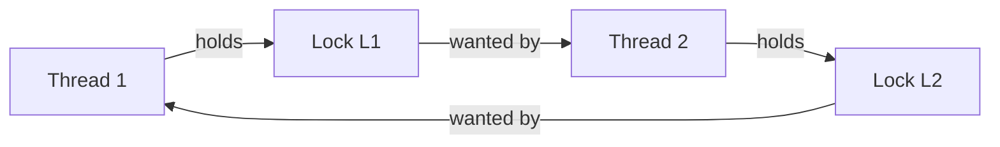

# OSTEP Notes 7 — Condition Variables, Semaphores, Common Bugs, and Event-Based Concurrency

> Covers Ch30 (Condition Variables), Ch31 (Semaphores), Ch32 (Common Concurrency Problems), Ch33 (Event-Based Concurrency). See `00-index.md` for the full series map.

---

## Part A: Condition Variables

> **The Crux: how to wait for a condition?** Just spinning until a condition becomes true is grossly inefficient (wastes CPU) and can even be incorrect. Locks alone aren't enough — we also need a way to **sleep** until something changes.

### Definition and Routines
A **condition variable** is an explicit queue threads can put themselves on (`wait()`) when some state isn't as desired; another thread, once it changes that state, can `signal()` to wake one (or more) waiters.
```c
pthread_cond_wait(pthread_cond_t *c, pthread_mutex_t *m);
pthread_cond_signal(pthread_cond_t *c);
```
⭐ **Crucial detail:** `wait()` takes the **mutex** as a parameter, and assumes it's **already locked** when called. Its job: **atomically** release the lock and put the caller to sleep; when later woken, it **re-acquires the lock** before returning. This atomicity is exactly what avoids a specific class of race condition (illustrated below).

### Worked Example — Parent Waiting for Child
```c
int done = 0;
pthread_mutex_t m = PTHREAD_MUTEX_INITIALIZER;
pthread_cond_t  c = PTHREAD_COND_INITIALIZER;

void thr_exit() {
    Pthread_mutex_lock(&m);
    done = 1;
    Pthread_cond_signal(&c);
    Pthread_mutex_unlock(&m);
}
void *child(void *arg) { printf("child\n"); thr_exit(); return NULL; }

void thr_join() {
    Pthread_mutex_lock(&m);
    while (done == 0)
        Pthread_cond_wait(&c, &m);
    Pthread_mutex_unlock(&m);
}
int main() {
    pthread_t p;
    Pthread_create(&p, NULL, child, NULL);
    thr_join();
    return 0;
}
```
⭐ **Why the state variable `done` is essential (not just the signal itself):** without it, if the child runs to completion and signals **before** the parent ever calls `wait()`, that signal is simply lost (no one was asleep to receive it) — and the parent would then wait forever. `done` records the fact independent of scheduling timing, so `thr_join()` can check it *before* deciding whether to sleep at all.

⭐ **Why the mutex is essential even around signal/wait (not just for the critical section):** without holding the lock, a race can slip in between the parent's check (`done == 0`) and its call to `wait()` — if the child runs and signals in that exact gap, the parent then sleeps forever, having missed the wakeup. Locking the check-and-sleep together as one atomic unit (which is exactly what `wait()`'s "release lock + sleep" atomicity guarantees) closes this gap entirely.

> **Tip: always hold the lock while signaling** (even though it's not *strictly* required in every case) — it's simplest and safest, and avoids subtle races like the one above.

---

## Part B: The Producer/Consumer (Bounded Buffer) Problem

⭐ **The canonical concurrency exercise** — worth memorizing end to end, because every step introduces a real, distinct bug class.

### Attempt 1: Single CV, `if` instead of `while` — broken
```c
void *producer(void *arg) {
    Pthread_mutex_lock(&mutex);          // p1
    if (count == 1)                      // p2
        Pthread_cond_wait(&cond, &mutex); // p3
    put(i);                               // p4
    Pthread_cond_signal(&cond);          // p5
    Pthread_mutex_unlock(&mutex);        // p6
}
void *consumer(void *arg) {
    Pthread_mutex_lock(&mutex);          // c1
    if (count == 0)                      // c2
        Pthread_cond_wait(&cond, &mutex); // c3
    int tmp = get();                      // c4
    Pthread_cond_signal(&cond);          // c5
    Pthread_mutex_unlock(&mutex);        // c6
}
```
⭐ **Bug: with 2+ consumers, a woken thread's premise can go stale before it runs.** Signaling only *wakes* a thread — it does not guarantee the state is still as expected by the time that thread actually gets scheduled and runs. This behavior is called **Mesa semantics** (after the first system to build CVs this way) — contrasted with the harder-to-implement **Hoare semantics**, which *would* guarantee the woken thread runs immediately. ⭐ **"Virtually every system ever built uses Mesa semantics"** — which is exactly why the fix below (`while`, not `if`) is universally necessary in real code.

### Attempt 2: `while` instead of `if` — still broken (with only 1 CV)
Simply changing `if` to `while` re-checks the condition upon waking, closing the staleness gap. But a **second** bug remains, specific to using a **single** condition variable for both roles:

⭐ **The bug:** with two sleeping consumers and one producer, if a woken consumer's `signal()` happens to wake the **other consumer** instead of the producer (which thread wakes is unspecified/queue-dependent), that consumer finds the buffer still empty, goes back to sleep — and **everyone ends up asleep**, including the producer, who never gets woken at all. A consumer's signal needs to be **directed specifically at producers**, and vice versa — a single shared CV has no way to express that distinction.

### Attempt 3: Two Condition Variables — correct
```c
cond_t empty, fill;
mutex_t mutex;

void *producer(void *arg) {
    Pthread_mutex_lock(&mutex);
    while (count == MAX)
        Pthread_cond_wait(&empty, &mutex);
    put(i);
    Pthread_cond_signal(&fill);
    Pthread_mutex_unlock(&mutex);
}
void *consumer(void *arg) {
    Pthread_mutex_lock(&mutex);
    while (count == 0)
        Pthread_cond_wait(&fill, &mutex);
    int tmp = get();
    Pthread_cond_signal(&empty);
    Pthread_mutex_unlock(&mutex);
}
```
⭐ **The fix:** producers wait on `empty` and signal `fill`; consumers wait on `fill` and signal `empty`. By construction, **a consumer can never accidentally wake another consumer**, and vice versa — this design eliminates the second bug entirely, and combined with `while` (fixing the first bug), gives a **fully correct** solution. Extending `MAX` from 1 to a multi-slot buffer (with `fill_ptr`/`use_ptr` indices) is then a small, mechanical change — this final version is the standard, production-quality bounded-buffer pattern.

### Covering Conditions
⭐ A related pattern: when a memory allocator's `free()` doesn't know exactly *which* waiting thread's request its newly-freed space will satisfy, it must use a `signal()` that **covers** all cases — implemented as `pthread_cond_broadcast()`, waking **every** waiter (each re-checks its own condition under `while` and goes back to sleep if not actually satisfied). Less efficient than a targeted `signal()` (wakes threads that will just re-sleep), but sometimes the only correct option when the exact right thread to wake can't be determined precisely.

---

## Part C: Semaphores

> **The Crux: how to use semaphores?** Can one primitive replace *both* locks and condition variables?

⭐ **Dijkstra's semaphore** is exactly this unifying primitive — an object holding an integer value, manipulated only via two atomic routines:
```c
int sem_wait(sem_t *s) { decrement value by 1; wait/block if value is now negative; }
int sem_post(sem_t *s) { increment value by 1; if threads waiting, wake one; }
```
- Historically named `P()` (Dutch *proberen*, "to try") and `V()` (*verhogen*, "to increase").
- Must be **initialized** to a starting value before use: `sem_init(&s, 0, value)`.
- ⭐ **Invariant worth memorizing:** when the value is **negative**, its absolute value equals the **number of threads currently waiting.**

### Binary Semaphores (Locks)
```c
sem_t m;
sem_init(&m, 0, 1);      // initial value 1 == a lock, unlocked
sem_wait(&m);             // acquire
// critical section
sem_post(&m);             // release
```
⭐ **Why the initial value must be 1:** the first `sem_wait()` decrements to 0 (not negative -> proceeds immediately, "acquiring" the lock). A second thread calling `sem_wait()` while the first holds it decrements to -1 (negative -> blocks). The eventual `sem_post()` increments back to 0 and wakes the waiter.

### Semaphores for Ordering (as a Condition Variable Replacement)
```c
sem_t s;
sem_init(&s, 0, 0);            // initial value 0 -- "nothing has happened yet"

void *child(void *arg) { printf("child\n"); sem_post(&s); return NULL; }
int main() {
    pthread_t c;
    Pthread_create(&c, NULL, child, NULL);
    sem_wait(&s);                // wait for child
    printf("parent: end\n");
}
```
⭐ **Two distinct trace outcomes**, both correct:
- **Parent waits first:** `sem_wait()` decrements to -1, parent sleeps; child eventually posts, incrementing to 0 and waking the parent.
- **Child runs first:** child posts immediately, incrementing to 1; parent's later `sem_wait()` decrements to 0 without ever blocking.

### The Producer/Consumer Problem, Solved With Semaphores
**First attempt** (`MAX=1`, single buffer):
```c
sem_t empty, full;
sem_init(&empty, 0, MAX);  // MAX buffers start empty
sem_init(&full,  0, 0);    // 0 buffers start full

void *producer(void *arg) {
    for (...) { sem_wait(&empty); put(i); sem_post(&full); }
}
void *consumer(void *arg) {
    for (...) { sem_wait(&full); int tmp = get(); sem_post(&empty); }
}
```
Works for `MAX=1`. ⭐ **But breaks with multiple producers/consumers and `MAX>1`:** the `put()`/`get()` index updates (`fill`/`use` pointers) are themselves a **critical section**, and this code has no mutual exclusion around them — two producers can race and **overwrite each other's data.**

**Second attempt — adding a mutex, incorrectly (deadlock!):**
```c
sem_wait(&mutex);   // p0 -- NEW, but placed OUTSIDE
sem_wait(&empty);   // p1
put(i);
sem_post(&full);
sem_post(&mutex);   // p4
```
⭐ **The bug: classic deadlock via lock-ordering cycle.** A consumer grabs `mutex` first, then blocks on `sem_wait(&full)` (buffer empty) — **while still holding `mutex`.** A producer, ready to supply data and signal `full`, first needs `mutex` — but it's held by the blocked consumer. **Consumer waits on the producer (for `full`); producer waits on the consumer (for `mutex`, which the consumer won't release until it gets data it's now blocked waiting for)** — a genuine circular wait.

**The correct fix — shrink the mutex's scope to exclude the ordering waits:**
```c
sem_wait(&empty);   // p1 -- ordering wait happens FIRST, outside the mutex
sem_wait(&mutex);   // p1.5 -- mutex only wraps the actual critical section
put(i);
sem_post(&mutex);
sem_post(&full);
```
⭐ **Lesson:** mutual-exclusion locks and ordering-wait semaphores must be scoped **separately** — never hold a mutex across a call that might block waiting for another thread's action, or you risk exactly this style of deadlock.

### Reader-Writer Locks and Dining Philosophers (brief mention)
Semaphores also naturally build **reader-writer locks** (many concurrent readers, but writers need exclusive access) and solve classic textbook problems like the **Dining Philosophers** (5 philosophers, 5 forks, each needing 2 adjacent forks to eat -- a direct illustration of the circular-wait deadlock condition, solved by breaking the symmetry, e.g. having one philosopher pick up forks in the opposite order from the others). These, plus the "cigarette smoker's" and "sleeping barber" problems, are named historical exercises mainly useful as concurrency-reasoning practice.

### How to Implement Semaphores ("Zemaphores")
⭐ Semaphores can themselves be built from **just a lock and a condition variable** — showing the two primitives are, in a sense, equally powerful:
```c
typedef struct __Zem_t { int value; pthread_cond_t cond; pthread_mutex_t lock; } Zem_t;

void Zem_wait(Zem_t *s) {
    Mutex_lock(&s->lock);
    while (s->value <= 0)
        Cond_wait(&s->cond, &s->lock);
    s->value--;
    Mutex_unlock(&s->lock);
}
void Zem_post(Zem_t *s) {
    Mutex_lock(&s->lock);
    s->value++;
    Cond_signal(&s->cond);
    Mutex_unlock(&s->lock);
}
```
(This simplified version never lets `value` go below 0 -- unlike a "pure" Dijkstra semaphore -- which matches how Linux actually implements it in practice.)

> **Tip: be careful with generalization** (Lampson) -- semaphores are a genuinely elegant single primitive covering both locking and ordering, but that flexibility is also exactly why semaphore-based code can be **harder to read** than separate, purpose-specific locks and condition variables -- each use has to be mentally classified as "is this a lock or an ordering wait?"

---

## Part D: Common Concurrency Problems

> **The Crux:** what patterns of concurrency bugs occur in practice, and how do you find/avoid/fix them?

Based on a real empirical study (Lu et al.) of **MySQL, Apache, Mozilla, and OpenOffice**: **105 total bugs -- 74 non-deadlock, 31 deadlock.**

### Non-Deadlock Bugs (the majority -- and often easier to fix)

**1. Atomicity-violation bugs** -- a code region *intended* to execute as a single atomic unit, isn't. Real MySQL example:
```c
// Thread 1:
if (thd->proc_info) { ...; fputs(thd->proc_info, ...); ... }
// Thread 2:
thd->proc_info = NULL;
```
⭐ Thread 1's check-then-use isn't atomic -- Thread 2 can set the pointer to NULL in the gap, causing a NULL-pointer crash in `fputs`. **Fix:** wrap both accesses in the **same lock.**

**2. Order-violation bugs** -- a desired ordering between two operations (`A` before `B`) isn't enforced. Real Mozilla example:
```c
// Thread 1: mThread = PR_CreateThread(mMain, ...);
// Thread 2 (mMain): mState = mThread->State;   // assumes mThread already set!
```
⭐ If Thread 2 runs before Thread 1 finishes assigning `mThread`, it dereferences NULL. **Fix:** exactly the ordering problem condition variables solve -- introduce a state flag + CV, and have Thread 2 `wait()` until the flag confirms Thread 1 has completed the assignment.

### Deadlock Bugs

⭐ **Why deadlock happens in real, complex systems:** (1) **complex module dependencies** -- e.g., in an OS, the virtual memory system may need the file system (to page in a block), while the file system may need virtual memory (to get a buffer) -- circular dependencies can arise naturally between subsystems; (2) **encapsulation actively works against you** -- a seemingly innocent API like Java's `Vector.AddAll()` internally acquires locks on both its receiver and argument; calling `v1.AddAll(v2)` and `v2.AddAll(v1)` concurrently from different threads can deadlock, entirely hidden behind the abstraction.

### The 4 Necessary Conditions for Deadlock
⭐ **All four must hold simultaneously** -- breaking any single one prevents deadlock:
| Condition | Meaning |
|---|---|
| **Mutual exclusion** | Threads claim exclusive control of a resource (e.g., a lock) |
| **Hold-and-wait** | A thread holds one resource while waiting to acquire another |
| **No preemption** | Resources can't be forcibly taken away from a thread holding them |
| **Circular wait** | A cycle of threads exists, each waiting on a resource the next one holds |



### Deadlock Prevention (attack one of the 4 conditions)
| Technique | Attacks | How |
|---|---|---|
| **Total/partial lock ordering** | Circular wait | Always acquire locks in a globally (or partially) agreed order (e.g., always L1 before L2) -- ⭐ real example: **Linux's memory-mapping code** documents ~10 explicit partial lock-ordering rules in its source comments |
| **Acquire all locks at once, atomically** | Hold-and-wait | Grab a global "prevention" lock before acquiring any of the real locks, ensuring no thread can be interrupted mid-acquisition -- ⚠️ requires knowing all needed locks upfront (hurts encapsulation) and reduces concurrency |
| **`trylock()` + backoff** | No preemption | `lock(L1); if (trylock(L2) == -1) { unlock(L1); goto top; }` -- if the second lock isn't available, **release what you're holding and retry** rather than blocking while holding L1. ⚠️ Introduces **livelock** -- two threads can repeatedly collide and back off forever without deadlocking, but also without making progress (mitigated by adding random delay before retrying) |
| **Wait-free / lock-free data structures** | Mutual exclusion (avoid it entirely) | Use CAS-based retry loops instead of locks: `do { old = *value; } while (CAS(value, old, old+amount) == 0);` -- no lock is ever held, so deadlock is structurally impossible (though livelock remains possible) |

### Deadlock Avoidance via Scheduling
⭐ A **global scheduler**, with full knowledge of which threads need which locks, can sometimes construct a schedule that **never lets conflicting lock-acquisitions run concurrently** -- e.g., ensuring threads competing for the same two locks are never co-scheduled on different CPUs at the same time. **Dijkstra's Banker's Algorithm** is the classic example. ⚠️ **Rarely practical**: requires complete advance knowledge of all future resource needs, and can significantly **reduce concurrency/performance** -- mostly limited to specialized environments (e.g., some embedded systems).

### Detect and Recover
⭐ **The pragmatic real-world default for many systems** (especially databases): let deadlocks occasionally happen, run a periodic **detector** (build a resource-dependency graph, check for cycles), and **recover** by restarting the affected component (or the whole system) when one is found -- sometimes with a human in the loop for complex data-structure repair.

> **Tip: don't always do it perfectly (Tom West's Law).** *"Not everything worth doing is worth doing well."* If a bad outcome is both rare and cheap, it's not worth large amounts of engineering effort to prevent entirely -- (with the explicit caveat that this absolutely does *not* apply if you're building something like a space shuttle).

---

## Part E: Event-Based Concurrency (Advanced)

> **The Crux: how to build concurrent servers *without* threads**, retaining full control over scheduling and avoiding lock/deadlock-related bugs entirely?

### The Basic Idea: An Event Loop
```c
while (1) {
    events = getEvents();
    for (e in events)
        processEvent(e);
}
```
⭐ **The core idea:** wait for something ("an event") to happen, then handle it -- one at a time, single-threaded. Because only **one** event handler ever runs at a time, **deciding which event to process next *is* scheduling** -- giving the programmer **explicit, direct control** over ordering, unlike relying on an opaque OS thread scheduler.

### `select()`/`poll()` -- Detecting Events
```c
int select(int nfds, fd_set *readfds, fd_set *writefds,
           fd_set *errorfds, struct timeval *timeout);
```
Checks a set of file descriptors to see which are ready for reading/writing, without blocking indefinitely on any single one:
```c
while (1) {
    fd_set readFDs;
    FD_ZERO(&readFDs);
    for (fd = minFD; fd < maxFD; fd++) FD_SET(fd, &readFDs);
    int rc = select(maxFD+1, &readFDs, NULL, NULL, NULL);
    for (fd = minFD; fd < maxFD; fd++)
        if (FD_ISSET(fd, &readFDs)) processFD(fd);
}
```

### Why Simpler? No Locks Needed
⭐ On a single CPU, an event-based server **needs no locks at all** -- since only one event handler ever executes at a time, it inherently **cannot be interrupted** by another handler racing for the same data. This structurally eliminates the entire category of concurrency bugs covered in Part D.

> **Tip: don't block in event-based servers.** The single biggest rule: **no call within a handler may block** -- a blocking call would freeze the *entire* event loop, since there's no other thread to keep making progress. This is precisely what motivates the next problem.

### A Problem: Blocking System Calls
Ordinary system calls (`read()`, `write()`, disk I/O in general) **block** the calling thread until completion -- fatal for a single-threaded event loop, since the whole server would freeze during that I/O.

### A Solution: Asynchronous I/O
⭐ **Async I/O (`aio_read()` and similar):** issue the I/O request and **return immediately**; the caller later **polls** (or is notified) when the operation completes, rather than blocking on it. This preserves the single-threaded event loop's core promise (never block), at the cost of restructuring code around callbacks/completion-checking instead of simple sequential calls.
- **Hybrid approaches exist too:** some systems (Pai et al.) use events for fast network-packet handling, but fall back to a small **thread pool** specifically to manage slower, harder-to-make-truly-async disk I/O.

### Another Problem: State Management ("Manual Stack Management")
⭐ **A genuine cost of the event-based style:** in ordinary thread-based code, a sequence like `read(); write();` naturally keeps all its needed local state on the **thread's own stack** across the blocking `read()` call. In event-based code, since the handler **returns** immediately after issuing an async read (rather than blocking), any state it will need later (e.g., the buffer, the destination socket) must be **manually packaged up** into a data structure and handed off, to be picked up again by whatever handler processes the eventual completion event. This extra bookkeeping -- explicitly reconstructing what a normal call stack would have given you for free -- is a real, recurring source of complexity in event-based systems, sometimes called **"stack ripping."**

### What Is Still Difficult With Events (brief)
- Handling **multi-CPU parallelism cleanly** -- a pure single-threaded event loop doesn't naturally use multiple cores; real systems often run multiple event loops (or hybridize with threads) to get multi-core benefit, reintroducing some of the very same synchronization concerns events were meant to avoid.
- Integrating gracefully with unavoidably-blocking or asynchronous OS mechanisms other than plain I/O (e.g., **signals**, page faults) remains genuinely awkward.

---

## Summary Table

| Concept | Core rule | Failure mode if violated |
|---|---|---|
| **Condition variables** | `wait()` under lock, always re-check in a `while` loop, hold lock while signaling | Mesa-semantics staleness bug (if `if` used instead of `while`); lost wakeups |
| **Producer/consumer pattern** | Two CVs (`empty`/`fill`), `while`-loop checks | Single-CV version can wake the wrong thread class and deadlock everyone |
| **Semaphores** | One primitive, two roles -- binary semaphore (lock) or counting semaphore (ordering) | Mixing mutex scope with ordering waits incorrectly -> classic circular-wait deadlock |
| **Deadlock** | Requires all 4 conditions (mutual exclusion, hold-and-wait, no preemption, circular wait) | Break any one condition (ordering, atomic multi-acquire, trylock+backoff, lock-free structures) to prevent it |
| **Event-based concurrency** | Single-threaded loop, never block in a handler | Blocking calls freeze the whole server; requires async I/O + manual state packaging |

## Interview/Exam-Ready Talking Points

- Walk through the **producer/consumer bug progression** from memory: single-CV+`if` (Mesa staleness) -> single-CV+`while` (wrong-thread-class wakeup) -> two-CV+`while` (correct) -- this is the single most testable concurrency sequence in the whole book.
- Precisely state **Mesa vs. Hoare semantics**, and explain why "always use `while`, never `if`" is a direct, unconditional consequence of virtually every real system using Mesa semantics.
- Walk through the **semaphore-based producer/consumer deadlock** (mutex wrapping an ordering wait) and its fix -- a genuinely subtle, frequently-tested bug pattern.
- Recite the **4 necessary conditions for deadlock** and, for each, name a concrete prevention technique that specifically breaks it.
- Distinguish **atomicity violations from order violations** using the real MySQL/Mozilla examples, and explain why the fix differs (a lock, vs. a condition variable/flag).
- Explain **why event-based servers need no locks on a single CPU**, and precisely what problem **async I/O** and **manual state packaging (stack ripping)** each solve/introduce in that model.