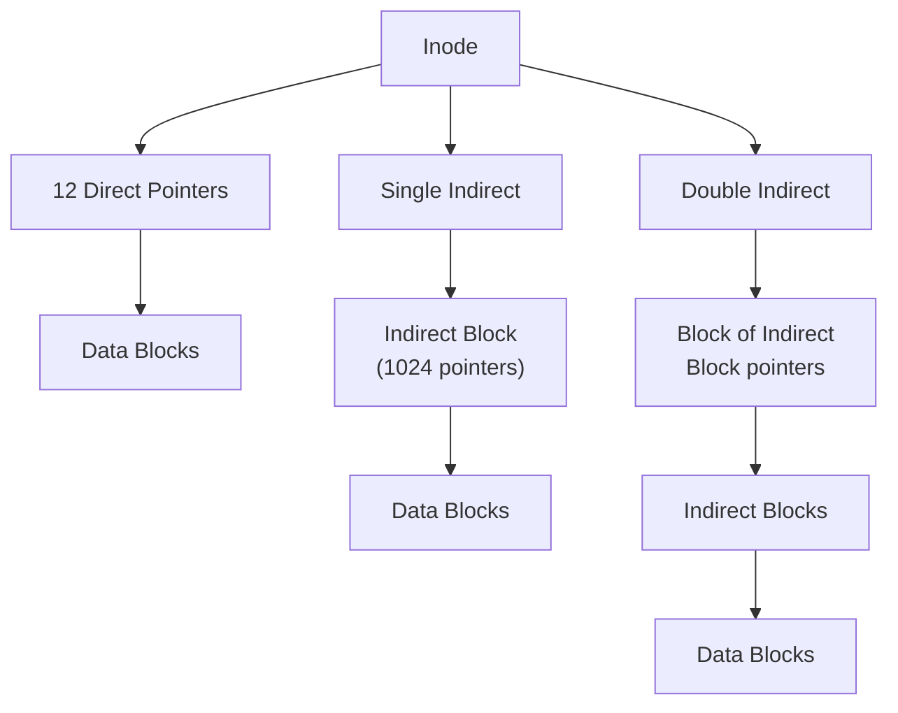

# OSTEP Notes 9 — Files and Directories, File System Implementation, and FFS

> Covers Ch39 (Interlude: Files and Directories), Ch40 (File System Implementation — vsfs), Ch41 (Locality and the Fast File System). See `00-index.md` for the full series map.

---

## Part A: Files and Directories

### Two Key Abstractions
- **File** — a linear array of bytes, readable/writable, with a low-level name (an **inode number**). The OS generally doesn't understand a file's internal structure — that's up to the application.
- **Directory** — itself has an inode number, but its **contents** are specific: a list of `(user-readable name, low-level name)` pairs, each referring to a file or another directory. Nesting directories builds an arbitrary **directory tree**, rooted at `/` on UNIX.

> **Tip: think carefully about naming.** UNIX names almost *everything* — files, devices, pipes, even processes — through the single unified file-system namespace. This uniformity simplifies the conceptual model of the whole system.

### The File System Interface (Key Calls)
| Call | Purpose |
|---|---|
| `open(path, flags, mode)` | Returns a **file descriptor** — a private, per-process integer handle |
| `read(fd, buf, size)` / `write(fd, buf, size)` | Sequential I/O from the current file offset, which auto-advances |
| `lseek(fd, offset, whence)` | Reposition the file offset for non-sequential access |
| `fsync(fd)` | Force all dirty data (and metadata) for this file to disk immediately |
| `stat()`/`fstat()` | Retrieve file metadata (size, permissions, timestamps, inode number...) |
| `mkdir()` / `rmdir()` | Create/delete a directory — `rmdir()` requires the directory be **empty** first |
| `unlink()` | Remove a name from the file system (explained in depth below) |

⭐ **File descriptors are per-process, private, and reused via lowest-available-number allocation** — this exact fact is what makes shell I/O redirection possible (covered in the earlier Process API notes file).

⭐ **Why `write()` doesn't necessarily write to disk immediately:** most file systems buffer writes in memory for a while (for performance — batching, scheduling, avoiding redundant writes) before flushing to disk. `fsync()` exists precisely to force durability when an application needs a guarantee *now*, rather than trusting the buffering layer's own schedule.

### Hard Links
⭐ **The key insight: creating a file is really two separate operations bundled together** — (1) making the **inode**, which tracks all real metadata about the file (size, block locations, etc.), and (2) **linking** a human-readable name to that inode, recorded as an entry in a directory.

```
prompt> echo hello > file
prompt> ln file file2       # hard link: a second name for the SAME inode
prompt> ls -i file file2
67158084 file
67158084 file2
```
⭐ **This is exactly why deletion is called `unlink()`, not `delete()`:** a file's inode carries a **reference count (link count)** — the number of directory entries currently pointing to it. `unlink()` removes *one* name and decrements the count; the underlying inode and its data blocks are only actually freed once that count reaches **zero.**
```
echo hello > file     ->  Links: 1
ln file file2         ->  Links: 2   (file and file2 both point to inode 67158084)
ln file2 file3        ->  Links: 3
rm file                ->  Links: 2  (file2, file3 still valid — data survives)
```

### Symbolic (Soft) Links
⭐ **Why they exist:** hard links have real limitations — you can't hard-link to a **directory** (risk of creating a cycle in the tree) and can't hard-link **across file systems** (inode numbers are only unique *within* one file system). Symbolic links solve both.

⭐ **A symbolic link is a genuinely different kind of file** — a third file *type* (alongside regular files and directories), whose data content is simply the **pathname string** of the target:
```
prompt> ln -s file file2
prompt> ls -al
lrwxrwxrwx 1 remzi remzi 4 May 3 19:10 file2 -> file    # size = 4 bytes = strlen("file")
```
⭐ **Consequence: dangling references are possible** (unlike hard links) — since a symlink just stores a *path*, deleting the target leaves the symlink pointing at nothing:
```
rm file
cat file2   # cat: file2: No such file or directory
```

### Making and Mounting a File System
- `mkfs` writes a **fresh, empty file system** (with its own root directory) onto a device/partition.
- `mount` takes that standalone file system and **grafts it** onto an existing directory (the **mount point**) in the unified system-wide tree — e.g., `mount -t ext3 /dev/sda1 /home/users` makes the new file system's root accessible as `/home/users`. ⭐ This is exactly how a single OS transparently unifies many separate physical/logical file systems (different disks, partitions, even network file systems like AFS) into **one coherent namespace.**

---

## Part B: File System Implementation — vsfs (a simple example)

> **The Crux:** how do we build a simple file system? What on-disk structures are needed, and how are they accessed?

⭐ **The book's recommended "way to think" about any file system: two lenses.** (1) **Data structures** — what on-disk layout stores data/metadata? (2) **Access methods** — how do `open()`/`read()`/`write()` map onto reads/writes of those structures? Understanding both = a working mental model of the file system.

### Overall On-Disk Organization
Divide the disk partition into fixed-size (e.g., 4KB) blocks. A simple layout, built up piece by piece:
```
[Superblock][inode bitmap][data bitmap][  Inode Table  ][      Data Region      ]
```
| Region | Purpose |
|---|---|
| **Data region** | Most of the disk — the actual file contents |
| **Inode table** | An array of on-disk inodes, one per file/directory (e.g., 256 bytes each — 16 fit per 4KB block) |
| **Inode bitmap / data bitmap** | One bit per inode/block: 0 = free, 1 = in-use — a simple, popular free-space tracking structure |
| **Superblock** | File-system-wide metadata: inode/block counts, where the inode table begins, a magic number identifying the FS type. **Read first on mount**, to bootstrap everything else. |

⭐ **Locating a specific inode is a direct calculation, not a search:**
```c
blk    = (inumber * sizeof(inode_t)) / blockSize;
sector = ((blk * blockSize) + inodeStartAddr) / sectorSize;
```

### File Organization: The Inode
⭐ **"Inode" = index node** — historically, an array of inodes, indexed directly by inode number (the **inumber**). Holds all metadata except the human-readable name (which lives in the parent directory's entry): type, size, owner, permissions, timestamps, link count, and — critically — **pointers to its data blocks.**

**The Multi-Level Index (the classic design, used by ext2/ext3, the original UNIX FS, NetApp WAFL):**
- A fixed number of **direct pointers** (e.g., 12) inside the inode, each pointing straight to one 4KB data block.
- Once a file outgrows the direct pointers, an **indirect pointer** kicks in — it points to an entire block *full of more pointers* (with 4-byte pointers and 4KB blocks: 1024 more block addresses) — extending max file size to `(12 + 1024) × 4KB ≈ 4144KB`.
- A **double indirect pointer** points to a block of pointers to indirect blocks — adding `1024 × 1024` more blocks (>4GB). A **triple indirect** pointer extends this further still.



⭐ **Why this deliberately "imbalanced" tree, rather than something more elegant?** Empirical studies of real file systems consistently find the same truths across decades: **most files are small** (a common average around 2KB), so a small number of direct pointers alone handles the overwhelming majority of files with zero indirection overhead — the imbalanced design is a direct, deliberate optimization for the *actual, measured* common case, at the cost of extra hops only for the (rarer) large files.

> **Tip: consider extent-based approaches too.** An **extent** = a single `(disk pointer, length)` pair, covering a whole contiguous run of blocks in one metadata entry, instead of one pointer per block. Far more compact, but less flexible (needs contiguous free space to allocate one) — used by SGI XFS and Linux ext4, conceptually similar to segments in memory virtualization (earlier notes file).

### Directory Organization
A directory is just a specially-typed file whose data blocks hold `(inode number, record length, string length, name)` tuples:
```
inum | reclen | strlen | name
  5      4        2      .
  2      4        3      ..
 12      4        4      foo
 13      4        4      bar
 24      8        7      foobar
```
- `.` = the directory itself; `..` = its parent.
- **Deletion leaves holes:** a removed entry's space (marked with, e.g., inode number 0) can later be **reused** by a new, possibly differently-sized entry — this is exactly why `reclen` (total space) and `strlen` (actual name length) are tracked separately.
- Some more sophisticated file systems (e.g., XFS) store directories as **B-trees** rather than a flat scanned list, to speed up name lookups/insertions on directories with very many entries.

### Access Paths: Reading a File, Traced Step by Step
⭐ **Walking through `open("/foo/bar", O_RDONLY)` end to end** (assuming only the superblock is cached in memory, everything else on disk) is the single best way to internalize how all these structures connect:
1. **Root inode is at a well-known, fixed inumber** (2, on most UNIX file systems) — read the block containing it.
2. Use the root inode's data-block pointers to read the **root directory's** data, scanning for an entry named `foo` → gives `foo`'s inumber.
3. Read `foo`'s inode, then `foo`'s directory data, scanning for `bar` → gives `bar`'s inumber.
4. Read `bar`'s **inode** — permission check, allocate a file descriptor, return it to the caller. **`open()` is now done.**
5. The **first `read()`** call uses `bar`'s inode to find its first data block, reads it, and (crucially) **updates and writes back the inode's access-time field** — so even a pure read causes a disk **write.**
6. Each subsequent `read()` repeats the "read data block, then write back the updated inode" pattern, until the file is exhausted.
7. `close()` simply deallocates the file descriptor — **no disk I/O at all**, since nothing about the on-disk file changed.

⭐ **Key generalizable lesson:** reading even a **single small file** can require traversing the *entire* path from the root — one inode read plus one directory-data read **per path component** — before you even get to the file's own inode and data. This is exactly the structural cost that motivates OS-level **caching** of frequently-accessed inodes/directory data (covered as "buffer/page cache" more generally elsewhere in the book).

---

## Part C: Locality and the Fast File System (FFS)

> **The Crux:** how do we organize on-disk data structures and allocation policies to improve real performance — making the file system genuinely "disk aware"?

### The Problem: The Old UNIX File System
The very first UNIX file system (Ken Thompson) had a simple, naive layout: `[Superblock][Inodes][Data]` — and **terrible performance**, eventually measured at just **2% of raw disk bandwidth.**

⭐ **Root cause: it treated the disk like RAM**, ignoring real positioning costs:
1. **Inode-to-data distance:** a file's inode and its data blocks were often placed far apart, forcing an expensive seek on essentially every file access (inode read, then data read).
2. **External fragmentation over time:** the free list wasn't managed with locality in mind — as files were created/deleted, free space became scattered, so even a single **logically contiguous** file could end up physically scattered across the disk. Worked example: files A/B/C/D laid out contiguously; deleting B and D leaves two fragmented free gaps; a new file E (4 blocks) then gets split into two disjoint 2-block pieces, forcing a seek mid-read even for one sequential file access.
3. **Tiny block size (512 bytes):** minimized internal fragmentation, but maximized the *number* of separate positioning operations needed to transfer any given amount of data.

### FFS's Solution: Cylinder Groups
⭐ **The core idea:** organize the disk into **cylinder groups** (a **cylinder** = the set of same-distance-from-center tracks across all platter surfaces) — or, on modern disks that don't expose real geometry, the equivalent **block groups** (Linux ext2/3/4): just consecutive ranges of the logical block address space.

```
[ Group 0 ][ Group 1 ][ Group 2 ] ...
```
Each group is a **complete miniature file system** in itself:
```
[S][inode bitmap][data bitmap][ Inodes ][ Data ]
```
- **Superblock replicated in every group** — pure reliability: if one copy is corrupted, another can still mount the file system.
- ⭐ **The payoff:** by deliberately placing related files within the *same* group, FFS guarantees that accessing one after another **doesn't require a long cross-disk seek** — directly attacking the old file system's core weakness.

### Policies: "Keep Related Stuff Together"
⭐ **FFS's placement mantra, stated directly:** *"keep related stuff together (and its corollary, keep unrelated stuff far apart)."*
- **Directory placement:** pick the group with a **low directory count** (to spread directories evenly across the disk) **and** a **high free-inode count** (so it'll have room for the files that will likely soon be created inside it).
- **File placement:** (1) place a file's **data blocks in the same group as its inode** — directly eliminating the old system's inode-to-data seek penalty; (2) place **all files within the same directory in that directory's own group** — e.g., `/dir1/1.txt`, `/dir1/2.txt`, `/dir1/3.txt` land together, while `/dir99/4.txt` lands elsewhere — reflecting the reasonable assumption that files in the same directory are often accessed together (compiling a project, browsing photos, etc.).

⭐ **Empirical validation (SEER traces, cited in the book):** measuring the "distance" between successive file accesses (0 = same file re-opened, 1 = same directory, 2 = shared grandparent, etc.) showed **~40% of file opens had distance 0 or 1** — directly validating FFS's core locality assumption in real workloads. An additional ~25% had distance 2 (e.g., a `src/foo.c` → `obj/foo.o` compile pattern) — a pattern FFS's simple same-directory heuristic **doesn't** directly capture, leaving some seek overhead on the table even under FFS.

### The Large-File Exception
⭐ **The problem a naive "always keep a file's blocks with its group" policy would create:** one sufficiently large file would **fill up its entire group** (and then some), crowding out space for other, genuinely-related files that should also live there — actively **hurting** the very locality FFS is trying to preserve for everyone else.
- **FFS's fix:** after an initial chunk of a large file is placed in its "home" group (e.g., the first ~12 blocks, matching the inode's direct-pointer count), **subsequent large chunks are spread into *other* groups** — the file "spills over," trading a bit of that one large file's own sequential-access locality for **preserving locality for the rest of the file system's smaller, more numerous files.** ⭐ With sufficiently large chunk sizes chosen for each spillover segment, the overall effect on the big file's own transfer performance turns out to be modest — a reasonable trade given the alternative (starving every other file in the group) would be far worse system-wide.

⭐ **Big-picture summary of FFS's contribution:** it preserved the **exact same file-system API** (`open`/`read`/`write`/`close`, etc.) while completely redesigning the *internal* on-disk layout and allocation policy around real disk characteristics — establishing the template essentially every subsequent file system (ext2/3/4, and beyond) has followed: keep the interface stable, keep innovating underneath it for performance and reliability.

---

## Summary Table

| Concept | Core idea |
|---|---|
| **File vs. directory** | File = byte array + inode; directory = list of (name, inode number) pairs |
| **Hard link** | Another name for the *same* inode; deletion just decrements a reference count |
| **Symbolic link** | A separate file whose contents are a pathname string; can dangle |
| **vsfs layout** | Superblock + inode/data bitmaps + inode table + data region |
| **Multi-level index (inode)** | Direct pointers for small files, indirect/double-indirect for large ones — deliberately imbalanced to match the "most files are small" reality |
| **Open/read path** | Every path component needs an inode read + directory-data read — motivates caching |
| **FFS cylinder/block groups** | Self-contained mini-file-systems spread across the disk, enabling locality-aware placement |
| **FFS placement policy** | Keep a file's data near its inode; keep files in the same directory near each other; spill large files into other groups to avoid starving locality for everyone else |

## Interview/Exam-Ready Talking Points

- Precisely explain **why `unlink()` is named that way**, and walk through the hard-link reference-count trace from memory.
- Distinguish **hard links from symbolic links** on every axis: what they point to, cross-file-system support, directory-linking restrictions, and dangling-reference risk.
- Walk through the **full `open()`/`read()` disk-access trace** for `/foo/bar` step by step — a very common file-systems exam question, and a great way to demonstrate you understand *why* caching matters.
- Explain the **multi-level index design**, and justify *why* it's deliberately imbalanced (direct pointers dominate) by connecting it to the empirical "most files are small" finding.
- Explain **why the old UNIX file system performed so badly** (inode/data distance, free-space fragmentation, tiny blocks), and then explain **precisely how FFS's cylinder groups and placement heuristics fix each one.**
- Explain the **large-file exception** and why it's a genuine trade-off (not a pure win) — spreading a big file's blocks slightly hurts *that* file's own locality to preserve locality for everyone else in its group.